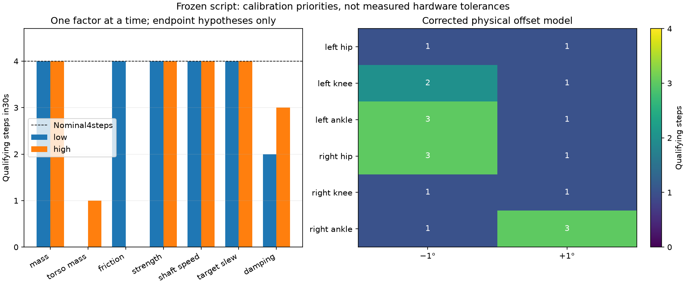

# From Simulation to Reality: How does a robot learn?

Generated from source by `python tools/build_handoff.py`. Do not edit HANDOFF.md.
Plan/revision date2026-10-27; individual evidence retains its original date.
Source files, ledgers and evidence states take precedence.
Short purchase/build plan for humans and AI: [SUMMARY.md](../SUMMARY.md).
Authoritative root plan, dependencies and completion gates: [PLAN.md](../PLAN.md).

## 1. Short design recommendation

Retain six Waveshare15024 MG90S servos: hip pitch, knee pitch and ankle roll per
leg, broad feet, Pico2 native PWM, MPU6050, PC USB
inference and separate5V servo power. This is a **provisional** design, not a
purchasable or calibrated walking robot. Ordering started—reported by user;
individual purchases/arrivals unknown. Nothing physically verified.
User can solder; no mandatory helper. Active route is outsourced PETG:seven frame
parts,two separate fit samples,eight bought TPE pads. Bare Pico2/header ownership
and pad contacts now match the provisional twin. No printer/filament/printedTPU
purchase. Complete delivered budget, actual fit and strength are still blocked.
The target remains30s standing followed by0.3m visibly alternating walking
within30s. Software checks and training rewards cannot substitute for that result.

## 2. Comparison of6DOF vs8DOF

| Layout | Cost/weight/current | Control/stability | Sim-to-Real and repair |
|---|---|---|---|
| OriginalA: hip-roll/hip-pitch/knee per leg | Six motors | Fixed ankle orientation constrains placement and balance | Simple, but constrained foot control |
| B: A plus ankle pitch | Eight motors; at least€7 extra motor cost, more frame/current | Better sagittal control, still lacks ankle roll | More calibration, failure points and unknown current |
| Selected: hip-pitch/knee/ankle-roll | Six motors; no arms/yaw | Direct lateral weight transfer, short steps and coupled sagittal sole angle | Few replaceable parts; walking feasibility still unproved |

Mechanical precedent: [Lynxmotion BRAT](https://wiki.lynxmotion.com/info/wiki/lynxmotion/view/ses-v1/ses-v1-bipeds/brat/).
Its existence does not establish scaled servo strength or RL transfer.

## 3. Selected robot architecture

Joint order: Lhip,Lknee,Lankle,Rhip,Rknee,Rankle. Coordinates xforward,yleft,zup;
SI software units. Hip/knee axes+Y; ankles+X. Positive pitch sends a downward link
toward−X. Electrical servo signs are measured individually, including right leg.
Torso owns hip cases, each thigh its knee case, each foot its ankle case; shins
carry moving horns. Every component's mass is assigned once in physical_spec.json.

PCpolicy50Hz → bounded USB → Pico PWM50Hz → six position servos.
IMU200Hz → raw telemetry → calibrated sensor/body transform → shared gravity
estimator → five18value frames (90float32). No shaft encoders exist. Applied
targets are commands, not measured angles. Gravity estimate3, gyro/10rad/s3,
normalized applied targets6 and previous actions6 are deployable observations.
No true orientation, joint angle, translation, velocity or contact is provided.
MuJoCo500Hz simulates200Hz IMU on4/6ms intervals; estimator uses actual dt.

## 4. Servo comparison

### Servo research, 2026-10-23

Prices are public VAT-inclusive product prices, not delivered basket totals.
No physical samples tested. Exact product identity matters: no generic TowerPro
specification is assigned to the Waveshare branded/resold unit.

| Product/source | Price and current listing | Product-specific data | Decision |
|---|---|---|---|
|[Waveshare15024 MG90S](https://www.welectron.com/Waveshare-15024-MG90S-Servo_1), [manufacturer](https://www.waveshare.com/mg90s-servo.htm)|€3.50; short supply, six units unconfirmed|22.8×12.2×28.5mm;12.2g;4.8–6V; metal gears; claimed stall2.0/2.8kgf·cm and unloaded.11/.09s60° at4.8/6V;5µs deadband; position PWM|Retain first candidate; no guarantee of repeated usable torque or fit|
|[Waveshare15286 SG90](https://www.welectron.com/Waveshare-15286-SG90-Servo_1)|€1.90; around three months delivery|Same claimed case size;10.5g;plastic;4.8–6V;2.0/2.2kgf·cm;.09/.08s60°;7µs deadband|Cheaper but weaker gears; not substituted to force budget|
|[Rotorama MG90D](https://www.rotorama.de/product/mg90d)|€4.09; **on the way08.11.2026**, live page overrides cached “in stock”|22.8×12.4×28.5mm;12g;4.8–6V;metal/digital;1.8/2.2kgf·cm;90°1000–2000µs; horn set listed|No evidence justifies price increase; both speed entries labelled4.8V, unresolved inconsistency|
|[FEETECH FS90, Pololu](https://www.pololu.com/product/2818/specs), [EU candidate](https://eckstein-shop.de/feetech-fs90-1-5kg-analog-servo)|EU live price/stock **unknown** (403 on refresh); historical€3.55 not current evidence|23.2×12.5×22mm;9g;4.8–6V;plastic/analog;1.3/1.5kgf·cm;.12/.10s60°; documented3.3V signals|Weaker/different geometry. FS90R is continuous rotation and unsuitable|

The selected product package text only says “servo”; horn, horn hole pattern,
spline and retaining screw thread are **unknown**. Generic MG90S pictures or
other sellers' horn sets do not establish compatibility. Ask the selected seller
for a dimensioned drawing and exact contents before final CAD approval.

For all four: gearbox backlash, sustained torque, wear/fall lifetime and loaded
repeatability are unknown. Selected MG90S/SG90/MG90D current is unknown. Pololu's
FS90 bench currents at6V (~0.2A no-load/~0.6A stall) vary by sample and are **not**
MG90S current data. PWM target is the only command; none supplies shaft feedback
in this proposed wiring. Servo repeatability must be measured at representative
load and supply voltage. Position acknowledgements are not encoder data.

At250g and20mm moment arm, static demand is0.0491Nm; a rough2× dynamic margin
is0.0981Nm. Advertised MG90S stall0.196Nm at4.8V is not a continuous rating.
Twin force cap0.08Nm is only a provisional intermittent hypothesis. See
`tools/torque_estimates.py`: fixed-support gravity calculations are not proof
that the servo can safely sustain a pose. Do not hold prolonged stalls.

Architecture comparison: original6DOF hip-roll/hip-pitch/knee uses fewer
actuators than8DOF adding ankle-pitch, but fixed ankle orientation limits foot
control. Selected6DOF hip-pitch/knee-pitch/ankle-roll permits lateral weight
transfer with fewer motors/measurements/current than8DOF, at the expense of
coupled sagittal foot angle, short steps, no yaw and limited terrain ability.
Eight motors add at least€7 in servo prices plus frame/current cost. Neither
architecture is established to walk in this budget. Slow alternating steps,
not humanoid appearance, remain the acceptance criterion.

## 5. Required BOM and incomplete route alternatives

Authoritative `procurement.json`, price review2026-10-25. Null prices are required,
unresolved costs, never zero. Quantities include full packs where sold as packs.

Shared parts plus active commercial_print scenario are the required basket. Other
scenarios are retained comparisons, not additional quantities or purchase selections.

| Category | Exact item / supplier source | Qty | Unit € | Line € | Selection / unresolved issue |
|---|---|---:|---:|---:|---|
| Motors | [Waveshare 15024 MG90S](https://www.welectron.com/Waveshare-15024-MG90S-Servo_1) — Welectron | 6 | 3.50 | 21.00 | VAT included, stock shown; horn/screw inclusion unverified |
| Electronics | [Raspberry Pi Pico 2 (bare RP2350 board), RPI-PICO2](https://www.berrybase.de/raspberry-pi-pico-2-rp2350-mikrocontroller-board) — BerryBase | 1 | 5.50 | 5.50 | User-selected Pico 2, bare board; existing header kit retained. Official 51x21mm footprint and pinout compatible. 3g board mass is a retained provisional estimate, NOT measured or seller gross mass. |
| Sensors | [Funduino F23107397 MPU6050 module](https://funduino.com/products/mpu-6050-modul-triaxial-beschleunigungssensor-gyroskop) — Funduino | 1 | 3.62 | 3.62 | Header soldering/board orientation to confirm |
| Power | [Mean Well GST40A05-P1J 5 V 5 A desktop PSU](https://www.berrybase.de/meanwell-schaltnetzteil-5v-dc-5-0a-mit-hohlstecker-5-5x2-1mm) — BerryBase | 1 | 15.50 | 15.50 | C14 inlet; centre-positive 5.5 x 2.1 mm; no mains lead in package |
| Power | [Goobay 68604 Schuko to C13, 1.5 m](https://www.berrybase.de/kaltgeraete-netzkabel-schutzkontakt-stecker-abgewinkelt-iec320-c13-buchse-schwarz) — BerryBase | 1 | 3.81 | 3.81 | Exact 1.5 m variant; 10 A AC rating |
| Wiring/connectors | [Official Raspberry Pi RPI-MUSB-1 USB data cable 1 m](https://www.berrybase.de/offizielles-raspberry-pi-micro-usb-kabel-rot-1-0m) — BerryBase | 1 | 1.80 | 1.80 | USB-A–Micro-B data cable required for Pico. User confirmed PC USB-A on2026-10-23; no adapter required or included. |
| Wiring/connectors | [DUPK-40-FF-50, 40 female-female Dupont leads, 50 cm](https://www.berrybase.de/40pin-jumper-dupont-kabel-female-female-trennbar/laenge-0-50-m) — BerryBase | 1 | 2.20 | 2.20 | Logic only. User shortens and insulates signal/I2C leads as needed; preserve removable female ends. Keep I2C short; verify continuity. Never servo power. |
| Wiring/connectors | [Funduino F23108007 JR-Futaba extension, 10 cm](https://funduino.com/products/jr-futaba-servo-verlangerung-kabel-10cm-female-male) — Funduino | 6 | 1.14 | 6.84 | User solders six replaceable servo sockets into short heavy positive/return buses; isolate each signal to its Pico GPIO. Actual wire gauge, contact rating, plug fit and current/droop must pass bench tests. |
| Wiring/connectors | [Donau E-175-11 black copper wire 0.75 mm², 10 m roll](https://www.berrybase.de/donau-kupferschaltlitze-0-75-mm2-10m-lang-1-adrig-24x0-20mm-pvc-isoliert/farbe-schwarz) — BerryBase | 1 | 5.50 | 5.50 | Replaces unavailable red E-175-10 with same 0.75mm² copper/24x0.20mm/PVC/10m specification. One full roll serves both short buses; identify positive with two separated heat-shrink bands and negative with one at every end, then verify continuity/polarity. Existing shrink pack supplies markings; do not rely on black wire colour. Wiring mass remains an estimate, not a new measured twin. |
| Power | [AiSHi ELK1M16VAWH 1000 µF 16 V capacitor](https://www.berrybase.de/elektrolytkondensator-1000-f-16v-1050c-1-radial-tht) — BerryBase | 1 | 0.29 | 0.29 | Polarity matters; actual tolerance ±20%, inconsistent page title ignored |
| Wiring/connectors | [PINH-1X40P 40-pin 2.54 mm header](https://www.berrybase.de/stiftleiste-1x-40-polig-rm-2-54-gerade) — BerryBase | 1 | 0.60 | 0.60 | One full40pin pack for up to8IMU pins+6signal ends;26spare. Pico headers supplied by separate RPIP-PINH kit. |
| Wiring/connectors | [McPower T1535561 heat-shrink, 100 pieces](https://www.berrybase.de/schrumpfschlauch-set-100-teilig-schwarz) — BerryBase | 1 | 1.90 | 1.90 | Insulate all user-soldered harness joints and label negative polarity; full shrink pack and separate10g solder pack are included. |
| Fasteners | [McPower T1535501 cable ties, 100 x 2.5 mm, pack of 100](https://www.berrybase.de/kabelbinder-uv-bestaendig-nylon-100-stueck/farbe-transparent/masse-100x2-5mm) — BerryBase | 1 | 0.60 | 0.60 | Six board ties +four tether strain restraints +eight harness restraints; full100pack, leave joint loops. |
| Power | [Goobay 11638 DC socket 5.5 x 2.1 mm, solder lugs, 5 A](https://www.berrybase.de/dc-einbaubuchse-fuer-hohlstecker-5-5x2-1mm-metallausfuehrung-loetanschluss) — BerryBase | 1 | 1.10 | 1.10 | Retailer specifies 5 A / 30 V DC, nut and washer. User solders short 0.75 mm2 bus, insulates lugs/case and provides strain relief using listed shrink/ties; support off robot. Unplug PSU DC for physical cutoff. Not branch-current or electrical verification. |
| Shipping | [Welectron German DPD shipping](https://www.welectron.com/Shipping-cost) — Welectron | 1 | 4.95 | 4.95 | Basket under €49 free-shipping threshold |
| Shipping | [BerryBase German DHL shipping](https://www.berrybase.de/versand-und-zahlungsbedingungen) — BerryBase | 1 | 4.95 | 4.95 | DHL EUR4.95 below EUR200; free-shipping threshold changed from recorded EUR150 |
| Shipping | [Funduino German shipping](https://funduino.com/policies/shipping-policy) — Funduino | 1 | 4.90 | 4.90 | Current policy opened in browser: Germany standard DHL EUR4.90 inclVAT; free only from EUR69 after discounts; tracking; no express surcharge. Snapshot docs/procurement/2026-10-23/funduino-shipping.txt |
| Consumables | [Zhongdi ZD-160 lead-free solder, 1 mm, 2% flux, 10 g](https://www.berrybase.de/zhongdi-loetzinn-bleifrei-oe1-0-mm-2-flussmittel-10-g) — BerryBase | 1 | 1.90 | 1.90 | Full 10 g pack counted; Sn99.3Cu0.7, flux core. No mandatory helper labour. Iron/tool access confirmed by user; other tools must be borrowed or priced separately. |
| Mechanical | [Delock 18309 self-adhesive TPE pads, 10 x 3 mm, pack50](https://www.reichelt.de/de/de/shop/produkt/gummifuesse_rund_selbstklebend_10_x_3_mm_50_stk_schwarz-371081) — Reichelt | 1 | 3.55 | 3.55 | Eight used, four per foot;42spare.10mm diameter x3mm TPE with adhesive; new twin uses discrete cylinders. Product dimensions sourced; friction/density/adhesion/positions provisional. |
| Shipping | [Reichelt German standard DHL delivery](https://www.reichelt.de/de/de/shop/service/-12_28) — Reichelt | 1 | 5.95 | 5.95 | Germany <=10 kg published rate. Final 25337 checkout pending; no booking. |
| Wiring/connectors | [BerryBase RPIP-PINH Pico header kit](https://www.berrybase.de/stiftleisten-pin-header-set-fuer-raspberry-pi-pico) — BerryBase | 1 | 0.50 | 0.50 | Two20pin headers for Pico; confirm package, solder yourself. Any supplied3pin debug strip is spare, not required. With one40pin pack provides at least80pins. Saves0.10 vs two40pin packs. |

### User-arranged classmate PETG printing — selected

| Additional item / source | Qty | Unit € | Line € | Issue |
|---|---:|---:|---:|---|
| [Schraubenking P010265 M2 x 8 PH DIN7985 zinc-plated steel 4.8, pack100](https://www.schraubenking-shop.de/M2-x-8mm-Linsenkopfschrauben-PH-DIN7985-Stahl-verzinkt-FKL48-P010265) | 1 | 1.51 | 1.51 | 12 ear screws used; 88 spare. Exact length/ear fit provisional. Head4mm dia/1.6mm high, PH1; M2 coarse thread. Do not order before stack/clearance review. |
| [Schraubenking P003474 M2 DIN934 zinc-plated steel class8 nuts, pack100](https://www.schraubenking-shop.de/M2-Sechskantmuttern-DIN934-Stahl-verzinkt-FKL8-P003474) | 1 | 1.13 | 1.13 | 12 used;88spare. Current browser price1.13; stale cached page1.16/20%VAT rejected. SW4,1.6mm high,0.4mm pitch; match M2 ear screws. |
| [Schraubenking P004198 M2 DIN125 A2 washers 2.2 x 5 x 0.3 mm, pack100](https://www.schraubenking-shop.de/22mm-Unterlegscheiben-DIN125-Edelstahl-A2-P004198) | 1 | 0.99 | 0.99 | 24 used at ears: one under each head and nut. 76spare; horn washer compatibility not presumed. Check5mm OD clears plastic ear/slot and horn sweep. |
| [Schraubenking German standard DHL delivery](https://www.schraubenking-shop.de/Versandinformationen) | 1 | 5.90 | 5.90 | Current Germany standard rate below99EUR; DHL1-3days afterdispatch. No priority selected. One shipment for all three fastener packs. |
| [6 matching horns + 6 servo shaft retaining screws](https://www.welectron.com/Waveshare-15024-MG90S-Servo_1) | 1 | pending | pending | Manufacturer package photo shows three horn shapes and three screws, but text lists servo only. Six selected horns and six correct retainers required; exact Welectron batch inclusion/spline/thread/geometry remain unconfirmed. No generic 25T substitution; no extra horns bought until confirmed. |
| 12 horn-to-frame screws and 12 matching washers | 1 | pending | pending | 12 screws + 12 washers, two per horn; diameter/thread/length unknown. Separate from six centre shaft retainers. Measure actual factory horns and frame thickness; do not guess M2 or generic 25T. |
| PETG full frame:7finished parts, VAT, packaging and delivery to25337 | 1 | pending | pending | No current file-specific delivered quote. One torso+2thighs+2shins+2feet. Support removal, usable holes, finishing and any fit inspection must be priced; no printed soles/filament. User selected this arrangement on2026-10-26; exact print/finishing/delivery cost still unknown, never zero. |
| PETG fit sample:2interface pieces, VAT and separate delivery | 1 | pending | pending | Ear cradle +horn plate. Separate fit-first order; include shipping/finishing. Any sample/full-order combination must be explicitly quoted, not assumed free. User selected this arrangement on2026-10-26; exact print/finishing/delivery cost still unknown, never zero. |


Optional: spare matching servo, thin protective surface, slack safety thread,
longer adequate power/USB tethers. These are not silently needed to make the
short initial indoor trial work; several-metre travel needs a newly budgeted tether.

## 6. Total cost and procurement gate

```json
{
  "active_required_basket": {
    "scenario": "commercial_print",
    "status": "OVER BUDGET",
    "known_delivered_subtotal_eur": "106.49",
    "remaining_for_all_unknowns_eur": "-6.49",
    "confirmed_minimum_shortfall_eur": "6.49",
    "total_price_eur": null,
    "pending_prices": [
      "6 matching horns + 6 servo shaft retaining screws",
      "12 horn-to-frame screws and 12 matching washers",
      "PETG full frame:7finished parts, VAT, packaging and delivery to25337",
      "PETG fit sample:2interface pieces, VAT and separate delivery"
    ],
    "unresolved_checks": [
      "All required full-frame/sample/finishing/horn costs and stock unresolved; unknowns never zero",
      "Six-unit Waveshare stock and actual supplied horn/shaft screw contents",
      "3.3V PWM threshold, branch/contact current ratings and PSU droop still need bench testing",
      "Final complete delivery to25337 incl every sample shipment; no bookings/orders/messages",
      "Fit/layer strength/pad friction and adhesion require physical measurements",
      "Classmate printing accepted by user; exact cost/finishing/delivery accounting unknown. Financial gate remains separate from completed design/provider decision.",
      "Active selected basket is over cap; a candidate subtotal is not its complete delivered quotation; no order",
      "Exact Waveshare batch horns/retainers/screw/ear measurements and interface sample fit",
      "Current exact-file print/support/finishing/sample/delivery prices missing",
      "Physical layer strength, continuous clearances, tie/connector routing and pad grip not verified"
    ],
    "purchase_cleared": false
  },
  "routes": {
    "commercial_print": {
      "scenario": "commercial_print",
      "status": "OVER BUDGET",
      "known_delivered_subtotal_eur": "106.49",
      "remaining_for_all_unknowns_eur": "-6.49",
      "confirmed_minimum_shortfall_eur": "6.49",
      "total_price_eur": null,
      "pending_prices": [
        "6 matching horns + 6 servo shaft retaining screws",
        "12 horn-to-frame screws and 12 matching washers",
        "PETG full frame:7finished parts, VAT, packaging and delivery to25337",
        "PETG fit sample:2interface pieces, VAT and separate delivery"
      ],
      "unresolved_checks": [
        "All required full-frame/sample/finishing/horn costs and stock unresolved; unknowns never zero",
        "Six-unit Waveshare stock and actual supplied horn/shaft screw contents",
        "3.3V PWM threshold, branch/contact current ratings and PSU droop still need bench testing",
        "Final complete delivery to25337 incl every sample shipment; no bookings/orders/messages",
        "Fit/layer strength/pad friction and adhesion require physical measurements",
        "Classmate printing accepted by user; exact cost/finishing/delivery accounting unknown. Financial gate remains separate from completed design/provider decision.",
        "Active selected basket is over cap; a candidate subtotal is not its complete delivered quotation; no order",
        "Exact Waveshare batch horns/retainers/screw/ear measurements and interface sample fit",
        "Current exact-file print/support/finishing/sample/delivery prices missing",
        "Physical layer strength, continuous clearances, tie/connector routing and pad grip not verified"
      ],
      "purchase_cleared": false
    }
  },
  "printer_comparisons": {}
}
```

### Current procurement / receiving actions — 2026-10-27

**User arrangement selected:** classmate PETG printing, bare Pico2, two fit samples
before seven frames. Ordering started according to the user; exact items, paid
costs and arrivals remain unknown. No AI purchases/messages/uploads. No further
Meltlab upload/provider search is required.

1. Record actual products, quantities, receipts and arrivals using the
   [receiving guide](RECEIVING.md), [blank record](templates/receiving.example.json)
   or [printable checklist](RECEIVING_CHECKLIST.md). Unknown values stay blank/null.
2. Inspect actual servo ears/shaft, supplied horns/retainers and screws; photograph
   and measure without guessing splines/threads. Test the two
   [classmate print samples](../print_for_classmate/00_START_HERE.md).
3. Review failures, remaining continuous clearances/strength, tool access and exact
   hardware before seven frames; [assembly details](../cad/ASSEMBLY.md).
4. Reconcile actual delivered cost separately from dated quotes. Source ledger:
   [procurement.json](../procurement.json). **€106.49 quoted before unknown print/
   finishing/transport/horn extras; at least €6.49 over the €100 cap.** Classmate price
   remains unknown, not free. No numerical budget clearance.
5. Follow the separate [one-servo/IMU bench guide](BENCH.md). Software STOP is not
   DC isolation; fit reports do not approve electrical operation.

Delivery record:25337Germany; USB-A present, no adapter; USB-A–Micro-B data cable
still required. Account for every shipment/full consumable pack. All physical gates
remain closed; a report only summarizes reported evidence.

Previous supplier research is preserved byte-for-byte in the
[historical page](history/2026-10-27/pre_receiving/PROCUREMENT_ACTIONS.md.txt).
Those old requests/prices are not the active task or a fresh checkout.

## 7. Mechanical design

`cad/build_frame.py` generates sevenPETG frames from physical_spec.json. Separate
sample/frame ZIPs include quantities,hashes,editable sources,drawings and fastener
schedule.90x45mm feet,50mm links,roughly18cm height. Ordinary10x3mm pads replace
continuous soles. Motor-ear/horn/shaft/screw fit remains unmeasured; sample first.
No manufacturing approval or actual printed density/strength is implied.

### Frame route decision — 2026-10-24

**Active:** commercial PETG frame +ordinary TPE pads. No printer purchase, no
filament spool or printed TPU soles. Self-solder electronics; six original joints.
User selected this route after comparing ready-made mechanics and own printing.

Deliverables:[sample2pieces](../cad/sample_quotation_package.zip),
[frame7pieces](../cad/frame_quotation_package.zip),[brief](../cad/QUOTE_REQUEST.md),
[drawings](../cad/print_order/drawings/interfaces.png),[assembly](../cad/ASSEMBLY.md).
All are quotation/fit prototypes. No frame manufacturing approval.

The physical ledger and MuJoCo now agree on Pico/header component ownership and
four cylindrical grip pads per foot. Solid-CAD masses and motor/friction parameters
remain estimates. Exact servo/horn fit, layer strength and budget must be proven.

Active priced basket105.34EUR before print/sample/horn extras, minimum known
shortfall5.34for this basket. Updated exact-file quote is missing: automatic approval
review blocked the Meltlab upload. No alternate provider was used to bypass it.
No supplier messages/orders; precise questions are in PROCUREMENT_ACTIONS.md.

Earlier standard-parts, own-printer/A1mini/Ender and commercialTPU comparisons are
historical in history/2026-10-24/pre_print_revision/. Their prices/configurations
are not this revision's quotation and do not authorize any purchase.

### S6-PETG-pad-r2 — assembly and fit checklist

**Quotation prototype, not manufacturing-approved.** All dimensions are in the
physical ledger; none of this is a physical test. [Exploded view](../cad/exploded.png),
[interface drawing](../cad/print_order/drawings/interfaces.png), [fasteners](../cad/print_order/fasteners.csv).
Commercial printing is active; no printer/spool or printed TPU sole purchase.

#### Parts and exact installed quantities

Seven printed PETG parts: torso, L/Rthigh, L/Rshin, L/Rfoot, one each. Two separate
interface samples are test pieces, not extra frame parts. Eight ordinary Delock18309
TPE pads, four per foot. [Quote brief](../cad/QUOTE_REQUEST.md).

| Use | Installed quantity | Known / unresolved |
|---|---:|---|
| Servo ear screws |12|M2×8 P010265;8mm under-head,4mm head diameter,1.6mm head height; actual grip length unverified|
| Ear nuts |12|P003474 M2,SW4,1.6mm height|
| Ear washers |24|P004198,2.2×5×0.3mm; one each side|
| Factory horns |6|Actual Waveshare batch/spline/shape/hole pattern unknown|
| Shaft retainers |6|Factory-matching thread and length unknown; do not assume M2|
| Horn-to-frame screws and washers |12+12|Two per horn; diameter/thread/length/washer size unknown|
| Board / tether / harness ties |6/4/8|From full100pack; exact safe routing needs review|

M2 ear hardware has dimensioned clearance shapes at **estimated** positions.
The old fastener mass boxes were not actual bolts; their550historical intersections
were not verified physical collisions. Unknown horn hardware still blocks release.

#### 1 — Fit sample before the full frame

1. Identify one exact servo, original horn and retaining screw. With no horn attached,
   bench-calibrate the zero pulse using [CALIBRATION](CALIBRATION.md).
2. Measure case, ear hole spacing/diameter/thickness, axial ear/shaft locations,
   supplied horn holes/radii, shaft screw and lead exit. Record units and photos.
3. After budget approval obtain the **two-piece sample**. Check insertion without
   bending/cracking, both ear holes, nut/head/washer access and case clearance.
4. Test a centred original horn on the horn plate. Opening6mm and2.4×7mm radial
   slots are provisional. Confirm two screws can retain it without drilling the
   horn/print, splitting plastic or bottoming a screw in the servo.
5. Measure every printed hole/slot and inspect layers. A failed sample means revise
   CAD and re-quote; do not force/drill it or print the full frame unchanged.

#### 2 — Bench and mechanical zero

Solder/insulate the bare Pico, IMU header and replaceable harness as described in
[HARDWARE](HARDWARE.md). Test PSU polarity, DC disconnect, one unloaded
servo,3.3V PWM, IMU, disarmed startup and100ms watchdog first. USB powers logic;
servo power bypasses Pico/breadboard. No physical gate is passed yet.

Set each servo to its measured **zero-joint** pulse, then disconnect DC before
fitting its compatible horn and shaft screw. HOME(-10,+10,0deg per leg) is not
mechanical zero. Software STOP is not physical isolation.

#### 3 — Assemble the verified frame

1. Mount left/right hip **cases to torso**. Output shafts face the corresponding
   lateral sides. Attach each thigh's upper horn plate to its hip horn.
2. Mount each knee **case to its thigh's lower cradle**. Attach the shin's upper
   plate to that knee horn. Hip and knee axes are pitch(+Y in the model).
3. Mount each ankle **case to its foot cradle**, shaft toward the corresponding
   perpendicular shin plate. Attach the shin's lower plate to the ankle horn.
   Ankle axis is roll(+X). The shin owns the ankle horn; the foot owns its case.
4. Fit only the confirmed screw schedule. The example3mm frame+1.4mm assumed ear+
   two0.3mm washers+1.6mm nut needs6.6mm under-head; M2×8 leaves1.4mm projection
   **only if that assumed ear stack is correct**. Check sweeps and wrench access.

#### 4 — Electronics, pads and cables

- Bare Pico PCB is51×21mm; two20pin headers are separately represented with an11mm
  pin envelope. Printed stand-offs support the PCB centre, away from GPIO rows.
  IMU sits on the opposite side. Check actual connector, tie and solder clearance;
  immobilize IMU and record its sensor-to-body alignment.
- Attach four pads under each90×45mm foot: x=-31,+43mm and y=±14.5mm relative
  to the ankle frame (see drawing). Pads are10mm diameter×3mm. Clean/dry the
  surface as the pad maker permits; test adhesion and slip before dynamic use.
- Route six removable servo connections with service loops; keep wires out of
  horn/fastener sweeps. Support the tether/DC socket externally and restrain the
  cable near torso COM. Never use a tight overhead line to hold the robot up.

#### 5 — Weigh, inspect and calibrate

Weigh every assembled rigid body and installed hardware once. The current model
uses solid-CAD PETG inertia and estimated electronics/hardware/pad masses, not
slicer25%infill or measured masses. Match measured COM/masses and version the twin.

With motor power off inspect full safe sweeps, lead exits, connectors, access to
retainers and all through-holes. Then test small unloaded motions, physical cutoff,
watchdog, disarmed reboot and manual standing. At a fall disconnect DC, inspect
gears/ears, pick up manually and deliberately reinitialize. Physical policies need
measured validated calibration and matching fingerprints; the smoke policy is not
approved for hardware. Full-frame release and walking remain blocked.

Body origins/axes, command intervals and mass/COM below derive from the ledger.
Unknown mechanical stops remain null and are absent from provisional MJCF.

| Body | Parent | Joint / axis | Origin in parent (mm) | Safe commands, NOT mechanical stops (°) | Mass (g) | COM local (mm) |
|---|---|---|---|---|---:|---|
| torso | world | root / floating | 0.000, 0.000, 156.240 | free | 75.74 | -6.321, 0.000, -10.299 |
| left_thigh | torso | left_hip / 0.000, 1.000, 0.000 | 0.000, 34.000, -30.000 | [-35, 35] | 19.77 | 0.000, -9.229, -43.367 |
| left_shin | left_thigh | left_knee / 0.000, 1.000, 0.000 | 0.000, 0.000, -50.000 | [-10, 60] | 8.62 | 1.770, 2.022, -25.191 |
| left_foot | left_shin | left_ankle / 1.000, 0.000, 0.000 | 0.000, 0.000, -50.000 | [-20, 20] | 32.26 | -3.144, 0.000, -14.081 |
| right_thigh | torso | right_hip / 0.000, 1.000, 0.000 | 0.000, -34.000, -30.000 | [-35, 35] | 19.77 | 0.000, 9.229, -43.367 |
| right_shin | right_thigh | right_knee / 0.000, 1.000, 0.000 | 0.000, 0.000, -50.000 | [-10, 60] | 8.62 | 1.770, -2.022, -25.191 |
| right_foot | right_shin | right_ankle / 1.000, 0.000, 0.000 | 0.000, 0.000, -50.000 | [-20, 20] | 32.26 | -3.144, -0.000, -14.081 |

| Body | Component (mass assigned once) | Dimensions xyz (mm) | Mass (g) | COM local xyz (mm) |
|---|---|---|---:|---|
| torso | torso_frame | 33.500, 82.000, 88.750 | 21.94 | -16.316, 0.000, -4.846 |
| torso | pico | 3.500, 51.000, 21.000 | 3.00 | -10.750, 0.000, 23.000 |
| torso | imu | 4.000, 16.000, 20.000 | 3.00 | -25.500, 0.000, 18.000 |
| torso | torso_wires_fasteners | 30.000, 70.000, 40.000 | 20.00 | 0.000, 0.000, 5.000 |
| torso | left_hip_servo | 12.200, 28.500, 22.800 | 12.20 | 0.000, 19.750, -34.750 |
| torso | right_hip_servo | 12.200, 28.500, 22.800 | 12.20 | 0.000, -19.750, -34.750 |
| torso | left_hip_ear_bolt_-1 | 5.000, 8.000, 5.000 | 0.55 | 0.000, 27.000, -48.750 |
| torso | left_hip_ear_bolt_+1 | 5.000, 8.000, 5.000 | 0.55 | 0.000, 27.000, -20.750 |
| torso | right_hip_ear_bolt_-1 | 5.000, 8.000, 5.000 | 0.55 | 0.000, -27.000, -48.750 |
| torso | right_hip_ear_bolt_+1 | 5.000, 8.000, 5.000 | 0.55 | 0.000, -27.000, -20.750 |
| torso | pico_header_0 | 11.000, 50.800, 2.540 | 0.60 | -10.000, 0.000, 14.110 |
| torso | pico_header_1 | 11.000, 50.800, 2.540 | 0.60 | -10.000, 0.000, 31.890 |
| left_thigh | left_thigh_frame | 24.000, 13.500, 87.750 | 5.27 | 0.000, -0.974, -24.526 |
| left_thigh | left_knee_servo | 12.200, 28.500, 22.800 | 12.20 | 0.000, -14.250, -54.750 |
| left_thigh | left_knee_ear_bolt_-1 | 5.000, 8.000, 5.000 | 0.55 | 0.000, -7.000, -68.750 |
| left_thigh | left_knee_ear_bolt_+1 | 5.000, 8.000, 5.000 | 0.55 | 0.000, -7.000, -40.750 |
| left_thigh | left_hip_horn_hardware | 20.000, 5.000, 26.000 | 1.20 | 0.000, 3.500, 0.000 |
| left_shin | left_shin_frame | 24.000, 24.000, 78.000 | 6.22 | 1.777, 2.128, -25.264 |
| left_shin | left_knee_horn_hardware | 20.000, 5.000, 26.000 | 1.20 | 0.000, 3.500, 0.000 |
| left_shin | left_ankle_horn_hardware | 5.000, 20.000, 26.000 | 1.20 | 3.500, 0.000, -50.000 |
| left_foot | left_foot_frame | 90.000, 45.000, 38.250 | 18.02 | 4.134, 0.000, -20.373 |
| left_foot | left_ankle_servo | 28.500, 12.200, 22.800 | 12.20 | -14.250, 0.000, -4.750 |
| left_foot | left_foot_pad_0 | 10.000, 10.000, 3.000 | 0.24 | -31.000, -14.500, -25.500 |
| left_foot | left_foot_pad_1 | 10.000, 10.000, 3.000 | 0.24 | -31.000, 14.500, -25.500 |
| left_foot | left_foot_pad_2 | 10.000, 10.000, 3.000 | 0.24 | 43.000, -14.500, -25.500 |
| left_foot | left_foot_pad_3 | 10.000, 10.000, 3.000 | 0.24 | 43.000, 14.500, -25.500 |
| left_foot | left_ankle_ear_bolt_-1 | 8.000, 5.000, 5.000 | 0.55 | -7.000, 0.000, -18.750 |
| left_foot | left_ankle_ear_bolt_+1 | 8.000, 5.000, 5.000 | 0.55 | -7.000, 0.000, 9.250 |
| right_thigh | right_thigh_frame | 24.000, 13.500, 87.750 | 5.27 | 0.000, 0.974, -24.526 |
| right_thigh | right_knee_servo | 12.200, 28.500, 22.800 | 12.20 | 0.000, 14.250, -54.750 |
| right_thigh | right_knee_ear_bolt_-1 | 5.000, 8.000, 5.000 | 0.55 | 0.000, 7.000, -68.750 |
| right_thigh | right_knee_ear_bolt_+1 | 5.000, 8.000, 5.000 | 0.55 | 0.000, 7.000, -40.750 |
| right_thigh | right_hip_horn_hardware | 20.000, 5.000, 26.000 | 1.20 | 0.000, -3.500, 0.000 |
| right_shin | right_shin_frame | 24.000, 24.000, 78.000 | 6.22 | 1.777, -2.128, -25.264 |
| right_shin | right_knee_horn_hardware | 20.000, 5.000, 26.000 | 1.20 | 0.000, -3.500, 0.000 |
| right_shin | right_ankle_horn_hardware | 5.000, 20.000, 26.000 | 1.20 | 3.500, 0.000, -50.000 |
| right_foot | right_foot_frame | 90.000, 45.000, 38.250 | 18.02 | 4.134, -0.000, -20.373 |
| right_foot | right_ankle_servo | 28.500, 12.200, 22.800 | 12.20 | -14.250, 0.000, -4.750 |
| right_foot | right_foot_pad_0 | 10.000, 10.000, 3.000 | 0.24 | -31.000, 14.500, -25.500 |
| right_foot | right_foot_pad_1 | 10.000, 10.000, 3.000 | 0.24 | -31.000, -14.500, -25.500 |
| right_foot | right_foot_pad_2 | 10.000, 10.000, 3.000 | 0.24 | 43.000, 14.500, -25.500 |
| right_foot | right_foot_pad_3 | 10.000, 10.000, 3.000 | 0.24 | 43.000, -14.500, -25.500 |
| right_foot | right_ankle_ear_bolt_-1 | 8.000, 5.000, 5.000 | 0.55 | -7.000, 0.000, -18.750 |
| right_foot | right_ankle_ear_bolt_+1 | 8.000, 5.000, 5.000 | 0.55 | -7.000, 0.000, 9.250 |

| Body | Ixx, Iyy, Izz, Ixy, Ixz, Iyz (kg·m²) |
|---|---|
| torso | 8.148313e-05, 5.34409e-05, 4.489893e-05, -6.368546e-22, 7.760571e-06, -8.856731e-22 |
| left_thigh | 1.201339e-05, 1.069531e-05, 2.361686e-06, -1.292697e-23, 9.29062e-24, -2.750783e-06 |
| left_shin | 5.202857e-06, 5.271289e-06, 4.593362e-07, 2.259578e-08, 3.373974e-07, -3.106646e-07 |
| left_foot | 6.690079e-06, 1.906431e-05, 1.860375e-05, -7.946503e-23, 2.654014e-06, 1.52336e-22 |
| right_thigh | 1.201339e-05, 1.069531e-05, 2.361686e-06, 1.292697e-23, 9.29062e-24, 2.750783e-06 |
| right_shin | 5.202857e-06, 5.271289e-06, 4.593362e-07, -2.259578e-08, 3.373974e-07, 3.106646e-07 |
| right_foot | 6.690079e-06, 1.906431e-05, 1.860375e-05, 7.946503e-23, 2.654014e-06, -1.52336e-22 |

Authoritative structured physical input (provisional):

```json
{
  "name": "School Biped S6",
  "status": "USER ACCEPTED design/printing arrangement; provisional mechanics pending actual servo/sample fit and physical calibration",
  "units": "m, kg, rad, s",
  "coordinates": "x forward, y left, z up; local body axes match parent at zero joint angle",
  "home_joint_angles_deg": [
    -10,
    10,
    0,
    -10,
    10,
    0
  ],
  "servo": {
    "model": "Waveshare 15024 MG90S",
    "mass": 0.0122,
    "housing_dimensions": [
      0.0228,
      0.0122,
      0.0285
    ],
    "shaft_offset_along_case_length": 0.00475,
    "shaft_to_case_center_axial": 0.01425,
    "mounting_hole_spacing": 0.028,
    "mounting_hole_diameter": 0.0022,
    "status": "housing size and mass are seller claims; shaft/ear/horn dimensions are estimates requiring measurement",
    "parameter_evidence": {
      "model": {
        "state": "sourced",
        "date": "2026-10-23",
        "evidence": "https://www.waveshare.com/mg90s-servo.htm"
      },
      "mass": {
        "state": "sourced",
        "date": "2026-10-23",
        "evidence": "https://www.waveshare.com/mg90s-servo.htm"
      },
      "housing_dimensions": {
        "state": "sourced",
        "date": "2026-10-23",
        "evidence": "https://www.waveshare.com/mg90s-servo.htm"
      },
      "shaft_offset_along_case_length": {
        "state": "estimated",
        "date": "2026-10-23",
        "evidence": "requires measured servo sample before manufacturing"
      },
      "shaft_to_case_center_axial": {
        "state": "estimated",
        "date": "2026-10-23",
        "evidence": "requires measured servo sample before manufacturing"
      },
      "mounting_hole_spacing": {
        "state": "estimated",
        "date": "2026-10-23",
        "evidence": "requires measured servo sample before manufacturing"
      },
      "mounting_hole_diameter": {
        "state": "estimated",
        "date": "2026-10-23",
        "evidence": "requires measured servo sample before manufacturing"
      }
    }
  },
  "geometry": {
    "hip_half_spacing": 0.034,
    "hip_z": -0.03,
    "thigh_length": 0.05,
    "shin_length": 0.05,
    "foot_dimensions": [
      0.09,
      0.045,
      0.003
    ],
    "foot_center": [
      0.006,
      0,
      -0.0225
    ],
    "ankle_to_floor": 0.027,
    "torso_dimensions": [
      0.04,
      0.082,
      0.066
    ],
    "cad_wall": 0.003,
    "cad_clearance": 0.0004,
    "petg_density": 1270,
    "mount": {
      "case_plate_width": 0.02,
      "case_plate_height": 0.038,
      "case_plate_y": -0.007,
      "ear_clearance_diameter": 0.0024,
      "horn_plate_dimensions": [
        0.024,
        0.003,
        0.028
      ],
      "horn_plate_y": 0.0035,
      "shaft_access_diameter": 0.006,
      "horn_slot_width": 0.0024,
      "horn_slot_length": 0.007,
      "horn_slot_radius": 0.009,
      "torso_back_x": -0.02,
      "board_tie_hole_diameter": 0.0032,
      "board_tie_y": [
        -0.032,
        -0.016,
        0.016,
        0.032
      ],
      "board_tie_z": [
        0.01,
        0.028
      ],
      "board_support_y": [
        -0.018,
        0.018
      ],
      "board_support_z": [
        0.023
      ],
      "board_support_size": [
        0.006,
        0.005,
        0.005
      ],
      "imu_support_dimensions": [
        0.002,
        0.003,
        0.005
      ],
      "imu_support_y": [
        -0.005,
        0.005
      ],
      "imu_support_z": 0.023
    },
    "grip_pad": {
      "product": "Delock18309",
      "radius": 0.005,
      "height": 0.003,
      "centres_xy": [
        [
          -0.031,
          -0.0145
        ],
        [
          -0.031,
          0.0145
        ],
        [
          0.043,
          -0.0145
        ],
        [
          0.043,
          0.0145
        ]
      ],
      "density_estimate_kg_m3": 1000,
      "placement_state": "estimated; dimensions sourced, placement/friction/density/adhesion require measurement",
      "source": "https://www.delock.com/produkt/18309/pdf.html?sprache=de"
    },
    "cad_features": {
      "tool_cut_depth": 0.012,
      "thigh_bridges": [
        {
          "dimensions": [
            0.004,
            0.003,
            0.02
          ],
          "center": [
            0.01,
            0.0035,
            -0.022
          ]
        },
        {
          "dimensions": [
            0.004,
            0.0135,
            0.004
          ],
          "center": [
            0.01,
            -0.00175,
            -0.03
          ]
        },
        {
          "dimensions": [
            0.004,
            0.003,
            0.013
          ],
          "center": [
            0.01,
            -0.007,
            -0.0365
          ]
        }
      ],
      "shin_web_allowance": 0.018,
      "shin_window_dimensions": [
        0.016,
        0.01,
        0.012
      ],
      "shin_window_center": [
        0,
        0.0035,
        -0.023
      ],
      "shin_corner_dimensions": [
        0.006,
        0.008,
        0.012
      ],
      "shin_corner_offset_from_ankle": [
        0.005,
        0.003,
        0.014
      ],
      "foot_rib_dimensions": [
        0.012,
        0.004,
        0.014
      ],
      "foot_rib_center": [
        -0.007,
        0.0085,
        -0.017
      ],
      "torso_window_dimensions": [
        0.01,
        0.042,
        0.024
      ],
      "torso_window_center_z": 0.002,
      "torso_brace_dimensions": [
        0.016,
        0.006,
        0.008
      ],
      "torso_brace_x": -0.014,
      "torso_brace_hip_inset": 0.007,
      "torso_brace_z": -0.018
    }
  },
  "bodies": [
    {
      "name": "torso",
      "parent": "world",
      "position": [
        0,
        0,
        0.15624038765061038
      ],
      "joint": "root",
      "axis": null,
      "components": [
        {
          "name": "torso_frame",
          "mass": 0.021943447742229213,
          "dimensions": [
            0.0335,
            0.082,
            0.08875
          ],
          "com": [
            -0.016315678648651345,
            1.0213107951874343e-18,
            -0.004845964988835626
          ],
          "inertia_tensor": [
            [
              2.6798224543308287e-05,
              -7.858597316502908e-22,
              2.16987487325085e-06
            ],
            [
              -7.858597316502908e-22,
              1.3620713899047003e-05,
              -6.688803109154264e-22
            ],
            [
              2.16987487325085e-06,
              -6.688803109154264e-22,
              1.5916424309425935e-05
            ]
          ],
          "material": "solid PETG estimate, 1270 kg/m\u00b3",
          "evidence": "generated CAD; actual infill/printed density must be weighed",
          "parameter_evidence": {
            "mass": {
              "state": "estimated",
              "date": "2026-10-24",
              "evidence": "generated CAD; actual infill/printed density must be weighed"
            },
            "com": {
              "state": "estimated",
              "date": "2026-10-24",
              "evidence": "generated CAD; actual infill/printed density must be weighed"
            },
            "dimensions": {
              "state": "estimated",
              "date": "2026-10-24",
              "evidence": "generated CAD; actual infill/printed density must be weighed"
            },
            "inertia_tensor": {
              "state": "estimated",
              "date": "2026-10-24",
              "evidence": "generated CAD; actual infill/printed density must be weighed"
            }
          }
        },
        {
          "name": "pico",
          "mass": 0.003,
          "dimensions": [
            0.0035,
            0.051,
            0.021
          ],
          "com": [
            -0.01075,
            0,
            0.023
          ],
          "material": "bare Pico 2 PCB/components; two headers separately owned",
          "evidence": "Pico2 official21x51mm footprint;3g mass/3.5mm populated envelope/COM retained estimates awaiting weighing/fit. Not retailer gross mass.",
          "parameter_evidence": {
            "mass": {
              "state": "estimated",
              "date": "2026-10-26",
              "evidence": "Pico2 official21x51mm footprint;3g mass/3.5mm populated envelope/COM retained estimates awaiting weighing/fit. Not retailer gross mass."
            },
            "dimensions": {
              "state": "estimated",
              "date": "2026-10-26",
              "evidence": "Pico2 official21x51mm footprint;3g mass/3.5mm populated envelope/COM retained estimates awaiting weighing/fit. Not retailer gross mass."
            },
            "com": {
              "state": "estimated",
              "date": "2026-10-26",
              "evidence": "Pico2 official21x51mm footprint;3g mass/3.5mm populated envelope/COM retained estimates awaiting weighing/fit. Not retailer gross mass."
            }
          },
          "model": "Raspberry Pi Pico 2 (bare RP2350)"
        },
        {
          "name": "imu",
          "mass": 0.003,
          "dimensions": [
            0.004,
            0.016,
            0.02
          ],
          "com": [
            -0.0255,
            0,
            0.018
          ],
          "material": "PCB",
          "evidence": "estimate",
          "parameter_evidence": {
            "mass": {
              "state": "estimated",
              "date": "2026-10-23",
              "evidence": "estimate"
            },
            "dimensions": {
              "state": "estimated",
              "date": "2026-10-23",
              "evidence": "estimate"
            },
            "com": {
              "state": "estimated",
              "date": "2026-10-23",
              "evidence": "estimate"
            }
          }
        },
        {
          "name": "torso_wires_fasteners",
          "mass": 0.02,
          "dimensions": [
            0.03,
            0.07,
            0.04
          ],
          "com": [
            0,
            0,
            0.005
          ],
          "material": "copper, plastic, steel",
          "evidence": "estimate includes six added 10 cm extensions, short heavy power wire, capacitor, pullup, board mounting ties and torso hardware; excludes suspended tether",
          "parameter_evidence": {
            "mass": {
              "state": "estimated",
              "date": "2026-10-23",
              "evidence": "estimate includes six added 10 cm extensions, short heavy power wire, capacitor, pullup, board mounting ties and torso hardware; excludes suspended tether"
            },
            "dimensions": {
              "state": "estimated",
              "date": "2026-10-23",
              "evidence": "estimate includes six added 10 cm extensions, short heavy power wire, capacitor, pullup, board mounting ties and torso hardware; excludes suspended tether"
            },
            "com": {
              "state": "estimated",
              "date": "2026-10-23",
              "evidence": "estimate includes six added 10 cm extensions, short heavy power wire, capacitor, pullup, board mounting ties and torso hardware; excludes suspended tether"
            }
          }
        },
        {
          "name": "left_hip_servo",
          "mass": 0.0122,
          "dimensions": [
            0.0122,
            0.0285,
            0.0228
          ],
          "com": [
            0,
            0.01975,
            -0.03475
          ],
          "material": "servo composite",
          "evidence": "seller mass, estimated uniform inertia",
          "parameter_evidence": {
            "mass": {
              "state": "sourced",
              "date": "2026-10-23",
              "evidence": "Waveshare15024 listing"
            },
            "dimensions": {
              "state": "estimated",
              "date": "2026-10-23",
              "evidence": "seller mass, estimated uniform inertia"
            },
            "com": {
              "state": "estimated",
              "date": "2026-10-23",
              "evidence": "seller mass, estimated uniform inertia"
            }
          }
        },
        {
          "name": "right_hip_servo",
          "mass": 0.0122,
          "dimensions": [
            0.0122,
            0.0285,
            0.0228
          ],
          "com": [
            0,
            -0.01975,
            -0.03475
          ],
          "material": "servo composite",
          "evidence": "seller mass, estimated uniform inertia",
          "parameter_evidence": {
            "mass": {
              "state": "sourced",
              "date": "2026-10-23",
              "evidence": "Waveshare15024 listing"
            },
            "dimensions": {
              "state": "estimated",
              "date": "2026-10-23",
              "evidence": "seller mass, estimated uniform inertia"
            },
            "com": {
              "state": "estimated",
              "date": "2026-10-23",
              "evidence": "seller mass, estimated uniform inertia"
            }
          }
        },
        {
          "name": "left_hip_ear_bolt_-1",
          "mass": 0.00055,
          "dimensions": [
            0.005,
            0.008,
            0.005
          ],
          "com": [
            0,
            0.027000000000000003,
            -0.048749999999999995
          ],
          "material": "steel, M2x8 screw + nut +2washers",
          "evidence": "sourced hardware dimensions; installed pose, mass and box inertia estimated",
          "parameter_evidence": {
            "mass": {
              "state": "estimated",
              "date": "2026-10-24",
              "evidence": "Actual ear/stack/assembly must be measured;0.55g group estimate"
            },
            "com": {
              "state": "estimated",
              "date": "2026-10-24",
              "evidence": "Actual ear/stack/assembly must be measured;0.55g group estimate"
            },
            "dimensions": {
              "state": "estimated",
              "date": "2026-10-24",
              "evidence": "Actual ear/stack/assembly must be measured;0.55g group estimate"
            }
          }
        },
        {
          "name": "left_hip_ear_bolt_+1",
          "mass": 0.00055,
          "dimensions": [
            0.005,
            0.008,
            0.005
          ],
          "com": [
            0,
            0.027000000000000003,
            -0.020749999999999998
          ],
          "material": "steel, M2x8 screw + nut +2washers",
          "evidence": "sourced hardware dimensions; installed pose, mass and box inertia estimated",
          "parameter_evidence": {
            "mass": {
              "state": "estimated",
              "date": "2026-10-24",
              "evidence": "Actual ear/stack/assembly must be measured;0.55g group estimate"
            },
            "com": {
              "state": "estimated",
              "date": "2026-10-24",
              "evidence": "Actual ear/stack/assembly must be measured;0.55g group estimate"
            },
            "dimensions": {
              "state": "estimated",
              "date": "2026-10-24",
              "evidence": "Actual ear/stack/assembly must be measured;0.55g group estimate"
            }
          }
        },
        {
          "name": "right_hip_ear_bolt_-1",
          "mass": 0.00055,
          "dimensions": [
            0.005,
            0.008,
            0.005
          ],
          "com": [
            0,
            -0.027000000000000003,
            -0.048749999999999995
          ],
          "material": "steel, M2x8 screw + nut +2washers",
          "evidence": "sourced hardware dimensions; installed pose, mass and box inertia estimated",
          "parameter_evidence": {
            "mass": {
              "state": "estimated",
              "date": "2026-10-24",
              "evidence": "Actual ear/stack/assembly must be measured;0.55g group estimate"
            },
            "com": {
              "state": "estimated",
              "date": "2026-10-24",
              "evidence": "Actual ear/stack/assembly must be measured;0.55g group estimate"
            },
            "dimensions": {
              "state": "estimated",
              "date": "2026-10-24",
              "evidence": "Actual ear/stack/assembly must be measured;0.55g group estimate"
            }
          }
        },
        {
          "name": "right_hip_ear_bolt_+1",
          "mass": 0.00055,
          "dimensions": [
            0.005,
            0.008,
            0.005
          ],
          "com": [
            0,
            -0.027000000000000003,
            -0.020749999999999998
          ],
          "material": "steel, M2x8 screw + nut +2washers",
          "evidence": "sourced hardware dimensions; installed pose, mass and box inertia estimated",
          "parameter_evidence": {
            "mass": {
              "state": "estimated",
              "date": "2026-10-24",
              "evidence": "Actual ear/stack/assembly must be measured;0.55g group estimate"
            },
            "com": {
              "state": "estimated",
              "date": "2026-10-24",
              "evidence": "Actual ear/stack/assembly must be measured;0.55g group estimate"
            },
            "dimensions": {
              "state": "estimated",
              "date": "2026-10-24",
              "evidence": "Actual ear/stack/assembly must be measured;0.55g group estimate"
            }
          }
        },
        {
          "name": "pico_header_0",
          "mass": 0.0006,
          "dimensions": [
            0.011,
            0.0508,
            0.00254
          ],
          "com": [
            -0.01,
            0,
            0.01411
          ],
          "material": "20pin 2.54mm header",
          "evidence": "RPIP-PINH11mm overall pin height sourced; row footprint/position/mass estimated; verify solder projection and jumper access",
          "parameter_evidence": {
            "mass": {
              "state": "estimated",
              "date": "2026-10-24",
              "evidence": "Header1x20 2.54mm pitch;11mm overall pin length; actual board fit unmeasured"
            },
            "dimensions": {
              "state": "estimated",
              "date": "2026-10-24",
              "evidence": "Header1x20 2.54mm pitch;11mm overall pin length; actual board fit unmeasured"
            },
            "com": {
              "state": "estimated",
              "date": "2026-10-24",
              "evidence": "Header1x20 2.54mm pitch;11mm overall pin length; actual board fit unmeasured"
            }
          }
        },
        {
          "name": "pico_header_1",
          "mass": 0.0006,
          "dimensions": [
            0.011,
            0.0508,
            0.00254
          ],
          "com": [
            -0.01,
            0,
            0.03189
          ],
          "material": "20pin 2.54mm header",
          "evidence": "RPIP-PINH11mm overall pin height sourced; row footprint/position/mass estimated; verify solder projection and jumper access",
          "parameter_evidence": {
            "mass": {
              "state": "estimated",
              "date": "2026-10-24",
              "evidence": "Header1x20 2.54mm pitch;11mm overall pin length; actual board fit unmeasured"
            },
            "dimensions": {
              "state": "estimated",
              "date": "2026-10-24",
              "evidence": "Header1x20 2.54mm pitch;11mm overall pin length; actual board fit unmeasured"
            },
            "com": {
              "state": "estimated",
              "date": "2026-10-24",
              "evidence": "Header1x20 2.54mm pitch;11mm overall pin length; actual board fit unmeasured"
            }
          }
        }
      ],
      "safe_command_deg": null,
      "mechanical_limits_deg": null,
      "parameter_evidence": {
        "state": "estimated",
        "date": "2026-10-23",
        "evidence": "prototype CAD design; mechanical stops unknown; safe command range is not mechanical travel"
      }
    },
    {
      "name": "left_thigh",
      "parent": "torso",
      "position": [
        0,
        0.034,
        -0.03
      ],
      "joint": "left_hip",
      "axis": [
        0,
        1,
        0
      ],
      "components": [
        {
          "name": "left_thigh_frame",
          "mass": 0.005273029560391083,
          "dimensions": [
            0.024,
            0.013500000000000002,
            0.08775
          ],
          "com": [
            2.6563334945902374e-19,
            -0.0009738150793376264,
            -0.02452563897898925
          ],
          "inertia_tensor": [
            [
              3.6463630740464687e-06,
              -1.3640154818355183e-24,
              3.5681746524361245e-23
            ],
            [
              -1.3640154818355183e-24,
              3.83564073707392e-06,
              -5.988303056018393e-07
            ],
            [
              3.5681746524361245e-23,
              -5.988303056018393e-07,
              4.6710755114091395e-07
            ]
          ],
          "material": "solid PETG estimate, 1270 kg/m\u00b3",
          "evidence": "generated CAD; actual infill/printed density must be weighed",
          "parameter_evidence": {
            "mass": {
              "state": "estimated",
              "date": "2026-10-24",
              "evidence": "generated CAD; actual infill/printed density must be weighed"
            },
            "com": {
              "state": "estimated",
              "date": "2026-10-24",
              "evidence": "generated CAD; actual infill/printed density must be weighed"
            },
            "dimensions": {
              "state": "estimated",
              "date": "2026-10-24",
              "evidence": "generated CAD; actual infill/printed density must be weighed"
            },
            "inertia_tensor": {
              "state": "estimated",
              "date": "2026-10-24",
              "evidence": "generated CAD; actual infill/printed density must be weighed"
            }
          }
        },
        {
          "name": "left_knee_servo",
          "mass": 0.0122,
          "dimensions": [
            0.0122,
            0.0285,
            0.0228
          ],
          "com": [
            0,
            -0.01425,
            -0.05475
          ],
          "material": "servo composite",
          "evidence": "seller mass, estimated inertia",
          "parameter_evidence": {
            "mass": {
              "state": "sourced",
              "date": "2026-10-23",
              "evidence": "Waveshare15024 listing"
            },
            "dimensions": {
              "state": "estimated",
              "date": "2026-10-23",
              "evidence": "seller mass, estimated inertia"
            },
            "com": {
              "state": "estimated",
              "date": "2026-10-23",
              "evidence": "seller mass, estimated inertia"
            }
          }
        },
        {
          "name": "left_knee_ear_bolt_-1",
          "mass": 0.00055,
          "dimensions": [
            0.005,
            0.008,
            0.005
          ],
          "com": [
            0,
            -0.007,
            -0.06875
          ],
          "material": "steel, M2x8 screw + nut +2washers",
          "evidence": "sourced hardware dimensions; installed pose, mass and box inertia estimated",
          "parameter_evidence": {
            "mass": {
              "state": "estimated",
              "date": "2026-10-24",
              "evidence": "Actual ear/stack/assembly must be measured;0.55g group estimate"
            },
            "com": {
              "state": "estimated",
              "date": "2026-10-24",
              "evidence": "Actual ear/stack/assembly must be measured;0.55g group estimate"
            },
            "dimensions": {
              "state": "estimated",
              "date": "2026-10-24",
              "evidence": "Actual ear/stack/assembly must be measured;0.55g group estimate"
            }
          }
        },
        {
          "name": "left_knee_ear_bolt_+1",
          "mass": 0.00055,
          "dimensions": [
            0.005,
            0.008,
            0.005
          ],
          "com": [
            0,
            -0.007,
            -0.04075
          ],
          "material": "steel, M2x8 screw + nut +2washers",
          "evidence": "sourced hardware dimensions; installed pose, mass and box inertia estimated",
          "parameter_evidence": {
            "mass": {
              "state": "estimated",
              "date": "2026-10-24",
              "evidence": "Actual ear/stack/assembly must be measured;0.55g group estimate"
            },
            "com": {
              "state": "estimated",
              "date": "2026-10-24",
              "evidence": "Actual ear/stack/assembly must be measured;0.55g group estimate"
            },
            "dimensions": {
              "state": "estimated",
              "date": "2026-10-24",
              "evidence": "Actual ear/stack/assembly must be measured;0.55g group estimate"
            }
          }
        },
        {
          "name": "left_hip_horn_hardware",
          "mass": 0.0012,
          "dimensions": [
            0.02,
            0.005,
            0.026
          ],
          "com": [
            0,
            0.0035,
            0
          ],
          "material": "factory horn +retainer +2frame screws/washers",
          "evidence": "unknown interfaces; estimated1.2g allowance, NOT a collision envelope",
          "parameter_evidence": {
            "mass": {
              "state": "estimated",
              "date": "2026-10-24",
              "evidence": "weigh/measure actual horn and screw set; do not use allowance as exact geometry"
            },
            "dimensions": {
              "state": "estimated",
              "date": "2026-10-24",
              "evidence": "weigh/measure actual horn and screw set; do not use allowance as exact geometry"
            },
            "com": {
              "state": "estimated",
              "date": "2026-10-24",
              "evidence": "weigh/measure actual horn and screw set; do not use allowance as exact geometry"
            }
          }
        }
      ],
      "safe_command_deg": [
        -35,
        35
      ],
      "mechanical_limits_deg": null,
      "parameter_evidence": {
        "state": "estimated",
        "date": "2026-10-23",
        "evidence": "prototype CAD design; mechanical stops unknown; safe command range is not mechanical travel"
      }
    },
    {
      "name": "left_shin",
      "parent": "left_thigh",
      "position": [
        0,
        0,
        -0.05
      ],
      "joint": "left_knee",
      "axis": [
        0,
        1,
        0
      ],
      "components": [
        {
          "name": "left_shin_frame",
          "mass": 0.006223103503190493,
          "dimensions": [
            0.024,
            0.024,
            0.078
          ],
          "com": [
            0.001777148714462294,
            0.002127532309995988,
            -0.025264417900762635
          ],
          "inertia_tensor": [
            [
              3.517439052233832e-06,
              1.526352745623322e-08,
              2.3238492246555624e-07
            ],
            [
              1.526352745623322e-08,
              3.5861170810492066e-06,
              -2.0583750953748297e-07
            ],
            [
              2.3238492246555624e-07,
              -2.0583750953748297e-07,
              3.5938805714611084e-07
            ]
          ],
          "material": "solid PETG estimate, 1270 kg/m\u00b3",
          "evidence": "generated CAD; actual infill/printed density must be weighed",
          "parameter_evidence": {
            "mass": {
              "state": "estimated",
              "date": "2026-10-24",
              "evidence": "generated CAD; actual infill/printed density must be weighed"
            },
            "com": {
              "state": "estimated",
              "date": "2026-10-24",
              "evidence": "generated CAD; actual infill/printed density must be weighed"
            },
            "dimensions": {
              "state": "estimated",
              "date": "2026-10-24",
              "evidence": "generated CAD; actual infill/printed density must be weighed"
            },
            "inertia_tensor": {
              "state": "estimated",
              "date": "2026-10-24",
              "evidence": "generated CAD; actual infill/printed density must be weighed"
            }
          }
        },
        {
          "name": "left_knee_horn_hardware",
          "mass": 0.0012,
          "dimensions": [
            0.02,
            0.005,
            0.026
          ],
          "com": [
            0,
            0.0035,
            0
          ],
          "material": "factory horn +retainer +2frame screws/washers",
          "evidence": "unknown interfaces; estimated1.2g allowance, NOT a collision envelope",
          "parameter_evidence": {
            "mass": {
              "state": "estimated",
              "date": "2026-10-24",
              "evidence": "weigh/measure actual horn and screw set; do not use allowance as exact geometry"
            },
            "dimensions": {
              "state": "estimated",
              "date": "2026-10-24",
              "evidence": "weigh/measure actual horn and screw set; do not use allowance as exact geometry"
            },
            "com": {
              "state": "estimated",
              "date": "2026-10-24",
              "evidence": "weigh/measure actual horn and screw set; do not use allowance as exact geometry"
            }
          }
        },
        {
          "name": "left_ankle_horn_hardware",
          "mass": 0.0012,
          "dimensions": [
            0.005,
            0.02,
            0.026
          ],
          "com": [
            0.0035,
            0,
            -0.05
          ],
          "material": "factory horn +retainer +2frame screws/washers",
          "evidence": "unknown interfaces; estimated1.2g allowance, NOT a collision envelope",
          "parameter_evidence": {
            "mass": {
              "state": "estimated",
              "date": "2026-10-24",
              "evidence": "weigh/measure actual horn and screw set; do not use allowance as exact geometry"
            },
            "dimensions": {
              "state": "estimated",
              "date": "2026-10-24",
              "evidence": "weigh/measure actual horn and screw set; do not use allowance as exact geometry"
            },
            "com": {
              "state": "estimated",
              "date": "2026-10-24",
              "evidence": "weigh/measure actual horn and screw set; do not use allowance as exact geometry"
            }
          }
        }
      ],
      "safe_command_deg": [
        -10,
        60
      ],
      "mechanical_limits_deg": null,
      "parameter_evidence": {
        "state": "estimated",
        "date": "2026-10-23",
        "evidence": "prototype CAD design; mechanical stops unknown; safe command range is not mechanical travel"
      }
    },
    {
      "name": "left_foot",
      "parent": "left_shin",
      "position": [
        0,
        0,
        -0.05
      ],
      "joint": "left_ankle",
      "axis": [
        1,
        0,
        0
      ],
      "components": [
        {
          "name": "left_foot_frame",
          "mass": 0.018016309759572663,
          "dimensions": [
            0.09,
            0.045,
            0.03825
          ],
          "com": [
            0.004134161361397353,
            1.943645122968221e-20,
            -0.02037258709585519
          ],
          "inertia_tensor": [
            [
              3.5912674486333607e-06,
              -9.047277336272573e-23,
              4.2675158262628113e-07
            ],
            [
              -9.047277336272573e-23,
              1.1641060651440434e-05,
              1.4825539214630055e-22
            ],
            [
              4.2675158262628113e-07,
              1.4825539214630055e-22,
              1.356399711276919e-05
            ]
          ],
          "material": "solid PETG estimate, 1270 kg/m\u00b3",
          "evidence": "generated CAD; actual infill/printed density must be weighed",
          "parameter_evidence": {
            "mass": {
              "state": "estimated",
              "date": "2026-10-24",
              "evidence": "generated CAD; actual infill/printed density must be weighed"
            },
            "com": {
              "state": "estimated",
              "date": "2026-10-24",
              "evidence": "generated CAD; actual infill/printed density must be weighed"
            },
            "dimensions": {
              "state": "estimated",
              "date": "2026-10-24",
              "evidence": "generated CAD; actual infill/printed density must be weighed"
            },
            "inertia_tensor": {
              "state": "estimated",
              "date": "2026-10-24",
              "evidence": "generated CAD; actual infill/printed density must be weighed"
            }
          }
        },
        {
          "name": "left_ankle_servo",
          "mass": 0.0122,
          "dimensions": [
            0.0285,
            0.0122,
            0.0228
          ],
          "com": [
            -0.01425,
            0,
            -0.00475
          ],
          "material": "servo composite",
          "evidence": "seller mass, estimated inertia",
          "parameter_evidence": {
            "mass": {
              "state": "sourced",
              "date": "2026-10-23",
              "evidence": "Waveshare15024 listing"
            },
            "dimensions": {
              "state": "estimated",
              "date": "2026-10-23",
              "evidence": "seller mass, estimated inertia"
            },
            "com": {
              "state": "estimated",
              "date": "2026-10-23",
              "evidence": "seller mass, estimated inertia"
            }
          }
        },
        {
          "name": "left_foot_pad_0",
          "mass": 0.00023561944901923448,
          "dimensions": [
            0.01,
            0.01,
            0.003
          ],
          "com": [
            -0.031,
            -0.0145,
            -0.025500000000000002
          ],
          "inertia_tensor": [
            [
              1.6493361431346417e-09,
              0,
              0
            ],
            [
              0,
              1.6493361431346417e-09,
              0
            ],
            [
              0,
              0,
              2.9452431127404312e-09
            ]
          ],
          "primitive": "cylinder_z",
          "radius": 0.005,
          "material": "TPE + supplied adhesive",
          "evidence": "sourced Delock18309 dimensions;1000kg/m3 density and homogeneous-cylinder inertia are estimates",
          "parameter_evidence": {
            "mass": {
              "state": "estimated",
              "date": "2026-10-24",
              "evidence": "sourced Delock18309 dimensions;1000kg/m3 density and homogeneous-cylinder inertia are estimates"
            },
            "com": {
              "state": "estimated",
              "date": "2026-10-24",
              "evidence": "sourced Delock18309 dimensions;1000kg/m3 density and homogeneous-cylinder inertia are estimates"
            },
            "inertia_tensor": {
              "state": "estimated",
              "date": "2026-10-24",
              "evidence": "sourced Delock18309 dimensions;1000kg/m3 density and homogeneous-cylinder inertia are estimates"
            },
            "dimensions": {
              "state": "sourced",
              "date": "2026-10-24",
              "evidence": "https://www.delock.com/produkt/18309/pdf.html?sprache=de"
            }
          }
        },
        {
          "name": "left_foot_pad_1",
          "mass": 0.00023561944901923448,
          "dimensions": [
            0.01,
            0.01,
            0.003
          ],
          "com": [
            -0.031,
            0.0145,
            -0.025500000000000002
          ],
          "inertia_tensor": [
            [
              1.6493361431346417e-09,
              0,
              0
            ],
            [
              0,
              1.6493361431346417e-09,
              0
            ],
            [
              0,
              0,
              2.9452431127404312e-09
            ]
          ],
          "primitive": "cylinder_z",
          "radius": 0.005,
          "material": "TPE + supplied adhesive",
          "evidence": "sourced Delock18309 dimensions;1000kg/m3 density and homogeneous-cylinder inertia are estimates",
          "parameter_evidence": {
            "mass": {
              "state": "estimated",
              "date": "2026-10-24",
              "evidence": "sourced Delock18309 dimensions;1000kg/m3 density and homogeneous-cylinder inertia are estimates"
            },
            "com": {
              "state": "estimated",
              "date": "2026-10-24",
              "evidence": "sourced Delock18309 dimensions;1000kg/m3 density and homogeneous-cylinder inertia are estimates"
            },
            "inertia_tensor": {
              "state": "estimated",
              "date": "2026-10-24",
              "evidence": "sourced Delock18309 dimensions;1000kg/m3 density and homogeneous-cylinder inertia are estimates"
            },
            "dimensions": {
              "state": "sourced",
              "date": "2026-10-24",
              "evidence": "https://www.delock.com/produkt/18309/pdf.html?sprache=de"
            }
          }
        },
        {
          "name": "left_foot_pad_2",
          "mass": 0.00023561944901923448,
          "dimensions": [
            0.01,
            0.01,
            0.003
          ],
          "com": [
            0.043,
            -0.0145,
            -0.025500000000000002
          ],
          "inertia_tensor": [
            [
              1.6493361431346417e-09,
              0,
              0
            ],
            [
              0,
              1.6493361431346417e-09,
              0
            ],
            [
              0,
              0,
              2.9452431127404312e-09
            ]
          ],
          "primitive": "cylinder_z",
          "radius": 0.005,
          "material": "TPE + supplied adhesive",
          "evidence": "sourced Delock18309 dimensions;1000kg/m3 density and homogeneous-cylinder inertia are estimates",
          "parameter_evidence": {
            "mass": {
              "state": "estimated",
              "date": "2026-10-24",
              "evidence": "sourced Delock18309 dimensions;1000kg/m3 density and homogeneous-cylinder inertia are estimates"
            },
            "com": {
              "state": "estimated",
              "date": "2026-10-24",
              "evidence": "sourced Delock18309 dimensions;1000kg/m3 density and homogeneous-cylinder inertia are estimates"
            },
            "inertia_tensor": {
              "state": "estimated",
              "date": "2026-10-24",
              "evidence": "sourced Delock18309 dimensions;1000kg/m3 density and homogeneous-cylinder inertia are estimates"
            },
            "dimensions": {
              "state": "sourced",
              "date": "2026-10-24",
              "evidence": "https://www.delock.com/produkt/18309/pdf.html?sprache=de"
            }
          }
        },
        {
          "name": "left_foot_pad_3",
          "mass": 0.00023561944901923448,
          "dimensions": [
            0.01,
            0.01,
            0.003
          ],
          "com": [
            0.043,
            0.0145,
            -0.025500000000000002
          ],
          "inertia_tensor": [
            [
              1.6493361431346417e-09,
              0,
              0
            ],
            [
              0,
              1.6493361431346417e-09,
              0
            ],
            [
              0,
              0,
              2.9452431127404312e-09
            ]
          ],
          "primitive": "cylinder_z",
          "radius": 0.005,
          "material": "TPE + supplied adhesive",
          "evidence": "sourced Delock18309 dimensions;1000kg/m3 density and homogeneous-cylinder inertia are estimates",
          "parameter_evidence": {
            "mass": {
              "state": "estimated",
              "date": "2026-10-24",
              "evidence": "sourced Delock18309 dimensions;1000kg/m3 density and homogeneous-cylinder inertia are estimates"
            },
            "com": {
              "state": "estimated",
              "date": "2026-10-24",
              "evidence": "sourced Delock18309 dimensions;1000kg/m3 density and homogeneous-cylinder inertia are estimates"
            },
            "inertia_tensor": {
              "state": "estimated",
              "date": "2026-10-24",
              "evidence": "sourced Delock18309 dimensions;1000kg/m3 density and homogeneous-cylinder inertia are estimates"
            },
            "dimensions": {
              "state": "sourced",
              "date": "2026-10-24",
              "evidence": "https://www.delock.com/produkt/18309/pdf.html?sprache=de"
            }
          }
        },
        {
          "name": "left_ankle_ear_bolt_-1",
          "mass": 0.00055,
          "dimensions": [
            0.008,
            0.005,
            0.005
          ],
          "com": [
            -0.007,
            0,
            -0.01875
          ],
          "material": "steel, M2x8 screw + nut +2washers",
          "evidence": "sourced hardware dimensions; installed pose, mass and box inertia estimated",
          "parameter_evidence": {
            "mass": {
              "state": "estimated",
              "date": "2026-10-24",
              "evidence": "Actual ear/stack/assembly must be measured;0.55g group estimate"
            },
            "com": {
              "state": "estimated",
              "date": "2026-10-24",
              "evidence": "Actual ear/stack/assembly must be measured;0.55g group estimate"
            },
            "dimensions": {
              "state": "estimated",
              "date": "2026-10-24",
              "evidence": "Actual ear/stack/assembly must be measured;0.55g group estimate"
            }
          }
        },
        {
          "name": "left_ankle_ear_bolt_+1",
          "mass": 0.00055,
          "dimensions": [
            0.008,
            0.005,
            0.005
          ],
          "com": [
            -0.007,
            0,
            0.009250000000000001
          ],
          "material": "steel, M2x8 screw + nut +2washers",
          "evidence": "sourced hardware dimensions; installed pose, mass and box inertia estimated",
          "parameter_evidence": {
            "mass": {
              "state": "estimated",
              "date": "2026-10-24",
              "evidence": "Actual ear/stack/assembly must be measured;0.55g group estimate"
            },
            "com": {
              "state": "estimated",
              "date": "2026-10-24",
              "evidence": "Actual ear/stack/assembly must be measured;0.55g group estimate"
            },
            "dimensions": {
              "state": "estimated",
              "date": "2026-10-24",
              "evidence": "Actual ear/stack/assembly must be measured;0.55g group estimate"
            }
          }
        }
      ],
      "safe_command_deg": [
        -20,
        20
      ],
      "mechanical_limits_deg": null,
      "parameter_evidence": {
        "state": "estimated",
        "date": "2026-10-23",
        "evidence": "prototype CAD design; mechanical stops unknown; safe command range is not mechanical travel"
      }
    },
    {
      "name": "right_thigh",
      "mirror_of": "left_thigh",
      "parent": "torso",
      "position": [
        0,
        -0.034,
        -0.03
      ],
      "joint": "right_hip",
      "axis": [
        0,
        1,
        0
      ],
      "safe_command_deg": [
        -35,
        35
      ],
      "mechanical_limits_deg": null,
      "parameter_evidence": {
        "state": "estimated",
        "date": "2026-10-23",
        "evidence": "prototype CAD design; mechanical stops unknown; safe command range is not mechanical travel"
      }
    },
    {
      "name": "right_shin",
      "mirror_of": "left_shin",
      "parent": "right_thigh",
      "position": [
        0,
        0,
        -0.05
      ],
      "joint": "right_knee",
      "axis": [
        0,
        1,
        0
      ],
      "safe_command_deg": [
        -10,
        60
      ],
      "mechanical_limits_deg": null,
      "parameter_evidence": {
        "state": "estimated",
        "date": "2026-10-23",
        "evidence": "prototype CAD design; mechanical stops unknown; safe command range is not mechanical travel"
      }
    },
    {
      "name": "right_foot",
      "mirror_of": "left_foot",
      "parent": "right_shin",
      "position": [
        0,
        0,
        -0.05
      ],
      "joint": "right_ankle",
      "axis": [
        1,
        0,
        0
      ],
      "safe_command_deg": [
        -20,
        20
      ],
      "mechanical_limits_deg": null,
      "parameter_evidence": {
        "state": "estimated",
        "date": "2026-10-23",
        "evidence": "prototype CAD design; mechanical stops unknown; safe command range is not mechanical travel"
      }
    }
  ],
  "revision": "S6-PETG-pad-r2-pico2",
  "updated_date": "2026-10-26",
  "controller": {
    "backend": "pico_pwm",
    "pins": [
      0,
      1,
      2,
      3,
      6,
      7
    ],
    "pwm_hz": 50,
    "pulse_resolution_us": 1,
    "i2c_pins": [
      4,
      5
    ],
    "state": "selected by user; electrical and firmware cross-build verification pending",
    "board": "Raspberry Pi Pico 2 bare (RP2350), user-soldered headers",
    "sdk_board": "pico2",
    "architecture": "rp2350-arm-s",
    "evidence": {
      "state": "sourced",
      "date": "2026-10-26",
      "source": "https://datasheets.raspberrypi.com/pico/pico-2-datasheet.pdf",
      "notes": "21x51mm board, Micro-USB B, pin-compatible non-wireless footprint; existing GPIO allocation retained"
    }
  },
  "parameter_evidence": {
    "geometry": {
      "state": "estimated",
      "date": "2026-10-24",
      "evidence": "S6-PETG-pad-r2 design, no physical fit; frame solid-CAD masses regenerated"
    },
    "actuator": {
      "state": "estimated",
      "date": "2026-10-23",
      "evidence": "robot_config.py; requires loaded step response"
    },
    "mechanical_stops": {
      "state": "unknown",
      "date": "2026-10-23",
      "evidence": "No hardware exists; omitted from MJCF"
    },
    "grip_pads": {
      "state": "sourced",
      "date": "2026-10-24",
      "evidence": "https://www.delock.com/produkt/18309/pdf.html?sprache=de",
      "note": "dimensions only; density/placement/friction estimated"
    }
  },
  "dynamics": {
    "kp": {
      "value": 0.9,
      "state": "estimated",
      "date": "2026-10-23",
      "evidence": "provisional simulation hypothesis; must fit real measurements"
    },
    "kv": {
      "value": 0.012,
      "state": "estimated",
      "date": "2026-10-23",
      "evidence": "provisional simulation hypothesis; must fit real measurements"
    },
    "intermittent_torque_nm": {
      "value": 0.08,
      "state": "estimated",
      "date": "2026-10-23",
      "evidence": "provisional simulation hypothesis; must fit real measurements"
    },
    "target_speed_deg_s": {
      "value": 180,
      "state": "estimated",
      "date": "2026-10-23",
      "evidence": "provisional simulation hypothesis; must fit real measurements"
    },
    "no_load_speed_deg_s": {
      "value": 545.4545454545455,
      "state": "sourced",
      "date": "2026-10-23",
      "evidence": "Waveshare15024 unloaded speed at4.8V; 5V loaded speed unmeasured"
    },
    "deadband_deg": {
      "value": 0.5,
      "state": "estimated",
      "date": "2026-10-23",
      "evidence": "provisional simulation hypothesis; must fit real measurements"
    },
    "damping_nm_s_rad": {
      "value": 0.002,
      "state": "estimated",
      "date": "2026-10-23",
      "evidence": "provisional simulation hypothesis; must fit real measurements"
    },
    "frictionloss_nm": {
      "value": 0.001,
      "state": "estimated",
      "date": "2026-10-23",
      "evidence": "provisional simulation hypothesis; must fit real measurements"
    },
    "armature_kg_m2": {
      "value": 5e-06,
      "state": "estimated",
      "date": "2026-10-23",
      "evidence": "provisional simulation hypothesis; must fit real measurements"
    },
    "sliding_friction": {
      "value": 0.8,
      "state": "estimated",
      "date": "2026-10-23",
      "evidence": "provisional simulation hypothesis; must fit real measurements"
    },
    "contact_model": {
      "value": "condim3 sliding only; torsional/rolling coefficients inactive",
      "state": "sourced",
      "date": "2026-10-23",
      "evidence": "https://mujoco.readthedocs.io/en/stable/computation/index.html#contact"
    }
  },
  "manufacturing": {
    "route": "user-arranged classmate PETG FDM, ordinary adhesive TPE pads",
    "frame_parts": 7,
    "sample_pieces": 2,
    "state": "quotation prototype; manufacturing NOT released",
    "layer_height_mm": 0.2,
    "walls": 3,
    "infill_percent": 25,
    "printed_soles": false,
    "mechanical_stops": "unknown, omitted",
    "measurements_required": [
      "servo ear spacing/holes/thickness and case axial location",
      "shaft height, spline, supplied horn shape/hole radii/thickness",
      "retaining-screw thread/length; horn-to-frame screw thread/length",
      "lead exit and connector mating; installed screw/tool sweeps",
      "sample insertion fit and actual printed hole diameters",
      "printed masses/layer strength, pad friction/adhesion",
      "Pico header11mm pin envelope, PCB stand-off fit and Dupont/cable clearances"
    ],
    "arrangement_state": "user accepted2026-10-26; price unknown; physical sample fit still required"
  },
  "hardware_interfaces": {
    "ear_bolt": {
      "screw": "P010265 M2x8 DIN7985",
      "shaft_diameter": 0.002,
      "length_under_head": 0.008,
      "head_diameter": 0.004,
      "head_height": 0.0016,
      "nut": "P003474 M2 DIN934",
      "nut_across_flats": 0.004,
      "nut_height": 0.0016,
      "washer": "P004198 DIN125",
      "washer_id": 0.0022,
      "washer_od": 0.005,
      "washer_thickness": 0.0003,
      "ear_thickness_estimate": 0.0014,
      "dimensions_state": "sourced; screw/nut/washer product dimensions",
      "placement_state": "estimated; actual ear/stack must be measured",
      "sources": [
        "https://www.schraubenking-shop.de/M2-x-8mm-Linsenkopfschrauben-PH-DIN7985-Stahl-verzinkt-FKL48-P010265",
        "https://www.schraubenking-shop.de/M2-Sechskantmuttern-DIN934-Stahl-verzinkt-FKL8-P003474",
        "https://www.schraubenking-shop.de/22mm-Unterlegscheiben-DIN125-Edelstahl-A2-P004198"
      ]
    },
    "horn": {
      "quantity": 6,
      "retainers": 6,
      "frame_screws": 12,
      "frame_washers": 12,
      "spline": null,
      "retainer_thread": null,
      "retainer_length": null,
      "horn_hole_radii": null,
      "frame_screw_thread": null,
      "frame_screw_length": null,
      "state": "unknown; factory batch, no generic25T/guessed threads",
      "designed_slot_radius_interval": [
        0.0055,
        0.0125
      ],
      "designed_frame_clearance_width": 0.0024
    }
  }
}
```

## 8. Wiring/power architecture and bench protocol

### Native-PWM S6 hardware and protocol

Updated 2026-10-26. Implemented source and local compilation are distinct from
physical verification: **nothing has been purchased or electrically tested**.
The selected *provisional quotation revision* is bare Pico 2 native PWM, six Waveshare15024
MG90S, MPU6050 and Mean Well GST40A05-P1J. PCA9685 is not in the current basket.
Its listing is unavailable and removing it resolves the original board/brace overlap.

#### Power and self-soldered harness

PC USB powers Pico and IMU. Enclosed 5V/5A PSU, including separately priced
Schuko–C13 mains lead, powers ONLY the servo bus. Never connect servo5V to Pico
VBUS/VSYS/3V3, or route servo current through GPIO jumpers or a breadboard.
Join logic ground to the short heavy servo-return bus once. Mains wiring remains
inside the commercial PSU/lead. Capacitor1000µF/16V goes across the bus with
correct polarity; it is not a substitute for an adequate supply.

The user selected **bare Raspberry Pi Pico 2 RP2350** on2026-10-26; headers
are soldered by the student. Official footprint/pin layout is compatible with
non-wireless Pico1 (51×21mm), so the GPIO table and MicroUSB cable remain.
Use SDK board`pico2`, not an RP2040 binary. Board3g +two0.6g header rows are
retained provisional mass estimates; populated envelope/COM require measurements.
Selected Pico2 price snapshot€5.50 plus existing€0.50 header kit and€0.60 pin pack.
No current Pico2 ARM build/electrical test exists. [Firmware](../firmware/README.md).

**Prepare unpowered, with the PSU disconnected from mains and DC, and USB removed:**

1. Solder two20pin rows to the bare Pico and the needed IMU header; inspect bridges.
   Keep IMU I2C/ground leads short. Sensor pull-ups and VCC must be3.3V.
2. For each of six10cm JR extensions, identify the factory connector that mates to
   the actual servo cable; preserve it for replaceability. Do not trust connector
   gender names or wire colours: verify end-to-end continuity and pin order first.
3. Remove the unused extension end and expose only short conductor lengths. Solder
   each positive/return branch separately onto short0.75mm² positive/negative buses.
   Keep each bus section to about10cm; stagger splices, insulate individually, then
   add overall strain relief. The2026-10-25 basket uses in-stock black DonauE-175-11
   instead of unavailable red wire, with the same0.75mm² copper specification.
   At every lead end mark positive with two separated bands of existing black
   shrink and negative with one; trace and meter polarity before powering.
   Wire colour alone is insufficient. Connector/wire ratings still need bench tests.
4. Bring each isolated signal to a separate insulated header/jumper and its Pico GPIO.
   No positive servo wire connects to the Pico. Join servo-bus return to Pico GND
   with one logic-reference lead; high-current return goes straight to the PSU.
   Use separate GND pins for IMU and servo reference (e.g.physical38and3).
5. Solder DC socket positive/return and the1000µF capacitor across the bus; verify
   socket polarity with a meter and the capacitor's negative stripe. Insulate all
   socket lugs and metal that could short, secure it off-robot, and strain-relieve
   the tether. No bare solder joint may reach frame/PCB/another conductor.
6. With no servo connected, check shorts/continuity, then energize the commercial
   enclosed PSU and measure centre-positive5V at each branch. Disconnect it before
   connecting one unloaded servo. Verify current/droop, connector heating and3.3V
   PWM compatibility before expanding to six. Never work on the mains internals.

Use ventilation, a stable iron stand and eye protection while clipping leads;
keep hot tools away from insulation/boards. Do not solder powered electronics.
No breadboard or thin Dupont wire carries servo supply current. Self-soldering is
not evidence of an electrically qualified harness; bench data is still required.

Estimated average six-servo current0.6–1.5A, assumed peak4.8A (6×0.8A), plus
logic below0.15A on USB. **Selected-servo current is unknown**; these are sizing
hypotheses. A5A PSU offers little peak margin; measure droop/current before six
servos. At4.8A, 20cm total0.75mm² copper loop drops~0.022V, excluding connectors,
PSU lead and branches. A2m one-way tether of this wire drops~0.45V and is not
acceptable. Use the PSU's existing lead and slack loop for the initial0.3m trial;
several metres need a newly sourced thicker tether/longer USB cable and budget.
1000µF stores only~0.04ms at4.8A for0.2V droop. Measure4.8–6V at the farthest
loaded servo and check connector temperature.

Accessible full-current DC unplug is the physical emergency cutoff. Selected
provisional input: [Goobay11638,EUR1.10](https://www.berrybase.de/dc-einbaubuchse-fuer-hohlstecker-5-5x2-1mm-metallausfuehrung-loetanschluss),
5.5×2.1mm solder socket with nut/washer; retailer specifies5A/30V DC. Replaces the
unpriced Delock pigtail. User solders short0.75mm² bus leads, separately insulates
lugs and outer metal, and secures strain relief with listed shrink/ties. Support this
connection off robot. Verify centre-positive continuity and insulation before power.
No exposed low-voltage metal may short to boards/fasteners. No mains modification.
JR branch gauge/contacts and actual servo current still require confirmation.
Socket rating is not a complete harness or bench approval. Unrated Goobay76743
is not accepted as5A. STOP/PWM silence **does not disconnect motor power**;
a servo may hold its last position. Always disarm before reconnecting DC.

USB-A–Micro-B data cable connects Pico directly to a USB-A PC; **no extra adapter**
in base basket. Only a PC without USB-A needs a separately sourced data adapter.
Available50cm Dupont pack replaces unavailable20cm; user keeps I2C wiring short
and secures excess. No servo supply current in any Dupont jumper.

#### Pin table

| Joint / function | GPIO | Pico physical pin |
|---|---:|---:|
| Left hip |0|1|
| Left knee |1|2|
| Left ankle |2|4|
| Right hip |3|5|
| Right knee |6|9|
| Right ankle |7|10|
| MPU SDA / SCL |4 / 5|6 / 7|
| IMU VCC |3V3 OUT|36|
| IMU GND |GND|38|
| Short common servo ground reference |GND|3|

Native PWM uses a1MHz counter and wrap19999:50Hz and1µs resolution. Paired
channels share slices with the same frequency. GPIOs produce3.3V logic;
**MG90S input compatibility is unverified**. Test one unloaded servo before
approving this revision; a level shifter would add cost and wiring. No onboard
PWM feedback or torque protection exists.

MPU6050 at0x68, AD0 grounded: WHO_AM_I checked, ±2g, ±250°/s, DLPF_CFG3
(~44Hz accel/~42Hz gyro), divider4 for200Hz. Wire pull-ups must go to3.3V.
Firmware sends raw scaled sensor-frame readings. PC removes measured biases,
rotates into body coordinates and uses `GravityEstimator`. The simulated
44Hz first-order filter is a provisional surrogate, not exact silicon transfer.
References: [Pico](https://www.raspberrypi.com/documentation/microcontrollers/pico-series.html),
[pinout](https://datasheets.raspberrypi.com/pico/pico-2-datasheet.pdf),
[IMU register map](https://invensense.tdk.com/wp-content/uploads/2015/02/MPU-6000-Register-Map1.pdf).

#### Executable version1 protocol

`hardware_interface.py`, `serial_robot.py`, `firmware/control.h` and
`firmware/main.cpp` implement the following contract, superseding the earlier
pseudocode-only draft. No physical firmware already exists to migrate.
USB CDC baud460800 (descriptor), ASCII, max192bytes including newline,
`payload*HHHH\n`, CRC16/CCITT initFFFF. Config/calibration SHA256s are lowercase
64hex. All numeric fields decimal integers; seq uint16, timestamps uint32 ms.
Angles mrad, acceleration mm/s², angular rates mrad/s.

| Payload | Behavior |
|---|---|
| `S,1` | Disarm, disable PWM, clear fault/queue and require new handshake |
| `H,1,config_hash,cal_hash,pc_ms` | Disarmed identity/time-origin handshake; mismatch faults |
| `I,1,config_hash,cal_hash,status` | Acknowledgement; no implicit arm |
| `A,1` | Explicit policy arm, only matching identity + valid measured calibration + healthy IMU |
| `C,1,seq,pc_ms,q0,q1,q2,q3,q4,q5` | Six bounded fresh target commands while armed |
| `B,1,seq,pc_ms,channel,pulse_us` | Explicit one-channel bench mode;1400–1600µs only; no policy arming |
| `T,1,ack_seq,mcu_ms,status,q0,q1,q2,q3,q4,q5,ax,ay,az,gx,gy,gz` |200Hz telemetry with applied command coordinates |

Bits:1 armed,2 latched fault (including watchdog/invalid data),4 unhealthyIMU,
8 invalid/unmeasured calibration,16 no matching handshake,32 bench mode.
Only fresh valid C/B renews100ms watchdog. CRC/length/type/range/replay faults
silence all outputs and latch fault. S then H is needed before deliberate restart.
Sequence deltas must be1..32767; PCtimestamp deltas positive and<=1000ms.
H establishes relative clock origin; inferred command age must be−20..80ms.
Host refuses policy arming for handshake round-trip>=20ms (provisional bound).
Unsigned wrap-safe comparisons are used; neither absolute clock is synchronized.

Firmware queues commands for a minimum20ms before50Hz target application,
limits target slew to calibrated maximum<=180°/s, uses an estimated0.5° command
deadband, rounds inward to1µs safe pulse bounds and acknowledges the sequence
when dequeued. Multiple commands within the same tick can be coalesced by
latest due target. This is commanded motion, not measured shaft motion; PWM
speed limits do not guarantee actual shaft speed or physical torque protection.
The queue is fixed8entries. No dynamic input allocation is used.

Calibration is versioned JSON persisted **in firmware flash at build time**.
Changing it requires rebuilding/flashing; it cannot be edited over an armed
serial link. `tools/firmware_config.py` generates the matching header. Examples
remain invalid and cannot policy-arm. Model/control/firmware source hashes
combine into one config hash; the calibration has its own hash. Policies carry
both plus their file hash. `deploy.py` rejects incompatible policies/calibration.
No historical prototype checkpoint is approved for the new model.

#### Bench and deployment

See [firmware build](../firmware/README.md) and [calibration](CALIBRATION.md).
[Initial bench guide](BENCH.md): offline preview is the default; USB requires
explicit `--execute`. Read-only IMU is the default execution mode. Nothing here means
an actual motor should be powered before procurement/fit/power gates pass.

```bash
python bench.py --seconds 10 --output runs/stationary_preview_NEW
### Later, after reviewed physical preparation (new directory, not a CSV filename):
python bench.py --execute --port /dev/ttyACM0 --seconds 10 --output runs/stationary_NEW
### Explicit single-channel pulse calibration, unloaded servo, horn detached initially:
python bench.py --execute --port /dev/ttyACM0 --channel 0 --pulse-us 1500 --seconds 2 --output runs/channel0_NEW
### Only after all physical checks and training with this measured calibration:
python deploy.py --port /dev/ttyACM0 --model runs/measured/best_model.zip \
  --calibration calibrations/measured-v1.json --arm --seconds 5 --output runs/trial01.csv
```

Ctrl-C/fault closes with STOP. Physical operator keeps the DC disconnect
reachable. Never reset a fallen robot automatically: power off, inspect, lift,
replace damaged parts and reinitialize. Real distances/steps require video/ruler,
not double integration of MPU acceleration.

### Pico 2 firmware — reproducible preparation build

Updated **2026-10-26**. Selected board: **bare Raspberry Pi Pico 2, RP2350**, not
Pico 1 or Pico 2 W. Native PWM/I2C pins and50Hz commands/200Hz IMU are unchanged.
See the official [Pico2 datasheet](https://datasheets.raspberrypi.com/pico/pico-2-datasheet.pdf).
Board/header masses and physical fit remain estimated. Ordering started according
to the user; items, paid prices, arrivals and physical measurements remain unknown.

The current preparation firmware is **locally cross-built**, not physically tested.
Full-policy arming is disabled by `CAL_VALID=false`; every boot starts disarmed.
Explicit narrow single-servo bench mode remains available only for a later reviewed
unloaded physical test. STOP is not physical motor-power isolation.

#### Pinned dependencies

[build_dependencies.json](../firmware/build_dependencies.json) records official URLs, verified
archive checksums, extracted executable hashes, SDK commit and pinned TinyUSB commit.

| Dependency | Version / source |
|---|---|
| Pico SDK | [2.3.1](https://github.com/raspberrypi/pico-sdk/tree/2.3.1), commit079c6f39; TinyUSB86ad6e56 |
| Arm GNU bare-metal compiler | [14.2.Rel1 Linux x86-64](https://developer.arm.com/-/media/Files/downloads/gnu/14.2.rel1/binrel/arm-gnu-toolchain-14.2.rel1-x86_64-arm-none-eabi.tar.xz) |
| picotool | [2.3.1 official Linux x86-64 release](https://github.com/raspberrypi/pico-sdk-tools/releases/tag/v2.3.1-0) |
| CMake / Ninja | Existing `.venv` executables; pinned in requirements-dev.txt |

Install tools outside the project/archive, for example `/tmp/s6-pico2-tools`.
This location is temporary: recreate it if the OS clears `/tmp`. The builder
does not download dependencies or install system packages.

```bash
mkdir -p /tmp/s6-pico2-tools
git clone --depth 1 --branch 2.3.1 https://github.com/raspberrypi/pico-sdk.git /tmp/s6-pico2-tools/pico-sdk-2.3.1
git -C /tmp/s6-pico2-tools/pico-sdk-2.3.1 submodule update --init --depth 1 lib/tinyusb
```

Download the compiler and picotool archives from the ledger URLs. Verify their
SHA256 against that ledger **before extraction**. Extract the compiler tree and
picotool package there; retain picotool's neighbouring CMake configuration files.
No OpenOCD, debugger or USB interaction is required for this software build.

#### Build and inspect without hardware

From the project root, with the existing Python environment installed:

```bash
.venv/bin/python tools/build_firmware.py \
  --sdk /tmp/s6-pico2-tools/pico-sdk-2.3.1 \
  --compiler /tmp/s6-pico2-tools/arm-gnu-toolchain-14.2.rel1-x86_64-arm-none-eabi/bin/arm-none-eabi-gcc \
  --picotool /tmp/s6-pico2-tools/picotool/picotool \
  --output runs/pico2_build_NEW
```

The new output directory must not exist. Each run keeps logs, source snapshot,
ELF/UF2 and `manifest.json`, including failed/interrupted builds. It checks the
whole generated header against the invalid example calibration, SDK/TinyUSB
commits, executable hashes, tool versions, Pico2/Arm secure flags, embedded hashes
and file-only ELF/UF2 metadata. It refuses stale headers or a wrong board.

Builds use Release mode, explicit installed picotool and disconnected CMake fetches.
`SOURCE_DATE_EPOCH` is fixed to the dependency ledger's date at UTC midnight;
actual execution dates are recorded separately. Inherited compiler overrides are
removed. No host transport, flash, arm, erase or reboot command is invoked by the
utility. SDK picotool operations post-process local files only.

Inspection uses `picotool info -a FILE.elf` and `picotool info -a FILE.uf2`.
**Do not substitute `picotool uf2 info`: that subcommand is device-oriented.**
Independent parsing checks the RP2350 Arm-S image and its official RP2350-E10
ignored absolute block separately; their block numbering is intentionally different.

Current identity begins`685e3802`; firmware/model/control sources were not changed
by the builder. Historical policies and older UF2 images remain untouched.
[Build evidence](validation/2026-10-26/pico2_crossbuild/README.md) records
actual results; compilation never proves servo timing, electrical safety or walking.

#### Next physical stage

No flashing was performed. After parts arrive, follow [PLAN.md](../PLAN.md) and
[initial bench](BENCH.md) and [calibration instructions](CALIBRATION.md): verify power/polarity and
physical DC isolation first, then current firmware identity, read-only IMU and one
unloaded servo. Verify disarmed startup and100ms watchdog before attached limbs.
[Manual six-joint control](MANUAL_CONTROL.md) defaults to offline preview.

The preparation builder deliberately refuses measured/validated policy calibration.
Real pulse mapping, directions, response and IMU measurements must be reviewed and
versioned before a separate measured-calibration image and policy deployment are
approved. Do not replace invalid calibration with invented measurements or flash
historical images to bypass a mismatch. Changed fingerprinted sources require
regeneration/rebuilding and invalidate incompatible policies.

## 9. MuJoCo parameter table

| Parameter | Starting value / evidence |
|---|---|
| Physics |2ms, implicitfast, gravity−9.81m/s² |
| Position servo |kp0.9,kv0.012; estimates, not identified motor gains |
| Torque |±0.08Nm intermittent estimate, drive torque decreases with actual shaft speed |
| Command trajectory |180°/s nominal, delayed20ms; DR discrete20/40ms |
| Speed envelope |60°/.11s seller no-load4.8V claim; not loaded capability |
| Deadband |0.5° hysteresis surrogate; not true gear backlash |
| PWM |native1µs; estimated500µs/rad unless measured per-channel calibration supplied |
| Damping/frictionloss/armature |0.002Nm·s/rad,0.001Nm,5e−6kg·m²; estimates |
| Contact |condim3,sliding μ0.8estimate; stored torsional/rolling coefficients inactive |
| IMU |±2g/±250°/s quantization,44Hz first-order surrogate,shared gravity estimator |
| Mass/COM/inertia |component ledger+parallel-axis theorem; estimates, not weighed |

`physical_spec.json` stores dynamics provenance/state/date and each component's
mass/COM/dimensions/inertia evidence. Mechanical joint travel is unknown.
Position actuators are force-limited; commanded slew is not a hard shaft-speed
constraint, and software angle bounds are not physical motor torque protection.

## 10. Full robot.xml

```xml
<!-- Generated from physical_spec.json; provisional hardware model. -->
<mujoco model="SchoolBipedS6_provisional">
  <compiler angle="radian" autolimits="true" inertiafromgeom="false" />
  <option timestep="0.002" gravity="0 0 -9.81" integrator="implicitfast" iterations="60" />
  <visual>
    <global offwidth="960" offheight="720" />
    <map znear="0.002" />
  </visual>
  <default>
    <joint limited="false" damping="0.002" armature="5e-06" frictionloss="0.001" />
    <geom condim="3" friction="0.8 0.005 0.0001" solref="0.008 1" solimp="0.9 0.95 0.001" />
    <position kp="0.9" kv="0.012" forcelimited="true" forcerange="-0.08 0.08" ctrllimited="true" />
  </default>
  <asset>
    <mesh name="torso_mesh" file="cad/stl/torso.stl" scale="0.001 0.001 0.001" />
    <mesh name="left_thigh_mesh" file="cad/stl/left_thigh.stl" scale="0.001 0.001 0.001" />
    <mesh name="left_shin_mesh" file="cad/stl/left_shin.stl" scale="0.001 0.001 0.001" />
    <mesh name="left_foot_mesh" file="cad/stl/left_foot.stl" scale="0.001 0.001 0.001" />
    <mesh name="right_thigh_mesh" file="cad/stl/right_thigh.stl" scale="0.001 0.001 0.001" />
    <mesh name="right_shin_mesh" file="cad/stl/right_shin.stl" scale="0.001 0.001 0.001" />
    <mesh name="right_foot_mesh" file="cad/stl/right_foot.stl" scale="0.001 0.001 0.001" />
  </asset>
  <worldbody>
    <light pos="0 -1 2" dir="0 0 -1" diffuse="0.8 0.8 0.8" />
    <geom name="floor" type="plane" size="3 3 0.05" rgba="0.87 0.88 0.90 1" />
    <body name="torso" pos="0 0 0.1562403877">
      <geom name="torso_visual" type="mesh" mesh="torso_mesh" contype="0" conaffinity="0" group="2" rgba="0.12 0.55 0.83 1" />
      <inertial mass="0.07574344774" pos="-0.006320972389 3.578534529e-19 -0.01029907144" fullinertia="8.148312538e-05 5.344089513e-05 4.48989327e-05 -6.368545737e-22 7.760571147e-06 -8.856730812e-22" />
      <freejoint name="root" />
      <geom name="torso_collision" type="box" pos="0 0 0.01" size="0.02 0.041 0.025" rgba="0.10 0.45 0.8 0.8" />
      <site name="imu_site" pos="-0.0255 0 0.018" size="0.003" rgba="1 0.7 0 1" />
      <camera name="overview" pos="0.42 -0.5 0.24" xyaxes="0.766 0.643 0 -0.26 0.31 0.916" />
      <geom name="left_hip_servo_case" type="box" pos="0 0.01975 -0.03475" size="0.0061 0.01425 0.0114" rgba="0.15 0.15 0.17 1" />
      <geom name="right_hip_servo_case" type="box" pos="0 -0.01975 -0.03475" size="0.0061 0.01425 0.0114" rgba="0.15 0.15 0.17 1" />
      <body name="left_thigh" pos="0 0.034 -0.03">
        <geom name="left_thigh_visual" type="mesh" mesh="left_thigh_mesh" contype="0" conaffinity="0" group="2" rgba="0.12 0.55 0.83 1" />
        <inertial mass="0.01977302956" pos="7.08385379e-20 -0.009228983103 -0.04336712372" fullinertia="1.201338719e-05 1.06953106e-05 2.361686476e-06 -1.292696745e-23 9.290620081e-24 -2.750783224e-06" />
        <joint name="left_hip" type="hinge" axis="0 1 0" />
        <geom name="left_thigh_link" type="capsule" fromto="0 0 -0.006 0 0 -0.044" size="0.006" rgba="0.12 0.55 0.83 1" />
        <geom name="left_knee_servo_case" type="box" pos="0 -0.01425 -0.05475" size="0.0061 0.01425 0.0114" rgba="0.15 0.15 0.17 1" />
        <body name="left_shin" pos="0 0 -0.05">
          <geom name="left_shin_visual" type="mesh" mesh="left_shin_mesh" contype="0" conaffinity="0" group="2" rgba="0.12 0.55 0.83 1" />
          <inertial mass="0.008623103503" pos="0.001769592628 0.002022456737 -0.02519082456" fullinertia="5.202857017e-06 5.271289455e-06 4.593362007e-07 2.259577502e-08 3.37397356e-07 -3.106646077e-07" />
          <joint name="left_knee" type="hinge" axis="0 1 0" />
          <geom name="left_shin_link" type="capsule" fromto="0 0 -0.006 0 0 -0.044" size="0.006" rgba="0.12 0.55 0.83 1" />
          <body name="left_foot" pos="0 0 -0.05">
            <geom name="left_foot_visual" type="mesh" mesh="left_foot_mesh" contype="0" conaffinity="0" group="2" rgba="0.12 0.55 0.83 1" />
            <inertial mass="0.03225878756" pos="-0.003143726384 1.312871641e-20 -0.01408134211" fullinertia="6.690079177e-06 1.906430994e-05 1.860375222e-05 -7.946502952e-23 2.654014327e-06 1.523359921e-22" />
            <joint name="left_ankle" type="hinge" axis="1 0 0" />
            <geom name="left_foot_plate" type="box" pos="0.006 0 -0.0225" size="0.045 0.0225 0.0015" rgba="0.08 0.36 0.65 1" />
            <geom name="left_foot_pad_0" type="cylinder" pos="-0.031 -0.0145 -0.0255" size="0.005 0.0015" rgba="0.15 0.15 0.15 1" />
            <geom name="left_foot_pad_1" type="cylinder" pos="-0.031 0.0145 -0.0255" size="0.005 0.0015" rgba="0.15 0.15 0.15 1" />
            <geom name="left_foot_pad_2" type="cylinder" pos="0.043 -0.0145 -0.0255" size="0.005 0.0015" rgba="0.15 0.15 0.15 1" />
            <geom name="left_foot_pad_3" type="cylinder" pos="0.043 0.0145 -0.0255" size="0.005 0.0015" rgba="0.15 0.15 0.15 1" />
            <site name="left_foot_contact_center" pos="0.006 0 -0.027" size="0.001" />
            <geom name="left_ankle_servo_case" type="box" pos="-0.01425 0 -0.00475" size="0.01425 0.0061 0.0114" rgba="0.15 0.15 0.17 1" />
          </body>
        </body>
      </body>
      <body name="right_thigh" pos="0 -0.034 -0.03">
        <geom name="right_thigh_visual" type="mesh" mesh="right_thigh_mesh" contype="0" conaffinity="0" group="2" rgba="0.12 0.55 0.83 1" />
        <inertial mass="0.01977302956" pos="7.08385379e-20 0.009228983103 -0.04336712372" fullinertia="1.201338719e-05 1.06953106e-05 2.361686476e-06 1.292696745e-23 9.290620081e-24 2.750783224e-06" />
        <joint name="right_hip" type="hinge" axis="0 1 0" />
        <geom name="right_thigh_link" type="capsule" fromto="0 0 -0.006 0 0 -0.044" size="0.006" rgba="0.12 0.55 0.83 1" />
        <geom name="right_knee_servo_case" type="box" pos="0 0.01425 -0.05475" size="0.0061 0.01425 0.0114" rgba="0.15 0.15 0.17 1" />
        <body name="right_shin" pos="0 0 -0.05">
          <geom name="right_shin_visual" type="mesh" mesh="right_shin_mesh" contype="0" conaffinity="0" group="2" rgba="0.12 0.55 0.83 1" />
          <inertial mass="0.008623103503" pos="0.001769592628 -0.002022456737 -0.02519082456" fullinertia="5.202857017e-06 5.271289455e-06 4.593362007e-07 -2.259577502e-08 3.37397356e-07 3.106646077e-07" />
          <joint name="right_knee" type="hinge" axis="0 1 0" />
          <geom name="right_shin_link" type="capsule" fromto="0 0 -0.006 0 0 -0.044" size="0.006" rgba="0.12 0.55 0.83 1" />
          <body name="right_foot" pos="0 0 -0.05">
            <geom name="right_foot_visual" type="mesh" mesh="right_foot_mesh" contype="0" conaffinity="0" group="2" rgba="0.12 0.55 0.83 1" />
            <inertial mass="0.03225878756" pos="-0.003143726384 -1.312871641e-20 -0.01408134211" fullinertia="6.690079177e-06 1.906430994e-05 1.860375222e-05 7.946502952e-23 2.654014327e-06 -1.523359921e-22" />
            <joint name="right_ankle" type="hinge" axis="1 0 0" />
            <geom name="right_foot_plate" type="box" pos="0.006 0 -0.0225" size="0.045 0.0225 0.0015" rgba="0.08 0.36 0.65 1" />
            <geom name="right_foot_pad_0" type="cylinder" pos="-0.031 0.0145 -0.0255" size="0.005 0.0015" rgba="0.15 0.15 0.15 1" />
            <geom name="right_foot_pad_1" type="cylinder" pos="-0.031 -0.0145 -0.0255" size="0.005 0.0015" rgba="0.15 0.15 0.15 1" />
            <geom name="right_foot_pad_2" type="cylinder" pos="0.043 0.0145 -0.0255" size="0.005 0.0015" rgba="0.15 0.15 0.15 1" />
            <geom name="right_foot_pad_3" type="cylinder" pos="0.043 -0.0145 -0.0255" size="0.005 0.0015" rgba="0.15 0.15 0.15 1" />
            <site name="right_foot_contact_center" pos="0.006 0 -0.027" size="0.001" />
            <geom name="right_ankle_servo_case" type="box" pos="-0.01425 0 -0.00475" size="0.01425 0.0061 0.0114" rgba="0.15 0.15 0.17 1" />
          </body>
        </body>
      </body>
    </body>
  </worldbody>
  <actuator>
    <position name="left_hip_servo" joint="left_hip" ctrlrange="-0.6108652382 0.6108652382" />
    <position name="left_knee_servo" joint="left_knee" ctrlrange="-0.1745329252 1.047197551" />
    <position name="left_ankle_servo" joint="left_ankle" ctrlrange="-0.3490658504 0.3490658504" />
    <position name="right_hip_servo" joint="right_hip" ctrlrange="-0.6108652382 0.6108652382" />
    <position name="right_knee_servo" joint="right_knee" ctrlrange="-0.1745329252 1.047197551" />
    <position name="right_ankle_servo" joint="right_ankle" ctrlrange="-0.3490658504 0.3490658504" />
  </actuator>
  <sensor>
    <gyro name="imu_gyro" site="imu_site" />
    <accelerometer name="imu_accel" site="imu_site" />
  </sensor>
  <keyframe>
    <key name="home" qpos="0 0 0.1562403877 1 0 0 0 -0.1745329252 0.1745329252 0 -0.1745329252 0.1745329252 0" ctrl="-0.1745329252 0.1745329252 0 -0.1745329252 0.1745329252 0" />
  </keyframe>
</mujoco>
```

## 11. Full humanoid_env.py and shared control modules

Reward: `10*min(dx,0.06*dt)`; positive progress capped, all backward motion charged.
Plus0.2*upright*dt, minus0.5*abs(lateral_velocity)*dt, minus0.0001*mean(action_rate²)*dt,
minus2 onfall. Command smoothness is a proxy, **not electrical energy**. Falling
uses body tilt/height or nonfoot-floor contact; time limit truncates separately.

Evaluation requires whole-foot3mm clearance for40ms, opposite supported stance,
>=5mm forward touchdown, <=3mm stance slip and alternating sides. Qualifying
foot advance contributes half its displacement to gait distance. Walking success
requires0.3m body travel AND0.3m gait distance, at least2steps each/3alternations,
no fall. Stationary lifts followed by sliding, toe pivots and hops gain no gait
credit. Force thresholds are SIM diagnostics, never policy input; real evidence
must come from video. Conservative diagnostics can reject marginal real steps.

```python
"""MuJoCo/Gymnasium walking environment for the provisional physical S6 design."""
from collections import deque
import numpy as np
import gymnasium as gym
from gymnasium import spaces
import mujoco
from robot_config import (ROOT, JOINT_NAMES, HOME, PHYSICS_DT, CONTROL_DT, IMU_DT,
                          HISTORY, FRAME_SIZE, DR, BASE_DELAY, TARGET_SPEED,
                          SERVO_TORQUE, SERVO_NO_LOAD_SPEED, GYRO_NOISE,
                          ACCEL_NOISE, MAX_EPISODE_SECONDS, action_to_target, target_to_action,
                          IMU_FILTER_HZ, IMU_ACCEL_RANGE, IMU_GYRO_RANGE)
from gait_metrics import GaitMetrics, progress_reward
from servo_control import ServoTargets
from imu_observation import GravityEstimator, ObservationHistory


class HumanoidEnv(gym.Env):
    metadata = {"render_modes": ["human", "rgb_array"], "render_fps": 50}

    def __init__(self, xml_path=None, render_mode=None, domain_randomization=False,
                 episode_seconds=MAX_EPISODE_SECONDS, calibration=None):
        super().__init__()
        if render_mode not in (None, "human", "rgb_array"):
            raise ValueError("render_mode must be None, human, or rgb_array")
        if not np.isfinite(episode_seconds) or episode_seconds <= 0:
            raise ValueError("episode_seconds must be positive")
        self.model = mujoco.MjModel.from_xml_path(str(xml_path or ROOT / "robot.xml"))
        if not np.isclose(self.model.opt.timestep, PHYSICS_DT):
            raise ValueError("MJCF timestep must match robot_config.PHYSICS_DT")
        self.data = mujoco.MjData(self.model)
        self.render_mode = render_mode
        self.calibration = calibration
        self.domain_randomization = bool(domain_randomization)
        self.max_steps = max(1, int(round(episode_seconds / CONTROL_DT)))
        self.action_space = spaces.Box(-1.0, 1.0, shape=(6,), dtype=np.float32)
        self.observation_space = spaces.Box(-1.0, 1.0, shape=(HISTORY * FRAME_SIZE,), dtype=np.float32)
        self.qadr = np.array([self.model.jnt_qposadr[self.model.joint(n).id] for n in JOINT_NAMES])
        self.vadr = np.array([self.model.jnt_dofadr[self.model.joint(n).id] for n in JOINT_NAMES])
        self.aids = np.array([self.model.actuator(n + "_servo").id for n in JOINT_NAMES])
        self.torso_id = self.model.body("torso").id
        self.floor_id = self.model.geom("floor").id
        self.foot_plate_ids = [self.model.geom(s + "_foot_plate").id for s in ("left", "right")]
        self.foot_geom_groups = [set([self.foot_plate_ids[i]] + [self.model.geom(f"{side}_foot_pad_{j}").id for j in range(4)])
                                 for i, side in enumerate(("left", "right"))]
        self.foot_ids = set.union(*self.foot_geom_groups)
        self.foot_center_sites = [self.model.site(s + "_foot_contact_center").id for s in ("left", "right")]
        self.nominal = {name: getattr(self.model, name).copy() for name in (
            "body_mass", "body_inertia", "geom_friction", "dof_damping", "actuator_forcerange",
            "actuator_biasprm")}
        self.estimator = GravityEstimator()
        self.history = ObservationHistory()
        self.viewer = None
        self.renderer = None
        self.done = True

    def _randomize(self):
        for name, value in self.nominal.items():
            getattr(self.model, name)[:] = value
        self.offset = np.zeros(6)
        self.gyro_bias = np.zeros(3)
        self.accel_bias = np.zeros(3)
        self.noise_scale = 1.0
        delay, speed, self.no_load_speed = BASE_DELAY, TARGET_SPEED, SERVO_NO_LOAD_SPEED
        if self.domain_randomization:
            rng = self.np_random
            scale = rng.uniform(1 - DR.mass, 1 + DR.mass, self.model.nbody)
            scale[0] = 1
            self.model.body_mass[:] *= scale
            self.model.body_inertia[:] *= scale[:, None]
            self.model.geom_friction[:] *= rng.uniform(1 - DR.friction, 1 + DR.friction)
            strength = rng.uniform(1 - DR.strength, 1 + DR.strength, 6)
            self.model.actuator_forcerange[self.aids] *= strength[:, None]
            self.model.dof_damping[self.vadr] *= rng.uniform(1 - DR.damping, 1 + DR.damping, 6)
            speed_scale = rng.uniform(1 - DR.speed, 1 + DR.speed)
            speed *= speed_scale
            self.no_load_speed *= speed_scale
            delay = int(rng.choice(DR.delay_ticks)) * CONTROL_DT
            self.offset = rng.uniform(-DR.offset_rad, DR.offset_rad, 6)
            self.gyro_bias = rng.uniform(-DR.gyro_bias, DR.gyro_bias, 3)
            self.accel_bias = rng.uniform(-DR.accel_bias, DR.accel_bias, 3)
            self.noise_scale = rng.uniform(*DR.sensor_noise_scale)
        self._apply_joint_offsets()
        self.torque_limit = self.model.actuator_forcerange[self.aids, 1].copy()
        self.servos = ServoTargets(delay=delay, speed=speed, calibration=self.calibration)
        mujoco.mj_setConst(self.model, self.data)

    def _apply_joint_offsets(self):
        # For our unit-gear position servos, force = kp*(command - q) - kv*qdot.
        # Add kp*offset as an affine bias: the unobserved physical equilibrium
        # becomes command+offset while ctrl/ack stay in safe COMMAND coordinates.
        # Clipping command+offset to ctrlrange would conceal error at the bounds.
        self.model.actuator_biasprm[self.aids, 0] = (
            self.nominal['actuator_biasprm'][self.aids, 0]
            + self.model.actuator_gainprm[self.aids, 0] * self.offset)

    def _raw_imu(self):
        gyro = self.data.sensor("imu_gyro").data.copy()
        accel = self.data.sensor("imu_accel").data.copy()
        gyro += self.gyro_bias + self.np_random.normal(0, GYRO_NOISE * self.noise_scale, 3)
        accel += self.accel_bias + self.np_random.normal(0, ACCEL_NOISE * self.noise_scale, 3)
        gyro = np.clip(gyro, -IMU_GYRO_RANGE, IMU_GYRO_RANGE)
        accel = np.clip(accel, -IMU_ACCEL_RANGE, IMU_ACCEL_RANGE)
        # First-order 44 Hz surrogate, not a claim to reproduce silicon DLPF exactly.
        alpha = 1 - np.exp(-2*np.pi*IMU_FILTER_HZ*IMU_DT)
        if self.filtered_gyro is None:
            self.filtered_gyro, self.filtered_accel = gyro.copy(), accel.copy()
        else:
            self.filtered_gyro += alpha*(gyro-self.filtered_gyro)
            self.filtered_accel += alpha*(accel-self.filtered_accel)
        gyro_lsb, accel_lsb = IMU_GYRO_RANGE/32768, IMU_ACCEL_RANGE/32768
        return (np.rint(self.filtered_gyro/gyro_lsb)*gyro_lsb,
                np.rint(self.filtered_accel/accel_lsb)*accel_lsb)

    def _motor_envelope(self):
        # Drive-direction torque falls with shaft speed; opposing/braking torque remains.
        velocity = self.data.qvel[self.vadr]
        positive = self.torque_limit * np.clip(1 - np.maximum(velocity, 0) / self.no_load_speed, 0, 1)
        negative = self.torque_limit * np.clip(1 - np.maximum(-velocity, 0) / self.no_load_speed, 0, 1)
        self.model.actuator_forcerange[self.aids, 0] = -negative
        self.model.actuator_forcerange[self.aids, 1] = positive

    def reset(self, *, seed=None, options=None):
        super().reset(seed=seed)
        self._randomize()
        mujoco.mj_resetDataKeyframe(self.model, self.data, self.model.key("home").id)
        self.data.ctrl[self.aids] = HOME
        # Simulate quiet physical startup before initializing from accelerometer data.
        for _ in range(100):
            self._motor_envelope()
            mujoco.mj_step(self.model, self.data)
        self.data.time = 0
        mujoco.mj_forward(self.model, self.data)
        self.filtered_gyro = self.filtered_accel = None
        gyro, accel = self._raw_imu()
        self.estimator.reset(accel)
        self.last_gyro = gyro
        self.imu_last_time = 0.0
        self.imu_next_time = IMU_DT
        self.servo_next_time = 0.0
        self.last_action = target_to_action(HOME)
        self.servos.reset()
        self.applied_command = HOME.copy()
        self.steps = 0
        self.total_reward = 0.0
        self.start_position = self.data.xpos[self.torso_id].copy()
        self.nominal_height = self.model.key("home").qpos[2]
        self.gait = GaitMetrics()
        self.lifted_steps = self.gait.steps
        self.alternations = 0
        self.done = False
        frame = self.history.frame(self.estimator.gravity, self.last_gyro, self.applied_command, self.last_action)
        obs = self.history.reset(frame)
        return obs, self._info(False)

    def _contact_state(self):
        contacts = np.zeros(2, dtype=bool)
        bad_contact = False
        for c in self.data.contact:
            if c.geom1 == self.floor_id or c.geom2 == self.floor_id:
                other = c.geom2 if c.geom1 == self.floor_id else c.geom1
                if other not in self.foot_ids:
                    bad_contact = True
                for i in range(2):
                    if other in self.foot_geom_groups[i]:
                        contacts[i] = True
        return contacts, bad_contact

    def _minimum_foot_height(self, foot_index):
        heights = []
        for gid in self.foot_geom_groups[foot_index]:
            zaxis = self.data.geom_xmat[gid].reshape(3, 3)[2]
            size = self.model.geom_size[gid]
            if self.model.geom_type[gid] == mujoco.mjtGeom.mjGEOM_CYLINDER:
                # Exact support function of a rotated finite cylinder.
                extent = size[0] * np.linalg.norm(zaxis[:2]) + size[1] * abs(zaxis[2])
            else:
                extent = np.dot(np.abs(zaxis), size)
            heights.append(self.data.geom_xpos[gid, 2] - extent)
        # All pads AND the plate must clear; a raised toe/one pad is insufficient.
        return float(min(heights))

    def _record_steps(self, contacts):
        load = np.zeros(2)
        force = np.zeros(6)
        for index, contact in enumerate(self.data.contact):
            if self.floor_id not in (contact.geom1, contact.geom2):
                continue
            other = contact.geom2 if contact.geom1 == self.floor_id else contact.geom1
            for i in range(2):
                if other in self.foot_geom_groups[i]:
                    mujoco.mj_contactForce(self.model, self.data, index, force)
                    load[i] += max(0, force[0])
        supported = load >= .10 * self.model.body_mass.sum()*9.81
        self.gait.update(self.data.site_xpos[self.foot_center_sites],
                         [self._minimum_foot_height(i) for i in range(2)],
                         contacts, supported, PHYSICS_DT)
        self.alternations = self.gait.alternations

    def _info(self, fallen):
        duration = self.steps * CONTROL_DT
        distance = float(self.data.xpos[self.torso_id, 0] - self.start_position[0])
        return {"distance_m": distance, "lateral_distance_m": float(self.data.xpos[self.torso_id, 1] - self.start_position[1]),
                "duration_s": duration, "mean_speed_m_s": distance / duration if duration else 0.0,
                "fallen": bool(fallen), "total_reward": float(self.total_reward),
                "lifted_steps_left": int(self.lifted_steps[0]), "lifted_steps_right": int(self.lifted_steps[1]),
                "alternations": int(self.alternations),
                "gait_distance_m": float(self.gait.distance),
                "max_stance_slip_m": float(self.gait.max_stance_slip),
                "rejected_steps": int(self.gait.rejected),
                "walking_success": bool(not fallen and distance >= 0.3 and self.gait.distance >= 0.3 and min(self.lifted_steps) >= 2 and self.alternations >= 3),
                "domain_randomization": self.domain_randomization}

    def step(self, action):
        if self.done:
            raise RuntimeError("Call reset() before step() and after an episode ends")
        target = action_to_target(action)
        action = np.clip(np.asarray(action, dtype=float), -1, 1)
        previous_position = self.data.xpos[self.torso_id].copy()
        self.servos.enqueue(self.data.time, target)
        fallen = False
        for _ in range(round(CONTROL_DT / PHYSICS_DT)):
            if self.data.time + 1e-10 >= self.servo_next_time:
                self.applied_command = self.servos.advance(self.data.time, CONTROL_DT)
                self.servo_next_time += CONTROL_DT
            applied = self.applied_command
            # Offset is already represented in the actuator bias, outside the
            # deployable observation. Bounds apply to commands, not true shaft pose.
            limits = self.model.actuator_ctrlrange[self.aids]
            self.data.ctrl[self.aids] = np.clip(applied, limits[:, 0], limits[:, 1])
            self._motor_envelope()
            mujoco.mj_step(self.model, self.data)
            if self.data.time + 1e-10 >= self.imu_next_time:
                gyro, accel = self._raw_imu()
                self.estimator.update(gyro, accel, self.data.time - self.imu_last_time)
                self.last_gyro = gyro
                self.imu_last_time = self.data.time
                self.imu_next_time += IMU_DT
            contacts, bad_contact = self._contact_state()
            self._record_steps(contacts)
            upright = self.data.xmat[self.torso_id].reshape(3, 3)[2, 2]
            fallen |= bad_contact or self.data.xpos[self.torso_id, 2] < self.nominal_height * 0.6 or upright < 0.5
        if not (np.isfinite(self.data.qpos).all() and np.isfinite(self.data.qvel).all()):
            raise FloatingPointError("Non-finite MuJoCo state; inspect model and controller")
        velocity = (self.data.xpos[self.torso_id] - previous_position) / CONTROL_DT
        upright = float(np.clip(self.data.xmat[self.torso_id].reshape(3, 3)[2, 2], 0, 1))
        terms = {"forward": progress_reward(velocity[0] * CONTROL_DT, CONTROL_DT),
                 "upright": CONTROL_DT * 0.2 * upright,
                 "lateral": -CONTROL_DT * 0.5 * abs(float(velocity[1])),
                 "smoothness": -CONTROL_DT * 0.0001 * float(np.mean(((action - self.last_action) / CONTROL_DT) ** 2)),
                 "fall": -2.0 if fallen else 0.0}
        reward = float(sum(terms.values()))
        self.steps += 1
        self.total_reward += reward
        self.last_action = action.copy()
        obs = self.history.append(self.history.frame(self.estimator.gravity, self.last_gyro, self.applied_command, self.last_action))
        terminated = bool(fallen)
        truncated = bool(self.steps >= self.max_steps and not terminated)
        self.done = terminated or truncated
        info = self._info(fallen)
        info["reward_terms"] = terms
        if self.render_mode == "human":
            self.render()
        return obs, reward, terminated, truncated, info

    def render(self):
        if self.render_mode == "human":
            if self.viewer is None:
                from mujoco import viewer
                self.viewer = viewer.launch_passive(self.model, self.data)
                self.viewer.cam.distance = 0.5
                self.viewer.cam.azimuth = 135
                self.viewer.cam.elevation = -15
            self.viewer.cam.lookat[:] = self.data.xpos[self.torso_id]
            self.viewer.sync()
        elif self.render_mode == "rgb_array":
            if self.renderer is None:
                self.renderer = mujoco.Renderer(self.model, height=480, width=640)
            cam = mujoco.MjvCamera()
            cam.distance, cam.azimuth, cam.elevation = 0.5, 135, -15
            cam.lookat[:] = self.data.xpos[self.torso_id]
            self.renderer.update_scene(self.data, camera=cam)
            return self.renderer.render()

    def close(self):
        if self.viewer is not None:
            self.viewer.close()
            self.viewer = None
        if self.renderer is not None:
            self.renderer.close()
            self.renderer = None
```

```python
"""Shared, conservative starting values. Units: SI; all actuator values are estimates."""
from dataclasses import dataclass
from pathlib import Path
import json
import numpy as np

ROOT = Path(__file__).resolve().parent
JOINT_NAMES = ("left_hip", "left_knee", "left_ankle", "right_hip", "right_knee", "right_ankle")
PHYSICAL_SPEC = json.loads((ROOT / "physical_spec.json").read_text())
_joint_bodies = {b["joint"]: b for b in PHYSICAL_SPEC["bodies"] if b["joint"] != "root"}
JOINT_LOW = np.deg2rad([_joint_bodies[n]["safe_command_deg"][0] for n in JOINT_NAMES])
JOINT_HIGH = np.deg2rad([_joint_bodies[n]["safe_command_deg"][1] for n in JOINT_NAMES])
HOME = np.deg2rad(PHYSICAL_SPEC["home_joint_angles_deg"])
PHYSICS_DT = 0.002
CONTROL_DT = 0.02
IMU_DT = 0.005
HISTORY = 5
FRAME_SIZE = 18  # gravity(3), gyro(3), applied target(6), previous action(6)
DYNAMICS = PHYSICAL_SPEC["dynamics"]
SERVO_KP = DYNAMICS["kp"]["value"]
SERVO_KV = DYNAMICS["kv"]["value"]
SERVO_TORQUE = DYNAMICS["intermittent_torque_nm"]["value"]  # Nm, estimated intermittent operating envelope, NOT continuous rating
TARGET_SPEED = np.deg2rad(DYNAMICS["target_speed_deg_s"]["value"])  # commanded trajectory limit, not actual shaft speed
SERVO_NO_LOAD_SPEED = np.deg2rad(DYNAMICS["no_load_speed_deg_s"]["value"])  # seller claim at 4.8 V; measure at 5 V
SERVO_DEADBAND = np.deg2rad(DYNAMICS["deadband_deg"]["value"])  # simple hysteresis surrogate; not mechanical backlash
BASE_DELAY = 0.02
PWM_RESOLUTION_US = 1
ESTIMATED_US_PER_RAD = 500.0  # provisional: replace using measured per-channel mapping
IMU_ACCEL_RANGE = 2 * 9.80665
IMU_GYRO_RANGE = np.deg2rad(250)
IMU_FILTER_HZ = 44.0  # surrogate for MPU6050 DLPF_CFG=3; not exact silicon response
GYRO_NOISE = 0.006  # rad/s standard deviation
ACCEL_NOISE = 0.04  # m/s^2 standard deviation
MAX_EPISODE_SECONDS = 30.0


@dataclass(frozen=True)
class Randomization:
    """Uniform multiplicative ranges, except noise/bias/offset/delay in SI units."""
    mass: float = 0.05
    friction: float = 0.15
    strength: float = 0.15
    speed: float = 0.10
    damping: float = 0.20
    offset_rad: float = np.deg2rad(1.0)
    delay_ticks: tuple[int, int] = (1, 2)
    gyro_bias: float = 0.01
    accel_bias: float = 0.05
    sensor_noise_scale: tuple[float, float] = (0.8, 1.2)


DR = Randomization()


def action_to_target(action):
    action = np.asarray(action, dtype=np.float64)
    if action.shape != (6,) or not np.isfinite(action).all():
        raise ValueError("Action must contain six finite normalized joint targets")
    return JOINT_LOW + (np.clip(action, -1, 1) + 1) * 0.5 * (JOINT_HIGH - JOINT_LOW)


def target_to_action(target):
    return np.clip(2 * (np.asarray(target) - JOINT_LOW) / (JOINT_HIGH - JOINT_LOW) - 1, -1, 1)
```

```python
"""Command delay and bounded position-target trajectory, shared with hardware tests."""
from collections import deque
import numpy as np
from robot_config import HOME, JOINT_LOW, JOINT_HIGH, TARGET_SPEED, SERVO_DEADBAND, PWM_RESOLUTION_US, ESTIMATED_US_PER_RAD


class ServoTargets:
    def __init__(self, delay=0.02, speed=TARGET_SPEED, deadband=SERVO_DEADBAND, calibration=None):
        self.calibration = calibration
        self.delay = float(delay)
        self.speed = float(speed)
        self.deadband = float(deadband)
        self.reset()

    def reset(self, home=HOME):
        self.applied = np.asarray(home, dtype=float).copy()
        self.goal = self.applied.copy()
        self.accepted = self.applied.copy()
        self.queue = deque()

    def enqueue(self, time, target):
        target = np.asarray(target, dtype=float)
        if target.shape != (6,) or not np.isfinite(target).all():
            raise ValueError("Invalid servo target")
        bounded = np.clip(target, JOINT_LOW, JOINT_HIGH)
        self.queue.append((float(time) + self.delay, bounded.copy()))

    def advance(self, time, dt):
        while self.queue and self.queue[0][0] <= time + 1e-10:
            _, incoming = self.queue.popleft()
            # Ignore sub-deadband reversals until accumulated change passes threshold.
            changed = np.abs(incoming - self.accepted) >= self.deadband
            self.accepted[changed] = incoming[changed]
            self.goal = self.accepted.copy()
        self.applied += np.clip(self.goal - self.applied, -self.speed * dt, self.speed * dt)
        self.applied = np.clip(self.applied, JOINT_LOW, JOINT_HIGH)
        return self.quantize(self.applied)

    def quantize(self, target):
        # Integer-us native PWM, per-channel measured mapping if supplied.
        if self.calibration is None:
            quantum = PWM_RESOLUTION_US / ESTIMATED_US_PER_RAD
            quantized = np.rint(np.asarray(target) / quantum)*quantum
            return np.clip(quantized, np.ceil(JOINT_LOW/quantum)*quantum,
                           np.floor(JOINT_HIGH/quantum)*quantum)
        c = self.calibration
        zero = np.array(c['zero_us']); gain = np.array(c['us_per_rad'])*c['sign']
        pulse_a = zero+gain*JOINT_LOW; pulse_b = zero+gain*JOINT_HIGH
        pulses = np.clip(np.rint(zero+gain*target),np.ceil(np.minimum(pulse_a,pulse_b)),np.floor(np.maximum(pulse_a,pulse_b)))
        return (pulses-zero)/gain
```

```python
"""Complementary gravity-direction estimator; no perfect quaternion/joint state input.

Accelerometer input is specific force (positive upward at rest). Gyro is body-frame
rad/s. The same update can be used on the PC with raw hardware telemetry.
"""
from collections import deque
import numpy as np
from robot_config import HISTORY, FRAME_SIZE, target_to_action


class GravityEstimator:
    def __init__(self, correction_seconds=0.5):
        self.correction_seconds = correction_seconds
        self.gravity = np.array([0.0, 0.0, -1.0])

    def reset(self, accel):
        a = np.asarray(accel, dtype=float)
        norm = np.linalg.norm(a)
        self.gravity = -a / norm if norm > 1e-6 else np.array([0.0, 0.0, -1.0])

    def update(self, gyro, accel, dt):
        gyro = np.asarray(gyro, dtype=float)
        a = np.asarray(accel, dtype=float)
        g = self.gravity - np.cross(gyro, self.gravity) * dt
        g /= max(np.linalg.norm(g), 1e-9)
        norm = np.linalg.norm(a)
        # Reject obvious impact/free-fall acceleration; smaller dynamic errors remain.
        if 0.8 * 9.81 < norm < 1.2 * 9.81:
            alpha = 1 - np.exp(-dt / self.correction_seconds)
            g = (1 - alpha) * g - alpha * a / norm
            g /= max(np.linalg.norm(g), 1e-9)
        self.gravity = g
        return g.copy()


class ObservationHistory:
    def __init__(self):
        self.frames = deque(maxlen=HISTORY)

    @staticmethod
    def frame(gravity, gyro, applied_target, previous_action):
        return np.concatenate((np.clip(gravity, -1, 1), np.clip(np.asarray(gyro) / 10, -1, 1),
                               target_to_action(applied_target), previous_action)).astype(np.float32)

    def reset(self, frame):
        self.frames.clear()
        for _ in range(HISTORY):
            self.frames.append(np.asarray(frame, dtype=np.float32).copy())
        return self.get()

    def append(self, frame):
        self.frames.append(np.asarray(frame, dtype=np.float32).copy())
        return self.get()

    def get(self):
        obs = np.concatenate(tuple(self.frames)).astype(np.float32)
        if obs.shape != (HISTORY * FRAME_SIZE,) or not np.isfinite(obs).all():
            raise RuntimeError("Invalid observation history")
        return obs
```

```python
"""Evaluation-only geometry/contact diagnostics. Never used in policy observations."""
import numpy as np


def progress_reward(displacement, dt):
    # Positive motion capped, backward motion fully charged: closed cycles cannot earn progress.
    return 10 * min(float(displacement), 0.06 * dt)


class GaitMetrics:
    """Credit translating alternating steps only, with a non-sliding supported stance.

    Foot centers and full-foot minimum heights are ground truth in simulation;
    physical trials must measure these externally using video. Contact alone does
    not prove load support: `supported` is the separate force diagnostic in SIM.
    """
    def __init__(self):
        self.previous = None
        self.airborne = np.zeros(2, dtype=bool)
        self.start = np.zeros((2, 2))
        self.stance_start = np.zeros((2, 2))
        self.clear_time = np.zeros(2)
        self.qualified = np.zeros(2, dtype=bool)
        self.valid_stance = np.ones(2, dtype=bool)
        self.steps = np.zeros(2, dtype=int)
        self.alternations = 0
        self.last = None
        self.distance = 0.0
        self.rejected = 0
        self.max_stance_slip = 0.0

    def update(self, centers, heights, contacts, supported, dt):
        centers = np.asarray(centers, dtype=float)[:, :2]
        contacts, supported = np.asarray(contacts, bool), np.asarray(supported, bool)
        if self.previous is None:
            self.previous = centers.copy()
        for i in range(2):
            j = 1-i
            if not contacts[i]:
                if not self.airborne[i]:
                    self.airborne[i] = True
                    self.start[i] = self.previous[i]
                    self.stance_start[i] = self.previous[j]
                    self.valid_stance[i] = True
                slip = float(np.linalg.norm(centers[j] - self.stance_start[i]))
                self.max_stance_slip = max(self.max_stance_slip, slip)
                self.valid_stance[i] &= bool(contacts[j] and supported[j] and slip <= .003)
                if heights[i] >= .003 and self.valid_stance[i]:
                    self.clear_time[i] += dt
                    self.qualified[i] |= self.clear_time[i] >= .04 - 1e-10
                else:
                    self.clear_time[i] = 0
            elif self.airborne[i]:
                advance = float(centers[i, 0]-self.start[i, 0])
                slip = float(np.linalg.norm(centers[j]-self.stance_start[i]))
                # No credit for hops, in-place lifts, toe pivots, or lifting then sliding.
                valid = (self.qualified[i] and self.valid_stance[i] and supported[i]
                         and supported[j] and slip <= .003 and advance >= .005
                         and abs(centers[i, 1]-self.start[i, 1]) <= .020)
                if valid and (self.last is None or self.last != i):
                    self.steps[i] += 1
                    self.alternations += int(self.last is not None)
                    self.last = i
                    # Two translating feet advance their midpoint by half the summed advance.
                    self.distance += advance/2
                else:
                    self.rejected += 1
                self.airborne[i] = False
                self.qualified[i] = False
                self.clear_time[i] = 0
        self.previous = centers.copy()
```

```python
"""Bounded serial wire format and calibration helpers, with no automatic arming.

Firmware source is in firmware/. Only local compiler/protocol checks are claimed;
physical deployment is pending. All angles here are radians, wire values mrad.
"""
from dataclasses import dataclass
import binascii
import numpy as np
from robot_config import JOINT_LOW, JOINT_HIGH

MAX_FRAME_BYTES = 192
BAUD = 460800  # USB CDC value; sufficient for optional UART implementation too
WATCHDOG_SECONDS = 0.100


def encode_frame(fields):
    payload = ",".join(str(field) for field in fields).encode("ascii")
    crc = binascii.crc_hqx(payload, 0xFFFF)
    frame = payload + f"*{crc:04X}\n".encode("ascii")
    if len(frame) > MAX_FRAME_BYTES:
        raise ValueError("Frame exceeds bounded buffer")
    return frame


def decode_frame(frame):
    if not isinstance(frame, bytes) or len(frame) > MAX_FRAME_BYTES or not frame.endswith(b"\n"):
        raise ValueError("Invalid frame length/termination")
    payload, sep, checksum = frame[:-1].partition(b"*")
    if not sep or len(checksum) != 4:
        raise ValueError("Missing CRC16")
    if binascii.crc_hqx(payload, 0xFFFF) != int(checksum, 16):
        raise ValueError("CRC mismatch")
    fields = payload.decode("ascii").split(",")
    if len(fields) < 2 or fields[1] != "1":
        raise ValueError("Unsupported protocol version")
    return fields


def command_frame(sequence, timestamp_ms, angles):
    q = np.asarray(angles, dtype=float)
    if q.shape != (6,) or not np.isfinite(q).all():
        raise ValueError("Six finite radian targets required")
    if np.any(q < JOINT_LOW) or np.any(q > JOINT_HIGH):
        raise ValueError("Target exceeds joint-safe limits")
    if not 0 <= int(sequence) <= 65535 or not 0 <= int(timestamp_ms) <= 0xFFFFFFFF:
        raise ValueError("Sequence or timestamp out of wire range")
    # Round safe endpoints inward; 35° rounded to 611 mrad would exceed 35°.
    wire = np.clip(np.rint(q * 1000), np.ceil(JOINT_LOW * 1000), np.floor(JOINT_HIGH * 1000)).astype(int)
    return encode_frame(["C", 1, int(sequence), int(timestamp_ms), *wire])


@dataclass(frozen=True)
class Telemetry:
    sequence: int
    timestamp_ms: int
    status: int
    applied_targets: np.ndarray
    accelerometer: np.ndarray
    gyroscope: np.ndarray


def telemetry_frame(frame):
    fields = decode_frame(frame)
    if len(fields) != 17 or fields[0] != "T":
        raise ValueError("Expected T,version,sequence,time,status,6 targets,3 accel,3 gyro")
    values = [int(x) for x in fields[2:]]
    seq, ms, status = values[:3]
    if not (0 <= seq <= 65535 and 0 <= ms <= 0xFFFFFFFF and 0 <= status <= 63):
        raise ValueError("Invalid telemetry header")
    q = np.array(values[3:9], dtype=float) / 1000
    accel = np.array(values[9:12], dtype=float) / 1000
    gyro = np.array(values[12:15], dtype=float) / 1000
    # Quantization of endpoints is allowed, but arbitrary excursions are rejected.
    if np.any(q < JOINT_LOW - 0.001) or np.any(q > JOINT_HIGH + 0.001):
        raise ValueError("Invalid applied command range")
    if np.max(np.abs(accel)) > 16 * 9.81 + 0.01 or np.max(np.abs(gyro)) > np.deg2rad(2000) + 0.01:
        raise ValueError("IMU outside configured sensor ranges")
    return Telemetry(seq, ms, status, q, accel, gyro)


def calibrated_pulses(angles, zero_us, us_per_rad, direction, pulse_min, pulse_max):
    """Per-servo calibration; never infer a universal 0..180 degree PWM mapping."""
    arrays = [np.asarray(a, dtype=float) for a in (angles, zero_us, us_per_rad, direction, pulse_min, pulse_max)]
    if any(a.shape != (6,) or not np.isfinite(a).all() for a in arrays):
        raise ValueError("All calibration arrays must contain six finite values")
    q, zero, gain, sign, low, high = arrays
    if np.any(gain <= 0) or np.any(np.abs(sign) != 1) or np.any(low >= high):
        raise ValueError("Invalid calibration")
    if np.any(q < JOINT_LOW) or np.any(q > JOINT_HIGH):
        raise ValueError("Unsafe angle")
    pulses = zero + sign * gain * q
    if np.any(pulses < low) or np.any(pulses > high):
        raise ValueError("Calibration cannot represent requested angle safely")
    a = zero + sign*gain*JOINT_LOW
    b = zero + sign*gain*JOINT_HIGH
    return np.clip(np.rint(pulses),np.ceil(np.minimum(a,b)),np.floor(np.maximum(a,b))).astype(int)
```

```python
"""Versioned persistent calibration, shared policy identity and deployment gate."""
from pathlib import Path
import hashlib
import json
import numpy as np
from robot_config import ROOT, JOINT_NAMES, JOINT_LOW, JOINT_HIGH, HOME


def digest(value):
    return hashlib.sha256(json.dumps(value, sort_keys=True, separators=(',', ':'), allow_nan=False).encode()).hexdigest()


def configuration_identity(calibration=None):
    names = ('physical_spec.json', 'robot.xml', 'robot_config.py', 'servo_control.py',
             'imu_observation.py', 'humanoid_env.py', 'gait_metrics.py', 'hardware_interface.py', 'calibration.py', 'firmware/main.cpp', 'firmware/control.h', 'firmware/CMakeLists.txt')
    files = {n: hashlib.sha256((ROOT/n).read_bytes()).hexdigest() for n in names}
    return {'configuration': digest(files), 'files': files,
            'calibration': digest(calibration) if calibration else None}


def load_calibration(path, *, require_valid=True):
    c = json.loads(Path(path).read_text())
    if c.get('version') != 1 or c.get('joint_order') != list(JOINT_NAMES):
        raise ValueError('Unsupported calibration version/joint order')
    if require_valid and (c.get('state') != 'measured' or not c.get('validated')):
        raise ValueError('Policy operation requires measured, validated calibration')
    for key in ('sign', 'zero_us', 'us_per_rad', 'pulse_min_us', 'pulse_max_us', 'safe_low_rad', 'safe_high_rad'):
        arr = np.asarray(c[key], float)
        if arr.shape != (6,) or not np.isfinite(arr).all():
            raise ValueError('Invalid calibration array: '+key)
    sign, zero, gain = np.array(c['sign']), np.array(c['zero_us']), np.array(c['us_per_rad'])
    low, high = np.array(c['pulse_min_us']), np.array(c['pulse_max_us'])
    qlo, qhi = np.array(c['safe_low_rad']), np.array(c['safe_high_rad'])
    if np.any(abs(sign) != 1) or np.any(gain <= 0) or np.any(low < 500) or np.any(high > 2500) or np.any(low >= high):
        raise ValueError('Unsafe pulse calibration')
    # Training and hardware must share the entire mapping. Narrower bench ranges need a new model.
    if not np.allclose(qlo, JOINT_LOW, atol=1e-10) or not np.allclose(qhi, JOINT_HIGH, atol=1e-10):
        raise ValueError('Calibration safe limits mismatch physical specification; rebuild and retrain')
    for q in (qlo, qhi, HOME):
        pulses = zero + sign*gain*q
        if np.any(pulses < low+.5) or np.any(pulses > high-.5):
            raise ValueError('Safe angles cannot be represented within pulse bounds')
    R = np.asarray(c['imu']['rotation_sensor_to_body'], float)
    if R.shape != (3,3) or not np.isfinite(R).all() or not np.allclose(R@R.T, np.eye(3), atol=1e-5) or not np.isclose(np.linalg.det(R), 1):
        raise ValueError('IMU alignment must be a proper rotation')
    for key in ('gyro_bias_rad_s','accel_bias_m_s2'):
        a = np.asarray(c['imu'][key], float)
        if a.shape != (3,) or not np.isfinite(a).all():
            raise ValueError('Invalid IMU bias')
    if not 0 < c.get('max_target_speed_rad_s', 0) <= np.pi:
        raise ValueError('Invalid slew limit')
    return c


def pulses_to_angles(pulses, c):
    return (np.asarray(pulses)-c['zero_us'])/(np.array(c['sign'])*c['us_per_rad'])


def check_policy(model_path, *, calibration=None):
    path = Path(model_path)
    if path.suffix != '.zip':
        path = path.with_suffix('.zip')
    metadata = json.loads(path.with_suffix('.manifest.json').read_text())
    if metadata['model_sha256'] != hashlib.sha256(path.read_bytes()).hexdigest():
        raise ValueError('Policy file hash mismatch')
    identity = configuration_identity(calibration)
    if metadata['identity']['configuration'] != identity['configuration']:
        raise ValueError('Policy model/control configuration is incompatible')
    if calibration is not None and metadata['identity']['calibration'] != identity['calibration']:
        raise ValueError('Policy was not trained/approved for this calibration fingerprint')
    return metadata
```

```python
"""USB CDC transport. Opening/handshaking never arms a motor."""
import time
import numpy as np
from calibration import configuration_identity
from hardware_interface import (BAUD, MAX_FRAME_BYTES, encode_frame, decode_frame,
                                telemetry_frame, command_frame)


class SerialRobot:
    def __init__(self, port, calibration, serial_factory=None):
        if serial_factory is None:
            import serial
            serial_factory = serial.Serial
        self.connection = serial_factory(port, BAUD, timeout=.010, write_timeout=.025)
        self.identity = configuration_identity(calibration)
        self.sequence = 0
        self.last_timestamp = None
        self.last_sequence = None
        self.telemetry = None
        self.last_received = 0
        self.buffer = bytearray()
        try:
            self.connection.reset_input_buffer()
        except BaseException:
            self.connection.close()
            raise

    def send(self, fields):
        packet = encode_frame(fields)
        if self.connection.write(packet) != len(packet):
            raise IOError('Incomplete USB write')

    def read(self):
        deadline = time.monotonic()+.050
        while time.monotonic() < deadline:
            b = self.connection.read(1)
            if not b:
                continue
            self.buffer.extend(b)
            if len(self.buffer)>MAX_FRAME_BYTES:
                raise ValueError('Oversize incoming frame')
            if b!=b'\n':
                continue
            packet=bytes(self.buffer);self.buffer.clear()
            fields=decode_frame(packet)
            if fields[0]=='I':
                if len(fields)!=5 or fields[2]!=self.identity['configuration'] or fields[3]!=self.identity['calibration']:
                    raise ValueError('Hardware/control/calibration fingerprint mismatch')
                return ('identity',int(fields[4]))
            t=telemetry_frame(packet)
            if self.last_timestamp is not None:
                dt=(t.timestamp_ms-self.last_timestamp)&0xffffffff
                if not 0<dt<100:
                    raise ValueError('Stale/reordered/gapped IMU telemetry')
            self.last_timestamp=t.timestamp_ms
            self.last_received=time.monotonic()
            self.telemetry=t
            return ('telemetry',t)
        raise TimeoutError('No complete frame within 50 ms')

    def handshake(self):
        self.send(['S',1])
        started=time.monotonic()
        self.send(['H',1,self.identity['configuration'],self.identity['calibration'],int(started*1000)&0xffffffff])
        deadline=time.monotonic()+2
        while time.monotonic()<deadline:
            # S acknowledgement may report identity but unmatched; wait for matched H response.
            kind, value=self.read()
            if kind=='identity' and not value&16:
                self.handshake_rtt=time.monotonic()-started
                return value
        raise TimeoutError('No matching hardware handshake')

    def arm(self):
        if getattr(self, 'handshake_rtt', 1) >= .020:
            raise ValueError('Handshake round-trip exceeds provisional 20 ms policy limit')
        self.send(['A',1]) # only an explicit caller can arm
        deadline=time.monotonic()+.100
        while time.monotonic()<deadline:
            kind,value=self.read()
            if kind=='telemetry' and value.status&2:
                raise ValueError(f'Firmware arming fault; status={value.status}')
            if kind=='identity':
                if value != 1:
                    raise ValueError(f'Firmware refused arming; status={value}')
                return
        raise TimeoutError('No arming acknowledgement within100ms')

    def command(self, targets):
        ms=int(time.monotonic()*1000)&0xffffffff
        packet=command_frame(self.sequence,ms,targets)
        if self.connection.write(packet) != len(packet):
            raise IOError("Incomplete command write")
        self.last_sequence=self.sequence
        self.sequence=(self.sequence+1)&0xffff

    def bench(self, channel, pulse_us):
        if not 0<=channel<6 or not 1400<=pulse_us<=1600:
            raise ValueError('Bench restricted to one channel and 1400..1600 us')
        self.send(['B',1,self.sequence,int(time.monotonic()*1000)&0xffffffff,channel,pulse_us])
        self.sequence=(self.sequence+1)&0xffff

    def stop(self):
        self.send(['S',1])

    def close(self):
        try:
            self.stop()
        finally:
            self.connection.close()
```

Bench and deployment tools are part of the checkout; neither auto-arms.

### Initial bench test — offline preparation first

This tool prepares the first one-servo/IMU test. It is **locally tested with mocked
transport, not physically verified**. Parts, exact order costs and measurements
remain unreported. No policy, automatic gait or six-joint motion is involved.

#### Preview now, without hardware

```bash
.venv/bin/python bench.py --output runs/imu_preview_NEW
.venv/bin/python bench.py --channel 0 --pulse-us 1500 --seconds 2 --output runs/servo_preview_NEW
```

Both commands stay offline. The second previews a constant pulse refreshed at50Hz;
it does not move a servo. Output folders must be new. Channel order is left
hip/knee/ankle, right hip/knee/ankle; channels0–5. The old CSV output argument is
now a **session directory**, and a port requires explicit `--execute`.

#### Later, with reviewed physical preparation

1. Check the actual PSU, lead, wiring polarity, common ground, insulation and
   accessible physical DC disconnect. Servo supply current bypasses the Pico.
   Follow [wiring](HARDWARE.md); no exposed mains work.
2. Use the current [Pico2 preparation firmware](../firmware/README.md), with matching
   configuration and calibration identities. Disconnect motor power for flashing;
   no flash was performed during software preparation. Invalid example calibration
   is permitted for this narrow bench test, never full-policy operation.
3. With motors disconnected, record stationary raw IMU first. Check sensor axes,
   supply and disarmed state. Keep original logs and video/photos.
4. Only after those checks, use **one unloaded servo with its horn removed**.
   Confirm connector pinout and keep DC disconnection reachable. A1400–1600µs
   bound does not establish its mechanical range or prevent an initial shaft jump.
   Do not attach the assembled robot or load for this first test.

Conditional commands below are procedures, not a claim of physical readiness:

```bash
### Explicit USB execution; read-only IMU, no motor commands:
.venv/bin/python bench.py --execute --port /dev/ttyACM0 --seconds 10 --output runs/imu_trial_NEW
### After the physical checks above; one constant pulse, not a sweep:
.venv/bin/python bench.py --execute --port /dev/ttyACM0 --channel 0 --pulse-us 1500 --seconds 2 --output runs/servo_trial_NEW
```

The program never calls policy ARM. It requires a matching handshake and two
fresh stationary IMU samples. Read-only duration is at most60s (default10s);
one-servo duration is at most5s (default2s). Durations must be20ms multiples.
Pulse values are integers1400–1600µs; no clipping or automatic sweep is performed.

Motor refreshes are at least20ms apart; no catch-up burst. Command lateness>40ms,
missing telemetry>50ms, non-increasing/gapped MCU time, sensor saturation, faults,
unmatched identity or unexpected armed/mode state stop the session. First bench
mode confirmation must arrive within80ms. Firmware's100ms watchdog remains active;
its **physical timing still needs testing**. No tilt interpretation is assumed
before IMU alignment calibration; this is not a standing/balancing controller.

Completion, Ctrl-C and failure request STOP and close USB. A failed STOP is
recorded; transport is still closed by SerialRobot. No automatic reconnect or
re-arm occurs. **Software STOP does not physically disconnect servo power.**

#### Records and their limits

Each new folder contains:

- `preview.csv`: planned read-only session or constant-pulse refresh slots.
- `telemetry.csv` in execution: raw IMU, timestamps, flags and six-joint command
  acknowledgements. These angles/sequence **do not describe the bench pulse or
  measured shaft position**. Actual sample timing must be read from the log.
- `events.jsonl` in execution: requested pulses and firmware identity/status events.
  Bench status confirms the mode only; this protocol has no per-pulse sequence,
  pulse-width feedback or shaft feedback.
- `manifest.json`: configuration/calibration/source hashes, settings, counts,
  completion/failure and cleanup outcome. It never marks physical approval.

Keep video/ruler/protractor evidence separately. Do not feed command angles to
step-response fitting as shaft measurements. See [calibration](CALIBRATION.md)
and [measurement intake](MEASUREMENT_INTAKE.md). No calibration, price, physical
parameter or gate is updated automatically. Actual receipts, fit and bench results
are the next inputs; their absence does not invalidate this software preparation.

```python
"""Preview initial bench sessions offline; --execute explicitly enables USB.

Read-only by default; --channel requests one constant 1400..1600us bench pulse.
Never policy-arms. Command acknowledgements are not measured shaft positions.
"""
import argparse
import csv
import hashlib
import json
import time
from pathlib import Path

import numpy as np

from calibration import configuration_identity, load_calibration
from robot_config import CONTROL_DT, IMU_ACCEL_RANGE, IMU_GYRO_RANGE, JOINT_NAMES
from serial_robot import SerialRobot


ROOT = Path(__file__).resolve().parent


def run_bench(output, *, calibration_path=ROOT/'calibrations/example.invalid.json',
              seconds=None, channel=None, pulse_us=None, execute=False, port=None,
              robot_factory=None, clock=None):
    if channel is not None and (type(channel) is not int or not 0 <= channel < 6):
        raise ValueError('Channel must be an integer0..5')
    if channel is None and pulse_us is not None:
        raise ValueError('Pulse requires an explicit channel')
    if channel is not None:
        pulse_us = 1500 if pulse_us is None else pulse_us
        if type(pulse_us) is not int or not 1400 <= pulse_us <= 1600:
            raise ValueError('Bench pulse must be integer1400..1600us')
    seconds = (2. if channel is not None else 10.) if seconds is None else seconds
    maximum = 5 if channel is not None else 60
    if (isinstance(seconds, bool) or not isinstance(seconds, (int, float))
            or not np.isfinite(seconds) or not CONTROL_DT <= seconds <= maximum):
        raise ValueError(f'Duration must be20ms..{maximum}s')
    ticks = round(seconds/CONTROL_DT)
    if not np.isclose(seconds, ticks*CONTROL_DT, rtol=0, atol=1e-9):
        raise ValueError('Duration must be a multiple of20ms')
    if execute and not port:
        raise ValueError('--execute requires a port')
    if port and not execute:
        raise ValueError('Offline preview does not accept a port; explicit --execute required')
    calibration_path, output = Path(calibration_path), Path(output)
    calibration = load_calibration(calibration_path, require_valid=False)
    output.mkdir(parents=True, exist_ok=False)  # checked before opening USB
    manifest = {'version': 1, 'mode': 'hardware_bench' if execute else 'offline_preview',
                'status': 'started', 'session': 'single_servo' if channel is not None else 'read_only_imu',
                'duration_s': seconds, 'channel': channel, 'requested_pulse_us': pulse_us,
                'command_hz': 1/CONTROL_DT if channel is not None else 0,
                'identity': configuration_identity(calibration), 'calibration_record': calibration,
                'calibration_file_sha256': hashlib.sha256(calibration_path.read_bytes()).hexdigest(),
                'source_sha256': {n: hashlib.sha256((ROOT/n).read_bytes()).hexdigest() for n in (
                    'bench.py','serial_robot.py','hardware_interface.py','calibration.py','robot_config.py')},
                'hardware_access_attempted': False, 'physically_verified': False,
                'commands_sent': 0, 'telemetry_samples': 0, 'bench_status_confirmed': False,
                'limits': ['Preview is not physical verification or permission to power a servo.',
                           'Use one unloaded servo with horn removed; pulse bounds do not guarantee mechanical safety.',
                           'Bench identity/status confirms mode only, not applied pulse, sequence or shaft angle.',
                           'Telemetry command angles/sequence describe the six-joint command state, not bench-pulse feedback.',
                           'No tilt estimate is assumed before IMU alignment calibration; this is not an assembled-robot controller.',
                           'STOP requests PWM disable; it is not physical motor-power isolation.']}
    robot = None
    failure = None
    clock = clock or time.monotonic
    try:
        with (output/'preview.csv').open('x', newline='') as f:
            writer = csv.writer(f);writer.writerow(['time_s','operation','channel','requested_pulse_us'])
            if channel is None:
                writer.writerow([0.,'read_only_no_motor_command','',''])
            else:
                writer.writerows((i*CONTROL_DT,'constant_bench_pulse',channel,pulse_us) for i in range(ticks))
        if not execute:
            manifest['status'] = 'preview_complete'
            return manifest

        with (output/'telemetry.csv').open('x', newline='') as tf, (output/'events.jsonl').open('x') as ef:
            writer = csv.writer(tf)
            writer.writerow(['host_elapsed_s','mcu_ms','command_ack_sequence','status',
                             *[n+'_command_ack_rad' for n in JOINT_NAMES],
                             'raw_ax','raw_ay','raw_az','raw_gx','raw_gy','raw_gz'])
            epoch = clock()

            def event(kind, **values):
                ef.write(json.dumps({'host_elapsed_s': clock()-epoch, 'event': kind, **values})+'\n')
                ef.flush()

            idle = 0 if calibration['state']=='measured' and calibration['validated'] else 8
            last_ms = None
            last_telemetry = clock()
            active = False

            def inspect(kind, value):
                nonlocal last_ms, last_telemetry, active
                now = clock()
                status = value.status if kind=='telemetry' else value
                if kind not in ('identity','telemetry'):
                    raise RuntimeError('Unknown incoming bench frame')
                if kind=='identity': event('identity_status', status=status)
                else:
                    writer.writerow([now-epoch,value.timestamp_ms,value.sequence,status,
                                     *value.applied_targets,*value.accelerometer,*value.gyroscope])
                    tf.flush();manifest['telemetry_samples'] += 1
                permitted = {idle | 32} if active else ({idle, idle | 32} if channel is not None and manifest['commands_sent'] else {idle})
                if status not in permitted:
                    raise RuntimeError('Firmware fault/unexpected bench status '+str(status))
                if status == idle | 32:
                    active = True;manifest['bench_status_confirmed'] = True
                if kind != 'telemetry': return
                if now-last_telemetry > .050:
                    raise TimeoutError('Fresh telemetry deadline exceeded50ms')
                accel, gyro = np.asarray(value.accelerometer), np.asarray(value.gyroscope)
                if accel.shape != (3,) or gyro.shape != (3,) or not np.isfinite([accel,gyro]).all():
                    raise RuntimeError('Invalid IMU sample')
                if np.any(abs(accel) >= IMU_ACCEL_RANGE*.99) or np.any(abs(gyro) >= IMU_GYRO_RANGE*.99):
                    raise RuntimeError('IMU saturation')
                if last_ms is not None and not 0 < ((value.timestamp_ms-last_ms)&0xffffffff) < 100:
                    raise RuntimeError('Stale/reordered/gapped telemetry timestamp')
                last_ms = value.timestamp_ms;last_telemetry = now

            manifest['hardware_access_attempted'] = True
            robot = (robot_factory or SerialRobot)(port, calibration)
            robot.handshake()  # match both identities; handshake never arms
            event('handshake_complete')
            last_telemetry = clock();deadline = clock()+.100;initial_samples = 0
            while initial_samples < 2:
                kind, value = robot.read()
                if clock() > deadline: raise TimeoutError('Startup telemetry exceeded100ms')
                inspect(kind, value)
                if kind=='telemetry':
                    if not .8*9.81 < np.linalg.norm(value.accelerometer) < 1.2*9.81 or np.linalg.norm(value.gyroscope) > 1:
                        raise RuntimeError('Need stationary initial IMU samples')
                    initial_samples += 1
            started = clock();next_command = started;first_command = None
            while clock()-started < seconds:
                now = clock()
                if now-last_telemetry > .050: raise TimeoutError('No fresh telemetry within50ms')
                if channel is not None and now >= next_command:
                    if now-next_command > .040: raise TimeoutError('Bench command deadline exceeded40ms')
                    robot.bench(channel, pulse_us)
                    sent = clock()
                    if first_command is None: first_command = sent
                    manifest['commands_sent'] += 1
                    event('bench_request', channel=channel, pulse_us=pulse_us,
                          acknowledgement='mode_status_only_not_pulse_feedback')
                    next_command = sent+CONTROL_DT  # never burst to catch up
                kind, value = robot.read()
                inspect(kind, value)
                if first_command is not None and not active and clock()-first_command > .080:
                    raise TimeoutError('Bench mode not confirmed within80ms')
            if channel is not None and not active:
                raise RuntimeError('Bench mode never confirmed')
            event('session_complete')
        manifest['status'] = 'completed'
        return manifest
    except BaseException as error:
        failure = error
        manifest['status'] = 'interrupted' if isinstance(error,KeyboardInterrupt) else 'failed'
        manifest['error'] = type(error).__name__+': '+str(error)
        raise
    finally:
        close_error = None
        if robot is not None:
            try:
                robot.close()  # STOP and close; SerialRobot closes even if STOP write fails
                manifest['stop_and_close'] = 'requested_not_physical_isolation'
            except BaseException as error:
                close_error = error;manifest['stop_and_close'] = 'failed: '+str(error)
                if failure is None:
                    manifest['status'] = 'failed';manifest['error'] = type(error).__name__+': '+str(error)
        (output/'manifest.json').write_text(json.dumps(manifest,indent=2,allow_nan=False)+'\n')
        if close_error is not None and failure is None: raise close_error


def main():
    p = argparse.ArgumentParser(description=__doc__)
    p.add_argument('--port')
    p.add_argument('--execute', action='store_true', help='Explicitly open USB after physical bench checks')
    p.add_argument('--calibration', type=Path, default=ROOT/'calibrations/example.invalid.json')
    p.add_argument('--seconds', type=float)
    p.add_argument('--channel', type=int, choices=range(6))
    p.add_argument('--pulse-us', type=int)
    p.add_argument('--output', type=Path, required=True, help='New session directory, not a CSV filename')
    a = p.parse_args()
    result = run_bench(a.output, calibration_path=a.calibration, seconds=a.seconds,
                       channel=a.channel, pulse_us=a.pulse_us, execute=a.execute, port=a.port)
    print(json.dumps({k: result[k] for k in ('mode','status','session','physically_verified')}))


if __name__ == '__main__':
    main()
```

### Reviewed manual movements

`manual_control.py` provides an **offline preview by default**. It does not run
a policy, open USB in preview mode, or approve physical standing. One-channel
unloaded calibration remains in `bench.py`.

```bash
.venv/bin/python manual_control.py \
  --sequence docs/templates/manual_home_only.json \
  --output runs/manual_home_preview_NEW
```

This uses the invalid example calibration only for an estimated command preview.
The output contains `trajectory.csv` at50Hz and a manifest with movement,
calibration/configuration/source hashes. Existing output directories are refused.
It does not change model parameters or release gates.

#### Movement format

Use version1, the exact six-name `joint_order`, `initial_targets_rad` and a
nonempty list of `segments`. Each segment has `duration_s` and six `targets_rad`.
The included JSON is a HOME-only example; targets are radians in the shared joint
order, never degrees or generic servo0–180° angles.

Durations are positive multiples of20ms. Target transitions are linear and must
already respect calibrated angle and slew limits; invalid input is rejected,
not clipped. At most100segments and30s of nominal commands including the final
command interval (waypoint durations therefore total at most29.98s).
The trajectory describes requested commands, not actual shaft speed or position.

#### Hardware operation, only after physical bench checks

Hardware execution requires explicit `--arm`, `--port` and a measured, validated
`--calibration` record. The existing example cannot arm. Before using those options,
a person must verify supply/cutoff, all joint directions/limits, printed fit and
manual poses, with motor power removable immediately.

The tool handshakes against the firmware/model/calibration identity and requires
fresh disarmed stationary IMU telemetry. Its reviewed initial command must agree
with the acknowledged start within PWM/telemetry quantization tolerance; otherwise
it refuses to arm. Runtime interpolation starts from that acknowledged command.
**Acknowledgements are not measured shaft positions.** The person must establish
the real initial pose; a matching command cannot prove it.

Commands target50Hz while telemetry is read continuously. Scheduling jitter never
causes catch-up bursts: commands stay at least20ms apart and may run more slowly.
Actual times are logged; the command session stops if it exceeds30s. The existing firmware
100ms watchdog remains active. Host stops on faults/disarm, stale/reordered IMU,
old/ahead acknowledgements,50ms telemetry timeout,40ms missed command deadline,
IMU clipping or excessive tilt. Before completing, the last command must be
acknowledged within80ms; this still does not prove shaft arrival.

The log directory contains command and raw IMU/ack CSVs, reviewed movement,
identities, status and any error. Completion, exceptions and Ctrl-C request STOP
and close the connection; no auto-reconnect/re-arm or automatic return-to-HOME.
**STOP/PWM silence does not isolate servo power.** Use the physical DC cutoff.

The acknowledgement grace may extend the final command by up to80ms.
This utility is a bench tool, not the30s walking-acceptance evaluator. Mocked tests
are labelled software evidence and do not clear physical gates.

```python
"""Reviewed six-joint movements. Offline preview by default; never auto-arm.

Targets and acknowledgements are command coordinates, NOT measured shaft angles.
Hardware use requires prior human bench checks and measured validated calibration.
"""
import argparse
import csv
import hashlib
import json
from pathlib import Path
import time

import numpy as np

from calibration import configuration_identity, load_calibration
from hardware_interface import command_frame
from imu_observation import GravityEstimator
from robot_config import CONTROL_DT, HOME, JOINT_NAMES, IMU_ACCEL_RANGE, IMU_GYRO_RANGE
from serial_robot import SerialRobot


def sha(path):
    return hashlib.sha256(Path(path).read_bytes()).hexdigest()


def vector(value, label):
    if not isinstance(value, list) or len(value) != 6 or any(
            isinstance(v, bool) or not isinstance(v, (int, float)) for v in value):
        raise ValueError(label+' must contain six numeric radian targets')
    q = np.asarray(value, dtype=float)
    if not np.isfinite(q).all():
        raise ValueError(label+' must be finite')
    return q


def compile_trajectory(movement, calibration, *, start=None):
    if type(movement.get('version')) is not int or movement['version'] != 1:
        raise ValueError('Movement version must be1')
    if movement.get('joint_order') != list(JOINT_NAMES):
        raise ValueError('Movement joint order mismatch')
    declared = vector(movement.get('initial_targets_rad'), 'initial_targets_rad')
    q = declared if start is None else np.asarray(start, float)
    if q.shape != (6,) or not np.isfinite(q).all():
        raise ValueError('Invalid acknowledged start')
    low, high = np.asarray(calibration['safe_low_rad']), np.asarray(calibration['safe_high_rad'])
    if np.any(declared < low) or np.any(declared > high) or np.any(q < low) or np.any(q > high):
        raise ValueError('Initial command outside calibrated safe angles')
    segments = movement.get('segments')
    if not isinstance(segments, list) or not segments or len(segments) > 100:
        raise ValueError('Need1..100timed segments')
    result = [q.copy()]
    for segment in segments:
        if not isinstance(segment, dict):
            raise ValueError('Each segment needs duration_s and targets_rad')
        duration = segment.get('duration_s')
        if isinstance(duration, bool) or not isinstance(duration, (int, float)) or not np.isfinite(duration):
            raise ValueError('Segment duration must be finite numeric seconds')
        if not CONTROL_DT <= duration <= 30:
            raise ValueError('Segment duration must be20ms..30s')
        ticks = round(duration/CONTROL_DT)
        if ticks < 1 or not np.isclose(duration, ticks*CONTROL_DT, rtol=0, atol=1e-9):
            raise ValueError('Durations must be positive multiples of20ms')
        # Including one last command interval, no session exceeds30s.
        if (len(result)+ticks)*CONTROL_DT > 30+1e-9:
            raise ValueError('Manual session exceeds30seconds')
        target = vector(segment.get('targets_rad'), 'targets_rad')
        if np.any(target < low) or np.any(target > high):
            raise ValueError('Target outside calibrated safe angles')
        if np.any(np.abs(target-q)/duration > calibration['max_target_speed_rad_s']+1e-12):
            raise ValueError('Movement exceeds calibrated commanded slew')
        result.extend(q+(target-q)*(i/ticks) for i in range(1, ticks+1))
        q = target
    targets = np.asarray(result)
    # Validate wire representation offline too; no connection is required.
    for row in targets:
        command_frame(0, 0, row)
    return np.arange(len(targets))*CONTROL_DT, targets


def run_sequence(sequence_path, calibration_path, output, *, arm=False, port=None,
                 robot_factory=None, clock=None):
    sequence_path, calibration_path, output = map(Path, (sequence_path, calibration_path, output))
    c = load_calibration(calibration_path, require_valid=arm)
    raw = sequence_path.read_bytes()
    movement = json.loads(raw)
    if not isinstance(movement, dict):
        raise ValueError('Movement must be a JSON object')
    times, targets = compile_trajectory(movement, c)
    if arm and not port:
        raise ValueError('--arm requires a USB port')
    if port and not arm:
        raise ValueError('Offline preview does not accept a port; explicit --arm required')
    output.mkdir(parents=True, exist_ok=False)
    manifest = {'mode': 'hardware_manual' if arm else 'offline_preview', 'status': 'started',
                'identity': configuration_identity(c), 'calibration_record': c,
                'movement': movement, 'movement_sha256': hashlib.sha256(raw).hexdigest(),
                'calibration_file_sha256': sha(calibration_path), 'command_hz': 1/CONTROL_DT,
                'duration_s': len(targets)*CONTROL_DT, 'physically_verified': False,
                'source_sha256': {n: sha(Path(__file__).parent/n) for n in (
                    'manual_control.py', 'serial_robot.py', 'hardware_interface.py', 'calibration.py', 'imu_observation.py')},
                'limits': ['Targets/acknowledgements are not measured shaft positions.',
                           'Software STOP does not physically isolate servo power.',
                           'A validated JSON assertion does not replace human bench/fit checks.']}
    robot = None
    failure = None
    clock = clock or time.monotonic
    try:
        if arm:
            robot = (robot_factory or SerialRobot)(port, c)
            robot.handshake()  # existing transport checks model/calibration fingerprints
            R = np.asarray(c['imu']['rotation_sensor_to_body'])
            ab, gb = np.asarray(c['imu']['accel_bias_m_s2']), np.asarray(c['imu']['gyro_bias_rad_s'])
            estimator = GravityEstimator()
            last_ms = None

            def inspect(t, expected_status):
                nonlocal last_ms
                if t.status != expected_status:
                    raise RuntimeError('Firmware fault/disarm status '+str(t.status))
                accel, gyro = np.asarray(t.accelerometer), np.asarray(t.gyroscope)
                if accel.shape != (3,) or gyro.shape != (3,) or not np.isfinite([accel, gyro]).all():
                    raise RuntimeError('Invalid IMU sample')
                if np.any(abs(accel) >= IMU_ACCEL_RANGE*.99) or np.any(abs(gyro) >= IMU_GYRO_RANGE*.99):
                    raise RuntimeError('IMU saturation')
                accel, gyro = R@(accel-ab), R@(gyro-gb)
                if last_ms is None:
                    if not .8*9.81 < np.linalg.norm(accel) < 1.2*9.81:
                        raise RuntimeError('Need stationary gravity sample before arming')
                    estimator.reset(accel)
                else:
                    dt = (t.timestamp_ms-last_ms) & 0xffffffff
                    if not 0 < dt < 100:
                        raise RuntimeError('Stale/reordered/gapped telemetry timestamp')
                    estimator.update(gyro, accel, dt/1000)
                last_ms = t.timestamp_ms
                if estimator.gravity[2] > -.7:
                    raise RuntimeError('IMU tilt stop')

            deadline = clock()+.100
            while True:
                kind, initial = robot.read()
                if clock() > deadline:
                    raise TimeoutError('No fresh startup telemetry within100ms')
                if kind == 'telemetry':
                    inspect(initial, 0)  # matched, calibrated, IMU good, disarmed
                    startup_received = clock()
                    break
                if kind == 'identity' and initial != 0:
                    raise RuntimeError('Unexpected startup firmware status '+str(initial))
            start = np.asarray(initial.applied_targets, float)
            tolerance = .5/np.asarray(c['us_per_rad'])+.0005+1e-9
            declared = np.asarray(movement['initial_targets_rad'])
            if start.shape != (6,) or not np.isfinite(start).all() or np.any(abs(start-declared) > tolerance):
                raise ValueError('Acknowledged start differs from reviewed movement start')
            times, targets = compile_trajectory(movement, c, start=start)
            manifest['acknowledged_start_rad'] = start.tolist()
            manifest['acknowledged_start_is_shaft_feedback'] = False
        with (output/'trajectory.csv').open('x', newline='') as f:
            writer = csv.writer(f); writer.writerow(['time_s', *[n+'_requested_rad' for n in JOINT_NAMES]])
            writer.writerows(zip(times, *targets.T))
        if not arm:
            manifest['status'] = 'preview_complete'
            return manifest

        with (output/'commands.csv').open('x', newline='') as commands, \
                (output/'telemetry.csv').open('x', newline='') as telemetry:
            cw, tw = csv.writer(commands), csv.writer(telemetry)
            cw.writerow(['host_elapsed_s', 'index', 'sequence', *[n+'_requested_rad' for n in JOINT_NAMES]])
            tw.writerow(['host_elapsed_s', 'mcu_ms', 'ack', 'status',
                         *[n+'_ack_rad' for n in JOINT_NAMES], 'raw_ax','raw_ay','raw_az','raw_gx','raw_gy','raw_gz'])
            if clock()-startup_received > .050:
                raise TimeoutError('Startup telemetry aged before arming')
            robot.arm()  # explicit caller request, measured calibration, matching handshake
            started = clock(); next_command = started; last_telem = started
            index = 0; last_ack = None; last_sent_at = None
            while True:
                now = clock()
                if index < len(targets) and now-started > 30:
                    raise TimeoutError('Manual command session exceeded30seconds')
                if now-last_telem > .050:
                    raise TimeoutError('Fresh telemetry deadline exceeded50ms')
                if index < len(targets) and now+1e-10 >= next_command:
                    if now-next_command > .040:
                        raise TimeoutError('PC command deadline missed by40ms')
                    robot.command(targets[index])
                    last_sent_at = now
                    cw.writerow([now-started, index, robot.last_sequence, *targets[index]])
                    index += 1
                    # Never burst commands to catch up after scheduling jitter:
                    # >=20ms spacing preserves the validated commanded slew.
                    next_command = now+CONTROL_DT
                if index == len(targets) and now+1e-10 >= last_sent_at+CONTROL_DT:
                    if last_ack == robot.last_sequence:
                        break
                    if now-last_sent_at > .080:
                        raise TimeoutError('Final command not acknowledged within80ms')
                kind, t = robot.read()
                now = clock()
                if kind != 'telemetry':
                    if kind == 'identity' and t != 1:
                        raise RuntimeError('Firmware fault/disarm status '+str(t))
                    continue
                tw.writerow([now-started, t.timestamp_ms, t.sequence, t.status,
                             *t.applied_targets, *t.accelerometer, *t.gyroscope])
                if now-last_telem > .050:
                    raise TimeoutError('Fresh telemetry deadline exceeded50ms')
                # Record even a fault sample before rejecting it.
                inspect(t, 1)
                if robot.last_sequence is not None and ((robot.last_sequence-t.sequence) & 0xffff) > 4:
                    raise RuntimeError('Applied command acknowledgement is too old or ahead')
                last_ack = t.sequence
                last_telem = now
            manifest['commands_sent'] = index
            manifest['final_command_acknowledged'] = True
        manifest['status'] = 'completed'
        return manifest
    except BaseException as e:
        failure = e
        manifest['status'] = 'interrupted' if isinstance(e, KeyboardInterrupt) else 'failed'
        manifest['error'] = type(e).__name__+': '+str(e)
        raise
    finally:
        close_error = None
        if robot is not None:
            try:
                robot.close()  # SerialRobot.close sends STOP and always closes transport
                manifest['stop_and_close'] = 'requested'
            except Exception as e:
                close_error = e
                manifest['stop_and_close'] = 'failed: '+str(e)
                if failure is None:
                    manifest['status'] = 'failed'
        (output/'manifest.json').write_text(json.dumps(manifest, indent=2, allow_nan=False)+'\n')
        if close_error is not None and failure is None:
            raise close_error


def main():
    p = argparse.ArgumentParser(description=__doc__)
    p.add_argument('--sequence', type=Path, required=True)
    p.add_argument('--calibration', type=Path, default=Path(__file__).parent/'calibrations/example.invalid.json')
    p.add_argument('--output', type=Path, required=True)
    p.add_argument('--arm', action='store_true')
    p.add_argument('--port')
    a = p.parse_args()
    result = run_sequence(a.sequence, a.calibration, a.output, arm=a.arm, port=a.port)
    print(json.dumps({k: result[k] for k in ('mode', 'status', 'duration_s', 'physically_verified')}))


if __name__ == '__main__':
    main()
```

```python
"""Explicitly armed PC inference. Requires measured calibration and compatible policy.

NOT physically verified. A human must have tested cutoff, watchdog and manual poses first.
"""
import argparse
import csv
import time
from pathlib import Path
import numpy as np
from stable_baselines3 import PPO
from calibration import load_calibration,check_policy
from serial_robot import SerialRobot
from imu_observation import GravityEstimator,ObservationHistory
from robot_config import HOME,CONTROL_DT,target_to_action,action_to_target,IMU_ACCEL_RANGE,IMU_GYRO_RANGE


def main():
    p=argparse.ArgumentParser(description=__doc__);p.add_argument('--port',required=True);p.add_argument('--model',type=Path,required=True);p.add_argument('--calibration',type=Path,required=True)
    p.add_argument('--arm',action='store_true');p.add_argument('--seconds',type=float,default=5);p.add_argument('--output',type=Path,default=Path('runs/hardware.csv'));a=p.parse_args()
    if not a.arm:p.error('Explicit --arm required after physical bench checks')
    if not 0<a.seconds<=30:p.error('Trial duration must be 0..30 seconds')
    c=load_calibration(a.calibration);check_policy(a.model,calibration=c)
    import torch
    torch.set_num_threads(1);model=PPO.load(a.model,device='cpu')
    R=np.array(c['imu']['rotation_sensor_to_body']);gb=np.array(c['imu']['gyro_bias_rad_s']);ab=np.array(c['imu']['accel_bias_m_s2'])
    robot=SerialRobot(a.port,c);est=GravityEstimator();history=ObservationHistory();previous=target_to_action(HOME);last_ms=None
    a.output.parent.mkdir(parents=True,exist_ok=True)
    try:
        robot.handshake()
        # Collect stationary IMU before arming. No true angles/orientation available.
        while robot.telemetry is None:robot.read()
        t=robot.telemetry;est.reset(R@(t.accelerometer-ab))
        history.reset(history.frame(est.gravity,R@(t.gyroscope-gb),t.applied_targets,previous))
        robot.arm();start=time.monotonic();next_command=start
        with a.output.open('x',newline='') as f:
            w=csv.writer(f);w.writerow(['host_ns','mcu_ms','ack','status',*[f'target_{i}' for i in range(6)],'ax','ay','az','gx','gy','gz',*[f'action_{i}' for i in range(6)]])
            while time.monotonic()-start<a.seconds:
                kind,t=robot.read()
                if kind!='telemetry':continue
                if np.any(np.abs(t.accelerometer) >= IMU_ACCEL_RANGE*.99) or np.any(np.abs(t.gyroscope)>=IMU_GYRO_RANGE*.99):
                    raise RuntimeError('IMU saturation software stop')
                if t.status!=1:raise RuntimeError(f'Hardware fault/disarm status {t.status}')
                gyro=R@(t.gyroscope-gb);accel=R@(t.accelerometer-ab)
                if last_ms is not None:est.update(gyro,accel,((t.timestamp_ms-last_ms)&0xffffffff)/1000)
                last_ms=t.timestamp_ms
                if robot.last_sequence is not None and ((robot.last_sequence-t.sequence)&0xffff)>4:
                    raise RuntimeError('Applied command acknowledgement is too old')
                if est.gravity[2]>-.7:raise RuntimeError('IMU tilt software stop')
                now=time.monotonic()
                if now>=next_command:
                    if now-next_command>.04:raise RuntimeError('PC control deadline missed')
                    obs=history.append(history.frame(est.gravity,gyro,t.applied_targets,previous))
                    action=np.clip(model.predict(obs,deterministic=True)[0],-1,1)
                    robot.command(action_to_target(action));previous=action;next_command+=CONTROL_DT
                w.writerow([time.monotonic_ns(),t.timestamp_ms,t.sequence,t.status,*t.applied_targets,*accel,*gyro,*previous])
    finally:robot.close()

if __name__=='__main__':main()
```

Firmware source (C++ official Pico SDK). Current Pico2 preparation build is
locally cross-built, not physically tested; invalid calibration prevents full-policy
arming. [Repeatable build and dependencies](../firmware/README.md).

```json
{
  "version": 1,
  "date": "2026-10-26",
  "host": "Linux-x86_64",
  "sdk": {
    "url": "https://github.com/raspberrypi/pico-sdk.git",
    "tag": "2.3.1",
    "commit": "079c6f39023649b154152db30f1d781e884879bc",
    "tinyusb_commit": "86ad6e56c1700e85f1c5678607a762cfe3aa2f47"
  },
  "compiler": {
    "version": "14.2.Rel1",
    "url": "https://developer.arm.com/-/media/Files/downloads/gnu/14.2.rel1/binrel/arm-gnu-toolchain-14.2.rel1-x86_64-arm-none-eabi.tar.xz",
    "archive_sha256": "62a63b981fe391a9cbad7ef51b17e49aeaa3e7b0d029b36ca1e9c3b2a9b78823",
    "checksum_source": "https://developer.arm.com/-/media/Files/downloads/gnu/14.2.rel1/binrel/arm-gnu-toolchain-14.2.rel1-x86_64-arm-none-eabi.tar.xz.sha256asc",
    "gcc_sha256": "2e6d1fc0b7709d2fc08278a06bbcbfadb6fafcf5837e13cde01a1fbd07ad6db1"
  },
  "picotool": {
    "version": "2.3.1",
    "url": "https://github.com/raspberrypi/pico-sdk-tools/releases/download/v2.3.1-0/picotool-2.3.1-x86_64-lin.tar.gz",
    "archive_sha256": "878a1a1e7d8336b8be60300c7218f366d9790c0d3a211b181d6d172e80b1248e",
    "checksum_source": "https://api.github.com/repos/raspberrypi/pico-sdk-tools/releases/tags/v2.3.1-0",
    "binary_sha256": "eefcbd48c2c0fa825a8e2ea3e44239644194d79abff8eb082bc3914971e745e5"
  },
  "notes": "Archive checksums verified before extraction; executable hashes taken from those verified archives. No SDK/toolchain is packaged. CMake/Ninja are pinned in requirements-dev.txt."
}
```

```python
"""Pinned file-only Pico 2 build: no USB, flashing, arming or automatic downloads."""
import argparse
from datetime import datetime, timezone
import hashlib
import json
import os
from pathlib import Path
import platform
import re
import shlex
import shutil
import struct
import subprocess
import sys

ROOT = Path(__file__).resolve().parents[1]
sys.path.insert(0, str(ROOT))
from calibration import configuration_identity, load_calibration
from tools.firmware_config import generate


class BuildError(RuntimeError):
    pass


def sha256(path):
    return hashlib.sha256(Path(path).read_bytes()).hexdigest()


def verify_source(output):
    """Compare every generated value, not only the printed identity strings."""
    calibration = load_calibration(ROOT/'calibrations/example.invalid.json', require_valid=False)
    if calibration['state'] == 'measured' or calibration['validated']:
        raise BuildError('This preparation build requires invalid example calibration')
    expected = output/'expected_generated_config.h'
    generate(ROOT/'calibrations/example.invalid.json', expected)
    if expected.read_bytes() != (ROOT/'firmware/generated_config.h').read_bytes():
        raise BuildError('Stale generated configuration: regenerate with tools/firmware_config.py')
    spec = json.loads((ROOT/'physical_spec.json').read_text())
    if spec['controller']['sdk_board'] != 'pico2':
        raise BuildError('Physical specification does not select Pico 2')
    return configuration_identity(calibration)


def inspect_artifacts(elf, uf2, identity):
    """Independent ELF/UF2 structural and identity checks, using files only."""
    data = elf.read_bytes()
    if data[:6] != b'\x7fELF\x01\x01' or struct.unpack_from('<H', data, 18)[0] != 40:
        raise BuildError('Expected ELF32 little-endian Arm executable')
    for key in ('configuration', 'calibration'):
        if identity[key].encode() not in data:
            raise BuildError('Compiled ELF lacks expected '+key+' identity')
    raw = uf2.read_bytes()
    if not raw or len(raw) % 512:
        raise BuildError('Invalid UF2 length')
    families, blocks, totals = set(), set(), set()
    absolute_blocks = 0
    for offset in range(0, len(raw), 512):
        magic0, magic1, flags, address, size, number, total, family = struct.unpack_from('<8I', raw, offset)
        if (magic0, magic1) != (0x0A324655, 0x9E5D5157) or struct.unpack_from('<I', raw, offset+508)[0] != 0x0AB16F30:
            raise BuildError('Invalid UF2 magic')
        if not flags & 0x2000 or not 0 < size <= 476:
            raise BuildError('Invalid UF2 family flag/payload/block numbering')
        families.add(family)
        if family == 0xE48BFF57:
            # Official picotool 2.3.1 RP2350-E10 ignored absolute block has its
            # own deliberately incomplete numbering (0/2), not Arm-image numbering.
            absolute_blocks += 1
            if (absolute_blocks > 1 or offset != 0 or flags != 0xA000 or number != 0
                    or total != 2 or size != 256 or address != 0x10FFFF00
                    or raw[offset+32:offset+288] != b'\xef'*256
                    or struct.unpack_from('<I', raw, offset+288)[0] != 0x9957E304):
                raise BuildError('Invalid RP2350-E10 absolute block')
        else:
            if number in blocks: raise BuildError('Duplicate Arm UF2 block')
            blocks.add(number); totals.add(total)
    # Picotool may include an absolute-family erratum block as well as Arm-S blocks.
    if 0xE48BFF59 not in families or not families <= {0xE48BFF59, 0xE48BFF57}:
        raise BuildError('UF2 is not RP2350 Arm secure-family firmware')
    if totals != {len(blocks)} or blocks != set(range(len(blocks))):
        raise BuildError('Incomplete UF2 block sequence')
    return {'elf_machine': 'ARM', 'elf_class': 32, 'uf2_families': [hex(x) for x in sorted(families)],
            'uf2_blocks': len(blocks), 'rp2350_e10_absolute_blocks': absolute_blocks}


def build(*, sdk, compiler, picotool, output, board='pico2'):
    """Create a new evidence folder or refuse without modifying an existing one."""
    output = Path(output).absolute()
    output.mkdir(parents=True, exist_ok=False)
    manifest = {'version': 1, 'started_utc': datetime.now(timezone.utc).isoformat(),
                'state': 'started', 'board': board, 'platform': 'rp2350-arm-s',
                'policy_arm_allowed': False, 'hardware_accessed': False,
                'physically_verified': False, 'commands': [], 'artifacts': {}}
    manifest_path = output/'manifest.json'
    env = {k: v for k, v in os.environ.items() if not k.startswith(('PICO_', 'PICOTOOL_', 'CMAKE_', 'CCACHE_', 'FETCHCONTENT_'))
           and k not in {'CC', 'CXX', 'ASM', 'CFLAGS', 'CXXFLAGS', 'LDFLAGS', 'CPATH',
                         'C_INCLUDE_PATH', 'CPLUS_INCLUDE_PATH', 'LIBRARY_PATH',
                         'GCC_EXEC_PREFIX', 'COMPILER_PATH', 'SOURCE_DATE_EPOCH'}}

    def save():
        manifest_path.write_text(json.dumps(manifest, indent=2)+'\n')

    def run(args, *, cwd=ROOT, timeout=300):
        command = [str(a) for a in args]
        name = f'{len(manifest["commands"]):02d}.log'
        entry = {'argv': command, 'cwd': str(cwd), 'log': name}
        manifest['commands'].append(entry)
        save()
        try:
            result = subprocess.run(command, cwd=cwd, env=env, text=True, stdout=subprocess.PIPE,
                                    stderr=subprocess.STDOUT, timeout=timeout, check=False)
            (output/name).write_text(result.stdout)
            entry['returncode'] = result.returncode
            save()
            if result.returncode:
                raise BuildError(f'Command failed ({result.returncode}); see {name}')
            return result.stdout.strip()
        except (OSError, subprocess.TimeoutExpired) as error:
            entry['error'] = str(error)
            captured = getattr(error, 'stdout', None) or ''
            if isinstance(captured, bytes): captured = captured.decode(errors='replace')
            (output/name).write_text(captured+'\n'+str(error)+'\n')
            raise BuildError(f'Command unavailable/timed out; see {name}') from error

    save()
    try:
        if board != 'pico2':
            raise BuildError('Only pico2 is permitted; never reuse a Pico 1 build')
        if (platform.system(), platform.machine()) != ('Linux', 'x86_64'):
            raise BuildError('Pinned tools require Linux x86_64')
        identity = verify_source(output)
        manifest['identity'] = identity
        manifest['source_sha256'] = {**identity['files'], **{
            p: sha256(ROOT/p) for p in ('firmware/generated_config.h', 'tools/firmware_config.py',
                                       'tools/build_firmware.py', 'firmware/build_dependencies.json')}}
        pins = json.loads((ROOT/'firmware/build_dependencies.json').read_text())
        manifest['dependency_pins'] = pins
        # Stabilize compiler date/time macros; actual execution time stays in the manifest.
        epoch = int(datetime.fromisoformat(pins['date']).replace(tzinfo=timezone.utc).timestamp())
        env['SOURCE_DATE_EPOCH'] = str(epoch)
        manifest['source_date_epoch'] = epoch
        sdk, compiler, picotool = Path(sdk).resolve(), Path(compiler).resolve(), Path(picotool).resolve()
        cmake, ninja = ROOT/'.venv/bin/cmake', ROOT/'.venv/bin/ninja'
        required = [sdk/'external/pico_sdk_import.cmake', compiler, picotool,
                    picotool.parent/'picotoolConfig.cmake', cmake, ninja]
        required += [compiler.with_name('arm-none-eabi-'+suffix) for suffix in ('g++', 'readelf', 'size')]
        for p in required:
            if not p.is_file(): raise BuildError('Missing dependency: '+str(p))
        if sha256(compiler) != pins['compiler']['gcc_sha256'] or sha256(picotool) != pins['picotool']['binary_sha256']:
            raise BuildError('Compiler/picotool executable checksum mismatch')
        revision = run(['git', '-C', sdk, 'rev-parse', 'HEAD'])
        tinyusb = run(['git', '-C', sdk/'lib/tinyusb', 'rev-parse', 'HEAD'])
        if revision != pins['sdk']['commit'] or tinyusb != pins['sdk']['tinyusb_commit']:
            raise BuildError('SDK/TinyUSB revision does not match dependency pins')
        for tree in (sdk, sdk/'lib/tinyusb'):
            if run(['git', '-C', tree, 'status', '--porcelain', '--untracked-files=no']):
                raise BuildError('SDK/TinyUSB has modified tracked files')
        versions = {'gcc': run([compiler, '--version']), 'target': run([compiler, '-dumpmachine']),
                    'picotool': run([picotool, 'version']), 'cmake': run([cmake, '--version']),
                    'ninja': run([ninja, '--version'])}
        if ('14.2.Rel1' not in versions['gcc'] or versions['target'] != 'arm-none-eabi'
                or not re.search(r'\bv2\.3\.1\b', versions['picotool'])
                or 'cmake version 3.31.10' not in versions['cmake'] or not versions['ninja'].startswith('1.13.2')):
            raise BuildError('Unexpected dependency version/target')
        manifest['tools'] = {'versions': versions, 'sdk_commit': revision, 'tinyusb_commit': tinyusb,
                             'executables': {str(p): sha256(p) for p in required if os.access(p, os.X_OK)}}
        source = output/'source'
        source.mkdir()
        for n in ('main.cpp', 'control.h', 'CMakeLists.txt', 'generated_config.h'):
            shutil.copy2(ROOT/'firmware'/n, source/n)
        env.update(PICO_SDK_PATH=str(sdk), PICO_TOOLCHAIN_PATH=str(compiler.parent),
                   PATH=os.pathsep.join((str(cmake.parent), str(compiler.parent), env.get('PATH', ''))))
        build_dir = output/'build'
        # SDK debug information also exists in Release ELFs. Normalize absolute
        # paths so distinct output directories do not change the delivered ELF.
        prefix_maps = ' '.join(shlex.quote('-ffile-prefix-map='+str(old)+'='+new) for old, new in (
            (ROOT, '/s6-project'), (sdk, '/pico-sdk'),
            (compiler.parent.parent, '/arm-toolchain'), (output, '/s6-build')))
        release_flags = '-g -O3 -DNDEBUG '+prefix_maps
        manifest['reproducibility_flags'] = release_flags
        run([cmake, '-S', source, '-B', build_dir, '-G', 'Ninja', '-DPICO_BOARD=pico2',
             '-DPICO_PLATFORM=rp2350-arm-s', '-DCMAKE_BUILD_TYPE=Release',
             '-DCMAKE_MAKE_PROGRAM='+str(ninja), '-Dpicotool_DIR='+str(picotool.parent),
             *['-DCMAKE_'+lang+'_FLAGS_RELEASE='+release_flags for lang in ('C', 'CXX', 'ASM')],
             '-DFETCHCONTENT_FULLY_DISCONNECTED=ON'])
        run([cmake, '--build', build_dir, '--parallel', '4'])
        elf, uf2 = output/'s6_bench.elf', output/'s6_bench.uf2'
        for target in (elf, uf2): shutil.copy2(build_dir/target.name, target)
        attributes = run([compiler.with_name('arm-none-eabi-readelf'), '-h', '-A', elf])
        cache = (build_dir/'CMakeCache.txt').read_text()
        if 'Tag_CPU_arch: v8-M.mainline' not in attributes or not re.search(
                r'^CMAKE_CXX_FLAGS:STRING=.*-mcpu=cortex-m33\b.*-mcmse\b', cache, re.M):
            raise BuildError('ELF/build flags do not identify Armv8-M Cortex-M33 secure target')
        run([compiler.with_name('arm-none-eabi-size'), elf])
        for artifact in (elf, uf2):
            info = run([picotool, 'info', '-a', artifact])
            if not all(re.search(pattern, info) for pattern in (
                    r'target chip:\s+RP2350', r'image type:\s+ARM Secure',
                    r'pico_board:\s+pico2\b', r'sdk version:\s+2\.3\.1\b')):
                raise BuildError('Artifact metadata does not match Pico2/RP2350 Arm secure/SDK2.3.1')
        manifest['inspection'] = inspect_artifacts(elf, uf2, identity)
        if verify_source(output) != identity:
            raise BuildError('Model/control identity changed during build')
        if any(sha256(ROOT/name) != expected for name, expected in manifest['source_sha256'].items()):
            raise BuildError('Build source or dependency ledger changed during build')
        manifest['artifacts'] = {p.name: {'sha256': sha256(p), 'bytes': p.stat().st_size} for p in (elf, uf2)}
        manifest['state'] = 'locally_cross_built'
        manifest['limits'] = ['Invalid example calibration; full-policy arming disabled.',
                              'Boot disarmed; explicit narrow single-servo bench mode still exists.',
                              'No USB/device access, flashing, electrical test, fit or physical approval.',
                              'Software stop is not physical DC isolation.']
    except (Exception, KeyboardInterrupt) as error:
        manifest['state'] = 'interrupted' if isinstance(error, KeyboardInterrupt) else 'failed'
        manifest['error'] = f'{type(error).__name__}: {error}'
        raise
    finally:
        manifest['finished_utc'] = datetime.now(timezone.utc).isoformat()
        save()
    return manifest


def main():
    p = argparse.ArgumentParser(description=__doc__)
    p.add_argument('--sdk', required=True, type=Path)
    p.add_argument('--compiler', required=True, type=Path, help='Path to arm-none-eabi-gcc')
    p.add_argument('--picotool', required=True, type=Path, help='Official installed executable beside its CMake config')
    p.add_argument('--output', required=True, type=Path, help='New output directory; existing folders refused')
    p.add_argument('--board', default='pico2')
    args = p.parse_args()
    try:
        result = build(**vars(args))
    except (Exception, KeyboardInterrupt) as error:
        print(f'Build not completed: {error}', file=sys.stderr)
        return 1
    print(json.dumps({'state': result['state'], 'identity': result['identity']['configuration'],
                      'policy_arm_allowed': False, 'output': str(args.output)}))
    return 0


if __name__ == '__main__':
    raise SystemExit(main())
```

Firmware source:

```text
cmake_minimum_required(VERSION 3.13)
set(PICO_BOARD pico2 CACHE STRING "Selected S6 controller: Raspberry Pi Pico 2")
if(NOT PICO_BOARD STREQUAL "pico2")
    message(FATAL_ERROR "This S6 revision targets Pico 2; use a fresh build directory with -DPICO_BOARD=pico2")
endif()
include($ENV{PICO_SDK_PATH}/external/pico_sdk_import.cmake)
project(s6_bench C CXX ASM)
set(CMAKE_CXX_STANDARD 17)
pico_sdk_init()
add_executable(s6_bench main.cpp)
target_include_directories(s6_bench PRIVATE ${CMAKE_CURRENT_LIST_DIR})
target_link_libraries(s6_bench pico_stdlib hardware_pwm hardware_i2c hardware_clocks)
target_compile_definitions(s6_bench PRIVATE PICO_STDIO_USB_STDOUT_TIMEOUT_US=0)
pico_enable_stdio_usb(s6_bench 1)
pico_enable_stdio_uart(s6_bench 0)
pico_add_extra_outputs(s6_bench)
```

```cpp
#pragma once
#include <cmath>
#include <cstdint>
#include <cstring>
#include <cstdlib>
#include <cerrno>
#include "generated_config.h"

inline uint16_t crc16(const char* p) {
    uint16_t c=0xffff;
    for (;*p;++p) { c^=uint16_t(uint8_t(*p))<<8; for(int b=0;b<8;++b)c=c&0x8000?(c<<1)^0x1021:c<<1; }
    return c;
}
inline bool integer(const char* text, int64_t& value) {
    static_assert(sizeof(value)>=8, "Wire parser must represent unsigned32 timestamps on ARM");
    if (!text || !*text) return false;
    char* end=nullptr; errno=0; value=strtoll(text,&end,10);
    return !errno && end && !*end;
}
struct Control {
    bool armed=false, bench=false, matched=false, fault=false, have_seq=false, imu=false;
    uint16_t seq=0, ack_seq=0; uint32_t host_ms=0, received_ms=0;
    int channel=-1, bench_us=1500;
    uint32_t clock_offset=0;
    float goal[6]{}, accepted[6]{}, applied[6]{};
    struct Pending {float q[6]; uint16_t seq; uint32_t due;};
    Pending queue[8]{}; unsigned head=0, count=0;
    Control(){for(int i=0;i<6;++i)goal[i]=accepted[i]=applied[i]=HOME_Q[i];}
    void stop(){armed=false;bench=false;channel=-1;have_seq=false;count=0;head=0;}
    void fail(){stop();fault=true;}
    void watchdog(uint32_t now){if((armed||bench) && uint32_t(now-received_ms)>=100)fail();}
    bool accept_time(int64_t s,int64_t t,uint32_t now){
        if(s<0||s>65535||t<0||uint64_t(t)>0xffffffff)return false;
        int32_t age=int32_t(now-(uint32_t(t)+clock_offset));
        if(age>80||age< -20)return false;
        if(have_seq){uint16_t delta=uint16_t(s-seq);uint32_t elapsed=uint32_t(uint32_t(t)-host_ms);
            if(!delta||delta>=32768||!elapsed||elapsed>1000)return false;}
        seq=uint16_t(s);host_ms=uint32_t(t);received_ms=now;have_seq=true;return true;
    }
    // CRC checked before tokenization; fixed stack buffer and no allocation.
    bool packet(char* line,uint32_t now){
        char* star=strchr(line,'*');
        if(!star || strlen(star+1)!=4){fail();return false;}
        *star=0; char* end=nullptr; unsigned long expected=strtoul(star+1,&end,16);
        if(!end||*end||expected!=crc16(line)){fail();return false;}
        char* fields[20]{};int n=0;char* save=nullptr;
        for(char* p=strtok_r(line,",",&save);p;p=strtok_r(nullptr,",",&save)){
            if(n==20){fail();return false;} fields[n++]=p;
        }
        if(n<2||strcmp(fields[1],"1")){fail();return false;}
        if(!strcmp(fields[0],"S")&&n==2){stop();fault=false;matched=false;return true;}
        if(!strcmp(fields[0],"H")&&n==5){
            stop();int64_t ms;matched=!strcmp(fields[2],CONFIG_HASH)&&!strcmp(fields[3],CAL_HASH)&&integer(fields[4],ms)&&ms>=0&&uint64_t(ms)<=0xffffffff;
            if(matched)clock_offset=now-uint32_t(ms);fault=!matched;return matched;
        }
        if(!strcmp(fields[0],"A")&&n==2){
            if(!matched||fault||!CAL_VALID||!imu){fail();return false;}
            armed=true;bench=false;received_ms=now;have_seq=false;return true;
        }
        if(!strcmp(fields[0],"B")&&n==6){
            int64_t s,t,c,p;
            if(!matched||fault||armed||!integer(fields[2],s)||!integer(fields[3],t)||!integer(fields[4],c)||!integer(fields[5],p)||c<0||c>5||p<1400||p>1600||!accept_time(s,t,now)){fail();return false;}
            bench=true;channel=c;bench_us=p;return true;
        }
        if(!strcmp(fields[0],"C")&&n==10){
            int64_t s,t,q[6];
            if(!armed||fault||!imu||!integer(fields[2],s)||!integer(fields[3],t)){fail();return false;}
            for(int i=0;i<6;++i)if(!integer(fields[i+4],q[i])||q[i]*.001<QMIN[i]||q[i]*.001>QMAX[i]){fail();return false;}
            if(!accept_time(s,t,now)){fail();return false;}
            if(count>=8){fail();return false;}
            Pending& item=queue[(head+count)%8];item.seq=seq;item.due=now+20;
            for(int i=0;i<6;++i)item.q[i]=q[i]*.001f;
            ++count;
            return true;
        }
        fail();return false;
    }
    int pulse(int i)const{
        float a=ZERO[i]+SIGN[i]*GAIN[i]*QMIN[i],b=ZERO[i]+SIGN[i]*GAIN[i]*QMAX[i];
        float low=std::ceil(std::fmin(a,b)),high=std::floor(std::fmax(a,b));
        return int(std::fmax(low,std::fmin(high,float(std::lround(ZERO[i]+SIGN[i]*GAIN[i]*applied[i])))));
    }
    void tick(uint32_t now){
        if(!armed)return;
        while(count && int32_t(now-queue[head].due)>=0){
            Pending& item=queue[head];
            for(int i=0;i<6;++i){if(std::abs(item.q[i]-accepted[i])>=.008726646f)accepted[i]=item.q[i];goal[i]=accepted[i];}
            ack_seq=item.seq;head=(head+1)%8;--count;
        }
        for(int i=0;i<6;++i){
            float change=goal[i]-applied[i]; // provisional .5 degree deadband
            applied[i]+=std::fmax(-MAX_SPEED*.02f,std::fmin(MAX_SPEED*.02f,change));
            if(pulse(i)<PMIN[i]||pulse(i)>PMAX[i]){fail();return;}
        }
    }
    unsigned status()const{return (armed?1:0)|(fault?2:0)|(!imu?4:0)|(!CAL_VALID?8:0)|(!matched?16:0)|(bench?32:0);}
};
```

```cpp
#include "pico/stdlib.h"
#include "hardware/pwm.h"
#include "hardware/clocks.h"
#include "hardware/i2c.h"
#include "control.h"
#include <cstdio>
#include <cstdarg>

constexpr uint PINS[6]={0,1,2,3,6,7};
Control ctrl;
float accel[3]{},gyro[3]{};
void send(const char* format,...){
    char body[180];va_list args;va_start(args,format);vsnprintf(body,sizeof(body),format,args);va_end(args);
    printf("%s*%04X\n",body,crc16(body));
}
bool reg(uint8_t r,uint8_t v){uint8_t b[2]={r,v};return i2c_write_timeout_us(i2c0,0x68,b,2,false,1500)==2;}
bool whoami(){
    uint8_t r=0x75,id=0;
    return i2c_write_timeout_us(i2c0,0x68,&r,1,true,1500)==1 && i2c_read_timeout_us(i2c0,0x68,&id,1,false,1500)==1 && id==0x68;
}
bool sample(){
    uint8_t r=0x3b,b[14];
    if(i2c_write_timeout_us(i2c0,0x68,&r,1,true,1500)!=1 || i2c_read_timeout_us(i2c0,0x68,b,14,false,1500)!=14)return false;
    auto raw=[&](int i){return int16_t((uint16_t(b[i])<<8)|b[i+1]);};
    for(int i=0;i<3;++i){accel[i]=raw(i*2)*9.80665f/16384;gyro[i]=raw(8+i*2)*.01745329252f/131;}
    return true;
}
void output(){
    for(int i=0;i<6;++i){int pulse=ctrl.armed?ctrl.pulse(i):(ctrl.bench&&ctrl.channel==i?ctrl.bench_us:0);pwm_set_gpio_level(PINS[i],pulse);}
}
int main(){
    stdio_init_all();
    for(auto pin:PINS){gpio_init(pin);gpio_put(pin,0);gpio_set_dir(pin,GPIO_OUT);}
    for(auto pin:PINS){
        gpio_set_function(pin,GPIO_FUNC_PWM);auto slice=pwm_gpio_to_slice_num(pin);
        pwm_config cfg=pwm_get_default_config();pwm_config_set_clkdiv(&cfg,float(clock_get_hz(clk_sys))/1000000.f);pwm_config_set_wrap(&cfg,19999);
        pwm_init(slice,&cfg,true);pwm_set_gpio_level(pin,0);
    }
    i2c_init(i2c0,400000);gpio_set_function(4,GPIO_FUNC_I2C);gpio_set_function(5,GPIO_FUNC_I2C);gpio_pull_up(4);gpio_pull_up(5);
    sleep_ms(100);
    // MPU6050: wake, DLPF=3 (~44Hz accel/42Hz gyro), sample divider4 ->200Hz, +/-2g,+/-250deg/s.
    bool configured=whoami()&&reg(0x6b,1)&&reg(0x1a,3)&&reg(0x19,4)&&reg(0x1b,0)&&reg(0x1c,0);
    char line[192];unsigned used=0;bool overflow=false;uint32_t next_imu=0,next_control=0;
    while(true){
        uint32_t now=to_ms_since_boot(get_absolute_time());ctrl.watchdog(now);
        if(int32_t(now-next_imu)>=0){
            next_imu=now+5;ctrl.imu=configured&&sample();
            if(!ctrl.imu && ctrl.armed)ctrl.fail();
            send("T,1,%u,%lu,%u,%d,%d,%d,%d,%d,%d,%d,%d,%d,%d,%d,%d",ctrl.ack_seq,(unsigned long)now,ctrl.status(),
                 int(std::lround((ctrl.pulse(0)-ZERO[0])/(SIGN[0]*GAIN[0])*1000)),int(std::lround((ctrl.pulse(1)-ZERO[1])/(SIGN[1]*GAIN[1])*1000)),int(std::lround((ctrl.pulse(2)-ZERO[2])/(SIGN[2]*GAIN[2])*1000)),int(std::lround((ctrl.pulse(3)-ZERO[3])/(SIGN[3]*GAIN[3])*1000)),int(std::lround((ctrl.pulse(4)-ZERO[4])/(SIGN[4]*GAIN[4])*1000)),int(std::lround((ctrl.pulse(5)-ZERO[5])/(SIGN[5]*GAIN[5])*1000)),
                 int(accel[0]*1000),int(accel[1]*1000),int(accel[2]*1000),int(gyro[0]*1000),int(gyro[1]*1000),int(gyro[2]*1000));
        }
        if(int32_t(now-next_control)>=0){next_control=now+20;ctrl.tick(now);}
        int ch=getchar_timeout_us(0);
        if(ch>=0){
            if(ch=='\n'){
                if(overflow){ctrl.fail();}else{line[used]=0;bool ok=ctrl.packet(line,now);if(ok)send("I,1,%s,%s,%u",CONFIG_HASH,CAL_HASH,ctrl.status());}
                used=0;overflow=false;
            }else if(ch<32||ch>126||used>=sizeof(line)-1){overflow=true;ctrl.fail();}
            else if(!overflow)line[used++]=char(ch);
        }
        output(); // immediate PWM disable on fault; servo electronics may still retain position
        tight_loop_contents();
    }
}
```

Invalid calibration example (must remain non-deployable):

```json
{
  "version": 1,
  "state": "estimated",
  "validated": false,
  "date": "2026-10-23",
  "evidence": "EXAMPLE ONLY. Never deploy without per-servo/IMU measurements.",
  "joint_order": [
    "left_hip",
    "left_knee",
    "left_ankle",
    "right_hip",
    "right_knee",
    "right_ankle"
  ],
  "sign": [
    1,
    1,
    1,
    -1,
    -1,
    -1
  ],
  "zero_us": [
    1500,
    1500,
    1500,
    1500,
    1500,
    1500
  ],
  "us_per_rad": [
    500,
    500,
    500,
    500,
    500,
    500
  ],
  "pulse_min_us": [
    900,
    900,
    900,
    900,
    900,
    900
  ],
  "pulse_max_us": [
    2100,
    2100,
    2100,
    2100,
    2100,
    2100
  ],
  "safe_low_rad": [
    -0.6108652381980153,
    -0.17453292519943295,
    -0.3490658503988659,
    -0.6108652381980153,
    -0.17453292519943295,
    -0.3490658503988659
  ],
  "safe_high_rad": [
    0.6108652381980153,
    1.0471975511965976,
    0.3490658503988659,
    0.6108652381980153,
    1.0471975511965976,
    0.3490658503988659
  ],
  "max_target_speed_rad_s": 3.141592653589793,
  "imu": {
    "rotation_sensor_to_body": [
      [
        1,
        0,
        0
      ],
      [
        0,
        1,
        0
      ],
      [
        0,
        0,
        1
      ]
    ],
    "gyro_bias_rad_s": [
      0,
      0,
      0
    ],
    "accel_bias_m_s2": [
      0,
      0,
      0
    ]
  }
}
```

Build-time persistent configuration generator:

```python
"""Generate build-persistent Pico calibration. Default deliberately cannot policy-arm."""
import argparse
import json
from pathlib import Path
import sys
ROOT = Path(__file__).resolve().parents[1]
sys.path.insert(0,str(ROOT))
from calibration import load_calibration, configuration_identity
from robot_config import HOME


def generate(path, output):
    c = load_calibration(path, require_valid=False)
    ident = configuration_identity(c)
    def array(v):
        return '{'+','.join(f'{float(x):.10g}f' if float(x) != int(float(x)) else f'{int(x)}.0f' for x in v)+'}'
    text = '#pragma once\n// Generated. Calibration persists in firmware flash; reboot always disarmed.\n'
    text += f'constexpr const char* CONFIG_HASH="{ident["configuration"]}";\n'
    text += f'constexpr const char* CAL_HASH="{ident["calibration"]}";\n'
    text += f'constexpr bool CAL_VALID={str(c["state"]=="measured" and c["validated"]).lower()};\n'
    for key,name in [('sign','SIGN'),('zero_us','ZERO'),('us_per_rad','GAIN'),('pulse_min_us','PMIN'),('pulse_max_us','PMAX'),('safe_low_rad','QMIN'),('safe_high_rad','QMAX')]:
        text+=f'constexpr float {name}[6]={array(c[key])};\n'
    text+=f'constexpr float HOME_Q[6]={array(HOME)};\nconstexpr float MAX_SPEED={c["max_target_speed_rad_s"]:.10g}f;\n'
    Path(output).parent.mkdir(parents=True,exist_ok=True)
    Path(output).write_text(text)
    print(json.dumps({'configuration':ident['configuration'],'calibration':ident['calibration'],'policy_arm_allowed':c['validated'] and c['state']=='measured'}))

if __name__=='__main__':
    p=argparse.ArgumentParser(description=__doc__);p.add_argument('--calibration',type=Path,default=ROOT/'calibrations/example.invalid.json');p.add_argument('--output',type=Path,default=ROOT/'firmware/generated_config.h');a=p.parse_args();generate(a.calibration,a.output)
```

## 12. Full train.py

```python
"""Bounded, reproducible PPO. Prototype experiments require --development explicitly."""
import argparse
import hashlib
import json
from pathlib import Path
from dataclasses import asdict
import numpy as np
import torch
from stable_baselines3 import PPO
from stable_baselines3.common.callbacks import BaseCallback
from stable_baselines3.common.env_checker import check_env
from stable_baselines3.common.monitor import Monitor
from humanoid_env import HumanoidEnv
from robot_config import ROOT, DR
from calibration import configuration_identity, load_calibration, check_policy, digest

ROLLOUT=1024
VALIDATION_SEEDS=tuple(range(2000,2005))
FINAL_SEEDS=tuple(range(1000,1010))
ALGORITHM={'learning_rate':3e-4,'n_steps':ROLLOUT,'batch_size':64,'n_epochs':10,
           'gamma':.99,'gae_lambda':.95,'clip_range':.2,'ent_coef':.005,
           'policy_kwargs':{'net_arch':[64,64]}}


def weight_hash(policy):
    h=hashlib.sha256()
    for name,value in sorted(policy.state_dict().items()):
        h.update(name.encode());h.update(value.detach().cpu().numpy().tobytes())
    return h.hexdigest()


def save_policy(model,path,manifest):
    path=Path(path).with_suffix('.zip');path.parent.mkdir(parents=True,exist_ok=True)
    model.save(path)
    record={**manifest,'actual_timesteps':model.num_timesteps,
            'model_sha256':hashlib.sha256(path.read_bytes()).hexdigest()}
    path.with_suffix('.manifest.json').write_text(json.dumps(record,indent=2)+'\n')


class Validation(BaseCallback):
    """Same validation seeds at every checkpoint; final test seeds never select models."""
    def __init__(self, output, manifest, seconds, interval=10240):
        super().__init__();self.output=output;self.manifest=manifest;self.seconds=seconds
        self.interval=interval;self.best=None;self.records=[];self.last_evaluated=-1

    def validate(self):
        rows=[]
        for randomized in (False,True):
            env=HumanoidEnv(domain_randomization=randomized,episode_seconds=self.seconds,calibration=self.manifest.get('calibration_record'))
            try:
                for seed in VALIDATION_SEEDS:
                    obs,info=env.reset(seed=seed);done=False
                    while not done:
                        obs,_,term,trunc,info=env.step(self.model.predict(obs,deterministic=True)[0]);done=term or trunc
                    rows.append({'seed':seed,'randomized':randomized,**{k:v for k,v in info.items() if k!='reward_terms'}})
            finally:env.close()
        score=(sum(r['walking_success'] for r in rows),float(np.mean([r['gait_distance_m'] for r in rows])),float(np.mean([r['total_reward'] for r in rows])))
        self.records.append({'timesteps':self.model.num_timesteps,'selection_score':score,'episodes':rows})
        (self.output/'validation.json').write_text(json.dumps(self.records,indent=2)+'\n')
        save_policy(self.model,self.output/'checkpoints'/f'ppo_{self.model.num_timesteps}',self.manifest)
        if self.best is None or score>self.best:
            self.best=score;save_policy(self.model,self.output/'best_model',self.manifest)
        self.last_evaluated=self.model.num_timesteps

    def _on_step(self):
        # Validate completed rollouts only, including after the corresponding PPO update.
        return True

    def _on_rollout_start(self):
        if self.model.num_timesteps and self.model.num_timesteps%self.interval==0:self.validate()

    def _on_training_end(self):
        if self.last_evaluated!=self.model.num_timesteps:self.validate()


def main():
    p=argparse.ArgumentParser(description=__doc__)
    p.add_argument('--steps',type=int,default=2048,help='TOTAL seed/condition budget, including resumed timesteps; rounds DOWN')
    p.add_argument('--seed',type=int,choices=(0,1,2),default=0);p.add_argument('--randomize',action='store_true')
    p.add_argument('--output',type=Path,default=ROOT/'runs/smoke');p.add_argument('--episode-seconds',type=float,default=30)
    p.add_argument('--resume',type=Path);p.add_argument('--calibration',type=Path)
    p.add_argument('--stage',choices=('smoke','pilot','formal'),default='smoke');p.add_argument('--development',action='store_true')
    a=p.parse_args();cap={'smoke':2048,'pilot':50000,'formal':1000000}[a.stage]
    budget=(min(a.steps,cap)//ROLLOUT)*ROLLOUT
    if a.steps>cap or budget<ROLLOUT:p.error(f'Budget must be 1024..{cap}; no automatic expansion')
    gates=json.loads((ROOT/'docs/gates.json').read_text())
    if a.stage=='formal' and not all(gates.values()):p.error('Formal experiment blocked: '+', '.join(k for k,v in gates.items() if not v))
    if not a.development and not all(gates.values()):p.error('Twin is provisional. Use --development for explicitly provisional smoke/pilot only')
    if a.development and a.stage=='formal':p.error('Development flag does not bypass formal gates')
    if a.output.exists() and any(a.output.iterdir()):p.error('Use a new empty run directory; preserve previous evidence')
    c=load_calibration(a.calibration) if a.calibration else None
    torch.set_num_threads(1)
    env=HumanoidEnv(domain_randomization=a.randomize,episode_seconds=a.episode_seconds,calibration=c)
    check_env(env,warn=True)
    a.output.mkdir(parents=True,exist_ok=True);env=Monitor(env,str(a.output/'training'))
    manifest={'seed':a.seed,'condition':'B' if a.randomize else 'A','randomization':a.randomize,
              'randomization_config':asdict(DR),'budget':budget,'requested_budget':a.steps,'stage':a.stage,
              'calibration_record':c,'episode_seconds':a.episode_seconds,'identity':configuration_identity(c),'algorithm':ALGORITHM,
              'validation_seeds':VALIDATION_SEEDS,'reserved_final_seeds':FINAL_SEEDS,
              'source_sha256':{n:hashlib.sha256((ROOT/n).read_bytes()).hexdigest() for n in ('train.py','evaluate.py')},
              'status':'provisional development simulation' if a.development else 'gate-cleared simulation; no physical result'}
    try:
        if a.resume:
            old=check_policy(a.resume,calibration=c)
            for key in ('seed','condition','algorithm','episode_seconds'):
                if old[key]!=manifest[key]:raise ValueError('Cannot resume across changed '+key)
            model=PPO.load(a.resume,env=env,device='cpu');manifest['initial_policy_sha256']=old['initial_policy_sha256']
            manifest['resumed_from']=str(a.resume);manifest['resumed_model_sha256']=old['model_sha256']
            if model.num_timesteps>=budget:raise ValueError('Total budget already consumed')
        else:
            model=PPO('MlpPolicy',env,**ALGORITHM,seed=a.seed,device='cpu',verbose=1)
            manifest['initial_policy_sha256']=weight_hash(model.policy)
            save_policy(model,a.output/'untrained_model',manifest)
        model.tensorboard_log=str(a.output/'tensorboard')
        (a.output/'training_config.json').write_text(json.dumps(manifest,indent=2)+'\n')
        callback=Validation(a.output,manifest,a.episode_seconds)
        if a.resume:
            previous_scores=Path(a.resume).parent/'validation.json'
            if previous_scores.exists():
                history=json.loads(previous_scores.read_text());callback.best=max(tuple(r['selection_score']) for r in history)
                # Keep prior winner accessible; selection across pilot/final must not discard it.
                manifest['prior_validation']=str(previous_scores)
                import shutil
                for suffix in ('.zip','.manifest.json'):
                    src=Path(a.resume).parent/('best_model'+suffix)
                    if src.exists():shutil.copy2(src,a.output/src.name)
        remaining=budget-model.num_timesteps
        model.learn(total_timesteps=remaining,callback=callback,reset_num_timesteps=not bool(a.resume))
        save_policy(model,a.output/'final_model',manifest)
        (a.output/'completed.json').write_text(json.dumps({'actual_timesteps':model.num_timesteps,'budget':budget,'initial_policy_sha256':manifest['initial_policy_sha256']},indent=2)+'\n')
    finally:env.close()

if __name__=='__main__':main()
```

## 13. Full evaluate.py

```python
"""Evaluate policy/neutral baseline, distinguish forward sliding from lifted steps."""
import argparse
import csv
import json
import time
from pathlib import Path
import numpy as np
from humanoid_env import HumanoidEnv
from robot_config import ROOT, HOME, CONTROL_DT, target_to_action


def show_physical_geometry(model):
    """Hide overlapping proxy drawings only; their contact physics is unchanged."""
    for i in range(model.ngeom):
        name=model.geom(i).name
        if name=='torso_collision' or name.endswith(('_link','_foot_plate')):
            model.geom_rgba[i,3]=0


def evaluate(model_path=None, episodes=10, seed=1000, randomize=False,
             output=ROOT / "runs" / "evaluation", video=False, render=False,
             episode_seconds=30, baseline="home", policy_seed=0, calibration_path=None):
    output = Path(output)
    if episodes <= 0:
        raise ValueError("episodes must be positive")
    if output.exists() and any(output.iterdir()):
        raise ValueError("Use a new empty output directory; preserve previous evidence")
    if video and render:
        raise ValueError("Choose video or human rendering, not both")
    mode = "rgb_array" if video else "human" if render else None
    from calibration import check_policy, configuration_identity, load_calibration
    explicit = load_calibration(calibration_path) if calibration_path is not None else None
    metadata = check_policy(model_path, calibration=explicit) if model_path else None
    effective_calibration = explicit if explicit is not None else metadata.get('calibration_record') if metadata else None
    if metadata is not None:
        # Verify the embedded mapping too, rather than trusting a mismatched record.
        if configuration_identity(effective_calibration) != metadata['identity']:
            raise ValueError('Policy calibration record/identity mismatch')
    output.mkdir(parents=True, exist_ok=True)
    env = HumanoidEnv(render_mode=mode, domain_randomization=randomize, episode_seconds=episode_seconds,
                      calibration=effective_calibration)
    if mode is not None:
        show_physical_geometry(env.model)
    model = None
    if model_path:
        from stable_baselines3 import PPO
        import torch
        torch.set_num_threads(1)
        from calibration import check_policy
        check_policy(model_path)
        model = PPO.load(model_path, device="cpu")
    if not model_path and baseline == "untrained":
        from stable_baselines3 import PPO
        from train import ALGORITHM
        import torch
        torch.set_num_threads(1)
        model = PPO("MlpPolicy", env, **ALGORITHM, seed=policy_seed, device="cpu")
    records = []
    writer = None
    try:
        if video:
            import imageio.v2 as imageio
            writer = imageio.get_writer(output / "episode_0.mp4", fps=50, codec="libx264", macro_block_size=16)
        for episode in range(episodes):
            obs, info = env.reset(seed=seed + episode)
            terminated = truncated = False
            while not (terminated or truncated):
                started = time.monotonic()
                action = model.predict(obs, deterministic=True)[0] if model else target_to_action(HOME)
                obs, reward, terminated, truncated, info = env.step(action)
                if writer is not None and episode == 0:
                    writer.append_data(env.render())
                if render:
                    time.sleep(max(0, CONTROL_DT - (time.monotonic() - started)))
            row = {k: v for k, v in info.items() if k != "reward_terms"}
            row.update(episode=episode, seed=seed + episode, terminated=terminated, truncated=truncated)
            records.append(row)
            print(json.dumps(row))
        summary = {"episodes": episodes, "falls": sum(r["fallen"] for r in records),
                   "fall_rate": float(np.mean([r["fallen"] for r in records])),
                   "mean_distance_m": float(np.mean([r["distance_m"] for r in records])),
                   "mean_forward_speed_m_s": float(np.mean([r["mean_speed_m_s"] for r in records])),
                   "mean_duration_s": float(np.mean([r["duration_s"] for r in records])),
                   "mean_total_reward": float(np.mean([r["total_reward"] for r in records])),
                   "mean_gait_distance_m": float(np.mean([r["gait_distance_m"] for r in records])),
                   "walking_successes": sum(r["walking_success"] for r in records),
                   "domain_randomization": randomize, "policy": str(model_path) if model_path else baseline + " baseline"}
        import hashlib
        from calibration import configuration_identity
        summary["identity"] = configuration_identity(effective_calibration)
        summary["calibration_record"] = effective_calibration
        summary["calibration_source"] = ("explicit_file" if explicit is not None else
                                         "policy_manifest" if metadata else "nominal_prototype_default")
        summary["model_sha256"] = hashlib.sha256(Path(model_path).read_bytes()).hexdigest() if model_path else None
        summary["policy_seed"] = policy_seed if baseline == "untrained" else None
        summary["xml_sha256"] = hashlib.sha256((ROOT / "robot.xml").read_bytes()).hexdigest()
        summary["evaluation_source_sha256"] = hashlib.sha256(Path(__file__).read_bytes()).hexdigest()
        summary["visualization"] = "physical CAD/servo cases/pads; overlapping proxy drawings hidden, contacts unchanged" if mode else None
        summary["seeds"] = list(range(seed, seed + episodes))
        with (output / "episodes.csv").open("w", newline="") as f:
            c = csv.DictWriter(f, fieldnames=list(records[0]))
            c.writeheader(); c.writerows(records)
        (output / "summary.json").write_text(json.dumps(summary, indent=2) + "\n")
        print(json.dumps(summary, indent=2))
        return summary
    finally:
        if writer is not None:
            writer.close()
        env.close()


def main():
    p = argparse.ArgumentParser(description=__doc__)
    p.add_argument("--model", type=Path)
    p.add_argument("--baseline", choices=("home", "untrained"), default="home")
    p.add_argument("--policy-seed", type=int, default=0)
    p.add_argument("--calibration", type=Path, help="Measured validated mapping; required by formal baseline runner")
    p.add_argument("--episodes", type=int, default=10)
    p.add_argument("--seed", type=int, default=1000)
    p.add_argument("--randomize", action="store_true")
    p.add_argument("--output", type=Path, default=ROOT / "runs" / "evaluation")
    p.add_argument("--episode-seconds", type=float, default=30)
    group = p.add_mutually_exclusive_group()
    group.add_argument("--video", action="store_true")
    group.add_argument("--render", action="store_true")
    args = p.parse_args()
    if args.episodes <= 0:
        p.error("--episodes must be positive")
    evaluate(args.model, args.episodes, args.seed, args.randomize, args.output,
             args.video, args.render, args.episode_seconds, args.baseline, args.policy_seed,
             calibration_path=args.calibration)


if __name__ == "__main__":
    main()
```

## 14. requirements.txt

Tested Linux/Python3.12 CPU dependencies, pinned top-level releases (not a full
transitive lock). C++ ARM toolchain and official Pico SDK are separate installs.

```text
# Linux/Python 3.12; versions installed and tested for this handoff.
# CPU wheels keep CUDA packages out of this small PPO project.
--extra-index-url https://download.pytorch.org/whl/cpu
torch==2.14.1+cpu
mujoco==3.15.0
gymnasium==1.4.0
stable-baselines3==2.9.0
numpy==2.5.3
tensorboard==2.21.0
pyserial==3.5
imageio==2.38.1
imageio-ffmpeg==0.6.0
```

```text
-r requirements.txt
pytest==9.1.1
trimesh==5.1.1
manifold3d==3.5.4
matplotlib==3.11.2
cmake==3.31.10
ninja==1.13.2
```

## 15. Run simulation, training and evaluation

```bash
python3.12 -m venv .venv
source .venv/bin/activate
python -m pip install -r requirements-dev.txt
python -m pytest -q
python tools/budget_gate.py  # exit2 incomplete,1 overbudget,0 cleared
python evaluate.py --episodes 5 --seed 2000 --output runs/new_home
python train.py --steps 2048 --development --output runs/new_smoke
python train.py --stage pilot --steps 50000 --development \
  --resume runs/new_smoke/final_model.zip --output runs/new_pilot
MUJOCO_GL=egl python evaluate.py --model runs/new_pilot/best_model.zip \
  --episodes 5 --seed 2000 --video --output runs/new_pilot_validation
python train.py --steps 2048 --randomize --development --output runs/new_smoke_B
tensorboard --logdir runs
```

Steps mean TOTAL budget including resume;50000 rounds DOWN to49152. Outputs
must be new directories; retain manifests beside ZIPs. Resume rejects changed
condition/seed/algorithm/twin. Never resume nominal A into randomized B.
A/B fresh seeds initialize identical weights; B gets no extra nominal pretraining.
2048development A/B smoke does not establish a final comparison.

Formal stages remain blocked by `docs/gates.json`. Once actual evidence clears
them, train seeds0,1,2 in A/B at equal budgets (1000000rounds down999424), with
matching initial weights, validation2000–2004 and held-out1000–1009:

```bash
python tools/experiments.py --calibration calibrations/measured-v1.json \
  --steps 1000000 --output runs/formal_measured_v1
```

The runner saves policies, validation/checkpoints, both-condition evaluations,
home/untrained baselines, CSV/JSON/video and aggregate results. It does not clear
gates automatically. Pilot counts toward final if unchanged; use train --resume
with the total target budget and preserve earlier winner metadata.

Rendering: --video saves first episode MP4; --render opens passive desktop viewer.
Headless physics needs no display. EGL worked locally; OSMesa is another runtime
option where installed. Historical checkpoints are incompatible with the current controller fingerprint
(use tools/replay_snapshot.py for isolated review) and are kept as historical evidence, not silently loaded with overrides.

Geometry regeneration (only before measured masses):

```bash
python cad/build_frame.py
python tools/sync_frame_mass.py # refuses measured masses; CAD estimates only
python build_model.py
python tools/check_clearance.py # fails on conflicts; no manufacturing release
python tools/torque_estimates.py
python tools/firmware_config.py
python tools/build_handoff.py
python tools/package_project.py
```

## 16. Calibration procedure for the real robot

### Receive parts and review the two fit samples

Prepared **2026-10-27**. Offline evidence review, not approval to manufacture,
power or deploy. **No arrivals or actual costs are recorded yet.** Use the
[printable checklist](RECEIVING_CHECKLIST.md) first; you can supply notes/photos
and let the AI enter them later. JSON is optional for the student.

#### Start a private record

```bash
mkdir -p local_records/receiving_01
cp docs/templates/receiving.example.json local_records/receiving_01/record.json
### Fill known fields; keep receipts/photos beside this private record.
.venv/bin/python tools/review_receiving.py local_records/receiving_01/record.json \
  --output local_records/receiving_01/review_01
```

`local_records/` is ignored by Git and excluded from delivery. Do not put real
receipts, addresses, photos or reports under docs/cad/tests/tools/firmware/
calibrations/print_for_classmate. The reviewer refuses physical inputs, outputs
and evidence in those packaged directories. Private reports also have a
`PRIVATE_RECEIVING_RECORD` marker that packaging excludes. Nothing opens USB.

Outputs: `report.md` and `report.json`: source/evidence SHA-256 hashes, per-order
known payments, missing costs/checks and reported failures. Exit **0**: diagnostic
record complete with no flags; **2**: incomplete, failed fit, changed print settings/
material or recorded spending over cap; **1**: invalid input, stale sources, missing
file or existing output. Even exit0 **never approves budget, fit or calibration**.
Use a fresh output directory after editing; keep previous reports.

#### Filling the version1 template

- `data_kind`: `physical` for actual records; `synthetic` only for labelled fiction.
  Dates: YYYY-MM-DD or `null`. Units: dimensions **mm**, costs **EUR**, quantities
  integers in purchase units. One pack100 washers is quantity1, not100. Installed
  quantities remain in [assembly](../cad/ASSEMBLY.md); software still uses SI units.
- `orders`: template groups expected products by source; **these are not claimed
  orders**. Set unique local `order_id` values when known. Keep exact ledger product
  names; fill dates, received quantities, accessories and relative `evidence_files`.
  Split deliveries may be separate records; do not duplicate payments. A changed
  product requires ledger/interface review, not a renamed label.
- `paid_line_eur`: actual whole-line payment, including VAT but **excluding** separately
  recorded shipping/other charges. Record `shipping_paid_eur` once per order;
  `other_paid_eur` covers separate finishing/fees. Old print-product names mention
  delivery: separate that charge here. Explicitly confirmed zero is allowed;
  `null` means unknown, never free.
- If horns are confirmed included, record the required accessory line at zero
  additional cost in the servo order with shared receipt evidence. Remove its
  unused placeholder order. Do not presume inclusion, spline or screw compatibility.
- `hardware`: actual tested servo ID, supplied horn/screw interfaces. Unknown spline/
  thread stays `null`; do not guess25T or M2. Lengths are under-head dimensions;
  hole radii are distances from the shaft centre.
- `printing`: material, actual settings, finishing/deviations, then both named samples.
  `received`: true/false/null. Check status: pending/passed/failed; a passed damage
  check means **no visible damage**. Add descriptions, photographs and named
  `measurements_mm`; instrument/uncertainty in notes. No fit tolerance is invented.

The template is tied to procurement, physical-specification, model/control and
print-manifest hashes, plus each sample STL hash. A changed source requires a
reviewed migration to a new record; do not blindly replace hashes to pass intake.

Known payments are **not the complete delivered robot cost**, even if every field
is filled. Quotes are never added to actual payments. The dated quotation remains
**€106.49 before unknown print/horn extras**, at least€6.49 over€100. Reconcile final
costs separately, including every printing/finishing/transport stage. The reviewer
never edits procurement, geometry, calibration or gates.

#### Next physical actions

1. Inspect actual servo/accessories against the [drawing](../cad/print_order/drawings/interfaces.png).
2. Check two samples; failed fit means revise/reprint, not drilling or forcing.
   Review complete costs and remaining clearance/strength uncertainties before seven frames.
3. Follow [one-servo/IMU bench](BENCH.md), [assembly](../cad/ASSEMBLY.md), then
   [measurement intake](MEASUREMENT_INTAKE.md). Horn mounting needing a centred
   shaft follows the unloaded bench test; disconnect servo DC before mechanical fit.

Hashes preserve provenance, not truth. Photos cannot verify continuous clearance,
structural strength, six-servo current capacity or learned walking.

### Parts and fit samples — student checklist

**Date:** __________ **Tested servo ID:** __________ **Print revision:** __________

No arrivals/fit assumed. Mark **pending / passed / failed**, add notes and photos.
Keep receipts/photos private; [record/reviewer](RECEIVING.md).

#### 1. Receive and record

- [ ] Exact model/supplier; order date, ordered/received quantities and arrival.
- [ ] VAT-inclusive line payments; shipping once per order; finishing/transport.
- [ ] Included horns, shaft retainers and mounting screws: photograph/count/identify.
- [ ] Missing prices/dates/accessories stay unknown; quotes are separate.

Required installed hardware: **6 horns +6 shaft retainers;12 M2×8 ear screws,
12 M2 nuts +24 washers;12 horn-to-frame screws +12 matching washers**.
Ear stack/horn screws remain provisional; do not assume the centre screw is M2.

#### 2. Print two samples first (PETG, mm, 100%)

Use only [ear_cradle +horn_plate](../print_for_classmate/00_START_HERE.md), one each.
Record file hashes, actual settings, orientation, support removal, finishing and
deviations. Starting instructions:0.2mm layers,3walls,25%infill.

| Check | Result / dimensions / photo reference |
|---|---|
| Cradle: case inserts freely; case dimensions/lead position | |
| Cradle: both ear holes align; spacing/diameter/ear thickness | |
| Cradle: frame/ear/washers/nut stack; screw length/projection/access | |
| Cradle: cable exit free, no trapping edge | |
| Cradle: usable holes; no cracks, splits or visible layer damage | |
| Horn plate: supplied horn fits; hole radii/thickness/confirmed screws | |
| Horn plate: shaft-retainer screwdriver access; no bottoming | |
| Horn plate: usable holes; no cracks, splits or visible layer damage | |

**Do not drill, force plastic or trial an unidentified thread.** Test unpowered;
establish shaft centre by the unloaded bench procedure before mounting its horn,
then disconnect DC. Unknown fit means pending.

#### 3. Review before seven frame parts

- [ ] Failed/uncertain interfaces reviewed; revised samples if needed.
- [ ] Complete cost, fasteners and remaining clearance/strength uncertainties reviewed.
- [ ] Seven frames only after sample review; no duplicate combined plate, printed
  horns or TPU soles. Physical assembly/bench/calibration remain separate.

[Assembly](../cad/ASSEMBLY.md), [drawing](../cad/print_order/drawings/interfaces.png)
and [bench](BENCH.md). This is human-reported evidence, **not automatic manufacturing,
budget or electrical approval**.

```python
"""Offline receiving/sample evidence review; never approves purchases or physical gates."""
import argparse
from datetime import date
from decimal import Decimal, InvalidOperation
import hashlib
import json
from pathlib import Path
import sys

ROOT = Path(__file__).resolve().parents[1]
sys.path.insert(0, str(ROOT))
from calibration import configuration_identity

UNITS = {'length': 'mm', 'currency': 'EUR'}
SAMPLES = {
    '01_FIT_SAMPLE/ear_cradle.stl': (
        'servo_insertion', 'ear_holes', 'mounting_stack', 'wire_exit',
        'usable_holes', 'visible_print_damage'),
    '01_FIT_SAMPLE/horn_plate.stl': (
        'horn_attachment', 'retaining_screw_access', 'usable_holes', 'visible_print_damage'),
}
PACKAGED_ROOTS = ('docs', 'cad', 'tests', 'tools', 'firmware', 'calibrations', 'print_for_classmate')
HARDWARE_FIELDS = ('servo_id', 'spline', 'retainer_thread', 'retainer_length_mm',
                   'horn_hole_radii_mm', 'frame_screw_thread', 'frame_screw_length_mm')


def sha(path):
    h = hashlib.sha256()
    with Path(path).open('rb') as f:
        for block in iter(lambda: f.read(1024 * 1024), b''):
            h.update(block)
    return h.hexdigest()


def load_json(path):
    def pairs(items):
        result = {}
        for key, value in items:
            if key in result:
                raise ValueError('Duplicate JSON key: ' + key)
            result[key] = value
        return result
    return json.loads(Path(path).read_text(), object_pairs_hook=pairs,
                      parse_constant=lambda x: (_ for _ in ()).throw(ValueError('Nonfinite JSON: ' + x)))


def sources():
    ledger = load_json(ROOT / 'procurement.json')
    spec = load_json(ROOT / 'physical_spec.json')
    manifest = load_json(ROOT / 'print_for_classmate/manifest.json')
    identity = {name: sha(ROOT / name) for name in
                ('procurement.json', 'physical_spec.json', 'print_for_classmate/manifest.json')}
    identity['configuration'] = configuration_identity()['configuration']
    if manifest['physical_spec_sha256'] != identity['physical_spec.json']:
        raise ValueError('Current print manifest does not match physical specification')
    meshes = {item['file']: item for item in manifest['files']}
    for name in SAMPLES:
        if name not in meshes or sha(ROOT / 'print_for_classmate' / name) != meshes[name]['sha256']:
            raise ValueError('Current sample file/hash mismatch: ' + name)
    items = ledger['items'] + ledger['scenarios'][ledger['active_scenario']]['items']
    # Shipping is recorded once per actual order, never as an item as well.
    products = {item['product']: item for item in items if item['category'] != 'Shipping'}
    return identity, ledger, spec, manifest, meshes, products


def blank_record():
    """Template only: expected products are not assertions of orders or arrivals."""
    identity, _, _, manifest, meshes, products = sources()
    orders = {}
    for name, product in products.items():
        order = orders.setdefault(product['shop'], {
            'order_id': None, 'supplier': product['shop'], 'ordered_date': None,
            'arrival_date': None, 'shipping_paid_eur': None, 'other_paid_eur': None,
            'evidence_files': [], 'notes': None, 'items': []})
        order['items'].append({'product': name, 'quantity_ordered': None,
                               'quantity_received': None, 'paid_line_eur': None,
                               'accessories': None, 'evidence_files': []})
    return {'version': 1, 'data_kind': 'physical', 'record_date': None, 'units': UNITS.copy(),
            'source_identity': identity, 'orders': list(orders.values()),
            'hardware': {field: None for field in HARDWARE_FIELDS},
            'printing': {'revision': manifest['revision'], 'material': None,
                         'layer_height_mm': None, 'walls': None, 'infill_percent': None,
                         'finishing': None, 'deviations': None, 'evidence_files': [],
                         'samples': [{'file': name, 'sha256': meshes[name]['sha256'],
                                      'received': None, 'print_date': None,
                                      'checks': {key: {'status': 'pending', 'measurements_mm': {},
                                                       'notes': None, 'evidence_files': []}
                                                 for key in keys}}
                                     for name, keys in SAMPLES.items()]}}


def text_or_null(value, label):
    if value is not None and (not isinstance(value, str) or not value.strip()):
        raise ValueError(label + ' must be a nonempty string or null')


def integer_or_null(value, label):
    if value is not None and (type(value) is not int or value < 0):
        raise ValueError(label + ' must be a nonnegative integer or null')


def number(value, label, *, money=False):
    if value is None:
        return None
    if type(value) not in (int, float):
        raise ValueError(label + ' must be a finite nonnegative number or null')
    try:
        d = Decimal(str(value))
        if not d.is_finite() or d < 0 or (money and d != d.quantize(Decimal('.01'))):
            raise ValueError(label + ' must be finite, nonnegative, and whole cents for costs')
    except InvalidOperation as e:
        raise ValueError('Invalid number: ' + label) from e
    return d


def day(value, label):
    text_or_null(value, label)
    if value is not None:
        try:
            if date.fromisoformat(value).isoformat() != value:
                raise ValueError()
        except ValueError as e:
            raise ValueError(label + ' must be YYYY-MM-DD or null') from e


def packaged(path):
    path = Path(path).resolve()
    return any(path.is_relative_to((ROOT / folder).resolve()) for folder in PACKAGED_ROOTS)


def review(record_path, output):
    record_path, output = Path(record_path).resolve(), Path(output).resolve()
    if output.exists():
        raise FileExistsError('Output already exists: ' + str(output))
    record = load_json(record_path)
    if not isinstance(record, dict) or type(record.get('version')) is not int or record['version'] != 1:
        raise ValueError('Expected receiving record version 1')
    kind = record.get('data_kind')
    if kind not in ('physical', 'synthetic') or record.get('units') != UNITS:
        raise ValueError('Specify physical/synthetic and explicit mm/EUR units')
    if kind == 'physical' and (packaged(record_path) or packaged(output)):
        raise ValueError('Keep physical records/reports outside packaged folders; use local_records/')
    identity, ledger, spec, manifest, meshes, products = sources()
    if record.get('source_identity') != identity:
        raise ValueError('Stale or incompatible source identity; review changed sources before migrating records')
    missing, failures, warnings, evidence = [], [], [], {}

    def require(value, label):
        if value is None:
            missing.append(label)

    def files(names, label):
        if not isinstance(names, list) or any(not isinstance(n, str) or not n.strip() for n in names):
            raise ValueError(label + ' evidence_files must be a list of paths')
        if len(set(names)) != len(names):
            raise ValueError('Duplicate evidence reference: ' + label)
        for name in names:
            p = (record_path.parent / name).resolve()
            if not p.is_file():
                raise ValueError('Missing evidence file: ' + name)
            if kind == 'physical' and packaged(p):
                raise ValueError('Private evidence must stay outside packaged folders')
            evidence[name] = sha(p)
        return bool(names)

    day(record.get('record_date'), 'record_date')
    require(record.get('record_date'), 'record_date')
    orders = record.get('orders')
    if not isinstance(orders, list):
        raise ValueError('orders must be a list')
    seen, order_costs = set(), []
    known, cost_fields = Decimal(0), 0
    cost_unknown = []
    quantities = {name: {'ordered': 0, 'received': 0} for name in products}
    for i, order in enumerate(orders):
        if not isinstance(order, dict):
            raise ValueError('Order must be an object')
        label = 'orders[' + str(i) + ']'
        for field in ('order_id', 'supplier', 'notes'):
            text_or_null(order.get(field), label + '.' + field)
        for field in ('order_id', 'supplier'):
            require(order.get(field), label + '.' + field)
        if order.get('order_id') is not None:
            if order['order_id'] != order['order_id'].strip():
                raise ValueError('Order identifiers must not have surrounding whitespace')
            if order['order_id'] in seen:
                raise ValueError('Duplicate order identifier: ' + order['order_id'])
            seen.add(order['order_id'])
        for field in ('ordered_date', 'arrival_date'):
            day(order.get(field), label + '.' + field)
            require(order.get(field), label + '.' + field)
        if order.get('arrival_date') and order.get('ordered_date') and order['arrival_date'] < order['ordered_date']:
            raise ValueError('Arrival precedes order date')
        order_evidence = files(order.get('evidence_files'), label)
        if not order_evidence:
            missing.append(label + '.receipt_evidence')
        start_known, start_fields, start_unknown = known, cost_fields, len(cost_unknown)
        for field in ('shipping_paid_eur', 'other_paid_eur'):
            amount = number(order.get(field), label + '.' + field, money=True)
            if amount is None:
                cost_unknown.append(label + '.' + field)
            else:
                known += amount
                cost_fields += 1
        items = order.get('items')
        if not isinstance(items, list) or not items:
            raise ValueError('Each order requires at least one item')
        order_products = set()
        for j, item in enumerate(items):
            if not isinstance(item, dict) or item.get('product') not in products:
                raise ValueError('Unknown product; record exact ledger name or review a ledger revision first')
            name = item['product']
            if name in order_products:
                raise ValueError('Duplicate product in one order; aggregate its quantity/line payment')
            order_products.add(name)
            key = label + '.items[' + str(j) + ']'
            for field, bucket in (('quantity_ordered', 'ordered'), ('quantity_received', 'received')):
                integer_or_null(item.get(field), key + '.' + field)
                require(item.get(field), key + '.' + field)
                if item.get(field) is not None:
                    quantities[name][bucket] += item[field]
            if item.get('quantity_ordered') is not None and item.get('quantity_received') is not None and item['quantity_received'] > item['quantity_ordered']:
                raise ValueError('Received quantity exceeds ordered quantity; explain extras separately')
            text_or_null(item.get('accessories'), key + '.accessories')
            require(item.get('accessories'), key + '.accessories')
            files(item.get('evidence_files'), key)
            amount = number(item.get('paid_line_eur'), key + '.paid_line_eur', money=True)
            if amount is None:
                cost_unknown.append(key + '.paid_line_eur')
            else:
                known += amount
                cost_fields += 1
        order_costs.append({'order_id': order.get('order_id'), 'supplier': order.get('supplier'),
                            'known_payments_eur': format(known - start_known, '.2f') if cost_fields > start_fields else None,
                            'unresolved_cost_fields': cost_unknown[start_unknown:]})
    coverage = []
    for name, product in products.items():
        coverage.append({'product': name, 'required_purchase_units': product['quantity'],
                         'known_reported_ordered_units': quantities[name]['ordered'],
                         'known_reported_received_units': quantities[name]['received']})
        if quantities[name]['received'] < product['quantity']:
            missing.append('Required receipt incomplete: ' + name)
        if not any(item['product'] == name for order in orders for item in order['items']):
            cost_unknown.append('Unrecorded required product: ' + name)
    hardware = record.get('hardware')
    if not isinstance(hardware, dict) or set(hardware) != set(HARDWARE_FIELDS):
        raise ValueError('hardware must contain the documented identity/interface fields')
    for field, value in hardware.items():
        require(value, 'hardware.' + field)
        if field == 'horn_hole_radii_mm':
            if value is not None:
                if not isinstance(value, list) or not value:
                    raise ValueError('horn_hole_radii_mm must be a nonempty list or null')
                for v in value:
                    if number(v, field) in (None, Decimal(0)):
                        raise ValueError('Horn hole radii must be positive')
        elif field.endswith('_mm'):
            if value is not None and number(value, field) == 0:
                raise ValueError('Screw lengths must be positive')
        else:
            text_or_null(value, 'hardware.' + field)
    printing = record.get('printing')
    if not isinstance(printing, dict) or printing.get('revision') != manifest['revision']:
        raise ValueError('Print revision mismatch')
    for field in ('material', 'finishing', 'deviations'):
        text_or_null(printing.get(field), 'printing.' + field)
        require(printing.get(field), 'printing.' + field)
    if printing.get('material') is not None and printing['material'].upper() != 'PETG':
        warnings.append('Reported material differs from PETG; engineering review required')
    for field in ('layer_height_mm', 'infill_percent'):
        v = number(printing.get(field), 'printing.' + field)
        require(v, 'printing.' + field)
        if v is not None and ((field == 'layer_height_mm' and v == 0) or (field == 'infill_percent' and v > 100)):
            raise ValueError('Invalid positive print setting: ' + field)
    integer_or_null(printing.get('walls'), 'printing.walls')
    require(printing.get('walls'), 'printing.walls')
    if printing.get('walls') == 0:
        raise ValueError('Print walls must be positive')
    for field in ('layer_height_mm', 'walls', 'infill_percent'):
        if printing.get(field) is not None and printing[field] != spec['manufacturing'][field]:
            warnings.append('Reported ' + field + ' differs from provisional print instructions; review required')
    files(printing.get('evidence_files'), 'printing')
    samples = printing.get('samples')
    if not isinstance(samples, list) or len(samples) != len(SAMPLES):
        raise ValueError('Require exactly the two individual fit samples')
    seen_samples, checks = set(), []
    for sample in samples:
        if not isinstance(sample, dict) or sample.get('file') not in SAMPLES:
            raise ValueError('Unknown sample')
        name = sample['file']
        if name in seen_samples or sample.get('sha256') != meshes[name]['sha256']:
            raise ValueError('Duplicate sample or stale sample hash: ' + name)
        seen_samples.add(name)
        if sample.get('received') is not None and type(sample['received']) is not bool:
            raise ValueError('Sample received must be true, false or null')
        if sample.get('received') is not True:
            missing.append('Sample not reported received: ' + name)
        day(sample.get('print_date'), name + '.print_date')
        require(sample.get('print_date'), name + '.print_date')
        if not isinstance(sample.get('checks'), dict) or set(sample['checks']) != set(SAMPLES[name]):
            raise ValueError('Sample check list mismatch: ' + name)
        for key, check in sample['checks'].items():
            if not isinstance(check, dict) or check.get('status') not in ('pending', 'passed', 'failed'):
                raise ValueError('Check requires pending/passed/failed status')
            label = name + ':' + key
            text_or_null(check.get('notes'), label + '.notes')
            m = check.get('measurements_mm')
            if not isinstance(m, dict) or any(not isinstance(k, str) or not k.strip() for k in m):
                raise ValueError('measurements_mm must be an object of named dimensions')
            for dimension, value in m.items():
                if number(value, label + '.' + dimension) is None:
                    missing.append(label + '.' + dimension)
            has_evidence = files(check.get('evidence_files'), label)
            if check['status'] == 'pending':
                missing.append(label)
            else:
                if sample.get('received') is not True:
                    raise ValueError('Cannot report a fit check on a sample not received')
                if not has_evidence:
                    missing.append(label + '.photo_or_measurement_evidence')
                if check['notes'] is None:
                    missing.append(label + '.description')
                if key in ('ear_holes', 'mounting_stack', 'horn_attachment') and not m:
                    missing.append(label + '.dimensions_mm')
            if check['status'] == 'failed':
                failures.append(label)
            checks.append({'sample': name, 'check': key, **check})
    missing.extend(cost_unknown)
    missing = sorted(set(missing))
    # Quoted values are contextual only: never add quotes to actual payments.
    from tools.budget_gate import check_basket
    quote = check_basket(ledger)
    report = {
        'version': 1, 'state': 'diagnostic_awaiting_human_review', 'data_kind': kind,
        'record_complete': not missing, 'missing_checks_or_fields': missing,
        'reported_failures': failures, 'warnings': warnings,
        'source_identity': identity, 'record_sha256': sha(record_path),
        'reviewer_sha256': sha(Path(__file__)), 'evidence_sha256': evidence,
        'spending': {'recorded_payments_eur': format(known, '.2f') if cost_fields else None,
                     'known_payment_fields': cost_fields, 'unresolved_costs': cost_unknown,
                     'orders': order_costs,
                     'scope': 'Recorded payments only; not a complete delivered robot total',
                     'complete_delivered_robot_total_eur': None,
                     'budget_max_eur': ledger['budget_max_eur'],
                     'recorded_payments_exceed_cap': known > Decimal(str(ledger['budget_max_eur'])),
                     'quoted_basket_snapshot': quote},
        'required_product_coverage': coverage, 'orders_reported': orders, 'hardware_reported': hardware,
        'printing_reported': printing, 'sample_checks': checks,
        'provisional_drawing_comparisons_mm': {
            'horn_slot_radius_interval': [1000 * x for x in spec['hardware_interfaces']['horn']['designed_slot_radius_interval']],
            'horn_slot_width': 1000 * spec['hardware_interfaces']['horn']['designed_frame_clearance_width'],
            'ear_thickness_estimate': 1000 * spec['hardware_interfaces']['ear_bolt']['ear_thickness_estimate']},
        'physically_verified': False, 'manufacturing_approved': False,
        'budget_cleared': False, 'gates_updated': False,
        'limits': ['Fit assertions are human-reported evidence awaiting review; hashes do not establish truth.',
                   'Drawing dimensions are provisional comparisons, not invented fit tolerances.',
                   'No automatic ledger, geometry, calibration, purchase or release update.',
                   'Incomplete receipts never establish complete delivered cost; unknown amounts are not zero.',
                   'Synthetic examples are not arrivals, purchases, measurements or fit evidence.']}
    markdown = render_report(report)
    output.mkdir(parents=True, exist_ok=False)
    if kind == 'physical':
        (output / 'PRIVATE_RECEIVING_RECORD').write_text('Private receiving report: do not package.\n')
    (output / 'report.json').write_text(json.dumps(report, indent=2, allow_nan=False) + '\n')
    (output / 'report.md').write_text(markdown)
    return report


def render_report(report):
    def safe(value):
        return str(value).replace('|', '\\|').replace('\n', ' ').replace('\r', ' ')
    spending = report['spending']
    lines = ['# Receiving and sample review — ' + report['data_kind'].upper(), '',
             '**Diagnostic: human-reported evidence awaiting review. No gates approved.**', '',
             'Record fields complete: ' + str(report['record_complete']) + '.',
             'Recorded payments: ' + str(spending['recorded_payments_eur']) + ' EUR (known entries only).',
             'Complete delivered robot total: **unknown**. Quotes remain separate.', '',
             '## Recorded payments', '', '| Order / supplier | Known payments EUR | Unresolved cost fields |',
             '|---|---:|---:|']
    for order in spending['orders']:
        lines.append('| ' + safe(str(order['order_id']) + ' / ' + str(order['supplier'])) + ' | ' +
                     safe(order['known_payments_eur']) + ' | ' + str(len(order['unresolved_cost_fields'])) + ' |')
    lines.extend(['', '## Sample checklist', '', '| Sample / check | Reported result |', '|---|---|'])
    for c in report['sample_checks']:
        lines.append('| ' + safe(c['sample'] + ' / ' + c['check']) + ' | ' + safe(c['status']) + ' |')
    for title, values in (('Reported failures', report['reported_failures']),
                          ('Missing checks / fields', report['missing_checks_or_fields']),
                          ('Review notes', report['warnings'] + report['limits'])):
        lines.extend(['', '## ' + title, ''])
        lines.extend('- ' + safe(v) for v in values or ['None reported; this is not approval.'])
    lines.extend(['', 'Next: review actual servo/accessories and both samples; resolve failures before seven frames.', ''])
    return '\n'.join(lines)


def main():
    p = argparse.ArgumentParser(description=__doc__)
    p.add_argument('record', type=Path)
    p.add_argument('--output', type=Path, required=True)
    args = p.parse_args()
    try:
        report = review(args.record, args.output)
    except (ValueError, OSError, KeyError, TypeError) as e:
        print('Receiving review refused: ' + str(e), file=sys.stderr)
        return 1
    print(json.dumps({k: report[k] for k in ('state', 'data_kind', 'record_complete', 'reported_failures')}))
    return 2 if (report['missing_checks_or_fields'] or report['reported_failures'] or
                 report['warnings'] or report['spending']['recorded_payments_exceed_cap']) else 0


if __name__ == '__main__':
    raise SystemExit(main())
```

### Parameters to measure on the real robot

All numbers currently in `physical_spec.json` and `robot_config.py` are estimates except the explicitly labelled seller claims. A school kitchen scale, ruler, protractor, phone camera, known weights and a borrowed multimeter are enough to replace many estimates. No prolonged stall tests.

2026-10-26: selected controller now bare Pico2; same pin/board footprint, new
configuration identity685e3802…. No actual mass/response measurements exist.
Use [measurement intake/provenance checker](MEASUREMENT_INTAKE.md) before fitting;
passing structural/quality checks never validates physical calibration automatically.

#### Priorities from the provisional gait diagnosis

The [current scripted baseline](REFERENCE_GAIT.md) has a weakest credited flight
peaking only0.177mm above the3mm threshold; mixed parameter randomization removes
most qualifying steps. Do not tune further against guessed physics or infer a
specific cause from those mixed draws. The completed [one-factor study](SENSITIVITY.md)
finds sensitivity to torso-body mass distribution, pad friction, damping and every
individual±1° zero error tested. These are hypotheses, not measured tolerances.
After budget clearance, prioritize:

1. Actual servo/horn/ear/screw dimensions and sample fit before the full frame.
2. Joint pulse mapping and repeated approach from both directions, with external
   angle/video measurements. Requested angles and applied acknowledgements are
   **not shaft measurements**. HOME holds retain the existing software deadband
   history; measure the physical servo's additional response separately.
3. Loaded motion, delay and supply voltage/current under safe small loads.
   The0.95s swap is a trajectory choice, not a measured actuator parameter.
4. Finished pad friction/adhesion and actual assembled body masses/COM. Solid-CAD
   mass and assumed0.8 sliding friction must not become measured by relabelling.

The corrected twin represents unknown shaft-zero error in actuator affine bias,
separately from bounded command/ack coordinates. Safe-command clipping cannot
erase that error. Fit the physical mapping in both approach directions, record
residual offset/uncertainty, and retain conservative measured clearance from actual
stops. Do not infer safety from a bounded requested angle alone. Current identity
begins`b11ab929`; all existing policies/UF2are historical, including the r2 smoke.

For `tools/fit_response.py`, `angle_rad` must come from external measurement;
never fill it with acknowledged commands. Preserve raw timestamped video/CSV,
clock alignment and uncertainty. The first-order fit does not uniquely identify
MuJoCo gains, sustainable torque or backlash; no automatic parameter replacement.

| Parameter | Inexpensive procedure | Where it goes |
|---|---|---|
| Housing/ears/shaft/horns | Photograph one servo against a ruler, measure ear hole pitch/diameter, shaft centre relative to the body, axial shaft height, horn screw thread, horn holes, supplied screws and lead exit. Have a sample printed interface checked before all prints. | `physical_spec.json` servo dimensions; `cad/build_frame.py` cradle/horn geometry |
| Angle range, offsets, sign | With one unloaded unmounted horn, start near a measured centre pulse. Increase in small increments; stop before buzzing or mechanical stops. Use a protractor/video. Repeat from both directions. Fit angle versus pulse, record sign and repeatability for all six servos. Shrink safe angles 5–10° from measured ends. | Safe command limits/HOME in JSON; measured mechanical travel separately; MCU calibration arrays; action map reads JSON |
| Backlash/deadband | Power off and gently reverse a tiny known load; film horn position. Compare pulse-angle curves approaching the same angle from both directions. Distinguish gear play from commanded deadband and structural flex. | `SERVO_DEADBAND`; potentially a shaft-play model; measured offset/noise ranges |
| Unloaded and loaded speed | Film a 10–20° step at 120/240 fps alongside timestamped command/ack LEDs or screen. Repeat with a safe small load in both directions, at measured servo voltage. | No-load speed envelope, target slew limit, kp/kv fitted jointly |
| Command and shaft latency | Log PC send, MCU receive, PWM apply and ack timestamps. Film the first shaft movement. Measure distribution over at least 100 commands. Synchronize clocks via handshake; do not call round-trip time one-way latency. | `BASE_DELAY`, DR delay ticks/distribution, controller scheduling; position-actuator response parameters |
| Approximate usable torque | Clamp a single test servo in a finished holder, attach a known short lever and known mass. Torque = mass × 9.81 × perpendicular lever length. Increase briefly until tracking deteriorates, then back off substantially. E.g. 100 g at 20 mm gives 0.0196 N·m. Test repeated gentle holds/moves with temperature and current checks. Stop on buzzing, hot case or rapid voltage sag. | Intermittent `SERVO_TORQUE` and strength uncertainty; this is not an industrial continuous rating |
| Current and voltage | Measure single-servo rest/movement/brief loaded current, then total on a conservative pose. Use correct meter range/fused current jack; measure current in series and voltage in parallel. Phone video captures intermittent readings, but a basic meter may miss peaks. Check voltage at the farthest servo and connector temperature. | PSU/harness feasibility and current assumptions; optional measured supply-droop model |
| Total and body masses | Weigh servo with lead, frame, horn/fasteners, PCB/headers, sole and attached wire separately. Then weigh each assembled rigid body and the complete robot. Assign every item once, including lead sections on the body that carries them. Support the tether externally. | JSON component masses; rerun `build_model.py`; aim <250 g |
| COM/inertia | Balance each unpowered assembled rigid body on two perpendicular edges or suspend it from two points; intersect plumb lines for COM. Use measured dimensions and mass distribution for box/parallel-axis inertia. More accurate inertia requires a pendulum experiment, not necessary initially. | JSON component COM and optional inertia tensor; all inertia entries kg·m² |
| Foot friction | Finished sole on intended flat material: slowly incline a board and note sliding angle θ. Start coefficient estimate μ ≈ tan(θ); repeat at different loads and orientations. This approximates static friction; dynamic friction may differ. | Floor/sole sliding friction; DR ±15% only if measurements support it |
| Joint friction/damping | Compare slow forward/reverse sweeps under known small loads, and commanded step settling videos. Powered-off servos resist motion through gears; do not force them. Fit passive friction/damping together with active gains, not from one video. | MJCF joint damping/frictionloss; recalibrate after wear |
| IMU biases and alignment | Record 30–60 s at rest in several known orientations, use +/− axis gravity poses. Subtract stationary gyro bias; fit accelerometer offset/scale and sensor-to-torso rotation. Keep raw MCU outputs in sensor coordinates; apply calibrated torso rotation on the PC. | PC bias/axis transform, estimator calibration, measured DR biases/noise |
| IMU noise | Record stationary 200 Hz samples and report per-axis standard deviation, bias drift, clipping and timestamps. Fit randomization from actual distributions. Repeat with servos powered. | GYRO_NOISE, ACCEL_NOISE, DR sensor scale/bias |
| Tether disturbance | Repeat identical standing trials with cable slack in different directions. Weigh unsupported cable section and video its pull. | Experimental confound; later conservative external-force randomization if needed |

Fit servo response from several amplitudes/loads, not one fast motion. The XML position actuator, torque-speed envelope and target deadband are approximations: gain tuning cannot recover missing feedback or a gearbox failure. Keep calibration records per physical servo so replacement parts can be remeasured.

After mechanical edits: regenerate CAD, review clearances, update **measured** body masses/COM/inertia in JSON, then generate MJCF. `tools/sync_frame_mass.py` overwrites frame mass with a solid CAD estimate: **do not run it over measured masses**. Use it only while designing the prototype. Update model and controller safe limits together; old policies are invalid when geometry, joint order, angle mapping or observation preprocessing change. Keep a versioned measured specification beside every training result.

#### Persistent records and measurement submission (2026-10-23 revision)

Current controller is **native Pico PWM**, not PCA9685. MPU raw samples remain
in sensor coordinates; the PC applies bias/alignment, then the same gravity
filter as SIM. Sample ranges are±2g/±250°/s with44Hz DLPF; watch saturation.
Safe command intervals and measured mechanical travel are separate fields in
`physical_spec.json`; unknown physical stops stay null and absent from MJCF.
Do not write narrowed safe limits into mechanical-stop fields to prop up SIM.

Start by copying `calibrations/example.invalid.json` to a new revision. Keep
`validated=false` until every channel and IMU transform has recorded evidence.
Fit `pulse_us = zero_us + sign * us_per_rad * joint_radians` separately for each
servo, with positive joint axes matching the MJCF. Save pulse bounds, safe-angle
bounds, serial/batch labels, date, voltage/load/temperature and source videos.
Calibration safe angles must match the physical ledger exactly: if narrowed,
update the ledger, regenerate the model, rerun checks and retrain. Do not merely
clip a policy trained on a wider range during deployment.

Record actual measured state/evidence/date on every replaced physical parameter.
Do not claim CAD-generated inertia is measured because its input mass was weighed:
retain estimated inertia unless experimentally identified. Weigh each complete
rigid body, then update component allocation so totals agree without counting
servo cases, horns or cables twice. A sample servo/horn and interface print must
be confirmed before ordering the full frame.

Use [bench.py](BENCH.md) to preview offline, then explicitly execute stationary
IMU logging or a deliberately enabled single channel. USB requires `--execute`;
output is a new session directory. Bench status is mode confirmation only, not
applied-pulse or shaft feedback. No automatic full-policy ARM is sent.
The restricted1400–1600µs window is a **bench bound, not a guarantee of mechanical
safety**. Start unmounted with the horn removed. Wider pulse exploration needs
a reviewed firmware revision based on measured travel; do not bypass bounds by
editing arbitrary values while a robot is assembled. Timestamped telemetry logs
and video identify command-to-PWM and PWM-to-shaft delays separately. USB round
trip is not one-way latency. A cheap meter can miss current peaks: treat readings
as incomplete peak evidence. Avoid prolonged stalls or hot servos.

Use [separate-trial response review](RESPONSE_REVIEW.md) to plot locked-fit
predictions and residuals before any model update. It never approves calibration
or identifies MuJoCo gains automatically.

Fit provisional gains/strength/damping/speed in `physical_spec.json`'s `dynamics`
from **multiple** step amplitudes and loaded/unloaded trials. Minimize angle
trajectory error across held-out steps, inspect overshoot and settling, then
bound residual variation for DR. `tools/fit_response.py` provides a simple
first-order delay/time-constant diagnostic; it is not automatic identification
of MuJoCo kp/kv/torque. Replace the PWM gain in calibration and the unloaded-speed
claim with measurements. The environment uses supplied per-channel calibration
for PWM quantization. Do not broaden DR to conceal a bad nominal fit.

After validation, set measured state/validated flag, generate the firmware header,
build/flash with motor power disconnected, and train with `--calibration` pointing
to that exact JSON. Flash persistence is build-time; no armed serial calibration
write exists. A changed physical/control/calibration hash invalidates prototype
policies and the firmware handshake until both are rebuilt. Keep old policies
and measurements as historical evidence rather than relabelling them compatible.

Templates live in `docs/templates/`; fill one measurement row per trial and keep
original CSV/video. Until those records exist, stages A/B/D/F remain blocked or
provisional and nothing is physically verified.


#### r2 mass ownership and aggregate allowances

The bare Pico PCB and two GPIO headers are separate ledger components (3g +0.6g
+0.6g estimates). Each foot owns its four pads and ankle case; each shin owns
both knee and ankle output-horn hardware. Case-ear bolts belong to the case's body.
The torso20g `torso_wires_fasteners` allowance is for additional harness/capacitor/
nylon tie/restraint hardware, excluding separately owned servos, Pico headers,
named M2ear assemblies and horn sets. It is not a measured component inventory;
verify the actual harness/connector distribution and replace this allowance.
No extra pull-up purchase is assumed: verify the chosen IMU/Pico I2C wiring on
bench, and add any required components/cost if the module lacks suitable pull-ups.

When weighing an assembled rigid body, do not add that complete weight on top of
its existing components. Either replace the complete body's ledger accounting,
or weigh/subtract each known component and replace the remaining allowance.
Never run solid-CAD mass synchronization over measured masses. Recompute COM and
inertia and issue a new fingerprint before training or deployment.

### Step-response measurement intake — 2026-10-26

Implemented WP2 preparation, **not physical calibration**. The checker validates
data/provenance structure, hashes evidence and screens response quality before a
human reviews the original video. It never changes calibration, the model or gates.

1. Copy `docs/templates/step_response.csv` and
   `docs/templates/step_response_provenance.example.json` to a new trial directory.
2. Record `time_s,target_rad,angle_rad,voltage_v,load_nm` in that exact order.
   `angle_rad` must be externally observed, not the target or applied acknowledgement.
   Use at least20 finite samples, increasing timestamps, at least3before the step,
   at least10after and0.5s post-step duration. A single step must be at least5°.
   These are data-analysis requirements, not instructions to move an untested servo.
3. Fill servo identity, joint index0–5, SI units, clock alignment, measurement
   method, positive angle uncertainty and paths to original evidence relative to
   the sidecar. Physical records require external video/protractor/encoder evidence.
4. Run against fresh output (the tool refuses to overwrite an existing report):

```bash
.venv/bin/python tools/validate_measurement.py runs/trial_NEW/step.csv \
  --metadata runs/trial_NEW/provenance.json --output runs/trial_NEW/intake.json
```

Exit0 means ready for **human fit review**, not approved calibration. Exit2 flags
unresolved motion, direction, gain, fit-boundary/residual, overshoot or voltage
issues. Invalid schema/provenance is rejected. Original evidence must be reviewed:
a filename/hash or a claimed external source cannot prove truthful measurements.

Quality screens (gain0.5–1.5, residual relative to step/uncertainty, at least3×
uncertainty resolved motion, etc.) are explicit diagnostic hypotheses in the source,
not published servo tolerances. The first-order response fitter cannot uniquely
identify sustainable torque, backlash or MuJoCo kp/kv from one step. Use multiple
loads/amplitudes and held-out trajectories; retain raw data and uncertainty.

Synthetic examples must use `data_kind=synthetic` and remain synthetic in every
report. Even well-formed physical input returns `physically_verified=false` and
`calibration_validated=false`: only reviewed measurements complete physical gates.
No real trials exist yet. Manual-control tooling, measured-baseline parity and
Pico2 cross-build are now locally verified. [Initial bench preparation](BENCH.md)
previews without USB; raw command acknowledgements never replace external angles.
[Separate-trial response review](RESPONSE_REVIEW.md) now prepares plots and locked-fit
predictions. Validation calls `validate_trial(..., perform_fit=False)`; CLI `--no-fit`
skips fitting and explicitly lists skipped screens. Default intake behaviour stays
unchanged. Demonstrations are synthetic; next: real fit/bench recordings and review.

```python
"""Review externally measured step-response intake; never validates calibration.

Requires a versioned provenance sidecar. Synthetic fixtures remain synthetic.
Quality thresholds are conservative diagnostic screens, not servo specifications.
"""
import argparse
import csv
import hashlib
import json
from pathlib import Path
import sys

import numpy as np

ROOT = Path(__file__).resolve().parents[1]
sys.path.insert(0, str(ROOT))
from tools.fit_response import fit

COLUMNS = ('time_s', 'target_rad', 'angle_rad', 'voltage_v', 'load_nm')
UNITS = {'time_s': 's', 'target_rad': 'rad', 'angle_rad': 'rad',
         'voltage_v': 'V', 'load_nm': 'N*m'}
EXTERNAL_ANGLE_SOURCES = ('external_video', 'external_protractor', 'external_encoder')


def sha(path):
    return hashlib.sha256(Path(path).read_bytes()).hexdigest()


def validate_trial(csv_path, metadata_path, *, perform_fit=True):
    if type(perform_fit) is not bool:
        raise ValueError('perform_fit must be a boolean')
    csv_path, metadata_path = Path(csv_path), Path(metadata_path)
    meta = json.loads(metadata_path.read_text())
    if not isinstance(meta, dict) or type(meta.get('version')) is not int or meta['version'] != 1 or meta.get('data_kind') not in ('physical', 'synthetic'):
        raise ValueError('Specify version1 and data_kind physical or synthetic')
    if meta.get('units') != UNITS:
        raise ValueError('Explicit SI units must match the CSV schema')
    if not isinstance(meta.get('joint_index'), int) or isinstance(meta['joint_index'], bool) or not 0 <= meta['joint_index'] < 6:
        raise ValueError('joint_index must be0..5 in shared joint order')
    for key in ('servo_id', 'clock_alignment', 'measurement_method'):
        if not isinstance(meta.get(key), str) or not meta[key].strip():
            raise ValueError('Missing provenance: '+key)
    source = meta.get('angle_source')
    if source not in EXTERNAL_ANGLE_SOURCES and not (meta['data_kind'] == 'synthetic' and source == 'synthetic_generator'):
        raise ValueError('Angles must be externally observed, never commands or acknowledgements')
    uncertainty = meta.get('angle_uncertainty_rad')
    if isinstance(uncertainty, bool) or not isinstance(uncertainty, (int, float)) or not np.isfinite(uncertainty) or uncertainty <= 0:
        raise ValueError('Positive finite angle_uncertainty_rad required')
    evidence = meta.get('evidence_files', [])
    if not isinstance(evidence, list) or any(not isinstance(s, str) or not s.strip() for s in evidence):
        raise ValueError('evidence_files must be a list of nonempty paths')
    if meta['data_kind'] == 'physical' and not evidence:
        raise ValueError('Physical data requires original external measurement evidence')
    hashes = {}
    for name in evidence:
        path = metadata_path.parent/name
        if not path.is_file():
            raise ValueError('Missing evidence file: '+name)
        hashes[name] = sha(path)
    with csv_path.open(newline='') as f:
        reader = csv.DictReader(f)
        if reader.fieldnames != list(COLUMNS):
            raise ValueError('Expected CSV header: '+','.join(COLUMNS))
        try:
            rows = [[float(row[k]) for k in COLUMNS] for row in reader]
        except (ValueError, TypeError, KeyError) as e:
            raise ValueError('All CSV values must be numeric and present') from e
    values = np.asarray(rows, float)
    if values.shape[0] < 20 or values.ndim != 2 or values.shape[1] != 5 or not np.isfinite(values).all():
        raise ValueError('Need at least20 complete finite samples')
    t, u, q, voltage, load = values.T
    if np.any(np.diff(t) <= 0) or np.any(voltage <= 0):
        raise ValueError('Need increasing timestamps and positive recorded voltage')
    changes = np.flatnonzero(np.abs(np.diff(u)) > 1e-5)
    if len(changes) != 1:
        raise ValueError('Use one isolated command step per file')
    index = changes[0]+1
    if index < 3 or len(t)-index < 10 or t[-1]-t[index] < .5:
        raise ValueError('Need>=3pre-step,>=10post-step samples and>=0.5s post-step recording')
    amplitude = u[-1]-u[0]
    if abs(amplitude) < np.deg2rad(5):
        raise ValueError('Need a step of at least5degrees for this diagnostic')
    data = np.array(list(zip(t, u, q)), dtype=[(k, float) for k in COLUMNS[:3]])
    fitted = fit(data) if perform_fit else None
    q0 = float(np.median(q[:index]))
    response = float(np.median(q[-max(3, len(q)//10):])-q0)
    flags = []
    if abs(response) < max(3*uncertainty, .1*abs(amplitude)):
        flags.append('insufficient_resolved_motion')
    elif response*amplitude <= 0:
        flags.append('response_direction_disagrees_with_command')
    if fitted is not None and not .5 <= fitted['step_gain'] <= 1.5:
        flags.append('gain_outside_diagnostic_screen')
    if fitted is not None and (fitted['delay_s'] >= .078 or fitted['time_constant_s'] <= .015001 or fitted['time_constant_s'] >= .499999):
        flags.append('fit_at_search_boundary')
    if fitted is not None and np.deg2rad(fitted['rmse_deg']) > max(3*uncertainty, .1*abs(amplitude)):
        flags.append('residual_exceeds_diagnostic_screen')
    directed = (q-q0)*np.sign(amplitude)
    if float(np.max(directed)) > 1.2*abs(response)+3*uncertainty:
        flags.append('overshoot_or_nonfirstorder_response')
    if np.any((voltage < 4.8) | (voltage > 6.0)):
        flags.append('recorded_voltage_outside_selected_servo_claim')
    result = {'state': 'intake review only, not validated actuator or calibration',
            'data_kind': meta['data_kind'], 'physically_verified': False,
            'calibration_validated': False, 'metadata': meta, 'samples': len(t),
            'source_sha256': {'csv': sha(csv_path), 'metadata': sha(metadata_path), 'evidence': hashes},
            'time_span_s': float(t[-1]-t[0]), 'post_step_s': float(t[-1]-t[index]),
            'command_step_rad': float(amplitude), 'observed_response_rad': response,
            'voltage_range_v': [float(voltage.min()), float(voltage.max())],
            'load_range_nm': [float(load.min()), float(load.max())], 'first_order_fit': fitted,
            'quality_flags': flags, 'ready_for_human_fit_review': not flags,
            'limits': ['Provenance assertions require human/video review; hashes do not establish truth.',
                       'Screens are diagnostic hypotheses, not hardware tolerances.',
                       'One step cannot identify sustainable torque, backlash or MuJoCo gains uniquely.',
                       'Never automatically update calibration, physical parameters or release gates.']}
    if not perform_fit:
        result['fit_performed'] = False
        result['skipped_fit_screens'] = ['gain_outside_diagnostic_screen', 'fit_at_search_boundary',
                                         'residual_exceeds_diagnostic_screen']
    return result


def main():
    p = argparse.ArgumentParser(description=__doc__)
    p.add_argument('csv', type=Path)
    p.add_argument('--metadata', type=Path, required=True)
    p.add_argument('--output', type=Path, required=True)
    p.add_argument('--no-fit', action='store_true', help='Provenance/basic screens only; never fit validation data')
    a = p.parse_args()
    result = validate_trial(a.csv, a.metadata, perform_fit=not a.no_fit)
    with a.output.open('x') as f:
        json.dump(result, f, indent=2, allow_nan=False)
        f.write('\n')
    print(json.dumps({k: result[k] for k in ('data_kind', 'samples', 'quality_flags', 'ready_for_human_fit_review')}))
    return 0 if result['ready_for_human_fit_review'] else 2


if __name__ == '__main__':
    raise SystemExit(main())
```

### Servo-response review — separate trials, locked fit

This is an **offline diagnostic**, never calibration approval or a MuJoCo parameter
update. The robot still needs actual fit, electrical and externally observed shaft
measurements. Current examples are synthetic; nothing here moves a motor.

#### Try the synthetic demonstration now

```bash
.venv/bin/python tools/make_response_demo.py --output runs/response_inputs_NEW
MPLCONFIGDIR=/tmp/s6-response-mpl .venv/bin/python tools/review_responses.py \
  --manifest runs/response_inputs_NEW/review.json --output runs/response_report_NEW
```

Both directories must be new. The generator creates one fitting step, a matching
negative step and a deliberately slower/lower-gain step with changed voltage/load
labels. Every angle, uncertainty and condition is invented for testing the software;
none is a verified MG90S specification. Shared generation metadata is reported.

#### Later, with actual external measurements

Use the existing [CSV/provenance requirements](MEASUREMENT_INTAKE.md). Each trial
needs its own CSV and metadata sidecar, matching servo identity/joint and the same
physical/synthetic data kind. Physical data requires original external evidence.
The [example manifest](templates/response_review.example.json) has this structure:

```json
{
  "version": 1,
  "fit_trial": {"csv": "fit_step.csv", "metadata": "fit_provenance.json"},
  "validation_trials": [
    {"csv": "other_step.csv", "metadata": "other_provenance.json"}
  ]
}
```

Paths are relative to the manifest (absolute paths also work). Select the fitting
trial before examining validation results. Duplicate CSV bytes, including renamed
copies, are rejected across all trials. Exact numerical time/target/angle copies
are also rejected after parsing, even with different formatting or voltage/load
labels. Different hashes alone cannot prove
independent physical trials. Shared source recordings are listed by content hash;
review clips/time windows manually. Conditions are reported separately, not pooled.

The tool calls the existing first-order fitter **only for fit_trial**. For each
validation step it predicts:

`q_pred = q_pre + gain × command_step × (1 − exp(−max(0, t − t_step − delay)/tau))`

Gain, delay and tau stay locked. Only recorded command timing, command amplitude
and the median externally observed **pre-step** angle come from each validation
trial. No post-step angle, time shift or parameter selection is fitted to validation
data. Record clock alignment honestly; do not silently realign traces to improve fit.

The intake API now accepts `perform_fit=False`, and its CLI accepts `--no-fit`.
Default results/fit behaviour are preserved. No-fit mode retains provenance/basic
motion/voltage checks but explicitly skips gain, search-boundary and fitted-residual
screens. It returns no first-order fit; this is not equivalent to full fit review.

The [initial bench logger](BENCH.md) provides raw IMU/command records and a constant
single-servo pulse. It does not supply measured shaft angles or create a complete
isolated step experiment. Use reviewed later measurement procedures and external
video/protractor/encoder evidence; never substitute command acknowledgements.

#### Outputs and interpretation

- `report.json`: locked parameters, trial RMSE/MAE/maximum and post-step errors,
  uncertainty, voltage/load ranges and differences, shared evidence and source hashes.
- `report.md`: brief comparison and links to each plot/CSV.
- `fit_prediction.csv` / `validation_XX_prediction.csv`: target, external angle,
  prediction, measured-minus-predicted residual, voltage and load, in SI units.
- `fit.png` / `validation_XX.png`: angle traces and residuals with the declared
  uncertainty band. The band is not an inferred confidence interval.

Inputs are checked before creating output; an existing output is never overwritten.
A generation error after creation leaves `failure.json`; partial plots are not a
completed report. Original data/videos are not copied automatically. Keep them.

Exit0 means **report generated**, not adequate fit; the deliberately mismatched demo
can also return0. Exit2 means existing intake quality flags need review. Invalid
inputs fail. No new automatic prediction-error acceptance threshold is imposed.
Report state remains awaiting human review, including records labelled physical.
No physical-verification/calibration flag or project gate is set automatically.

Review errors against declared measurement uncertainty and repeatability, sample
rate, voltage/load changes, backlash, clock alignment and source evidence. One
first-order step cannot identify sustainable torque, friction or MuJoCo kp/kv
uniquely. Actual measured-twin changes require later reviewed multi-trial evidence,
versioned parameters and the existing hardware/training gates.

```python
"""Grid-fit a FIRST-ORDER diagnostic to one isolated measured servo step.

CSV time_s,target_rad,angle_rad; >=20 timestamped externally measured samples.
This does not identify continuous torque, backlash, or MuJoCo kp/kv uniquely.
"""
import argparse
import json
from pathlib import Path
import numpy as np


def fit(data):
    t,u,q=[np.atleast_1d(data[k]).astype(float) for k in ('time_s','target_rad','angle_rad')]
    if len(t)<20 or not np.isfinite([t,u,q]).all() or np.any(np.diff(t)<=0):raise ValueError('Need >=20 finite increasing samples')
    changes=np.flatnonzero(np.abs(np.diff(u))>1e-5)
    if len(changes)!=1:raise ValueError('Use one isolated step per file, with pre-step samples')
    index=changes[0]+1;t0=t[index];q0=np.median(q[:index]);amplitude=u[-1]-u[0]
    if abs(amplitude)<np.deg2rad(5):raise ValueError('Step too small for this diagnostic')
    best=None
    for delay in np.arange(0,.081,.002):
        for tau in np.geomspace(.015,.5,100):
            basis=1-np.exp(-np.maximum(0,t-t0-delay)/tau)
            gain=float(np.dot(basis,q-q0)/max(np.dot(basis,basis),1e-12))
            pred=q0+gain*basis;error=float(np.mean((q-pred)**2))
            if best is None or error<best['mse_rad2']:
                best={'delay_s':float(delay),'time_constant_s':float(tau),'step_gain':gain/amplitude,'mse_rad2':error,'rmse_deg':float(np.rad2deg(np.sqrt(error)))}
    return best


def main():
    p=argparse.ArgumentParser(description=__doc__);p.add_argument('csv',type=Path);p.add_argument('--output',type=Path,required=True);a=p.parse_args()
    result={'source':str(a.csv),'fit':fit(np.genfromtxt(a.csv,delimiter=',',names=True)),'state':'measured-data fit only; requires source/video review, not a validated actuator model'}
    with a.output.open('x') as f:json.dump(result,f,indent=2)
    print(json.dumps(result,indent=2))

if __name__=='__main__':main()
```

```python
"""Review a first-order servo fit against separate trials; never approves calibration."""
import argparse
import csv
from datetime import datetime, timezone
import hashlib
import json
from pathlib import Path
import sys

import numpy as np

ROOT = Path(__file__).resolve().parents[1]
sys.path.insert(0, str(ROOT))
from calibration import configuration_identity
from tools.validate_measurement import COLUMNS, sha, validate_trial


def predict_response(values, parameters):
    """Use the locked fit and this trial's command timing/pre-step angle only."""
    t, u, q = values[:, :3].T
    index = int(np.flatnonzero(np.abs(np.diff(u)) > 1e-5)[0]+1)
    q0 = float(np.median(q[:index]))
    amplitude = float(u[-1]-u[0])
    pred = q0 + parameters['step_gain']*amplitude*(
        1-np.exp(-np.maximum(0, t-t[index]-parameters['delay_s'])/parameters['time_constant_s']))
    return pred, {'pre_step_angle_rad': q0, 'step_time_s': float(t[index]),
                  'command_step_rad': amplitude, 'step_index': index}


def error_metrics(values, prediction, step_index):
    residual = values[:, 2]-prediction  # measured minus predicted
    if not np.isfinite(residual).all():
        raise ValueError('Nonfinite prediction/residual')
    rmse = float(np.sqrt(np.mean(residual**2)))
    return {'rmse_rad': rmse, 'rmse_deg': float(np.rad2deg(rmse)),
            'mae_deg': float(np.rad2deg(np.mean(np.abs(residual)))),
            'max_abs_error_deg': float(np.rad2deg(np.max(np.abs(residual)))),
            'post_step_rmse_deg': float(np.rad2deg(np.sqrt(np.mean(residual[step_index:]**2))))}


def plot_trial(values, prediction, uncertainty, role, kind, path):
    import matplotlib
    matplotlib.use('Agg')
    import matplotlib.pyplot as plt
    fig, axes = plt.subplots(2, 1, figsize=(9, 6), layout='constrained', sharex=True)
    try:
        t, u, q = values[:, :3].T
        axes[0].step(t, np.rad2deg(u), where='post', color='0.6', label='Recorded target')
        axes[0].plot(t, np.rad2deg(q), color='black', lw=1, label='External angle / synthetic fixture')
        axes[0].plot(t, np.rad2deg(prediction), '--', color='tab:blue', label='Locked fit prediction')
        axes[0].set(ylabel='Angle (degrees)',
                    title=f'{role} — {kind}, diagnostic only; awaiting human review')
        axes[0].legend(fontsize=8)
        axes[1].plot(t, np.rad2deg(q-prediction), label='Measured minus predicted', color='tab:orange')
        axes[1].axhline(0, color='black', lw=.7)
        axes[1].fill_between(t, -np.rad2deg(uncertainty), np.rad2deg(uncertainty),
                             alpha=.2, color='tab:blue', label='Declared angle uncertainty (not a confidence interval)')
        axes[1].set(xlabel='Recorded aligned time (s)', ylabel='Residual (degrees)')
        axes[1].legend(fontsize=8)
        for ax in axes: ax.grid(alpha=.25)
        fig.savefig(path, dpi=150)
    finally:
        plt.close(fig)


def review(manifest_path, output):
    manifest_path, output = Path(manifest_path).resolve(), Path(output)
    if output.exists():
        raise FileExistsError('Use a new output directory; existing reports are preserved')
    manifest_hash = sha(manifest_path)
    manifest = json.loads(manifest_path.read_text())
    if not isinstance(manifest, dict) or type(manifest.get('version')) is not int or manifest['version'] != 1:
        raise ValueError('Response-review manifest must be version1')
    validation = manifest.get('validation_trials')
    if not isinstance(validation, list) or not validation:
        raise ValueError('At least one validation trial is required')
    entries = [('fit', manifest.get('fit_trial'))] + [
        (f'validation_{i:02d}', trial) for i, trial in enumerate(validation, 1)]
    trials, input_hashes, evidence_uses = [], {str(manifest_path): manifest_hash}, {}
    seen_data, seen_numeric_data = set(), set()
    cohort = None
    for role, entry in entries:
        if not isinstance(entry, dict) or any(not isinstance(entry.get(k), str) or not entry[k].strip() for k in ('csv','metadata')):
            raise ValueError('Each trial needs csv and metadata paths')
        csv_path, meta_path = ((manifest_path.parent/entry[k]).resolve() for k in ('csv','metadata'))
        intake = validate_trial(csv_path, meta_path, perform_fit=(role=='fit'))
        digest = intake['source_sha256']['csv']
        if digest in seen_data:
            raise ValueError('Duplicate fitting/validation CSV data; separate trials required')
        seen_data.add(digest)
        meta = intake['metadata']
        signature = (meta['servo_id'], meta['joint_index'], meta['data_kind'])
        if cohort is None: cohort = signature
        if signature != cohort:
            raise ValueError('Trials must match servo identity, joint and physical/synthetic data kind')
        input_hashes[str(csv_path)] = digest
        input_hashes[str(meta_path)] = intake['source_sha256']['metadata']
        for name, evidence_hash in intake['source_sha256']['evidence'].items():
            evidence_path = (meta_path.parent/name).resolve()
            input_hashes[str(evidence_path)] = evidence_hash
            evidence_uses.setdefault(evidence_hash, []).append({'trial': role, 'file': str(evidence_path)})
        # The intake already checked exact columns, finite values and isolated step.
        with csv_path.open(newline='') as f:
            values = np.asarray([[float(row[k]) for k in COLUMNS] for row in csv.DictReader(f)])
        trajectory = np.array(values[:, :3], dtype='<f8', order='C')
        trajectory[trajectory == 0] = 0.  # canonicalize negative zero
        numeric_hash = hashlib.sha256(trajectory.tobytes()).hexdigest()
        if numeric_hash in seen_numeric_data:
            raise ValueError('Duplicate numerical time/target/angle trajectory; separate trials required')
        seen_numeric_data.add(numeric_hash)
        trials.append({'role': role, 'csv': str(csv_path), 'metadata': str(meta_path),
                       'intake': intake, 'values': values, 'numeric_data_sha256': numeric_hash})
    parameters = dict(trials[0]['intake']['first_order_fit'])
    source_hashes = {n: sha(ROOT/n) for n in (
        'tools/review_responses.py','tools/validate_measurement.py','tools/fit_response.py',
        'requirements.txt','requirements-dev.txt')}
    result = {'version': 1, 'created_utc': datetime.now(timezone.utc).isoformat(),
              'state': 'diagnostic_awaiting_human_review', 'data_kind': cohort[2],
              'servo_id': cohort[0], 'joint_index': cohort[1],
              'physically_verified': False, 'calibration_validated': False,
              'model_updated': False, 'trial_independence_verified': False,
              'fit_parameters': parameters, 'fit_trial_role': 'fit',
              'validation_parameters_refitted': False, 'trials': [],
              'shared_evidence_files': [uses for uses in evidence_uses.values() if len({u['trial'] for u in uses}) > 1],
              'input_sha256': input_hashes, 'source_sha256': source_hashes,
              'project_configuration_reference': configuration_identity(),
              'limits': ['A first-order diagnostic cannot identify sustainable torque, backlash or MuJoCo gains uniquely.',
                         'Validation parameters are locked; only command timing and pre-step angle baseline come from each trial.',
                         'Distinct CSV hashes do not prove independent physical trials; review source recordings and alignment.',
                         'Shared evidence and voltage/load differences require human review; trials are never pooled.',
                         'Uncertainty is declared measurement uncertainty, not an inferred statistical confidence interval.',
                         'No automatic acceptance threshold, calibration, physical parameter or gate update.']}
    # Hashes must describe the bytes used, including evidence read during intake.
    def verify_inputs():
        for path, expected in input_hashes.items():
            if sha(path) != expected: raise ValueError('Input changed during review: '+path)
        for name, expected in source_hashes.items():
            if sha(ROOT/name) != expected: raise ValueError('Review source changed during execution: '+name)
    verify_inputs()
    output.mkdir(parents=True, exist_ok=False)
    try:
        fit_intake = trials[0]['intake']
        for trial in trials:
            role, values, intake = trial['role'], trial['values'], trial['intake']
            pred, baseline = predict_response(values, parameters)
            metrics = error_metrics(values, pred, baseline['step_index'])
            uncertainty = intake['metadata']['angle_uncertainty_rad']
            metrics['rmse_over_declared_uncertainty'] = metrics['rmse_rad']/uncertainty
            prediction_file, plot_file = role+'_prediction.csv', role+'.png'
            with (output/prediction_file).open('x', newline='') as f:
                writer = csv.writer(f)
                writer.writerow(['time_s','target_rad','measured_angle_rad','predicted_angle_rad',
                                 'residual_rad','voltage_v','load_nm'])
                writer.writerows(zip(values[:,0], values[:,1], values[:,2], pred,
                                     values[:,2]-pred, values[:,3], values[:,4]))
            plot_trial(values, pred, uncertainty, role, cohort[2], output/plot_file)
            differences = {key: {'fit': fit_intake[key], 'trial': intake[key],
                                 'differs_from_fit': intake[key] != fit_intake[key]}
                           for key in ('voltage_range_v','load_range_nm')}
            result['trials'].append({'role': role, 'csv': trial['csv'], 'metadata': trial['metadata'],
                                     'numeric_data_sha256': trial['numeric_data_sha256'],
                                     'baseline': baseline, 'metrics': metrics,
                                     'angle_uncertainty_rad': uncertainty,
                                     'conditions': differences, 'intake': intake,
                                     'prediction_csv': prediction_file, 'plot_png': plot_file})
        result['intake_quality_flags_present'] = any(t['intake']['quality_flags'] for t in result['trials'])
        lines = ['# Servo-response diagnostic — awaiting human review', '',
                 f"Data kind: **{cohort[2]}**. No physical verification or calibration approval.", '',
                 'One fitting trial supplies the parameters below. Validation trials are never fitted.', '',
                 f"Delay {parameters['delay_s']:.6g}s; time constant {parameters['time_constant_s']:.6g}s; "
                 f"gain {parameters['step_gain']:.6g}.", '',
                 '| Trial | RMSE (deg) | Max error (deg) | Declared uncertainty (deg) | RMSE / uncertainty |',
                 '|---|---:|---:|---:|---:|']
        for t in result['trials']:
            m = t['metrics']
            lines.append(f"| {t['role']} | {m['rmse_deg']:.4g} | {m['max_abs_error_deg']:.4g} | "
                         f"{np.rad2deg(t['angle_uncertainty_rad']):.4g} | {m['rmse_over_declared_uncertainty']:.4g} |")
        for t in result['trials']:
            flags = ', '.join(t['intake']['quality_flags']) or 'none in performed screens'
            changed = ', '.join(k for k,v in t['conditions'].items() if v['differs_from_fit']) or 'none'
            lines += ['', f"## {t['role']}", '', f"Intake flags: {flags}. Condition differences: {changed}.",
                      f"Voltage {t['intake']['voltage_range_v']}V; load {t['intake']['load_range_nm']}N·m.",
                      f"", '', f"[Prediction/residual CSV]({t['prediction_csv']})"]
        lines += ['', f"Shared evidence groups: {len(result['shared_evidence_files'])}; details and hashes in [report.json](report.json).", '',
                  'Residual = measured minus predicted. Validation baseline uses only pre-step samples.',
                  'No automated goodness threshold: a generated report is not proof of an adequate model.',
                  'Validation no-fit intake omits gain/search-boundary/fit-residual screens; predictions above use the locked fitting parameters.',
                  'Declared uncertainty is not a confidence interval. Review raw recordings, time alignment, conditions and independence.',
                  'Never infer shaft angles from acknowledgements or infer sustainable torque/MuJoCo gains from this fit.', '']
        (output/'report.md').write_text('\n'.join(lines))
        verify_inputs()
        artifact_names = ['report.md'] + [t[k] for t in result['trials'] for k in ('prediction_csv','plot_png')]
        result['artifact_sha256'] = {n: sha(output/n) for n in artifact_names}
        (output/'report.json').write_text(json.dumps(result, indent=2, allow_nan=False)+'\n')
        return result
    except BaseException as error:
        (output/'failure.json').write_text(json.dumps({'state': 'failed_diagnostic_generation',
            'error': type(error).__name__+': '+str(error), 'physically_verified': False,
            'calibration_validated': False, 'input_sha256': input_hashes,
            'source_sha256': source_hashes}, indent=2)+'\n')
        raise


def main():
    p = argparse.ArgumentParser(description=__doc__)
    p.add_argument('--manifest', type=Path, required=True)
    p.add_argument('--output', type=Path, required=True)
    args = p.parse_args()
    result = review(args.manifest, args.output)
    print(json.dumps({k: result[k] for k in ('state','data_kind','physically_verified','calibration_validated')}))
    return 2 if result['intake_quality_flags_present'] else 0


if __name__ == '__main__':
    raise SystemExit(main())
```

```python
"""Generate deterministic SYNTHETIC servo-response examples, never measurements."""
import argparse
import csv
import json
from pathlib import Path
import sys

import numpy as np

ROOT = Path(__file__).resolve().parents[1]
sys.path.insert(0, str(ROOT))
from tools.validate_measurement import COLUMNS, UNITS, sha


def create(output):
    output = Path(output)
    output.mkdir(parents=True, exist_ok=False)
    cases = {
        'fit': {'step_s': .15, 'amplitude_rad': .2, 'baseline_rad': .04,
                'delay_s': .03, 'tau_s': .1, 'gain': .95, 'voltage_v': 5., 'load_nm': 0.},
        'matching': {'step_s': .2, 'amplitude_rad': -.14, 'baseline_rad': -.06,
                     'delay_s': .03, 'tau_s': .1, 'gain': .95, 'voltage_v': 5., 'load_nm': 0.},
        'mismatched': {'step_s': .25, 'amplitude_rad': .16, 'baseline_rad': .03,
                       'delay_s': .065, 'tau_s': .23, 'gain': .7, 'voltage_v': 4.85, 'load_nm': .005}}
    generation = {'data_kind': 'synthetic', 'physically_verified': False,
                  'generator_sha256': sha(__file__), 'cases': cases,
                  'note': 'Invented first-order fixtures for software demonstration, not MG90S specifications.'}
    (output/'generation.json').write_text(json.dumps(generation, indent=2)+'\n')
    for name, p in cases.items():
        t = np.arange(241)*.005
        u = np.where(t < p['step_s'], 0., p['amplitude_rad'])
        q = p['baseline_rad'] + p['gain']*p['amplitude_rad']*(
            1-np.exp(-np.maximum(0, t-p['step_s']-p['delay_s'])/p['tau_s']))
        with (output/(name+'.csv')).open('x', newline='') as f:
            w = csv.writer(f);w.writerow(COLUMNS)
            w.writerows(zip(t,u,q,np.full(len(t),p['voltage_v']),np.full(len(t),p['load_nm'])))
        meta = {'version': 1, 'data_kind': 'synthetic', 'servo_id': 'SYNTHETIC_ONLY_S6_SERVO',
                'joint_index': 0, 'angle_source': 'synthetic_generator',
                'measurement_method': 'Deterministic first-order fixture; no physical observation',
                'clock_alignment': 'Same generated timebase', 'angle_uncertainty_rad': float(np.deg2rad(.1)),
                'evidence_files': ['generation.json'], 'units': UNITS,
                'note': 'Shared generation metadata is not proof of independent physical trials.'}
        (output/(name+'.json')).write_text(json.dumps(meta, indent=2)+'\n')
    def trial(name): return {'csv': name+'.csv', 'metadata': name+'.json'}
    manifest = {'version': 1, 'fit_trial': trial('fit'),
                'validation_trials': [trial('matching'),trial('mismatched')],
                'note': 'SYNTHETIC ONLY. No calibration, model or physical gate may be updated.'}
    (output/'review.json').write_text(json.dumps(manifest, indent=2)+'\n')
    return manifest


if __name__ == '__main__':
    p = argparse.ArgumentParser(description=__doc__)
    p.add_argument('--output', required=True, type=Path)
    a = p.parse_args();create(a.output)
    print(json.dumps({'data_kind': 'synthetic', 'physically_verified': False, 'manifest': str(a.output/'review.json')}))
```

## 17. Sim-to-Real and domain-randomization plan

The `Randomization` dataclass is the single DR configuration: mass/inertia±5%,
sliding friction±15%, strength±15%, no-load/target speed±10%, damping±20%,
offsets±1°, uniform choice of1or2control ticks; gyro bias±.01rad/s, accel bias±.05m/s²,
noise gyro.006rad/s and accel.04m/s² with.8–1.2scale. These are hypotheses.
Nominal arrays are restored before each reset; inertia scales with body mass.
Fit real nominal response before broadening ranges. Record wear, voltage and
load effects; domains should represent measured variation rather than hide error.

The shared interface keeps privileged rewards/diagnostics out of policy inputs.
A calibrated measured model/control/calibration fingerprint must accompany every
policy, firmware build and physical trial. Changing geometry/mapping/filtering
invalidates prototypes. No real travel is estimated by double-integrating IMU.
See experiment/physical protocol and report template for equal trials/limits.

### Reproducible experiment protocol

#### Calibration parity

Formal evaluation passes the selected measured calibration to all trained-policy,
HOME and untrained baselines. `evaluate.py --calibration` validates the record;
with a policy it must match the saved calibration fingerprint. Without an explicit
argument, a policy uses its verified manifest record. Default prototype calibration
is retained only for explicitly provisional baseline exploration. Result summaries
record the effective calibration/source and identity; no extra training is implied.

#### Simulation

Current twin is provisional. Full measured-twin experiment requires the gates in
`docs/gates.json`, backed by linked evidence, not edited to true for convenience.
A development pilot can reveal software/control problems but cannot validate
Sim-to-Real. Never tune on the held-out final seeds.

- Smoke2048; nominal pilot<=50000 requested (49152complete1024step rollouts).
- Final per condition and training seed0,1,2<=1000000 (999424actual). An unchanged
  pilot counts toward its corresponding total; changed model/calibration is a new
  condition and the old result remains historical.
- A fixed nominal, B randomized; equal training budgets, matching initial weights.
  B never resumes A. `initial_policy_sha256` verifies the seed pairing.
- Validation2000–2004 in nominal AND randomized evaluation selects by total
  walking successes, then mean qualifying gait distance, then reward.
- Test1000–1009 is reserved for final reporting. Final comparison evaluates both
  trained conditions in both environment conditions, with home and seed-matched
  untrained policy baselines. Selection does not use final test results.
- Save complete per-episode CSV, aggregate means/falls/successes, condition/seeds,
  code/config/calibration hashes, model SHA, actual timesteps, TensorBoard and
  video. `tools/experiments.py` orchestrates the gated formal comparison.
- Every directory is immutable evidence: use a new output name for reruns.
  Checkpoint reload enforces file hash and configuration compatibility.
  Resume preserves timestep budget and prior validation winner. SB3 resume is
  not claimed bitwise identical to uninterrupted training: RNG/simulator rollout
  state is not fully checkpointed. Fresh runs have reproducible seeds.

Success requires a separate30s stand plus0.3m alternating lifted walking within
30s. Count full-foot lift>=3mm for>=40ms with opposite supported stance, forward
landings>=5mm, stance slip<=3mm, alternating sides,>=2steps each and>=3alternations.
Qualifying gait distance (half summed forward foot advances) and body distance
must each reach0.3m. SIM force checks are diagnostics, unavailable to the policy.
Contact onset may conservatively reject marginal steps; inspect video/trajectory
rather than relaxing acceptance after seeing results. Smoothness is not energy.

If the agreed cap fails, report the failure and mode (fall, standing, sliding,
insufficient lift or forward foot placement). Do not extend training automatically.
Turning, recovery and terrain are conditional extensions after walking works.

#### Human-assisted physical sequence

1. Clear delivered basket, self-soldered harness, rated connections and fit questions.
2. On bench: test enclosed PSU/physical disconnect, Pico USB, stationary IMU,
   one unloaded servo,3.3V PWM and boot/disarm/STOP/watchdog. Log actual timing.
3. Measure servo/shaft/horn/ear interfaces; approve one sample mounting interface
   before full frame. Include all sample and split-order deliveries in budget.
4. Fit pulse/sign/offset/range and response/current/latency; repeat six channels.
   Use known small weights/levers briefly; stop before stalls/heating. Measure
   loaded voltage and branch temperature, not only unloaded PSU output.
5. Assemble and weigh each body/component, record COM, sole friction and cable
   allocation. Review all clearances/wires/manual poses, then manual standing.
6. Replace physical parameters, version measured calibration/twin and rebuild
   firmware. Run checks/reference sequence. Invalidate incompatible prototypes.
7. Train/evaluate measured A/B. Confirm compatible hashes before limited physical
   standing, then progressively longer low-speed stepping on a low clear floor.
8. Use equal trial durations/floor/voltage/start pose/cable routing for A/B.
   Alternate order AB,BA,AB,BA to reduce wear/temperature/order bias. Begin with
   at least5paired attempts only after conservative supervised trials are safe.
   Record fall/stop reasons, unsuccessful trials and replacements, not successes only.
9. Measure distance with ruler/calibrated overhead/side video and observable foot
   landmarks; record frame rate/timebase and uncertainty. Never double-integrate
   cheap IMU acceleration into travelled distance. Record timestamped commands/
   IMU alongside video, identifying the exact policy/model/calibration hashes.
10. Compare SIM vs real and A vs B, including failed transfer, cable pull and
    protective-surface effects. Do not call different unequal conditions evidence
    that randomization caused an improvement.

Use `docs/templates/physical_trials.csv`; record total battery-free servo power
setup, cable routing and ambient conditions. A command/IMU log cannot prove a
3mm foot clearance or30cm travel: video/ruler evidence is required. The optional
safety line is slack and must not carry robot weight; no elaborate rig is required.

## 18. Remaining unknowns and risks

Delivered budget, sample fit, horns/screws, connector/branch ratings, servo current,
continuous torque, loaded speed/response/backlash,3.3V input, printed strength,
actual masses/COM, friction, IMU alignment/noise and tether forces remain unknown
or estimated. No compiler run proves electronics safety. PWM STOP is not power
isolation. Cheap position servos have no measured joint feedback or torque cap.
Finite sampled clearances do not prove all continuous paths. Dimensioned M2hardware at estimated
positions has no sampled modeled collision; five unknown interface groups still block manufacture. No physical hardware
or measured twin exists. Walking target remains unachieved unless actual recorded
metrics/video demonstrate otherwise. Standing alone or increasing reward is not
walking. Long formal training is blocked until fit/calibration/reference gates.

## 19. Exact build/test order and current checkpoint

### Procurement and delivery review — 2026-10-25

**No purchases, reservations, messages or CAD uploads.** Prices below include VAT
and published German delivery rates, not a final checkout for25337. The exact
source records are in [the dated evidence](procurement/2026-10-25/basket_review.json);
the selected quantities/prices remain authoritative in [procurement.json](../procurement.json).

#### Selected basket refresh

| Change | Evidence | Cost effect |
|---|---|---:|
| Red Donau E-175-10 unavailable → black E-175-11 | [Exact black variant](https://www.berrybase.de/donau-kupferschaltlitze-0-75-mm2-10m-lang-1-adrig-24x0-20mm-pvc-isoliert/farbe-schwarz), browser:7rolls, €5.50; same0.75mm² copper,24×0.20mm, PVC,10m | −€0.40 |
| Exact transparent100×2.5mm tie pack | [T1535501](https://www.berrybase.de/kabelbinder-uv-bestaendig-nylon-100-stueck/farbe-transparent/masse-100x2-5mm), now€0.60,6packs displayed | +€0.15 |
| Other selected prices | Product/standard delivery pages rechecked; no remaining price change credited | €0.00 |
| **Selected priced subtotal** | Previously€105.34 → **€105.09** | **−€0.25** |

This is still **at least€5.09 over the cap before printing, sample deliveries,
finishing and unresolved horn hardware**. Complete delivered cost remains unknown.
No supplier is booked; advertised working-day intervals are not promised arrival
dates. Several staged orders may add postage. None has been assumed free.

The wire colour change requires polarity identification, not a controller or CAD
change. Use two separated bands of the existing black heat-shrink at each positive
lead end and one at each negative end. Trace and meter every branch before power;
never infer polarity from the all-black conductor colour. Retain separate heavy
servo buses, insulation, strain relief and accessible physical DC disconnection.
See [wiring](HARDWARE.md). Actual harness current/connector/PWM tests remain pending.

#### One useful but unselected alternative

[FIX&FASTEN FIX-RF-003](https://www.berrybase.de/fix-fasten-selbstklebender-fuss-rund-oben-9-5mm-unten-10mm-hoehe-4-5mm-gummi-schwarz)
is sold individually at€0.15 including VAT. Eight cost€1.20 in the existing
BerryBase delivery. If they replace Delock18309 (€3.55) and Reichelt has no other
required items, its€5.95 delivery can also be removed: **conditional saving€8.30**.

| Scenario | Priced subtotal | Maximum left for every unknown | Cleared? |
|---|---:|---:|---|
| Selected basket/current3mm TPE pads | €105.09 | Already€5.09 over cap | No |
| Unselected FIX-RF-003 comparison | €96.79 | €3.21 | No; incomplete and mechanically different |

FIX-RF-003 is tapered rubber, upper diameter9.5mm/lower10mm, height4.5mm; the
current twin uses cylindrical10×3mm TPE pads. The extra1.5mm changes contact and
standing geometry. Hardness, compression, adhesive performance, installed mass
and friction remain unknown. The seller's0.682g **gross** mass is not a measured
installed mass. Stock displays differ (10vs100+); checkout must confirm eight.

**Recommendation:** retain the current pad/model baseline until a complete
affordable basket exists. The alternative leaves only€3.21 for two fit samples,
seven finished prints, every staged delivery and unresolved horns/screws. No such
quotation exists. Do not spend a new CAD/control identity on an unclosed budget
or advertise€96.79 as a complete robot price.

Other reviewed options do not justify a substitution:

- [Funduino F23106261 assortment](https://funduino.com/products/schraubenset-kreuzschrauben-sortiment):
  €9.97; titleM2–M5 conflicts with the3–5mm technical table. Exact12M2×8 screws,
  12M2nuts and24washers are not established. It is not a complete matched replacement.
- Reviewed BerryBase fastening listings show M2.5 hardware; it cannot silently
  replace M2. Reichelt's exactM2x8 search gave no result; this is not proof that
  its entire catalogue has no suitable fasteners. No complete kit was verified.
- The previously considered direct-header servo harness still lacks qualified
  mating/keying/current/insulation evidence. No extension cable saving is credited.
- Adding unnecessary items to reach free-postage thresholds increases spending.
  Unconfirmed pickup, coupon, membership or service-supplied hardware is not free.

#### Reproducible comparison and next action

```bash
.venv/bin/python tools/budget_gate.py
### Exit1: selected basket over cap; incomplete total remains null.
.venv/bin/python tools/compare_procurement.py --option berrybase_round_pads
### Exit2: comparison only; cannot clear purchase, even below the cap.
```

The comparison uses declared ledger substitutions without editing the selected
basket, physical specification or model. It refuses to remove a supplier's postage
while retaining any required item from that supplier, including unpriced items.
All pending print/sample/horn lines and fit checks remain in its result.

**Next:** obtain the missing exact-file service/hardware costs or a complete
verified consolidation that leaves enough room for them. Preserve the six selected
servos, PSU capacity and all required parts. Print upload authorization remains a
separate unresolved action; no retry or supplier message occurred in this review.
All physical/manufacturing/training gates remain false; no new PPO was run.

### Hardware-first execution roadmap

Updated **2026-10-27**. This is the short map; the
[complete execution plan](../PLAN.md) contains all phases, completed work,
WP1–WP11 procedures, owners, affected files, acceptance evidence and failure decisions.
[STATUS](STATUS.md) records evidence; ledgers remain authoritative.

#### Current user decision / next phase

2026-10-26: design and classmate-printing arrangement COMPLETE by user confirmation;
Pico2 selected. Exact printing/transport price remains unknown, not free. This closes
provider-selection research and starts WP2, without claiming physical fit or a numeric
budget pass. [Print folder](../print_for_classmate/00_START_HERE.md).
Measurement-intake/provenance checker implemented; manual six-joint utility and
measured-baseline calibration parity and Pico2 preparation firmware now locally verified.
Initial bench safeguards and response/receiving review locally verified;238tests pass;
no new PPO. [Response review](RESPONSE_REVIEW.md), [receiving checklist](RECEIVING.md).
[Firmware build](../firmware/README.md), [initial bench guide](BENCH.md).

#### Previous checkpoint (2026-10-25; historical costs/identity)

Implemented: provisional S6-PETG-pad-r2 CAD/twin, common control interface,
firmware/bench foundations, Gym/PPO/evaluation and diagnostic tools. Latest
recorded full suite:58passes. No physical robot, measured calibration or current
compatible learned policy. Four scripted nominal steps/6.60cm in30s fail30cm
walking acceptance; small unmeasured parameter changes remove steps.

The selected dated basket is€105.09 BEFORE print/sample/horn extras, at least
€5.09 over cap. No exact complete affordable quote or actual fit exists. The
unselected taller-pad comparison is€96.79 before unknowns; it is not a complete
robot and cannot silently replace current contact geometry. See BUDGET_REVIEW.

#### Dependency-ordered work

| Stage / original phases | Detailed work packages and owner | Completion gate |
|---|---|---|
| Entry /0,13 | Student+AI: requirements, status, plan, evidence | Constraints/next task unambiguous; claims tied to real evidence |
| A /1 | User-complete design/printing choice, Pico2 selected; actual costs recorded later | Decision complete; numeric budget and physical fit are separate, still unverified |
| B preparation /3,6,8,9 | WP2 AI: measurement intake, fit quality, six-joint manual utility, initial bench safeguards, response review and measured-baseline parity | Mocked/synthetic tests/clear procedures; no physical claim; can proceed alongside A |
| B hardware /1,8,9 | WP3–WP5 student+AI: bench, measured interfaces, sample fit, finished assembly/weighing | Electrical/fit records, safe manual control, real mass ownership |
| C /2,3,4,9 | WP6–WP7 student+AI: measured twin, observation parity, model/reference validation | Measured calibration and reviewed weight transfer/lift; all five gates backed by evidence |
| D /5,6,7 | WP8–WP9 AI: bounded matched fixed/DR training and held-out evaluation | Equal initialization/budgets, compatible identities, actual gait results/CSV/videos |
| E /8,10 | WP10 student+AI: supervised standing, short steps, progressive policy trials | Compatible measured setup, physical safety checks and actual trial records |
| F /11,13 | WP11 student+AI: equal physical A/B, comparison, report/presentation | Recorded successes/failures, uncertainty, cable effects and reproducible handoff |
| Extensions /12 | Future scoped work: turning, recovery, terrain | Stable walking first |

**Next AI:** validate actual order/fit/bench records when supplied. Pico2 preparation
firmware, manual control and baseline calibration parity are locally verified. Ordering has started according to user;
actual items/paid prices/arrivals unknown. Keep root PLAN updated after each chunk. Keep the reference frozen; no more nominal
tuning/PPO, stronger fictitious actuation or repeated identical budget searches.
**Next human/classmate:** print/test2sample pieces on actual servo/horn, then7frame
parts if fit passes; record dimensions, costs and weights. No more Meltlab upload/
provider-selection loop is needed for this arrangement. Physical checks stay pending.

#### Contracts to preserve

- Six actions in joint order L hip/knee/ankle then R same; +Y pitch, +X roll.
- 50Hz commands,200Hz IMU processing,2ms physics; actual timestamps matter.
- Five18-value observation frames: estimated gravity, gyro, acknowledged targets
  and previous actions. No perfect orientation, shaft feedback, velocity or contacts.
- Safe command limits are not unknown mechanical stops. Torque is a simulation
  estimate, not programmable hardware current/torque protection.
- Boot disarmed, explicit arm,100ms watchdog, bounded/versioned CRC packets,
  persistent measured calibration/fingerprints; STOP is not physical DC isolation.
- Current Pico2 identity begins`685e3802`; saved policies/older UF2are historical.
  Current preparation ELF/UF2 is locally cross-built with invalid calibration.
  Use snapshots; never relabel old checkpoints or headers.
- Smoke2048, pilot≤50000 (49152actual), final≤1000000 (999424actual) each for
  A/B seeds0,1,2. Compatible pilot counts toward final total; B never resumes A.
- Match A/B initial weights and budgets. Validation2000–2004 selects success,
  gait distance, reward; reserve1000–1009 for final tests, with HOME/untrained baselines.
- Acceptance: separate30s stand; body AND qualifying gait progress≥0.3m/30s,
  ≥3mm/40ms full-foot lift,≥5mm touchdown,≤3mm stance slip,≥2steps per side and
  ≥3alternations, no fall. Physical thresholds need video/ruler evidence.
- Stop/report failure at the agreed cap. No simulation result clears a physical gate.

#### Evidence/continuation rule

Record each step as planned, implemented, locally verified, physically verified
or blocked. Keep all five gates false until actual evidence closes them. Preserve
historical trials, quotes and policies. Follow the detailed plan's next executable
task when human-dependent work is blocked; do not restart already completed research.

### Project plan — authoritative living record

Updated **2026-10-27**. Read this overview before each work chunk; the complete
work packages follow. SUMMARY.md is the purchase/build snapshot, not a competing plan.

| Main phase | Current position | Remaining work |
|---|---|---|
| Requirements and hardware selection | User agreed; Pico2/classmate printing selected | Record actual purchases/costs |
| Printable parts and provisional simulation | Print package, twin/RL and intake checker implemented; 238tests pass (current local suite) | Actual fit/strength/calibration |
| Bench-control software | **LOCALLY VERIFIED:** initial bench preview/safeguards, manual control, calibration parity, response/receiving review and Pico2 build;238tests pass | Pico2 firmware locally cross-built; next: actual fit/one-servo bench records |
| Physical assembly and calibration | **Ordering started—reported by user** | Receive parts, sample-fit, bench, assemble, weigh/measure |
| Measured twin and learning | Provisional model; scripted motion below walking target | Measured twin/reference, bounded fixed/DR training |
| Physical transfer and school experiment | Procedures prepared | Supervised trials, matched comparison, report/presentation |

**Update rule:** after every completed task, changed scope, failed check or blocker,
update this plan before reporting completion. Record date/change/evidence/remaining
work/exact next action; synchronize STATUS/SUMMARY. Never equate user agreement,
implementation, local tests and physical verification.


#### Current work log

| Date | Change / evidence | Remaining / exact next action |
|---|---|---|
|2026-10-26|Root plan created from detailed plan; previous source archived. User says ordering has started; individual items, quantities, paid prices and arrivals remain unknown.|Implement manual_control.py with offline preview and explicit hardware arm, then calibration parity; no new PPO or hardware operation.|
|2026-10-26|Manual sequence preview/hardware runner and evaluation calibration propagation implemented; no hardware/learning run.|Next: mocked safety, calibration parity and orchestration tests. Existing source-only replay registry must get a successor because evaluate.py changed.|
|2026-10-26|First mocked manual/calibration batch passed25tests; inspection added explicit final-command acknowledgement before STOP (pending retest). No physical run.|Finish focused tests, create source-only replay successor, then full active suite.|
|2026-10-26|Focused manual/evaluation suite passed28tests. Timing review found that catch-up bursts could violate host commanded slew; scheduler now enforces≥20ms spacing and a30s command cap, pending targeted verification.|Run the jitter regression and full suite; physical tests still pending.|
|2026-10-26|Full active suite passed98tests in17.11s. Manual previews/mocked safety, no catch-up bursts/final ACK and measured evaluation parity verified. Source-only replay successor keeps exact nominal metrics and configuration identity; no PPO.|Next: documentation/archive integrity, then Pico2 cross-build preparation. Student: record ordered items as they arrive, sample-fit/bench/calibrate.|
|2026-10-26|Delivery review added root-plan link rebasing in generated handoff and cleanup if USB buffer initialization fails; regression test added. Geometry/control identity unchanged.|Rerun active suite for the new cleanup regression, then validate document/archive integrity.|
|2026-10-26|Final active suite99passed in17.21s, including constructor-failure cleanup. HOME-only offline CLI preview passed; no USB, PPO or physical gate change.|Finish link/handoff/archive checks. Next independent task: Pico2 disarmed cross-build; user records actual orders/arrivals and performs fit/bench measurements.|
|2026-10-26|Delivery link audit failed: extracted print_for_classmate folder absent while its original ZIP remains intact. No source/CAD change.|Verify ZIP manifest and restore identical files, then rerun link/handoff/archive checks.|
|2026-10-26|Original print ZIP integrity/manifest verified; extracted folder restored byte-for-byte without changing ZIP/STLs or regenerating CAD.|Rerun delivery link checks and regenerate final handoff/archive.|
|2026-10-26|Second link-check attempt hit a checker false-positive inside embedded C++ code (`int i`), not a document link. Checker now excludes fenced code.|Revalidate actual Markdown links/anchors; no implementation change or extra training.|
|2026-10-26|Delivery verified:216actual Markdown links,19-section regenerated handoff and1,717-member archive; required new files present and every archived byte matches its source. Original print ZIP unchanged. Final active suite remains99passed; no hardware/PPO.|Refresh the archive with this final log entry. Next AI task: prepare official Pico2 SDK/Arm cross-build and compile disarmed firmware without flashing. Human: supply order/arrival records and perform sample-fit/bench measurements.|
|2026-10-26|Pico2 cross-build stage started: prepare isolated SDK2.3.1, Arm14.2.Rel1 and picotool2.3.1; implement a file-only reproducible builder. Missing purchase details do not block this software work.|Validate tool provenance/configuration, build current invalid-calibration firmware, test failure paths and record actual results. No USB/flash/arm/PPO or physical gate change.|
|2026-10-26|Initial dependency metadata download failed in sandbox: curl could not resolve api.github.com. No build claimed.|Retry the official read-only download through permitted network access; continue independent builder/tests if unavailable.|
|2026-10-26|Official downloads succeeded outside project archive; Arm compiler archive and picotool release checksums verified, SDK2.3.1 commit079c6f39/TinyUSB86ad6e56 fetched. Sandbox DNS failure resolved through permitted download access.|Implement pinned file-only builder and focused safety/failure tests, then actual Pico2 compile. No device access or physical claim.|
|2026-10-26|First actual Pico2 build compiled/linked ELF+UF2, but builder inspection rejected the ELF because readelf does not print a literal Cortex-M33 model name. Failed run preserved under runs/pico2_crossbuild_20261026_01.|Inspect architecture attributes and compiler flags; correct the overly specific inspection without changing firmware or accepting the wrong target. Retest in a new output directory.|
|2026-10-26|Inspection resolved: ELF uses Armv8-M architecture attributes; CMake flags explicitly select cortex-m33/secure mode. Picotool uf2 info is device-oriented, so it is excluded; only info -a with an explicit ELF/UF2 filename is allowed. Manual rejected syntax did not access hardware.|Verify both artifacts through file-only metadata and independent UF2 parsing; add target/command regression tests and rerun builder in a new folder. Firmware sources remain unchanged.|
|2026-10-26|Pico2 build02 passed independent ELF/UF2/identity checks;20focused builder tests passed. Firmware/model/control files unchanged, invalid calibration retained; no USB/flash. Official RP2350-E10 absolute block validated separately from Arm-image numbering.|Fix compiler date macros to a recorded epoch and remove inherited compiler overrides, verify repeat builds in new folders, then active suite/documentation delivery.|
|2026-10-26|Builder now fixes SOURCE_DATE_EPOCH and strips inherited compiler overrides;21focused tests pass. Build03 passed file-only target/identity inspection. Overview remains six phases; dated evidence is kept in this work log.|Run independent repeat build04 and compare ELF/UF2 hashes; active suite in progress. Then publish compact build evidence and refresh guides/handoff/archive.|
|2026-10-26|Active suite120passed in18.85s. Repeat builds03/04 both passed target/identity checks, but byte-equality comparison failed; evidence folders retained. No physical result.|Diagnose path-dependent ELF/UF2 differences before claiming repeatability; record actual results, then complete documentation/archive.|
|2026-10-26|Repeat-build diagnosis: UF2 images already identical; ELF debug paths differed by output folder. Added compiler path normalization and source/ledger drift guard; prior runs preserved.|Verify final builder with normalized repeat builds and active suite, then document evidence. No firmware source/identity or physical gate changes.|
|2026-10-26|Full suite121passed in17.44s. Normalized builds06/07 have identical ELF/UF2 and source hashes. Inspection noted custom Release flags omitted SDK default debug information; retain -g for usable debugging before final delivery.|Build final two copies with SDK-equivalent -g/-O3/-DNDEBUG plus path normalization, compare hashes, then publish evidence. No control logic or physical changes.|
|2026-10-26|Final builds08/09 passed: ELF and UF2 byte-identical with debug information retained, fixed timestamp and normalized paths. Firmware/model/control identity remains685e3802; artifacts/manifests copied to docs/validation/2026-10-26/pico2_crossbuild. No USB/flash/PPO.|Finish post-flag active-suite check, source/document links,19-section handoff and explicit-allowlist archive. Next physical dependency: actual samples/electronics and user bench records.|
|2026-10-26|Post-flag full active suite121passed in18.02s. Current status/summary/AI guide updated; verified ELF explicitly allowed in delivery, toolchains excluded. Earlier inspection/comparison failures retained.|Complete document/allowlist/archive integrity checks and refresh delivery. Then receive and review actual order/fit/bench records; no automatic flash/arm/training.|
|2026-10-26|Pico2 preparation stage COMPLETE locally:121tests passed in18.02s; final ELF/UF2 repeat byte-identically.249local links/anchors,19-section handoff and initial1,856-member archive passed integrity/byte/allowlist checks. Firmware/model/control files and print ZIP unchanged; all physical gates false.|Refresh final archive with this log and delivery records. Next: user receives parts, tests2fit samples/power/one unloaded servo/IMU and supplies receipts/measurements; AI validates records. Missing order details remain unknown, not blockers to completed software work.|
|2026-10-26|Continuation without purchase details: inspection found initial bench.py ignores firmware faults and opens USB without a separate execute flag. Scope: harden this existing WP3 preparation tool, add default offline preview and mocked checks; no hardware/motion/calibration claim.|Implement/read-only and restricted single-servo safeguards, log requested pulses separately from command acknowledgements, test cleanup/faults/timing, then update handoff/archive. Physical WP3 still needs parts.|
|2026-10-26|Initial bench recorder hardened: default offline preview, explicit --execute for USB, fresh stationary startup, strict fault/saturation/timestamp/deadline stops, constant one-channel pulse only, new session logs and STOP/close.41focused mocked tests passed; no device accessed.|Run actual offline CLI previews and full suite. Document new output-directory/execute interface, bench status-only confirmation limits and human checks; preserve identity/UF2/geometry/gates.|
|2026-10-26|Bench preparation complete locally:41focused mocked checks; full active suite162passed in16.54s. Read-only and single-servo CLI previews passed with no USB. Source/model/firmware identity and current ELF/UF2 unchanged; physical gates false. Bench docs/old-CLI migration recorded.|Verify links/current statuses and regenerate19-section handoff/archive. Human next: actual parts, sample fit, safe power and one unloaded servo/IMU; AI reviews their records when supplied.|
|2026-10-26|Delivery verified:278local links/anchors,19-section current-source handoff and initial1,874-member archive passed integrity/byte checks.162tests passed; no hardware access, new PPO or gate change. Initial bench preparation is locally complete.|Refresh final archive with this record. Next dependency remains actual order/arrival, printed fit and one-servo/IMU bench evidence; use existing offline tools while waiting, never invent measurements or clear physical gates.|
|2026-10-26|Servo-response review stage started: preserve current fitter/intake history, add opt-out fitting for validation trials and a locked-fit report with synthetic matching/mismatched examples. No hardware, model/firmware/calibration or training changes.|Implement provenance/duplicate checks, fit-only-on-training prediction, metrics/plots/source hashes; test leakage and failure cases; then update docs/handoff/archive. Physical records still pending.|
|2026-10-26|Response tool/intake no-fit mode and deterministic synthetic demo implemented.29focused tests passed in3.12s (including8existing intake checks); exact legacy default result preserved. Actual demo CLI generated reports with validation parameters locked and no physical approval.|Inspect plots, strengthen/report input edge cases, run full suite; update current guide/status/handoff/archive. No hardware or measured model change.|
|2026-10-26|Full suite184passed in17.29s. Synthetic held-out demo: matching negative step~0.0146degRMSE, intentionally mismatched step~2.8288deg with same fit; plot inspected. Review found duplicate guard only hashes CSV bytes, allowing reformatted numerical copies.|Strengthen duplicate rejection for timestamp/target/angle arrays, including copies with changed condition labels; rerun checks/demo under new evidence directory, then publish docs/archive. No measured evidence or gates changed.|
|2026-10-26|Duplicate checks now cover exact numerical timestamp/target/angle arrays as well as CSV bytes; copied data cannot be relabelled with changed voltage/load. Updated demo preserved separately as final_report; fit and validation metrics unchanged.|Run final focused/full suites; verify artifact/source hashes, plot quality and unchanged prototype/firmware/gates; finish synchronized status/handoff/archive.|
|2026-10-26|Response review locally complete:32focused checks/186full tests passed (16.80s full). Final synthetic CLI report and no-fit intake passed; matching/mismatched plots inspected, source/artifact hashes checked, numerical duplicate rejection tested. Model/control685e3802, firmware ELF/UF2 and all gates unchanged.|Synchronize current docs, regenerate19-section handoff and verify links/allowlisted archive. Next human inputs: actual receipt/fit/bench/external-angle records; no automatic calibration, physical release or PPO.|
|2026-10-26|Current guide/status/summary and19-section source handoff regenerated. Preliminary report source bytes recovered and verified against original hashes; final source snapshot and synthetic evidence remain separate. No historical report overwritten.|Verify current document links and complete allowlisted archive; then refresh final delivery record. Physical data is still the next dependency, not more synthetic tuning or PPO.|
|2026-10-26|Response-review delivery verified:305local links/anchors,19-section exact-source handoff and initial1,925-member archive passed integrity/byte checks.32focused/186full tests; source/configuration/print hashes and unchanged gates verified. All response examples remain synthetic.|Refresh final archive with this record/checks. Next: review actual order/fit/bench/external-angle inputs when supplied; do not infer calibration, approve gates or start more PPO from synthetic results.|
|2026-10-27|Receiving/sample-review preparation started: add a blank versioned record, printable checklist and offline evidence/cost reviewer. Actual orders/arrivals and fit remain unknown; no hardware/model/PPO/gate change.|Implement source-linked intake and diagnostic reports, test partial/failed/stale/private-record paths, then synchronize documentation and handoff/archive.|
|2026-10-27|Blank-record builder and offline receiving reviewer implemented: exact ledger products, per-order shipping, null unknowns, source/sample identities, fit checklist and private-record location checks. Not yet verified; no physical claim.|Generate blank template, add diagnostics/privacy/accounting tests, then run focused suite before marking software verified.|
|2026-10-27|First focused receiving suite:46passed/2failed. Invalid-unit test revealed the blank-record builder shared its units dictionary with the validator, contaminating subsequent in-process records. No source identity/physical gates changed.|Return an independent units mapping per template, add a regression, then rerun receiving and full suites; software not yet marked verified.|
|2026-10-27|Receiving focused suite49passed after units isolation fix. Packaging now excludes private session markers and local receiving folders. Review caught a new per-order summary being captured before its item costs; moved it after aggregation and added a subtotal reconciliation regression.|Finish human checklist and synthetic CLI evidence, rerun focused/full checks, then update delivery. No receipts or physical fit supplied.|
|2026-10-27|Receiving guide, printable checklist and current action page complete; obsolete supplier requests archived byte-for-byte.49focused tests passed after per-order reconciliation fix; additional direct-STL/shipping/settings regressions added.|Run synthetic CLI demonstrations and full active suite; publish actual results and regenerate checked handoff/archive. Orders/fit/costs remain unknown.|
|2026-10-27|Receiving review locally verified:52focused tests,238full tests passed in21.07s; four synthetic CLI reports (complete/partial/failed/blank) returned expected statuses. Per-order/overall payments reconcile; private records excluded. No arrivals/fit claimed.|Synchronize status/summary/AI guide, regenerate19-section handoff and verify sources/links/archive. Next human input remains actual servo/accessories, receipts and two fit samples; no PPO.|
|2026-10-27|Receiving stage COMPLETE locally:52focused/238full tests; four synthetic CLI reports;344local links,19handoff sections/29exact source inclusions and initial1,963-member archive checked.18protected files, print ZIP and all gates unchanged; private records excluded.|Refresh archive/checksum with this final entry, then review actual receipts/servo accessories and two fit samples when supplied. No hardware/PPO or automatic physical release.|

---

### Detailed execution plan

Updated **2026-10-27**. This is the detailed plan for the student and future AI
sessions. [SUMMARY](../SUMMARY.md) remains the short shopping/build overview;
[STATUS](STATUS.md) records evidence; [ROADMAP](ROADMAP.md) is the dependency map.
Prices and physical parameters remain authoritative in their structured ledgers.

#### Active decision update — 2026-10-26

**WP1 design/printing selection COMPLETE by user confirmation.** Classmate printing
is accepted; exact price unknown/excluding delivery. Selected board now bare Pico2
RP2350. This supersedes the earlier provider-selection/quotation-search next task
below; it does not invent a≤€100 numerical total or actual print fit.
Separate ready-to-slice files/instructions: [print folder](../print_for_classmate/00_START_HERE.md)
and [print ZIP](../print_for_classmate.zip),2fit samples before7frame parts.

**WP2 independent preparation locally complete:** receiving/sample review and
external-angle provenance/measurement quality checker implemented; manual six-joint tooling and measured-baseline parity now also locally
verified; initial bench preparation now also tested. Current suite238tests passes. [Manual usage](MANUAL_CONTROL.md). No physical operation; no new PPO. Pico2 identity begins
`685e3802`; board mass remains estimated. Pico2 preparation firmware is now locally
cross-built; physical tests remain pending.
All references to older prices/fingerprints/results below retain their historical
date; current cost ledger is authoritative. Do not repeat earlier supplier searches.

**Current position:** the provisional robot design, digital twin, control interface
and RL pipeline exist. A handwritten script produces four qualifying simulated
steps. A calibrated physical robot and learned walking do not yet exist.
User ordering has started; purchased items/prices/arrivals are not yet known.
Physical interface and actuator measurements remain pending. More PPO is not the next task.

#### 1. Objective and fixed constraints

Answer **“From Simulation to Reality: How does a robot learn?”** by building one
small biped, learning walking in simulation and comparing fixed-parameter and
domain-randomized policies under matched simulated and physical conditions.

- Six Waveshare 15024 MG90S joints: left hip pitch, knee pitch, ankle roll; then
  the same right joints. No weaker motor or reduced-joint substitution.
- Approximately 15–20 cm, lightweight, broad feet, repairable, no arms.
- PC inference; USB to bare Pico2; direct PWM; MPU6050; separate wired servo power.
- User-arranged classmate PETG printing: seven frame parts and two separate fit-test pieces.
  Eight bought grip pads; no printed TPU, printer purchase or filament packs.
- Soldering is available. Student assembly needs no mechanical drilling, cutting
  or bending; the printing service must finish usable mounting holes.
- Preferred hardware cost €50–75; **complete delivered maximum €100**, including
  VAT, required parts, full consumable packs, finishing and all staged deliveries.
  Tools are separate but still belong in initial cash expenditure.
- Delivery to 25337, Germany; PC USB-A confirmed. Include the USB-A–Micro-B data
  cable, omit an unnecessary adapter. No battery or onboard neural inference.
- This planning task authorizes no purchase, reservation, supplier message or CAD
  upload. Quotation, fit review, manufacturing release and purchase are distinct.

##### Success criteria, fixed before further experiments

| Requirement | Evidence |
|---|---|
| Stand for 30 s | Separate unassisted trial; record falls/stops and cable arrangement |
| Walk at least 0.3 m within 30 s without falling | Both body displacement and qualifying gait distance reach 0.3 m |
| Alternate real lifted steps | At least two qualifying steps per foot and three alternations |
| Whole-foot lift, not a toe pivot | At least 3 mm continuously for at least 40 ms |
| Advancing touchdown with supported stance | Forward touchdown at least 5 mm, stance slip at most 3 mm and opposite supported stance |

Simulation geometry/force diagnostics can audit these criteria but never enter
policy observations. Physical acceptance uses calibrated video/ruler measurements.
If measurement resolution cannot establish a threshold, mark it **unverified**.
Reward growth, standing and sliding alone are not walking.
Qualifying gait distance is half the sum of accepted forward foot advances;
it is tracked separately from body displacement and excludes rejected steps.

#### 2. Phase-by-phase checkpoint

States: **implemented** = design/code exists; **locally verified** = recorded
software evidence; **physically verified** = actual measurements/trials. No phase
is physically verified now. Blocked work has a named missing dependency.

| Original phase | Already exists / evidence | Remaining work |
|---|---|---|
| 0 Requirements | Six-joint layout, constraints and acceptance agreed | Demonstrate feasibility without silently relaxing them |
| 1 Hardware research | Sourced basket, servo comparison, power/harness design, dated budget review | Complete exact-file quotes, total delivery cost, actual interfaces and electrical ratings |
| 2 Digital twin | `physical_spec.json` → CAD/MJCF; estimated 197.053 g; local geometry/accounting checks | Confirm printed fit and replace physical estimates with measured evidence |
| 3 Common interface | Six actions, serial/calibration/fingerprints plus locally verified reviewed manual utility | Actual hardware timing/operation and measured calibration |
| 4 RL environment | Gymnasium reset/step, bounded servo approximation, reward, falls and gait metrics | Validate against measured dynamics and feasible reference motion |
| 5 Baseline training | Historical 2,048-step smoke and older 49,152-step pilot; no learned walking | New compatible measured-model baseline after gates pass |
| 6 Evaluation | CSV/JSON/videos and calibrated HOME/untrained/policy parity locally verified | Formal trained-policy and physical comparisons with uncertainty |
| 7 Domain randomization | Conservative hypotheses implemented; one-factor study completed | Fit ranges from measurements; equal-budget trained A/B experiment |
| 8 Physical robot | Firmware, wiring/assembly procedures and quotation prototypes prepared | Approved procurement, electrical bench, sample fit, assembly and manual control |
| 9 Calibration | Templates and first-order response-fit diagnostic | Real per-servo, IMU, mass/COM, contact/current/timing records |
| 10 Sim-to-Real | Host transport and `deploy.py` prototype | Compatible measured policies; supervised standing and progressive walking |
| 11 Main experiment | Protocol in [EXPERIMENT](EXPERIMENT.md) | Matched simulated/real A/B trials, failures and analysis |
| 12 Extensions | Conditional ideas only | Turning/recovery/terrain after stable walking |
| 13 Documentation | Summary, AI guide, plan, handoff, drawings and archive | Keep synchronized; produce final school report/presentation from actual results |

##### Discoveries that must not be lost

- Latest recorded full suite: **238 passed in21.07s**, [receiving review log](validation/2026-10-27/receiving_review/pytest_full.txt).
  Earlier186/162/121/99/69/58/55-test records remain historical.
- Current fingerprint: `685e3802999f8c9f72abbe119b17377380f9a41f13eeea32953432b17c153c88`.
  [Current frozen reference](baselines/scripted_bench_tools.json) and
  [historical predecessor](baselines/scripted_r2.json) remain separate.
- Seven connected watertight frame meshes; 55 sampled poses, zero modeled known
  collisions, **five unresolved interface groups**. Not manufacturing approval.
- Nominal script: four qualifying steps, three alternations, 6.60 cm torso
  displacement / 4.39 cm qualifying gait distance in 30 s, no fall. It ends
  leaned, not at HOME; it is time-driven, **not learned walking**.
- Each tested individual ±1° offset loses steps. Torso-only mass ±5% gives 0/1
  steps; friction ±15% gives 4/0; damping ±20% gives 2/3. All 73 credited steps
  in the corrected study were raw-audited. These are not physical failure rates.
- Shaft-zero error now enters actuator bias instead of disappearing at command
  bounds. All existing policies and older UF2 images are historical and incompatible.
  Current Pico2 preparation ELF/UF2 is locally cross-built with invalid calibration;
  electrical tests and measured-policy firmware remain pending.

References: [support](SUPPORT_DIAGNOSIS.md), [one-step transfer](STANCE_TRANSFER.md),
[scripted gait](REFERENCE_GAIT.md), [sensitivity](SENSITIVITY.md),
[verification](VALIDATION_CURRENT.md). Preserve failed trials and source snapshots.

#### 3. Dependency map and next five tasks

```text
Existing provisional CAD + control + twin + RL pipeline + diagnostic evidence
                          ↓ CURRENTLY HERE
Complete delivered budget + exact interfaces ─────┐
                                                 ├→ bench + fit sample
Independent data/manual-control preparation ──────┘        ↓
                                                   assembly + measurements
                                                          ↓
                                                measured twin + reference checks
                                                          ↓
                                                 bounded matched A/B training
                                                          ↓
                                                 supervised transfer + real A/B
                                                          ↓
                                                 school report/presentation
```

| Order | Concrete task | Owner | Done means / blocks |
|---|---|---|---|
| N1 | Record user-reported orders/receipts, then inspect actual parts and fit samples | Student supplies receipts/interface measurements; AI reconciles records with offline receiving reviewer | Ordering started; exact items/costs unknown. Physical fit and numeric accounting remain distinct from accepted design |
| N2 | Completed: intake, manual-control previews/mocked safety, measured-baseline parity | AI software locally verified |238tests pass; receiving/response review, initial bench preparation and Pico2 cross-build verified. Physical manual operation still pending |
| N3 | Verify real accessories/dimensions, electrical behaviour and two-piece sample | Student + AI analysis | Photos/dimensions, bench records and actual fit; costs remain accounted. Blocks full frame |
| N4 | Assemble/weigh; calibrate/version twin; run model and reference checks | Student measures, AI models | Traceable measured calibration and reviewed feasible stepping. Blocks substantial training/deployment |
| N5 | Run bounded matched A/B training, evaluate, then supervised physical trials | AI training, student trials | Equal budgets/initialization, held-out metrics/videos and failures. Blocks learned-walking/transfer claims |

N1 and N2 can proceed independently. Later tasks require their dependencies;
there are no invented completion dates while quotes and hardware are absent.

#### 4. WP1 — Close procurement and staged delivery costs

**State:** design/provider decision complete by user; numeric accounting and fit pending. **Owner:** AI ledger; student external quotes and
later decisions. **Inputs:** [BUDGET_REVIEW](BUDGET_REVIEW.md),
[PROCUREMENT_ACTIONS](PROCUREMENT_ACTIONS.md), [procurement.json](../procurement.json).

##### Budget decision

The dated selected basket is **€106.49 before** printing/sample/finishing/horn
extras: common subset €96.96 plus €9.53 ear-fastener packs/delivery. Known shortfall
is at least **€6.49**; complete delivered total is unknown. This is not a new live
checkout. Revalidate price, stock, VAT and postcode delivery before any future order.

The earlier unselected taller-pad comparison was€96.79 with Pico1; with Pico2
it would be€98.19 before unknowns, leaving€1.81. It is not an affordable complete robot. Its 4.5 mm geometry differs
from the selected 3 mm pads and needs a new twin if ever selected. Do not change
geometry or credit a comparison saving without a complete verified alternative.

##### Quantities to resolve

Exact products, links, full-pack prices and supplier charges remain in the
[SUMMARY purchase table](../SUMMARY.md#cost-record--selected-arrangement-accepted-exact-total-pending)
and ledger; this checklist does not create a second price list.

| Group | Required content | Unresolved point |
|---|---|---|
| Actuation | 6 exact MG90S, 6 compatible horns, 6 shaft retainers | Six-unit stock/accessories, spline, shape, thread and dimensions |
| Control/sensing | 1 bare Pico2, header kit, 1 MPU6050, header/signal pack, USB data cable | Board envelope, pull-ups, alignment and 3.3 V operation |
| Power | 1 enclosed 5 V/5 A PSU, mains lead, DC socket, capacitor | Loaded droop/current, connector ratings and cutoff |
| Harness | 6 removable branches, full heavy-wire roll, signal leads, solder, insulation/ties | Actual mating, pin order, rating and strain relief |
| Frame | 7 finished PETG parts: torso, two thighs, two shins, two feet | Exact-file quote, usable holes, supports, strength and fit |
| Samples | 1 cradle + 1 horn plate, separate test pieces | Finishing and separate delivery included |
| Contacts | 8 Delock 18309 pads installed, bought as 50-pack | Installed mass, compression, adhesion and friction |
| Ear fasteners | 12 M2×8 screws, 12 M2 nuts, 24 washers installed; priced full packs | Real stack, projection, access and length |
| Horn fasteners | 12 horn-to-frame screws + 12 matching washers | Unknown diameter/thread/length; shaft retainers are not assumed M2 |

##### Current procedure after user acceptance

1. The user has started ordering and arranged classmate printing. Record exact
   item/model, quantity, paid price, postage, order date and arrival only when
   supplied. Keep historical quotes separate; never infer all items were bought. Use the
   [receiving record/checklist](RECEIVING.md); private receipts/photos stay in
   unarchived local_records, never packaged documentation.
2. Use the separate classmate print folder:2fit samples first, then7frame parts
   if actual servo/horn/screws fit. Record material/settings, finishing, sample
   dimensions, actual costs and any transport. Do not print duplicate combined files.
3. Reconcile actual total against€100, showing unknown amounts as unknown and
   reporting any shortfall honestly. User acceptance is not a numerical proof.
4. New suppliers, services, CAD uploads or AI purchases/messages are not authorized
   or needed by this task. Earlier Meltlab research is historical; do not restart it.
5. Real fit/current/strength checks remain required before full assembly or dynamic
   operation; continue independent bench software preparation while parts arrive.

**Files/deliverable:** procurement ledger with separate ordering/paid-cost records,
classmate print manifest, actual fit/bench evidence. **Decision state:** design/
printing selection complete; financial accounting and physical checks pending.
**Blocks:** numerical budget and physical release, not independent software work.

#### 5. WP2 — Prepare independent bench/software tools

**State:** implemented and locally verified; physical use remains pending.
**Owner:** AI preparation, student later bench operation.

- Receiving/sample record and offline reviewer now provide source/sample hashes,
  per-order known payments, missing checks and reported failures. Private physical
  records stay outside packaged folders; no automatic budget/fit/gate approval.
  [Receiving guide](RECEIVING.md), [printable checklist](RECEIVING_CHECKLIST.md).
- Initial `bench.py` now previews offline; USB requires explicit `--execute`.
  Read-only logging or one constant restricted pulse, fresh stationary startup,
  fault/time/saturation checks, no catch-up refreshes, STOP/close and new session
  records. [Bench guide](BENCH.md). Status confirms mode only, never pulse/shaft feedback.
- Measurement-intake/provenance checker and diagnostic quality screens exist.
  Locked-fit response reports/plots now have a synthetic demo; actual external-angle
  recordings and reviewed physical fits/calibration still await data.
  [Intake guide](MEASUREMENT_INTAKE.md), [response review](RESPONSE_REVIEW.md).
  Validation trials use no-fit intake; no automatic model/calibration approval.
- `manual_control.py` accepts version1 timed six-radian targets in shared order.
  Defaults to offline50Hz trajectory/manifest without USB. Hardware requires
  explicit arm, measured validated calibration, matching identity and fresh
  stationary disarmed telemetry. Start is the acknowledged command, not shaft feedback.
- Invalid ranges/durations/slew are rejected before connection. Runtime avoids
  catch-up bursts, stops on faults/stale data/tilt/saturation/deadlines, requires
  final command acknowledgement, logs commands/rawIMU/acks/errors, and requests
  STOP/close on completion, failure or Ctrl-C. No reconnect, GUI or gait policy.
- Example [HOME-only movement](templates/manual_home_only.json) is for preview,
  not physical approval. [Manual guide](MANUAL_CONTROL.md) documents limits.
- `evaluate.py --calibration` now supplies measured calibration to HOME/untrained
  baselines. Explicit/policy mismatch is rejected; result identities record the
  effective mapping. Formal orchestration passes the same calibration everywhere.
- Tests cover mocked safety/USB cleanup, quantization/calibration parity and
  orchestration without real training or hardware. New source-only replay registry
  preserves previous snapshots, model/control identity and exact nominal metrics.

**Done evidence:** current bench-tools test/preview/replay records linked above.
**Next:** Pico2 preparation build is locally verified; receive/inspect parts and perform the
human-assisted WP3–WP7 checks. No software test clears a physical gate.

#### 6. WP3 — Electrical bench and exact servo interfaces

**State:** not physically started. **Owner:** student; AI reviews data.
**Depends on:** WP1 budget/fit/purchasing conditions and required WP2 preparation.

1. Confirm/borrow meter, stripper/cutters, iron/stand, insulation heat source, small
   screw tools, ruler/protractor, scale and timed video equipment. Iron access is
   confirmed; other tools/access costs are not silently free.
2. Follow [HARDWARE](HARDWARE.md): short insulated heavy servo buses, replaceable
   branches, polarity markings, common ground, capacitor and strain relief.
   No servo supply current through Pico, breadboard or thin logic jumpers.
   Mains remains inside the enclosed PSU/lead.
3. Inspect/continuity-test unpowered; measure all branches with no servo attached.
   Check USB and stationary IMU. Rebuild current firmware using
   [firmware instructions](../firmware/README.md), not a historical UF2.
4. Connect one unloaded servo with horn removed. Verify pin order, 3.3 V PWM,
   supply droop/current, physical DC cutoff, disarmed boot, STOP/fault recovery
   and 100 ms command-loss watchdog. Record timing rather than assuming it.
5. Use restricted single-channel bench mode, not a policy. Its 1400–1600 µs window
   is a bench bound, not guaranteed mechanical safety. Wider exploration requires
   measured travel and reviewed limits. Establish a safe centre before fitting horns.
6. Measure/photograph housing, ears, shaft, lead exit, horn holes and actual supplied
   screws against a ruler. Identify threads/length without forcing a wrong screw.
7. Record response in both directions, backlash, repeatability, current and voltage
   unloaded and under brief small known loads. Avoid prolonged stalls; stop on
   heat/buzzing/droop. Basic meters may miss peaks—record that uncertainty.
8. Repeat mapping/identity for all six servos. Record 30–60 s stationary IMU data
   and multiple known gravity orientations, with and without servo power.

**Evidence/files:** [CALIBRATION](CALIBRATION.md), template measurements/step-response
CSV, raw bench logs/video/photos, per-servo records. **Done:** measured one-servo
operation and exact interface table. One unloaded servo test does not establish
six-servo current capacity or sustainable torque. **Blocks:** real sample/full assembly.

#### 7. WP4 — Sample fit and full-frame manufacturing review

**State:** quotation prototypes ready; actual fit blocked. **Owner:** student/service;
AI geometry review. **Depends on:** WP1 and WP3 interface measurements.

1. Compare measured case/ear/horn/screw dimensions with the ledger/drawings. Correct
   authoritative geometry, not separate hidden mesh dimensions. Regenerate/requote
   any changed hash, settings, quantity or fastener schedule.
2. Obtain the two reviewed sample pieces first. Test case insertion, both ear holes,
   horn attachment, retaining-screw access, nut/washer stack and wire exit without
   drilling, forcing or cracking plastic. Check fasteners do not bottom out.
3. Inspect measured holes/slots, finishing, layer orientation and strength. A failed
   interface means revise and repeat, with actual additional costs—not full-frame release.
4. Review complete assembly sweeps: neighboring cases, links, electronics, the
   Pico's 11 mm header envelope, fasteners, wires and screwdriver access. Existing
   55 sampled poses do not prove every continuous path.
5. Freeze reviewed seven-part geometry, exact hardware and finishing quote. Ensure
   removed supports do not damage load-bearing features or leave unusable holes.

**Files:** [sample ZIP](../cad/sample_quotation_package.zip),
[frame ZIP](../cad/frame_quotation_package.zip), [brief](../cad/QUOTE_REQUEST.md),
[fastener schedule](../cad/print_order/fasteners.csv), `physical_spec.json`, CAD.
**Done:** photographed fit on actual selected servo/horn/screws; real unknowns
closed with evidence; complete cost still passes. **Blocks:** full-frame approval.
A watertight STL or quotation calculator does not satisfy this task.

#### 8. WP5 — Assemble, inspect and weigh

**State:** not physically started. **Owner:** student; AI reconciles ledger.
**Depends on:** WP3/WP4 and approved finished-frame delivery.

Use the illustrated [assembly instructions](../cad/ASSEMBLY.md):

1. Set each bare servo to measured joint zero, isolate DC, then fit its horn.
   HOME is a control pose, not the shaft's mechanical zero.
2. Hip cases → torso, thigh plates → hip horns; knee cases → thighs, shin upper
   plates → knee horns; ankle cases → feet, shin lower plates → ankle horns.
   Verify pitch/roll axes and mirrored electrical signs.
3. Fit only verified fasteners; inspect projection, screw bottoming, layer cracks
   and tool access. Do not substitute larger screws or drill the student's parts.
4. Insulate/secure boards, immobilize IMU, attach four selected pads per foot at
   drawing coordinates and route wire service loops outside sweeps. Support tether
   externally without lifting/pushing the torso.
5. Weigh parts and each assembled rigid body. Assign every case/horn/bolt/board/pad/
   wire section once. Do not add assembled mass on top of its component masses.
6. Estimate COM by balancing/suspension, recording uncertainty. Inertia derived
   from measured mass/geometry remains estimated unless experimentally identified.
7. Use reviewed manual tools: one joint, small combinations, safe poses, six-servo
   power checks, cutoff/watchdog and standing. Inspect after every fall; manually
   recover and deliberately reinitialize.

**Deliverable:** measured body/component inventory, photos, calibration and manual
trial records. **Done:** assembled robot follows safe manual targets; mass totals,
current and fault checks reconcile. Physical walking is not implied.

#### 9. WP6 — Fit and version the measured twin

**State:** provisional twin implemented; measured twin blocked.
**Owner:** student measures, AI models. **Depends on:** WP3–WP5.

| Parameter group | How to obtain evidence | Update/verification |
|---|---|---|
| Geometry/transforms | Real joints, horns, cases, link lengths and pads | Ledger → CAD/MJCF; compare drawings and assembly |
| Mass/COM/inertia | Weigh assembled bodies; balance/suspend; reconcile ownership | Consistent masses/inertias, no double count; label estimates |
| Pulse mapping | Six zeros/gains/signs/ranges, repeated approach both ways | Versioned calibration; inward quantization; safe commands separate from real stops |
| Actuation | Multiple unloaded/loaded steps, voltage, tracking, delay/heat | Joint fit of gains/strength/damping/speed; held-out response errors |
| Contact | Finished pad dimensions/compression/adhesion, incline/sliding tests | Baseline sliding friction and evidence-based uncertainty |
| IMU | Bias/noise/alignment, clipping/filter timing, timestamps | Same estimator in SIM/real; confirm actual firmware ranges/filter behaviour |
| Tether | Slack, unsupported mass, pull direction and repeated trials | Document experimental confound; never count cable support as unassisted |

The 0.08 N·m model torque and power estimates are hypotheses. HOME single-support
static demand was about 0.0657 N·m; doubling it exceeds that strength hypothesis.
Measure usable torque/loaded tracking before claiming margin. If inadequate,
review lighter geometry/shorter moments within the agreed layout/height; do not
raise fictitious strength just to obtain a simulated lift.

Use `tools/fit_response.py` only after WP2 quality review: a first-order delay/time
constant cannot uniquely identify MuJoCo kp/kv, sustainable torque or backlash.
Fit several amplitudes/loads and validate separate trajectories with
[locked-fit response review](RESPONSE_REVIEW.md); no validation refitting
or automatic calibration/model approval. Synthetic examples are software checks only.

Every parameter keeps **sourced / estimated / measured / unknown**, units, date,
evidence and method. New measured calibration stays invalid until all channels
and IMU entries are evidenced/reviewed. Never run `tools/sync_frame_mass.py` over
measured masses—it replaces them with solid-CAD estimates.

Regenerate model/config/header, rebuild firmware and issue a new identity after
relevant changes. Preserve incompatible policies/manifests and old snapshots;
new measured policies must be trained under their own full fingerprints.
**Done:** coherent measured/provisional distinction, mass/axis/contact checks,
held-out response agreement with errors reported, valid calibration/handshake.

#### 10. WP7 — Close model, observation and reference checks

**State:** provisional checks implemented; measured acceptance blocked.
**Owner:** AI + student. **Depends on:** WP6 and physical manual checks.

1. Compile/regenerate from the same specification; verify ownership, mass, positive
   inertias, transforms, axes, contacts and continuous assembly access/sweeps.
2. Check finite HOME, bounded random and limit commands; clipping, target slew,
   PWM quantization, force/speed envelope, delay and reproducible reset behaviour.
3. Retain error outside command clipping, nominal restoration and matching inertia
   scaling. Initial delay is one/two command ticks until actual timing replaces it.
4. Compare recorded physical commands/IMU through shared preprocessing. Six normalized
   targets map to safe angles. Five 18-value frames give 90 observations: estimated
   gravity, gyro, applied-target acknowledgements and previous actions. No true
   shaft positions, orientation, translation, velocity, contact or force leaks.
5. Keep progress reward `10 × min(forward_displacement, 0.06 × control_dt)`;
   upright, lateral-motion, command-smoothness and fall terms remain simple.
   Backward motion is fully debited. Smoothness is not measured electrical energy.
6. Recheck zero-net cycles, sliding, stationary lifts, toe pivots and unsupported
   hops cannot produce walking success. Do not relax thresholds after seeing failures.
7. Replay the frozen reference against measured dynamics; compare lift, touchdown,
   slip, support, tracking and torque use with historical snapshots. Verify standing,
   weight transfer and supported lifted stepping, not only ideal initialized poses.
8. Adjust a reference only with an explicit new revision and measured reason. Small
   physical manual tests require review; do not blindly copy the full diagnostic script.

**Done:** source-hashed checks and reviewed measured-model/physical manual step
records. Current fragile four-step guessed physics does not pass this gate.
If mechanics cannot support a slow step, return to WP4–WP6 before substantial PPO.

#### 11. WP8 — Bounded training and selection

**State:** pipeline implemented; no current-compatible policy trained.
**Owner:** AI. **Depends on:** WP7 and all five evidence-backed release gates.
This plan launches no training; the current instruction remains no further PPO.

| Run | Agreed maximum | Complete 1,024-step rollout budget |
|---|---:|---:|
| Measured-config smoke, when explicitly scheduled | 2,048 | 2,048 |
| Nominal pilot | 50,000 | 49,152 |
| Final each condition/training seed | 1,000,000 | 999,424 |
| Six final A/B seed runs combined | 6,000,000 | 5,996,544 maximum |

1. Before running, write seed/condition, code/model/control/calibration hashes,
   initialization hash, total budget and environment. Historical incompatible
   smoke/pilot cannot be resumed or used as proof for the measured configuration.
2. Schedule a bounded new smoke when justified: Gym/SB3, finite training, save/reload,
   validation, metrics and reviewed video. Then a nominal pilot only if checks pass.
3. Inspect falls/standing/sliding/lift/placement—not reward alone. Final **A** fixed
   and **B** randomized use seeds 0,1,2, matching initial weights and equal total
   training. B never resumes a nominal-trained A. Fit DR ranges from measurements.
4. An unchanged compatible A0 pilot counts toward its final total. Compatible smoke
   may count if actually resumed. Do not add these steps on top of the cap; B gets
   the same total learning budget from matching untrained weights.
5. Select using nominal AND randomized validation seeds **2000–2004**: walking
   successes first, qualifying gait distance second, reward third.
6. Stop at cap. If walking fails, report the mode and return to evidence/model
   diagnosis; do not silently increase steps, torque or change acceptance.

**Files:** `train.py`, `tools/experiments.py`, `robot_config.py`, new run directories.
**Done:** bounded matched runs/checkpoints/TensorBoard/manifests and compatible
reload. Resume preserves budget but is not claimed bitwise identical to uninterrupted
training because full RNG/simulator rollout state is not checkpointed.

#### 12. WP9 — Final simulated evaluation

**State:** tools/prototype results exist; formal comparison pending.
**Owner:** AI. **Depends on:** WP8; freeze selection before final tests.

- Reserve seeds **1000–1009** for final evaluation, never diagnostic tuning. Each
  selected A/B seed policy is tested under nominal and randomized environments.
- Include HOME and seed-matched untrained baselines under both conditions. The
  existing full three-seed orchestration gives 120 trained-policy episodes plus
  20 HOME and 60 untrained episodes: **200 final episodes**.
  WP2 calibration parity is implemented; use the explicit measured calibration
  for all formal baselines, not default prototype quantization.
- Save per-episode distance/speed/duration/falls/reward, left/right steps, alternations,
  gait distance/slip and stop reasons. Report each training seed and spread; ten
  environment seeds are not ten independently trained policies.
- Keep nominal and randomized results separate. Save videos and representative
  failures. `evaluate.py --video` currently records only the first episode per call;
  other reviewed episodes need separate immutable calls/output directories.
- Independently review credited foot motion. If tuning follows final test exposure,
  report that and define a new protocol instead of calling the tests untouched.

**Files:** `evaluate.py`, `gait_metrics.py`, EXPERIMENT, CSV/JSON/videos.
**Done:** comparable tables with actual identities/steps and honest acceptance
result. No trained walking claim from a handwritten script or body displacement alone.

#### 13. WP10 — Conservative physical transfer

**State:** deployment prototype exists; no physical trial.
**Owner:** student with AI analysis. **Depends on:** safe bench/manual checks,
measured calibration, compatible trained policy/firmware and reviewed WP9 results.

1. Check exact identities/handshake and rejection of stale checkpoints. Confirm
   cutoff, watchdog, disarmed boot, faults, deadlines and IMU saturation behaviour.
2. Use the trained calibrated mapping. Do not clip a wide-range policy into narrower
   hardware limits; update/version/retrain if limits change. Begin with reviewed
   standing, then short supervised stepping, then longer attempts.
3. Use a low clear floor, thin protective surface if needed and optional slack line.
   Wires must not lift/push the body. Record floor/protection/cable changes; hidden
   assistance cannot become an unassisted pass.
4. On fall, unusual heat/buzz/droop or control fault, isolate DC, inspect, recover
   manually and deliberately reinitialize. Software STOP is not power isolation.
5. Log commands/acks/IMU/faults with calibrated ruler/video. Commands are not shaft
   measurements. Never double-integrate the cheap IMU to claim travelled distance.
   Record interventions, unsuccessful trials and damaged/replaced servos.

**Files:** `deploy.py`, measured calibration, immutable physical trials and
`docs/templates/physical_trials.csv`. **Done:** actual measured standing/step
results, not merely a successfully launched Python process.

#### 14. WP11 — Main school experiment and presentation

**State:** protocol exists; physical comparison/report pending.
**Owner:** student + AI. **Depends on:** compatible A/B policies and safe WP10 trials.

- Fix floor, voltage, start pose, duration, cable route, policy limits and scoring
  before comparison. Alternate AB/BA order; begin at least five paired attempts
  only after earlier supervised trials are safe.
- Keep conditions/budgets equal. Record wear, warm-up, servo replacements and order
  effects. Include failures, not only successful clips.
- Compare simulation vs real and A vs B: body/gait distance, speed, falls, upright
  time, foot motion and uncertainty. Failed transfer is a valid reportable outcome.
- Report structure: question/hypothesis → hardware/cost → learning/actions/
  observations/reward → calibration → matched method → tables/videos → failures,
  cable/simulation limits → conclusion. Label script and PPO behaviours separately.
- Produce final school report/presentation, brief summary and reproducible archive.
  Separate priced, actually paid and unknown costs; use actual timestep/model labels.

**Done:** honest reproducible school results, whether walking succeeds or fails.
Turning, recovery, narrower feet and terrain are separately scoped extensions
only after stable baseline walking.

#### 15. Release gates and evidence

All five entries in [gates.json](gates.json) are **false**. A changed entry needs
linked evidence, a status update and reviewed next action; a software test must
not silently turn a physical gate true.

| Gate key | Required evidence |
|---|---|
| `delivered_bom_below_100` | Complete current exact basket, stock/VAT/finishing and all staged deliveries ≤€100 |
| `servo_and_horn_fit_verified` | Actual exact servo/horn/screw measurements and photographed sample fit |
| `assembly_clearances_reviewed` | Complete assembly/sweep, wires/tool access, printed fit/strength review—not only sampled meshes |
| `measured_actuator_and_imu_fit` | Per-servo/IMU calibration, electrical/timing records and held-out response fit |
| `reference_weight_transfer_and_lifted_step_verified` | Reviewed measured-model and safe physical manual weight transfer/lift evidence |

These gates do not by themselves claim learned walking or transfer success.
Separate measured trials must satisfy the acceptance criteria.

#### 16. Failure decisions and realistic scheduling

| Failure/risk | Evidence now | Response |
|---|---|---|
| No complete robot ≤€100 | Selected subtotal €106.49, prints unknown | Stop procurement; record shortfall. User later decides constraints if no compliant route exists |
| Horn/ear/screw mismatch | Actual batch unknown | Measure/revise/requote sample; no forced/drilled student assembly |
| Insufficient torque/power | Hypotheses and limited HOME margin | Measure loaded tracking/current/heat; review mass/moments and cost, not fictitious force |
| Print failure/hidden sweep conflict | Finite modeled checks only | Sample/load review and physical continuous inspection before dynamics |
| Fragile gait/poor transfer | Offset/mass/friction/damping sensitivity | Calibrate uncertainty and measured reference; no further guessed-physics tuning |
| Sliding/reward exploit | Root movement can exceed gait progress | Keep raw foot audit and fixed thresholds; report sliding separately |
| Timing/preprocessing mismatch | Local tests, no electrical timing | Measure PWM/IMU/USB/acks and shared observation parity |
| Rework consumes staged budget | Sample/finishing costs unknown | Price staged orders first; no assumed free repeat parts/delivery |
| No walking at training cap | No learned walking yet | Stop/report failure; retain useful school experiment rather than moving goalposts |

Do not promise a completion date before budget, supply and interfaces are resolved.
Use gate milestones; record actual dates/effort after completion. Hardware waiting
can overlap WP2 preparation, not fabricated measurements or speculative long training.

#### 17. AI continuation and executable commands

1. Read SUMMARY → AGENTS → STATUS → relevant work package. Inspect only its source,
   ledger and evidence; do not restart a whole-repository audit.
2. Preserve existing working-tree edits. Choose one executable task and identify
   whether it is software preparation or requires human measurements/quotes.
3. New experiments use immutable directories with source/config/calibration hashes
   and actual timesteps/trial conditions. Preserve old failed trials and policies.
4. Never invent physical evidence. Name the exact missing measurement and continue
   independent WP2 work when possible. Do not repeat completed budget searches.
5. Keep procurement/physical/config ledgers authoritative; source code overrides
   embedded handoff copies. Rebuild after actual geometry/control changes.
6. Update STATUS/SUMMARY and affected references, regenerate the 19-section handoff
   and explicit-allowlist archive. Exclude hidden app folders, credentials, installs,
   toolchains and private files. Forward only quotation ZIPs to print services.

**Available now: no hardware arm, PPO or external upload.** Use `tests/` explicitly:
archived copied tests can collide during unrestricted root discovery. The prior
collection error and successful history-excluded run remain preserved.

```bash
.venv/bin/python -m pytest --collect-only -q tests
.venv/bin/python -m pytest -q tests
.venv/bin/python tools/budget_gate.py  # expected exit1; complete total unknown
.venv/bin/python tools/compare_procurement.py --option berrybase_round_pads # exit2

git diff --check
```

**Conditional later commands—not instructions to execute them now:**

```bash
### After reviewed geometry changes; inspect new output before releasing files.
MPLCONFIGDIR=/tmp/s6-mpl .venv/bin/python tools/prepare_print_order.py
.venv/bin/python tools/check_clearance.py --output runs/geometry_NEW/clearances.json

### With reviewed real bench hardware, correct port and a new session directory.
.venv/bin/python bench.py --execute --port /dev/ttyACM0 --seconds 10 --output runs/bench_NEW

### Actual external angle measurements; diagnostic requires quality review.
.venv/bin/python tools/fit_response.py runs/measured_step_NEW.csv --output runs/fit_NEW.json

### Only with measured calibration, all gates and a newly scheduled experiment.
.venv/bin/python tools/experiments.py --calibration calibrations/measured-v1.json --steps 1000000 --output runs/formal_NEW

### After substantive source/documentation edits.
.venv/bin/python tools/build_handoff.py
.venv/bin/python tools/package_project.py
```

Measured calibration/CSV and `runs/*_NEW` paths above are placeholders, not existing
physical records. Firmware build/flash commands stay in its README. Do not supply
an immediate policy-arm command while physical checks are absent.

**Exact next AI task:** review actual order/arrival, fit-sample and one-servo/IMU bench
records when supplied; record their provenance and only then update affected ledgers.
Pico2 cross-build is locally verified; no additional build or training is needed
without changed sources or new measurements. Never flash/arm without physical checks. Keep the script frozen; do not rerun sensitivity,
repeat the same searches, change pad geometry, tune motion or start PPO. If new
evidence arrives, validate provenance/dependencies before updating any ledger/gate.

### Support and lifted-step diagnosis — 2026-10-24

**Local provisional-model evidence only.** No physical fit, strength or walking
verification. Geometry, gains, torque envelope, policy observations and model
fingerprint remain unchanged. No new PPO training was run.

**Follow-up:** a later stance-crouch/swap probe reaches one qualifying scripted
step from HOME. The [current handoff baseline](REFERENCE_GAIT.md) reaches four
nominal alternating steps but fails the distance/robustness targets. The failed
sequences below are preserved earlier evidence, not the latest result.

#### What was tested

1. **154 ideal poses:** either stance foot placed level at its pad plane, within
   existing safe command intervals. Compute COM projection, pad support hull,
   exact whole-foot clearance and gravity torque. This is offline engineering
   kinematics, not an artificial constraint added to the training environment.
2. **Existing three18s profiles:** replay without state changes; log both normal
   loads, loaded-contact hull, tracking error and actual foot roll/clearance.
3. **Four3s prepared-pose holds:** initialize each pose kinematically once, then
   release the floating robot into ordinary dynamics. This tests holding a pose,
   explicitly **not** reaching it from HOME.
4. **Two22s HOME transitions:** lean20° then shorten the swing leg, or shorten
   first then lean. Both sides tested, same bounds/servo approximation and seed42.
   No state anchoring, extra torque, altered contact or training.

#### Results

| Test | Observed result | Interpretation |
|---|---|---|
| HOME, ideal single support | COM14.5mm outside either stance pad hull | Double-support HOME is not a quiet single-support pose |
| Static pose scan |48of154 pass sampled COM/clearance/estimated-torque/collision screens | Candidate poses exist; this is not a gait or exhaustive feasibility proof |
| Left20° lean, right hip−35°/knee35° | Ideal clearance31.04mm; COM8.64mm inside stance hull; peak static torque0.02099Nm | Fits the provisional0.08Nm hypothesis, even at2×static demand; not measured servo capability |
| Original15° reference, held swing windows | Intended stance supports about54.2%; actual feet roll about±21.3° | Both feet remain loaded and rock; transient zero load is not a sustained lifted step |
| Prepared±15° poses | Swing settles back onto floor, no fall | Ideal2.44mm COM margin is insufficient to retain this pose with the actual compliant controller/contact dynamics |
| Prepared±20° poses | Both mirrored holds last3s; minimum swing clearance25.36mm; final stance load100% | A sustained single-support state exists in this provisional model, but a HOME transition has not been demonstrated |
| Lean-first HOME transition |0qualifying steps; max clearance<0.001mm; distance−4.58mm | No walking |
| Shorten-first HOME transition |0qualifying steps; max clearance0.015mm; distance+6.11mm | Forward drift is not walking |

The failed reference is **not evidence that the servos are saturating**: maximum
observed actuator torque during the original profiles is only about42% of the
estimated static envelope; maximum target tracking error is2.27°. Feet rolling
and an unreached support state are directly observed. The cause of the transition
failure is not fully isolated: contact equilibrium, trajectory and actuator
compliance need review against physical measurements. Do not increase torque or
claim that these few poses prove the architecture either works or cannot work.


#### Reproduction and evidence

```bash
MPLCONFIGDIR=/tmp/s6-mpl .venv/bin/python tools/analyze_support.py --output runs/support_NEW
.venv/bin/python tools/transfer_reference.py --output runs/transfer_NEW
.venv/bin/python -m pytest -q
```

- [Final support summary](validation/2026-10-24/support_diagnosis_final/summary.json),
  static_poses.json, dynamic/hold CSVs and hashed source/mesh snapshot.
- [Transition results](validation/2026-10-24/transition_probes/summary.json), both
  CSVs and hashed runnable source/mesh snapshot.
- The earlier support_diagnosis/ directory is the preserved initial scan, before
  prepared holds and transition probes. Its source snapshot is partial; use the
  final record for reproduction.

The64-point inscribed pad-circle hull conservatively approximates a flat pad
patch. Dynamic hulls use only instantaneous loaded solver contact points; a
degenerate line/point hull is reported without a numeric margin. Static torque
omits acceleration, cable force and flex. Command-level20ms clearance streaks
are diagnostics, not replacements for the physics-step gait acceptance test.

#### Next decision

Before another training run or a mechanical redesign, investigate a transition
that moves the COM into the stance pad area while retaining a level loaded foot.
Review actual ankle response, pad friction and foot rocking against bench/video
measurements; test any proposed trajectory in a new bounded diagnostic. The current
candidate is at the20° software bound, so no unmeasured extra travel is available.
Obtain the complete affordable basket and real servo/horn sample in parallel.
Manufacturing, reference-gait and physical-transfer gates remain false.

### Scripted stance-transfer result — 2026-10-24

**Implemented and locally verified; provisional model only.** One qualifying
scripted step now occurs from an ordinary HOME reset. Alternating walking,
learned walking and physical transfer remain unachieved. No model, actuator,
observation, joint limit or policy fingerprint changed; no additional PPO ran.

**Follow-up:** [REFERENCE_GAIT.md](REFERENCE_GAIT.md) records four alternating
nominal handoff steps and randomized fragility. This page preserves the earlier
single-step result; it is not the latest motion checkpoint.

#### What changed

Earlier references shortened the intended swing leg immediately. The new
open-loop diagnostic first bends the stance knee and coordinates both ankles
with the resulting leg-height difference. After transferring load, it extends
the stance leg and shortens the swing leg. It then returns and mirrors the
sequence. Commands use the existing normalized-action mapping,50Hz updates,
delayed/slew-limited targets and estimated0.08Nm envelope.

The geometric preparation assumes equal hip+knee pitch on both sides. Its ankle
roll is `atan2(L × (cos(knee_swing) − cos(knee_stance)), hip_spacing)`, with
dimensions from physical_spec.json. Forward-kinematics tests confirm level pad
planes during this ideal preparation. Dynamics still include actual contact,
friction, compliance and torque/speed limits; no foot is pinned to the floor.

#### Bounded tests and results

| Probe | Result in30s |
|---|---|
| Simultaneous crouch/lean,50° stance knee | No qualifying lifted step |
| Crouch before lean,50° knee | No qualifying lifted step |
| Matched-height preparation,50° knee | No qualifying lifted step |
| Matched-height preparation,40° knee | No qualifying lifted step |
| Matched50° preparation, then swap leg extension | One qualifying step, zero alternations; body advances3.33mm; walking fails |

The last probe was replayed with first stance left/right and sensor seeds42–44.
All six logs reproduce the corresponding one-sided step. **These are not six
independent robustness trials:** nominal open-loop dynamics do not consume IMU
noise, so changing its seed cannot vary the motion. Mirroring gives the opposite
side. The first swing still misses acceptance; the second succeeds after the
earlier motion changes foot placement. Maximum sampled foot clearances are only
about3.00/3.86mm, so the margin above the3mm criterion is small.

#### Independent check of the credited step

The existing GaitMetrics implementation is unchanged. An observer wrapper records
its inputs every2ms; a separate report recomputes the flight/landing checks from
raw CSV rather than trusting the accepted-event label.

| Evidence, left-first replay | Measured in simulation |
|---|---:|
| Credited foot / touchdown | Left /22.592s |
| Longest continuous whole-foot clearance>=3mm during that flight |112ms |
| Forward foot-centre advance at touchdown |22.36mm |
| Lateral foot-centre movement |9.61mm |
| Maximum stance-centre movement over the flight |2.33mm |
| Opposite foot continuously supported | Yes |
| Both feet supported at touchdown | Yes |
| Credited midpoint gait distance |11.18mm |
| Final body displacement / alternations |3.33mm /0 |

The mirrored replay gives matching opposite-side evidence. This meets the
existing **single-step** thresholds, not the project target of0.3m alternating
walking within30s plus a separate30s stand. Force/position diagnostics remain
outside policy observations; physical step evidence requires external video.


[Video](validation/2026-10-24/stance_transfer_review/left42/geometric50_swap.mp4)
and [reviewed frames](validation/2026-10-24/stance_transfer_report/video_frames.png).
The wide video provides visual context;3mm acceptance comes from simulation
geometry/force diagnostics, not a claimed pixel measurement or physical test.

#### Reproduce or inspect

```bash
.venv/bin/python tools/stance_transfer.py --profiles geometric50_swap --output runs/stance_NEW
MUJOCO_GL=egl .venv/bin/python tools/stance_transfer.py --profiles geometric50_swap --video --output runs/stance_video_NEW
.venv/bin/python tools/audit_transfer.py --output runs/stance_audit_NEW
.venv/bin/python tools/audit_transfer.py --first-stance right --output runs/stance_mirror_audit_NEW
.venv/bin/python -m pytest -q
```

Immutable records under validation/2026-10-24/: stance_transfer/ (initial four
probes), stance_transfer_swap/ (first swap probe), stance_transfer_review/ (six
replays/video), stance_transfer_audit/ (two raw15000-row traces/events),
stance_transfer_report/ (independent checks, aggregate CSV, plot, frames).
Each run retains its actual diagnostic source and matching model/mesh snapshot;
diagnostic source evolved, while the model/control fingerprint stayed fixed.

#### Next work and gates

Investigate why the first swing remains below the duration/clearance requirement
and how earlier foot placement affects the second swing. Any further bounded
probe must declare its phase change and preserve current strength/limits. Do not
relax3mm/40ms acceptance or increase torque to turn a marginal step into success.
Resolve physical servo response, pad friction, fit and delivered cost in parallel.
Keep the reference, manufacturing and formal-training gates false: one scripted
step is insufficient for repeatable alternating walking or measured Sim-to-Real.

### Provisional scripted gait baseline — 2026-10-24

**2026-10-26 follow-up:** this report retains its historical identity. Current
Pico2 registry is [scripted_pico2.json](baselines/scripted_pico2.json), identity
`685e3802…`; nominal metrics exactly reproduced. No sensitivity/DR rerun or new
PPO. User-arranged classmate printing is accepted, physical fit still pending.


**Historical identity`4d3b0dcb` below.** [Current offset correction and29-case
sensitivity study](SENSITIVITY.md) retain the exact nominal result/target sequence
under identity`b11ab929`. Mixed-DR rows below remain historical; do not apply their
identity/results to the corrected model. All saved policies are historical.

**Locally verified simulation, not a learned policy or physical result.** A new
weight-handoff sequence produces four qualifying alternating steps from HOME.
The 30 cm walking target remains unmet, and performance is fragile under the
existing parameter-randomization hypotheses. All release/training gates stay closed.

#### Findings from the phase study

The original first forward flight peaked at **2.987 mm**, below the unchanged
3 mm requirement. Its later backward return briefly exceeded 3 mm but did not
advance. The second forward flight qualified after a different command/contact
history. Requesting HOME did not erase that history: the estimated software
deadband retained acknowledged targets up to 0.458° from their initial values.
These are command acknowledgements, not measured shaft positions.

| Controlled comparison | Result |
|---|---|
| Original 1 s swap | One qualifying step, no alternation |
| 0.75 s swap | Both feet lift clearly; stance movement >4 mm rejects both steps |
| 1.25 s swap | Lower stance movement, insufficient lift |
| 40° rather than 50° preparation knee | No qualifying steps |
| Extra 2 s HOME hold | Same one-step outcome; commands retain deadband history |
| 0.95 s swap, all other phases retained | Two qualifying steps and one alternation; only 2.07 mm net torso advance |

The extra-hold comparison is a **32 s history diagnostic**, not a 30 s acceptance
trial. It rules out residual body motion as a sufficient explanation by itself;
it does not isolate command hysteresis from foot placement or contact equilibrium.
No internal pose, velocity or actuator-history resets were used between phases.

#### Weight handoff instead of reversing each step

Reversing each swap back toward HOME undid much of the forward foot placement.
The new sequence prepares the opposite stance after touchdown instead:

`prepare stance → shift load → swap leg extension → hold → prepare opposite stance`

The compact variant uses 3 s preparation, 1.5 s load transfer, 0.95 s swap and
0.55 s hold per cycle. Four cycles follow an initial 2 s quiet period; the last
support target is held to 30 s. **It does not finish at HOME.** It is a simulation
diagnostic, not released hardware control. Targets depend on time and design
geometry only; privileged geometry/contact data are logged separately.

| Nominal result, first stance left or mirrored right | Value |
|---|---:|
| Qualifying steps / alternations | 2 per foot / 3 |
| Torso forward displacement in 30 s | 6.60 cm |
| Qualifying midpoint gait distance | 4.39 cm |
| Mean torso forward speed | 2.20 mm/s |
| Minimum peak whole-foot height across credited flights | 3.177 mm |
| Continuous clearance ≥3 mm per flight | 56, 78, 88, 90 ms |
| Largest stance movement across those flights, including touchdown | 2.525 mm |
| Falls / project walking acceptance | 0 / failed |

The torso also ends about 3.16 cm laterally displaced, with the sign reversed in
the mirrored run; the final leaned posture contributes to that measurement.
Neither torso displacement nor individual foot advance alone proves straight
walking. Raw 2 ms traces independently confirm all credited step thresholds.
The slower three-cycle variant produces three steps and 4.58 cm torso advance.

#### Randomized diagnostic check

Same compact script; five draws from the **existing, unmeasured** mass, friction,
strength, speed, damping, offset, delay and IMU ranges. No tuning after these draws.

| Environment / seed | Torso advance cm | Gait distance cm | Qualifying steps | Alternations |
|---|---:|---:|---:|---:|
| Nominal, left or mirrored right | 6.60 | 4.39 | 4 | 3 |
| Randomized 42 | 8.31 | 1.30 | 1 | 0 |
| Randomized 43 | 5.30 | 1.05 | 1 | 0 |
| Randomized 44 | 6.36 | 1.17 | 1 | 0 |
| Randomized 45 | 7.09 | 1.33 | 1 | 0 |
| Randomized 46 | 6.92 | 0.00 | 0 | 0 |

All remain upright, but none meets walking acceptance. Distance alone hides
unqualified movement. This is **not the fixed-trained versus DR-trained policy
experiment**: it is one handwritten script in different simulated environments.
Five mixed draws establish fragility in these draws, not which parameter caused
it, measured hardware tolerances, or real transfer performance.


[Nominal video](validation/2026-10-24/handoff_review/nominal_left/compact/episode.mp4),
[reviewed frames](validation/2026-10-24/handoff_report/video_frames.png),
[per-episode CSV](validation/2026-10-24/handoff_report/episodes.csv),
[independent audit](validation/2026-10-24/handoff_report/summary.json).

#### Reproduction and continuation

[Historical machine-readable baseline](baselines/scripted_r2.json) records the exact
model/control fingerprint, immutable source snapshot, replay command and expected
nominal metrics. Use its snapshot to compare later measured revisions explicitly;
do not relabel a changed model as the same baseline.
The [current offset-corrected registry](baselines/scripted_r2_offset_corrected.json)
records a separate source snapshot and the same nominal metrics. Commands below
use the current workspace; old mixed-DR evidence requires its historical snapshot.

```bash
.venv/bin/python tools/phase_study.py --output runs/phase_NEW
.venv/bin/python tools/handoff_probe.py --profiles compact --output runs/handoff_NEW
MUJOCO_GL=egl .venv/bin/python tools/handoff_probe.py --profiles compact --video --output runs/handoff_video_NEW
.venv/bin/python tools/handoff_probe.py --profiles compact --domain-randomization --seed 42 --output runs/handoff_DR_NEW
.venv/bin/python -m pytest -q
```

Preserved records: phase_study/ (five original comparisons),
phase_study_followup/ and its mirror (0.95 s), handoff_probes/ (two sequences),
handoff_review/ (two nominal and five randomized episodes), handoff_report/
(12 independently checked credited steps, tables, plot and video frames).
Paths above are under validation/2026-10-24/. Actual diagnostic source versions,
model/mesh hashes and randomized runtime parameters are retained. No plant,
observation or threshold changes and no additional PPO training occurred.

**Follow-up completed:** the script is frozen; [one-factor isolation](SENSITIVITY.md)
also exposed and corrected a shaft-offset clipping defect. Next, keep it frozen
rather than tune further
against guessed physics. Resolve the affordable basket and sample fit, then
measure joint offsets, loaded response, latency/current and pad friction before
updating the twin. AI can analyse real calibration records; mixed randomization
alone cannot identify a cause. Keep
manufacturing, measured-reference, formal-training and physical-transfer gates
closed. Hardware measurements are still absent and the full walking target fails.

### Frozen-script sensitivity and offset correction — 2026-10-24

**2026-10-26 follow-up:** this report retains its historical identity. Current
Pico2 registry is [scripted_pico2.json](baselines/scripted_pico2.json), identity
`685e3802…`; nominal metrics exactly reproduced. No sensitivity/DR rerun or new
PPO. User-arranged classmate printing is accepted, physical fit still pending.


**Locally verified diagnostics; no physical calibration or new PPO training.**
The unchanged compact handoff script still produces four qualifying steps and
6.60cm torso advance in30s nominally. It fails the30cm walking target. One-factor
probes identify calibration priorities; they do not establish hardware tolerances,
failure probabilities or a global ranking of parameter importance.

#### A calibration-error modelling defect was corrected

Previously `humanoid_env.py` clipped `applied_command + joint_offset` to the safe
command interval. That concealed part of an unknown shaft-zero error at command
bounds: up to0.939° of a1° ankle error in these probes. A software bound on a
requested angle cannot erase a real calibration error or guarantee shaft position.

For the model's unit-gear position actuators, the corrected force is
`kp * (bounded_command + offset - q) - kv * qdot`, subject to the existing
force/speed envelope. `kp * offset` enters MuJoCo's affine actuator bias; control
and acknowledged targets remain bounded in command coordinates. This follows
the documented [affine actuation law](https://mujoco.readthedocs.io/en/stable/computation/index.html#actuation-model)
and [position-actuator parameters](https://mujoco.readthedocs.io/en/stable/XMLreference.html#actuator-position).
Nominal bias is restored before each reset; errors do not accumulate.

Geometry, nominal gains/strength, action mapping, safe intervals, observations,
acceptance thresholds and the target sequence are unchanged. Unknown mechanical
stops remain absent. True equilibrium may lie outside a command interval when
calibration is wrong; this is a modelled error, never permission to operate there.

| Identity | Evidence / use |
|---|---|
| Historical `4d3b0dcb…` | [Original frozen registry](baselines/scripted_r2.json), old mixed-DR and first sensitivity study; replay its snapshot only |
| Current `b11ab929…` | [Offset-corrected registry](baselines/scripted_r2_offset_corrected.json), new nominal replay and corrected sensitivity study |

Full current fingerprint:
`b11ab9292c586ace4f2028c7061aa4ef279b6c84bd3966d2e806e0f96d01560b`.
Zero-offset nominal results and all17 non-offset probe trajectories are exactly
unchanged, including every recorded2ms trace column. **All existing policy checkpoints and UF2 images are historical and
incompatible with the current configuration.** No policy was relabelled or trained.
The regenerated firmware header remains invalid for policy arming; no new ARM
build or electrical test is claimed.

#### Declared one-factor study

Each configuration has29cases: nominal,14 paired mechanical/dynamic endpoints,
one40ms delay,12 individual±1° joint offsets and one IMU-noise control. Each case
uses seed42, the same30s time-only targets, and nominal restoration before applying
one factor. These endpoints come from existing **estimated** randomization ranges,
not measurements. Uniform/torso mass changes also scale inertia, retaining each
body's local COM. Torso-only scaling changes the overall mass distribution.

| Factor changed alone | Low / high | Qualifying steps, low / high |
|---|---|---|
| All moving-body masses/inertias | −5% / +5% | 4 / 4 |
| Torso-body mass/inertia only | −5% / +5% | 0 / 1 |
| Sliding friction | −15% / +15% | 4 / 0 |
| Servo strength envelope | −15% / +15% | 4 / 4 |
| Shaft no-load speed envelope | −10% / +10% | 4 / 4 |
| Software target slew | −10% / +10% | 4 / 4 |
| Joint damping | −20% / +20% | 2 / 3 |
| Command delay | Nominal20ms /40ms | 4 / 4 |
| IMU noise scale | Nominal1.0 /1.2 | 4 / 4 |

| Individual corrected offset | −1° steps | +1° steps |
|---|---:|---:|
| Left hip |1|1|
| Left knee |2|1|
| Left ankle |3|1|
| Right hip |3|1|
| Right knee |1|1|
| Right ankle |1|3|

All12 offset cases lose at least one of the nominal four steps. Correcting the
clipping changes credited counts for right-hip−1° (1→3) and right-ankle+1° (4→3);
other unchanged counts do not imply unchanged trajectories. No corrected case
falls, but **none achieves walking success**. Root movement remains a separate
metric and cannot stand in for qualifying gait progress.

The target-slew endpoints give exactly the nominal trajectory: that limit is not
binding for this slow script. Increased IMU noise changes observations, while
motion stays identical because this script ignores them. This does not show that
a feedback policy can ignore IMU quality. Delay and shaft-speed results likewise
do not establish irrelevance for faster or feedback-controlled motion. The higher
strength endpoint is diagnostic only, not a new nominal torque recommendation.



[Per-case CSV](validation/2026-10-24/sensitivity_report_final/episodes.csv),
[73 independently checked credited steps](validation/2026-10-24/sensitivity_report_final/credited_steps.csv),
[hashes and report](validation/2026-10-24/sensitivity_report_final/summary.json).
The independent checker recomputes whole-foot≥3mm/≥40ms lift, forward touchdown,
stance motion and opposite support from2ms traces. No acceptance limit was relaxed.

#### Evidence and reproduction

- Original29cases: `validation/2026-10-24/sensitivity/`; corrected29cases:
  `validation/2026-10-24/sensitivity_corrected/`. Each has mechanics/timing/offset
  batch manifests, executed source snapshots, runtime values and numeric NPZ traces.
- New nominal replay: `validation/2026-10-24/offset_correction/nominal/`.
  Its complete metrics exactly match the predecessor registry.
- Full suite: **55passed in14.93s**, `offset_correction/pytest.txt`. Tests include
  both outward offsets at every command bound, bias restoration, unchanged
  command bounds, isolated factors and IMU/physics separation.
- Corrected batch snapshots initially omitted the new registry input. It was
  appended with a separate `replay_inputs.json` hash record; executed source and
  original manifests/results were not replaced. Future exports include it directly.
- `sensitivity_report/` preserves an interrupted report-generation attempt caused
  by repeated NPZ decompression. It contains no completed result. The reviewed
  completed report is `sensitivity_report_final/`; no physics run was repeated
  to repair that reporting inefficiency.

```bash
### Source/model guard; no training. Use a fresh output directory.
MPLCONFIGDIR=/tmp/s6-mpl .venv/bin/python tools/sensitivity_probe.py \
  --cases nominal offset_left_ankle_plus --output runs/sensitivity_NEW
MPLCONFIGDIR=/tmp/s6-mpl .venv/bin/python tools/report_sensitivity.py \
  --legacy docs/validation/2026-10-24/sensitivity \
  --corrected docs/validation/2026-10-24/sensitivity_corrected \
  --output runs/sensitivity_report_NEW
```

Load traces with `numpy.load(path, allow_pickle=False)`; materialize each column
once before processing rows. Old evidence must be replayed from its source snapshot,
never by silently running the current environment under an old identity.

#### Next decision

Keep this script frozen. After budget/fit clearance, measure **per-servo zero/gain
and repeatability, assembled body mass distribution/COM, actual pad friction,
and loaded actuator response/damping**. Also measure delay, current, IMU and cable
effects; this study does not eliminate those requirements. See [calibration](CALIBRATION.md).
Do not choose guessed friction, mass or stronger actuation just to regain four
steps. Reconcile measured parameters, issue a new identity, replay this reference
and check robust lifted steps before substantial PPO or any policy deployment.
All five release gates remain false; no new procurement or physical result exists.

### Current project status — 2026-10-27

**Design/printing selection COMPLETE by user2026-10-26.** Classmate printing is
accepted; exact price unknown/excluding delivery. Selected board now Pico2.
Independent WP2 preparation is locally verified; this is not physical/manufacturing/financial verification.
Separate print folder: [instructions](../print_for_classmate/00_START_HERE.md),
[ZIP](../print_for_classmate.zip). [Decision record](decisions/2026-10-26-printing-pico2.json).

Read SUMMARY.md → root PLAN.md → AGENTS.md → relevant roadmap stage.
**Ordering started—reported by user; exact items, quantities, paid prices and arrivals
unknown. No physical fit, assembly, firmware flash or calibration verified.** Frame revision **S6-PETG-pad-r2-pico2**;
active route is classmate PETG, bare Pico2 and eight ordinary grip pads.

| Stage | State | Evidence / blocker |
|---|---|---|
| Requirements / AI entry | implemented | Six joints,15–20cm,PC/USB,wired power,EUR100; no printer purchase |
| Design / printing selection | complete, user accepted | Classmate printing selected; Pico2 adopted. Price unknown; numerical budget remains separate/unverified (106.49before unknowns) |
| CAD / quotation package | implemented, locally verified partial | Seven connected watertight frames, two-piece fit sample, drawings/manifests;0modeled collisions/55poses,5unknown interface groups; NOT manufacturing-approved |
| Shared control / firmware | locally verified partial | Protocol/native tests and current Pico2 cross-build pass; invalid calibration, full-policy arm disabled. Older images historical; physical timing absent |
| Provisional twin / Gym | locally verified | Estimated197.053g; matching barePico/pad ownership; no fake mechanical stops or privileged policy inputs;latest full suite238passes |
| Frozen scripted reference | locally verified partial | Four qualifying steps/3alternations,6.60cm torso and4.39cm gait distance in30s;30cm target fails.29one-factor cases show fragile guessed physics |
| PPO / evaluation | historical local evidence | Prior2048-step smoke/reload:0walking successes/0gait. All saved policies now incompatible; no new PPO. Older49152-step pilot also failed |
| Physical build / calibration / transfer | planned, blocked | User ordering started; arrivals/measurements unreported. Bench/fit procedures prepared |
| Formal A/B / school experiment | planned, blocked | No full current six-run experiment or physical trials; fixed seeds/budgets retained |
| Extensions | planned | After stable walking |

#### Current architecture and identity

Six Waveshare15024MG90S; Lhip/knee pitch/ankle roll, then Rsame.50Hz directPicoPWM
and PC commands,200Hz MPU6050 processing,2ms MuJoCo. Separate USB logic and5V/5A
servo bus, common ground, self-soldered replaceable harness. Seven PETG frames,
four bought10×3mm pads per90×45mm foot; no PCA9685, printer/spool or TPU soles.

Policy:90values from five frames of estimated IMU gravity/gyro, acknowledged
applied targets and previous actions. No true orientation, translation, velocity,
shaft feedback, contact or force. Diagnostics/rewards may use simulation truth.
Safe commands are not measured mechanical limits; real stops remain unknown.

Current configuration:
`685e3802999f8c9f72abbe119b17377380f9a41f13eeea32953432b17c153c88`.
[Current frozen registry](baselines/scripted_bench_tools.json);
[historical predecessor](baselines/scripted_r2.json), identity`4d3b0dcb…`.
**All saved policy checkpoints and older UF2images are historical/incompatible**,
including r2 smoke. Current Pico2 preparation ELF/UF2 is locally cross-built with
invalid calibration; no physical test. Never relabel old images. Measured calibration
and reviewed physical checks remain required before policy operation.

#### Receiving / sample review — latest completed work

- Blank source-linked record, printable checklist and offline reviewer implemented.
  Actual dates/quantities/payments stay null; no arrivals or fit were invented.
- Reports keep shared shipping once per order, quotes separate from actual known
  payments, and complete delivered cost unknown. Sample/manifest/source hashes,
  measurements/photos, missing checks and reported failures retained for human review.
- Physical inputs/reports/evidence refused in packaged directories; local_records
  ignored/excluded; private-session marker provides an additional archive exclusion.
- **52focused /238full tests pass** (21.07s full). Four synthetic CLI demonstrations
  returned expected exit codes; no synthetic result becomes physical approval.
  [Guide](RECEIVING.md), [checklist](RECEIVING_CHECKLIST.md),
  [evidence](validation/2026-10-27/receiving_review/README.md).
- Delivery source/link/allowlist checks passed;19handoff sections contain current code.
  [Initial delivery check](validation/2026-10-27/receiving_review/initial_delivery_checks.json).
- Model/control, firmware ELF/UF2, print ZIP, procurement and all five gates unchanged.
  Next: actual servo/accessories and two samples; verify physical records when supplied.

#### Servo-response review — previous completed work

- One fitting trial supplies locked delay/tau/gain; separate validation trials never
  refit. Baselines use pre-step samples only; plots/residual CSV/metrics/hashes exported.
- Intake no-fit API/CLI retains provenance/basic screens; valid default output exactly
  matches historical behaviour. Byte/numerical duplicate trajectories rejected;
  shared evidence and voltage/load differences remain visible.
-32focused tests; **186tests passed in16.80s**. [Evidence](validation/2026-10-26/response_review/README.md),
  [usage](RESPONSE_REVIEW.md). Synthetic match~0.0146degRMSE; mismatch~2.8288deg.
- No hardware, measured calibration, model update, firmware change or PPO. All gates
  stay false; real inputs still need human review. Report generation is not approval.

#### Initial bench preparation — previous completed work

- `bench.py` defaults to offline preview; USB needs explicit `--execute`. New session
  directories retain settings/source hashes, commands/status events, raw IMU and errors.
- Read-only logging or one constant restricted pulse; fresh stationary startup,
  fault/saturation/timestamp/deadline checks and STOP/close. No policy ARM or reconnect.
- Mode confirmation is not applied-pulse/shaft feedback. CLI migration and physical
  prerequisites: [bench guide](BENCH.md). Orders/measurements remain unknown.
-41focused mocked tests; **162tests passed in16.54s**. [Evidence](validation/2026-10-26/bench_preparation/README.md).
  Both CLI previews ran without USB; no geometry/identity/firmware/PPO/gate change.

#### Pico2 preparation firmware — previous completed work

- Pinned SDK2.3.1/TinyUSB, Arm14.2.Rel1 and picotool2.3.1; official archive checksums
  verified before extraction. Toolchains live outside the project archive.
- File-only build utility rejects stale headers/wrong targets, logs failure/interruption
  and preserves old evidence. Current preparation calibration invalid; no full-policy arm.
- **121tests pass in18.02s**; physical operation remains pending.
- [Build procedure](../firmware/README.md), [evidence](validation/2026-10-26/pico2_crossbuild/README.md).
  No hardware USB/flash, PPO or change to model/control identity.

#### Root plan and bench tools — previous completed work

- Full living plan moved to root [PLAN.md](../PLAN.md); old path is a pointer.
  Phase overview and dated progress come first; AI must update it after every
  completed task/change/failure/blocker before reporting completion.
- User ordering recorded separately from quoted prices; individual order data unknown.
- `manual_control.py`: offline preview by default; validated calibrated hardware
  requires explicit arm, matching handshake and fresh startup telemetry. Timed
  bounded/slew-checked commands, no catch-up bursts, final ACK, logs, STOP/close.
  Commands/acknowledgements are not shaft measurements. [Usage](MANUAL_CONTROL.md).
- HOME/untrained baselines now accept measured calibration; formal runner passes it
  everywhere; policy/explicit mismatch rejected. Mocked and short software tests only.
- **99tests pass in17.21s**, validation/2026-10-26/bench_tools/pytest_final.txt. No PPO,
  hardware operation, geometry/strength/observation change or physical gate release.
- New source-only frozen registry `scripted_bench_tools.json`; same685e3802model/
  control identity and exact nominal metrics. Previous source snapshots untouched.

#### New2026-10-26 work

- Pico2 selected in ledger/spec; official same footprint/pins/MicroUSB confirmed.
  CMake defaults to pico2 and refuses pico; build target is now fingerprinted.
  At that earlier checkpoint SDK/compiler were absent; superseded by the local
  cross-build below. No electrical claim.
- Separate print-only folder/ZIP:7frame and2sample STL files, German instructions,
  drawings, hashes, quantities and dimensions; no fit approval.
- WP2 measurement intake/provenance/quality checker implemented. Eight focused
  intake tests and full69-test suite pass (16.52s); log:validation/2026-10-26/pico2/pytest.txt. Synthetic response
  never becomes measured calibration; commands/acknowledgements rejected as angles.
- New nominal reference replay exactly matches prior complete metrics:4steps,
  6.60cm torso/4.39cm gait in30s, no fall. No new PPO, strength or trajectory change.

#### Previous completed work (historical identities/evidence)

[Full report](SENSITIVITY.md), [current validation](VALIDATION_CURRENT.md).

- 2026-10-25 planning refresh: [expanded execution plan](../PLAN.md)
  now maps all14phases and WP1–WP11, with owners, dependencies, procedures,
  files, acceptance evidence, failure decisions and conditional commands.
  No source/model/training/hardware change. Next independent implementation is
  WP2 measurement-intake validation; six-joint manual tooling is still planned.
- Planning inspection also found a remaining formal-evaluation gap: HOME/untrained
  baseline evaluation currently has no measured-calibration CLI input, unlike
  policy evaluation through metadata. WP2 must add/test parity before formal A/B;
  no evaluation implementation was changed by this planning edit.
- Latest recorded full suite: **58passed in16.41s**,
  `validation/2026-10-25/procurement_review/pytest_after_history_exclusion.txt`.
  This planning edit rechecked active collection (58tests), not full execution.
  Use `pytest -q tests` to avoid copied historical test-module collisions.

- Frozen compact sequence: nominal30s metrics exactly match predecessor, four
  qualifying steps,3alternations,0.066021479m torso/0.043929229m gait, no fall;
  **not learned walking, not30cm acceptance**. Reference has no HOME return.
-29one-factor cases under each identity; no target tuning/PPO. Torso-body mass±5%
  gives0/1steps, friction±15% gives4/0, damping±20% gives2/3. Every individual±1°
  offset gives1–3steps. These are unmeasured endpoint hypotheses, not failure rates.
- Found/fixed clipping of unknown shaft-zero error at safe command bounds.
  Offset now enters affine actuator bias; command/ack bounds, nominal strength,
  observations and geometry are unchanged. Nominal bias restored every reset.
- All17non-offset cases exactly preserve previous physics. IMU-noise control
  changes observations but not this open-loop motion; target-slew probes are inactive
  here. This does not establish feedback-policy robustness or sensor irrelevance.
- Independent raw2ms audit validates all73credited steps in the corrected study;
  none meets project walking acceptance. CSV/plot/source/trace hashes preserved.
- **55pytest cases pass in14.93s**: `validation/2026-10-24/offset_correction/pytest.txt`.
  Includes force at both command bounds for each joint, repeated reset restoration,
  command clipping, one-factor isolation and observation/physics separation.
- Historical mixed-DR script draws42–46 give1,1,1,1,0steps; retain their old identity.
  Earlier37/41/45/49-test records, movies, snapshots and policies remain historical.

All physical parameters remain sourced/estimated/unknown, not measured. Solid-CAD
mass,0.08Nm torque hypothesis, friction and response need measurements. Static HOME
single-support torque~0.0657Nm;2×margin exceeds0.08Nm. No strength inflation to
force gait.0modeled collisions does not resolve horns, screws, wires or print strength.
All five [release gates](gates.json) remain false. Software STOP is not power isolation.

#### Exact next task

**AI:** review actual receipt/arrival and fit-sample records with the offline
[receiving tool](RECEIVING.md), plus one-servo/IMU bench records when supplied; preserve provenance and keep gates closed until evidence passes.
Pico2 preparation build complete locally; no automatic flash/arm or extra PPO.
**Student/classmate:** receive/record exact ordered items, print/test2samples with
actual servo/horn/screws, then7frames if fit passes; bench, weigh and calibrate.
No numerical financial or physical gate is cleared by user agreement or software tests.
See root PLAN.md for full dependencies; do not restart provider-selection research
or motion tuning. Use `pytest -q tests`, not copied historical test modules.

### Current local verification — 2026-10-27, S6-PETG-pad-r2-pico2

#### Receiving / sample review — latest2026-10-27

- Version1 blank record, private evidence intake, exact source/sample identities,
  per-order payment reconciliation, unknown-cost/partial receipt and failed-fit reports.
- **52focused /238full tests passed** (21.07s full):
  [focused](validation/2026-10-27/receiving_review/pytest_focused.txt),
  [full](validation/2026-10-27/receiving_review/pytest_full.txt).
- Four explicitly synthetic CLI reports returned0/2/2/2; no actual arrivals,
  paid costs, measured dimensions or fit results are inferred from them.
- Packaging excludes local receiving folders, symlinks and private-report marker trees.
  Model/control685e3802, procurement, prints, firmware and all five gates unchanged.
- [Receiving guide](RECEIVING.md), [checklist](RECEIVING_CHECKLIST.md),
  [evidence/reproduction](validation/2026-10-27/receiving_review/README.md).
  Next physical input: actual servo/accessories, receipts and the two fit samples.

#### Servo-response review — previous2026-10-26

- Locked first-order fit predicted separate synthetic trials without fitting validation
  data. Pre-step-only baseline, condition/shared-evidence reporting, CSV/PNG/JSON
  artifacts and source hashes verified. No automatic acceptance or calibration update.
- Default intake result exactly matches historical code; no-fit mode skips fitted
  screens explicitly. Byte/numerical duplicates, invalid provenance/units, missing
  evidence, wrong servo/joint/kind, NaNs and overwrite attempts tested.
-32focused tests; **186tests passed in16.80s**: [log](validation/2026-10-26/response_review/pytest_final.txt).
- [Evidence/plots](validation/2026-10-26/response_review/README.md), [guide](RESPONSE_REVIEW.md).
  Synthetic matching negative step~0.0146degRMSE versus mismatched step~2.8288deg;
  these are invented fixtures, never MG90S measurements.
- Fingerprinted core685e3802/current ELF/UF2/gates unchanged; no physical test/PPO.

#### Initial bench preparation — previous2026-10-26

- Offline preview default, explicit `--execute` for USB, new session directories.
- Initial raw IMU or one constant bounded pulse; fresh stationary startup, fault/time/
  saturation checks, no catch-up bursts, STOP/close and visible cleanup failure.
- No policy ARM. Bench status and six-joint command acknowledgements are not
  applied-pulse or shaft feedback. This tool is not an assembled-robot controller.
-41focused mocked checks; **162tests passed in16.54s**: [log](validation/2026-10-26/bench_preparation/pytest.txt).
- Actual CLI previews completed offline. [Evidence](validation/2026-10-26/bench_preparation/README.md).
  Model/control685e3802, prepared ELF/UF2 and all five false gates unchanged. No PPO.

#### Pico2 preparation cross-build — previous2026-10-26

- Current Pico2/RP2350 Arm secure preparation firmware locally compiled and inspected
  using pinned SDK2.3.1, TinyUSB commit86ad6e56, Arm14.2.Rel1 and picotool2.3.1.
- Builder is file-only and fail-closed for wrong board, stale header, missing/changed
  dependencies, target mismatch, corruption, source drift, timeout and interruption.
- **121tests passed in18.02s**: [final log](validation/2026-10-26/pico2_crossbuild/pytest_release.txt).
- [Build evidence and repeatability](validation/2026-10-26/pico2_crossbuild/README.md).
  Identity685e3802unchanged; invalid calibration and disarmed startup retained.
- No physical USB/flash, electrical timing, fit, measured calibration or PPO result.
  All five gates remain false; order details remain unknown.

#### Root plan and bench-control/parity delivery — previous2026-10-26

- Root [PLAN.md](../PLAN.md) is authoritative, overview first. The prior path is
  a pointer; all completed chunks/changes/failures/blockers must update the plan.
- User reports ordering started; exact items/quantities/paid prices/arrivals unknown.
  Quoted basket retained separately. No purchases/messages performed by AI.
- Manual HOME-only CLI preview runs without USB. Hardware mode needs explicit arm,
  measured calibration, matching handshake, fresh telemetry and reviewed start.
  Commands/slew/bounds, no catch-up bursts, final ACK, logging, STOP/close verified
  through mocked transport. Constructor-failure connection cleanup also tested.
- Evaluation now propagates the same measured calibration through HOME, untrained
  and policy paths; rejects mismatch. Formal orchestration propagation tested with
  mocked commands only; reserved test seeds were not actually evaluated.
- **99tests passed in17.21s**: [final log](validation/2026-10-26/bench_tools/pytest_final.txt).
  Earlier98-test and focused logs remain evidence for their respective checkpoints.
- New source-only [reference registry](baselines/scripted_bench_tools.json) keeps
  exact nominal metrics and the same685e3802configuration. Prior snapshots untouched.
  No robot geometry/strength/observation change, PPO training or physical gate release.
- Current manual/source/handoff/preview and delivery checks are under
  `validation/2026-10-26/bench_tools/`. Subsequent cross-build is recorded above; later
  student/classmate fit, bench, assembly, weights and actual calibration.

#### Pico2 and classmate-printing continuation — 2026-10-26

Design/printing choice complete by user confirmation; printing price unknown.
This is decision evidence, not a numerical budget, actual fit or physical test.
Current spec revisionS6-PETG-pad-r2-pico2; fingerprint
`685e3802999f8c9f72abbe119b17377380f9a41f13eeea32953432b17c153c88`.

- Official same51×21mm footprint/pinout/MicroUSB; GPIO mapping retained. Board3g,
  populated envelope3.5mm and COM remain estimates; no mass borrowed from gross data.
- CMake pico2 default/wrong-board rejection; CMake now part of identity. Invalid
  generated header current. No installed SDK/cross compiler: no new ARM build/UF2.
- Separate classmate folder and ZIP checked:7frame STL files plus2sample STL files,
  1×each, connected/watertight, dimensions/hashes and German instructions/drawings.
  Template exists; actual servo/horn fit and printed layer strength still unknown.
- Measurement intake checker rejects target/ack/simulated-angle provenance, missing
  original evidence, bad units/nonfinite samples, and flags stuck/reversed response.
  Synthetic examples stay synthetic; no automatic calibration approval/gate change.
- **69tests pass in16.52s**, `validation/2026-10-26/pico2/pytest.txt`.
- New nominal replay exactly matches every predecessor metric:4steps,6.60cm torso/
  4.39cm qualifying gait distance/30s, no fall; still fails30cm walking target.
  [New frozen registry](baselines/scripted_pico2.json). No new PPO or retuned motion.

Current ledger subtotal€106.49 before printing/horn unknowns. The user accepts the
arrangement, not a fabricated numeric quote. Physical/financial gates remainfalse;
next phase WP2 continues despite incomplete accounting. Prior evidence below is
historical and must not be relabelled as this revision.

**Physical purchase/arrival details are unreported; user now reports ordering
started. No fit, electrical or deployment result is verified.**
Prior2026-10-23record is preserved under history/2026-10-24/pre_print_revision/docs/.
Latest evidence: `validation/2026-10-24/offset_correction/`,
`sensitivity_corrected/` and `sensitivity_report_final/`. The sections labelled
historical retain the configuration that actually produced them.

#### 2026-10-25 documentation and procurement checkpoint

Latest recorded full suite: **58passed in16.41s**,
[log](validation/2026-10-25/procurement_review/pytest_after_history_exclusion.txt).
The earlier55-test offset result below remains valid historical evidence.
The expanded-plan refresh verified active collection (58tests), references,
ledger/fingerprint/gates and generated delivery; it did not rerun the full suite,
train, change physics, obtain a quote or perform any physical test.
Scope future collection to `pytest -q tests`: archived copies caused a previous
root-discovery import collision; both the failed and successful logs are retained.

Selected dated priced basket now€105.09 before printing/sample/horn extras,
minimum known shortfall€5.09; complete total unknown. See [budget review](BUDGET_REVIEW.md).
The€105.34 snapshot near the end belongs to the prior checkpoint, not current prices.

#### Historical offset correction and frozen-script study

Current identity:
`b11ab9292c586ace4f2028c7061aa4ef279b6c84bd3966d2e806e0f96d01560b`.
See [SENSITIVITY.md](SENSITIVITY.md) for the actuator law, source documentation,
complete factor table, raw audit, limitations and replay commands.

- Unknown physical shaft-zero errors now enter affine actuator bias instead of
  being clipped away at safe command bounds. Acknowledged/control targets remain
  bounded. Repeated resets restore nominal bias; no fake mechanical stops added.
- Geometry, estimated197.053g mass, nominal strength/action/observation/thresholds
  and compact target sequence unchanged. Nominal results exactly match predecessor:
  four qualifying steps/three alternations,6.602cm torso/4.393cm gait in30s, no fall.
  This is open-loop scripted motion;30cm walking acceptance remains unmet.
-29one-factor cases per old/corrected identity, all raw/source hashes preserved.
  Corrected torso-only mass±5%:0/1steps; friction±15%:4/0; damping±20%:2/3;
  all12individual±1° joint offsets:1–3steps. All17zero-offset case trajectories
  exactly match their predecessors. IMU-noise and slew negative controls pass.
- All73credited steps in the corrected study independently pass existing raw2ms
  lift≥3mm/40ms, forward touchdown, stance-motion and opposite-support checks.
  All29episodes remain upright; zero walking successes. These endpoint hypotheses
  do not establish measured tolerances or a failure probability.
- **55tests passed in14.93s**, `offset_correction/pytest.txt`; includes native C++
  tests, Gym/SB3/provenance, reset restoration and offset force at command bounds.
- Generated invalid header carries the new hash, `CAL_VALID=false`; no new ARM
  build or electrical test. **All saved policies/UF2are historical/incompatible**,
  including the2048-step r2 smoke. No new PPO and no stage gate cleared.
- Geometry recheck again finds0modeled conflicts across55poses,5unknown fit
  groups. Trimesh emits COM warnings for498zero-volume intersection results;
  the recorded warning audit confirms every evaluated volume finite and those
  warning volumes exactly0mm³. This is not manufacturing/continuous-fit approval.
- Plot visually reviewed; case/credited-step CSVs and source manifests are in
  `sensitivity_report_final/`. The incomplete slow report attempt is preserved in
  `sensitivity_report/`, not counted as a result. Supplemental registry snapshot
  inputs are explicitly hash-recorded; executed source/results were not replaced.

Next: genuine calibration data and affordable quotation/fit, not more nominal
motion tuning. All five gates remain false; nothing is physically verified.

#### Historical r2 geometry and smoke evidence — identity4d3b0dcb

The following records belong to the previous environment. Words such as
“current” inside these retained descriptions refer to that historical checkpoint,
not the offset-corrected workspace. Preserve/replay snapshots; never relabel policies.

#### Geometry, accounting and interface

- 37 pytest cases passed in9.69s: original32 plus five new print/pad/ownership/budget checks.
- Seven watertight connected CAD frames; solid-PETG mass properties match ledger.
- Total **197.053g estimated**, not weighed. Bare Pico3g +two0.6g headers;
  eight cylindrical10×3mm TPE pads; horn/fastener masses remain estimated.
- Sourced M2 screw/nut/washer dimensions replace old mass-proxy boxes for clearance.
 55poses: **0modeled collisions**, but **5unknown interface groups remain**.
  Exact horns/ear locations, stack/tool access, leads/ties and layer strength block release.
  Intentional PCB/header attachment is the sole named collision exclusion.
- No unknown mechanical stops in MJCF. Six pitch/pitch/roll hinges; safe commands
  are software bounds. Eight pad contacts and plate checked for whole-foot lift;
  test compares rotated-cylinder/box minimum heights to independently transformed meshes.
- Gym/SB3 API, seeded resets, nominal restoration/inertia scaling, noisy IMU-only
  observations, delay/clipping/slew/quantization, finite neutral/random/limit commands,
  reward/gait exploit tests and native C++ control tests pass.
-30s HOME remains upright with both feet contacting; neutral video seed2000,
  distance0.00002723m, no fall, zero gait. Standing is not learned walking.
- Firmware invalid calibration header regenerated for current identity. No new ARM
  firmware build/UF2/electrical test claimed. Rebuild before flash; historicalUF2is incompatible.

#### Motion diagnosis and strength

Original46s reference and three18s bounded stance/swing ankle variants completed
without a qualifying step. Maximum whole-foot clearances stayed below0.000005m,
versus required0.003m for0.04s. Logged actual/applied angles, roll and actuator torque;
CSV and summary retained. Model torque remains0.08Nm; no inflated strength/gains.

Quasi-static entire-weight-on-left-foot estimates: HOME~0.0657Nm maximum;
lean~0.0338Nm; lifted-right pose~0.0321Nm; deep-bend stress~0.0451Nm.
Twice HOME static demand~0.1314Nm exceeds current0.08Nm operating hypothesis.
This is **not** measured continuous servo capability or a proof of supported gait.
Torque margin, real plant response and the failed lifted-step sequence need diagnosis
before large PPO runs or a walking-ready physical claim.

#### Historical bounded PPO smoke and reload

Fresh seed0,A nominal, **2048actual timesteps**, current identity. No resume/relabel
of old checkpoints. Validation2000–2004; final1000–1009unused. Checkpoint reload
and current evaluation/video succeeded; no measured calibration or physical approval.

| Condition | Episodes | Mean distance m | Mean reward | Falls | Gait distance / success |
|---|---:|---:|---:|---:|---|
| Nominal |5|-0.02039646|5.310372|0/5|0 /0of5|
| Randomized |5|-0.02027713|5.303456|0/5|0 /0of5|

This is stationary/sliding backward drift, **not walking**. No pilot/formal A/B
training beyond this smoke was run. Preserve older49152step pilot and2048A/B
records as historical. Current smoke cannot be used on hardware without a new
measured twin/calibration, compatible training and physical checks.

Configuration fingerprint:`4d3b0dcbad59774b12f9c908c74446f6bf7452d5bdf34a08f07cf4271cc15019`.
Current source snapshot includes matching model/control files and CAD STLs.
Policy manifests record model/source/config hashes, initialization, actual steps,
validation seeds and algorithm settings. Videos are640×480,50fps; representative frames were inspected. Clean renders in
`home_clean_video` and `smoke_clean_video` hide overlapping collision-proxy drawings
only; metrics exactly match the original videos. Physics/controller identity did
not change. New rendering source hashes/copies are saved with those evaluations.
No video proves physical success.

#### Additional support diagnosis — same model identity, no new training

See [SUPPORT_DIAGNOSIS.md](SUPPORT_DIAGNOSIS.md). New tools/tests probe154ideal
single-support configurations (48pass limited static screens), replay three existing
motions with load/foot-roll diagnostics, release four prepared poses for3s, and
test two22s command-only transitions from HOME. Prepared±20° states retain>=25.36mm
swing clearance;±15° states settle back to double support. Both HOME transitions
produce zero qualifying steps. No torque/geometry/control/preprocessing change.
Current model identity stays4d3b0dcbad59774b12f9c908c74446f6bf7452d5bdf34a08f07cf4271cc15019.
New immutable records:validation/2026-10-24/support_diagnosis_final/ and
validation/2026-10-24/transition_probes/, including CSV, plot and source/mesh hashes.
This clarifies an unachieved support transition; it proves no physical or learned gait.
The expanded full suite passes **41 tests in10.31s**; its log is in
support_diagnosis_final/pytest.txt. The37-test result above is the preserved
pre-diagnosis verification, not an additional test count.

#### Scripted stance-crouch/swap follow-up — unchanged physics

[STANCE_TRANSFER.md](STANCE_TRANSFER.md) documents four additional failed
stance-crouch probes and a fifth leg-extension-swap probe that reaches one
qualifying step from HOME. Two mirrored starting orders and three sensor seeds
reproduce the corresponding single-sided result. Noise seeds affect unused IMU
readings only, so these are not independent physical/parameter robustness trials.

Independent recomputation from raw2ms trace:112ms continuous whole-foot lift>=3mm,
22.36mm forward touchdown,2.33mm maximum stance-centre movement, continuously
supported opposite foot. Final body distance3.33mm, credited gait distance11.18mm,
zero alternations, no falls. **Walking remains unachieved**, no PPO added and no
gate cleared. The diagnostic wrapper is tested to preserve exact state,
observations, rewards and original metrics. Video and representative frames were
inspected; raw geometry/force diagnostics establish simulated thresholds.
The expanded suite passes **45tests in13.31s**, recorded in
stance_transfer_report/pytest.txt. Earlier37/41-test logs remain historical.

Artifacts: validation/2026-10-24/stance_transfer/, stance_transfer_swap/,
stance_transfer_review/, stance_transfer_audit/ and stance_transfer_report/.
Each run retains the diagnostic source version it actually executed, with hashes;
model/control identity remains4d3b0dcbad59774b12f9c908c74446f6bf7452d5bdf34a08f07cf4271cc15019.

#### Historical phase/history study and weight handoff

[REFERENCE_GAIT.md](REFERENCE_GAIT.md) records the bounded continuation. The
original first forward flight peaks at2.987mm; faster swaps improve lift but
exceed the3mm stance-motion threshold, slower swaps miss lift. A0.95s swap gives
two qualifying steps. Returning each step backwards toHOME still erases much of
the advance. Extra2s HOME settling preserves the result and command deadband bias;
it does not isolate all causes of history dependence.

Two handoff probes then transfer weight to the landed foot. The compact version
produces **four qualifying alternating steps**,3alternations,6.602cm torso advance,
4.393cm qualifying gait distance, no fall in30s. Mirroring gives matching results.
Raw credited flights clear3mm for56–90ms, peak at≥3.177mm and have≤2.525mm stance
movement including touchdown. Video/frames inspected. This remains a handwritten
open-loop diagnostic and falls well short of the30cm target.

Five existing-DR draws, seeds42–46, produce1,1,1,1,0credited steps and zero
alternations/successes; all stay upright. Their5–8cm torso displacements do not
establish walking. Mixed draws show fragility, not parameter attribution or real
hardware tolerances. No trained-policy A/B comparison, PPO extension, relaxed
threshold, changed plant or gate release occurred. Freeze the nominal script.

Current suite: **49tests passed in14.21s**, handoff_report/pytest.txt. New tests
cover exact baseline preservation, safe/mirrored/rate-bounded phase and handoff
commands, and deadband history retained despite HOME holds. Independent raw checks
verify all12credited steps across two nominal and five randomized review episodes.
Artifacts under validation/2026-10-24/: phase_study/, phase_study_followup/,
phase_study_followup_mirror/, handoff_probes/, handoff_review/, handoff_report/.
Actual source snapshots/hashes and randomized runtime parameters are retained;
configuration identity remains unchanged. Physical fit/actuator data are absent.

#### Historical procurement checkpoint — 2026-10-24

Active priced basket105.34EUR **before** current prints/sample/horn extras; minimum
known shortfall5.34EUR for that basket. No complete quote or budget clearance.
Automatic approval review rejected uploading the revised STL toMeltlab; design
was not uploaded, no supplier message/order sent. Public example/old-geometry
prices are not new quotations. See PROCUREMENT_ACTIONS.md or procurement ledger
for the exact upload/quote/measurement requirements.

Next: provider-specific quotation upload authorization or user-returned quote;
actual servo/horn measurements; sample fit; complete budget. All physical gates false.
