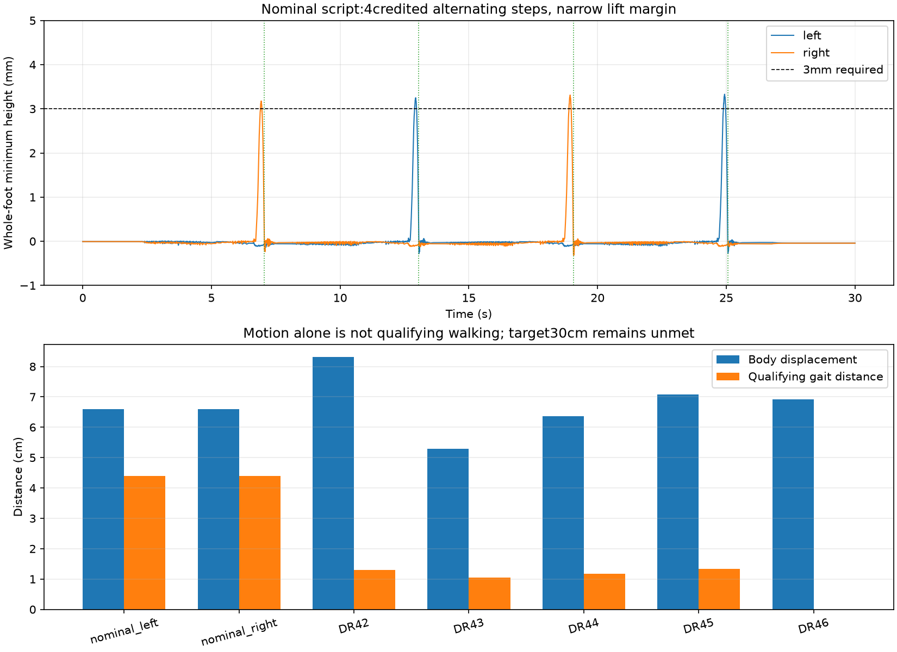

# Provisional scripted gait baseline — 2026-10-24

**Historical identity`4d3b0dcb` below.** [Current offset correction and29-case
sensitivity study](SENSITIVITY.md) retain the exact nominal result/target sequence
under identity`b11ab929`. Mixed-DR rows below remain historical; do not apply their
identity/results to the corrected model. All saved policies are historical.

**Locally verified simulation, not a learned policy or physical result.** A new
weight-handoff sequence produces four qualifying alternating steps from HOME.
The 30 cm walking target remains unmet, and performance is fragile under the
existing parameter-randomization hypotheses. All release/training gates stay closed.

## Findings from the phase study

The original first forward flight peaked at **2.987 mm**, below the unchanged
3 mm requirement. Its later backward return briefly exceeded 3 mm but did not
advance. The second forward flight qualified after a different command/contact
history. Requesting HOME did not erase that history: the estimated software
deadband retained acknowledged targets up to 0.458° from their initial values.
These are command acknowledgements, not measured shaft positions.

| Controlled comparison | Result |
|---|---|
| Original 1 s swap | One qualifying step, no alternation |
| 0.75 s swap | Both feet lift clearly; stance movement >4 mm rejects both steps |
| 1.25 s swap | Lower stance movement, insufficient lift |
| 40° rather than 50° preparation knee | No qualifying steps |
| Extra 2 s HOME hold | Same one-step outcome; commands retain deadband history |
| 0.95 s swap, all other phases retained | Two qualifying steps and one alternation; only 2.07 mm net torso advance |

The extra-hold comparison is a **32 s history diagnostic**, not a 30 s acceptance
trial. It rules out residual body motion as a sufficient explanation by itself;
it does not isolate command hysteresis from foot placement or contact equilibrium.
No internal pose, velocity or actuator-history resets were used between phases.

## Weight handoff instead of reversing each step

Reversing each swap back toward HOME undid much of the forward foot placement.
The new sequence prepares the opposite stance after touchdown instead:

`prepare stance → shift load → swap leg extension → hold → prepare opposite stance`

The compact variant uses 3 s preparation, 1.5 s load transfer, 0.95 s swap and
0.55 s hold per cycle. Four cycles follow an initial 2 s quiet period; the last
support target is held to 30 s. **It does not finish at HOME.** It is a simulation
diagnostic, not released hardware control. Targets depend on time and design
geometry only; privileged geometry/contact data are logged separately.

| Nominal result, first stance left or mirrored right | Value |
|---|---:|
| Qualifying steps / alternations | 2 per foot / 3 |
| Torso forward displacement in 30 s | 6.60 cm |
| Qualifying midpoint gait distance | 4.39 cm |
| Mean torso forward speed | 2.20 mm/s |
| Minimum peak whole-foot height across credited flights | 3.177 mm |
| Continuous clearance ≥3 mm per flight | 56, 78, 88, 90 ms |
| Largest stance movement across those flights, including touchdown | 2.525 mm |
| Falls / project walking acceptance | 0 / failed |

The torso also ends about 3.16 cm laterally displaced, with the sign reversed in
the mirrored run; the final leaned posture contributes to that measurement.
Neither torso displacement nor individual foot advance alone proves straight
walking. Raw 2 ms traces independently confirm all credited step thresholds.
The slower three-cycle variant produces three steps and 4.58 cm torso advance.

## Randomized diagnostic check

Same compact script; five draws from the **existing, unmeasured** mass, friction,
strength, speed, damping, offset, delay and IMU ranges. No tuning after these draws.

| Environment / seed | Torso advance cm | Gait distance cm | Qualifying steps | Alternations |
|---|---:|---:|---:|---:|
| Nominal, left or mirrored right | 6.60 | 4.39 | 4 | 3 |
| Randomized 42 | 8.31 | 1.30 | 1 | 0 |
| Randomized 43 | 5.30 | 1.05 | 1 | 0 |
| Randomized 44 | 6.36 | 1.17 | 1 | 0 |
| Randomized 45 | 7.09 | 1.33 | 1 | 0 |
| Randomized 46 | 6.92 | 0.00 | 0 | 0 |

All remain upright, but none meets walking acceptance. Distance alone hides
unqualified movement. This is **not the fixed-trained versus DR-trained policy
experiment**: it is one handwritten script in different simulated environments.
Five mixed draws establish fragility in these draws, not which parameter caused
it, measured hardware tolerances, or real transfer performance.



[Nominal video](validation/2026-10-24/handoff_review/nominal_left/compact/episode.mp4),
[reviewed frames](validation/2026-10-24/handoff_report/video_frames.png),
[per-episode CSV](validation/2026-10-24/handoff_report/episodes.csv),
[independent audit](validation/2026-10-24/handoff_report/summary.json).

## Reproduction and continuation

[Historical machine-readable baseline](baselines/scripted_r2.json) records the exact
model/control fingerprint, immutable source snapshot, replay command and expected
nominal metrics. Use its snapshot to compare later measured revisions explicitly;
do not relabel a changed model as the same baseline.
The [current offset-corrected registry](baselines/scripted_r2_offset_corrected.json)
records a separate source snapshot and the same nominal metrics. Commands below
use the current workspace; old mixed-DR evidence requires its historical snapshot.

```bash
.venv/bin/python tools/phase_study.py --output runs/phase_NEW
.venv/bin/python tools/handoff_probe.py --profiles compact --output runs/handoff_NEW
MUJOCO_GL=egl .venv/bin/python tools/handoff_probe.py --profiles compact --video --output runs/handoff_video_NEW
.venv/bin/python tools/handoff_probe.py --profiles compact --domain-randomization --seed 42 --output runs/handoff_DR_NEW
.venv/bin/python -m pytest -q
```

Preserved records: phase_study/ (five original comparisons),
phase_study_followup/ and its mirror (0.95 s), handoff_probes/ (two sequences),
handoff_review/ (two nominal and five randomized episodes), handoff_report/
(12 independently checked credited steps, tables, plot and video frames).
Paths above are under validation/2026-10-24/. Actual diagnostic source versions,
model/mesh hashes and randomized runtime parameters are retained. No plant,
observation or threshold changes and no additional PPO training occurred.

**Follow-up completed:** the script is frozen; [one-factor isolation](SENSITIVITY.md)
also exposed and corrected a shaft-offset clipping defect. Next, keep it frozen
rather than tune further
against guessed physics. Resolve the affordable basket and sample fit, then
measure joint offsets, loaded response, latency/current and pad friction before
updating the twin. AI can analyse real calibration records; mixed randomization
alone cannot identify a cause. Keep
manufacturing, measured-reference, formal-training and physical-transfer gates
closed. Hardware measurements are still absent and the full walking target fails.
