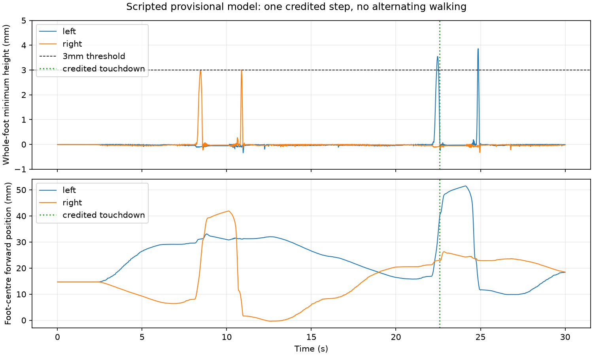

# Scripted stance-transfer result — 2026-10-24

**Implemented and locally verified; provisional model only.** One qualifying
scripted step now occurs from an ordinary HOME reset. Alternating walking,
learned walking and physical transfer remain unachieved. No model, actuator,
observation, joint limit or policy fingerprint changed; no additional PPO ran.

**Follow-up:** [REFERENCE_GAIT.md](REFERENCE_GAIT.md) records four alternating
nominal handoff steps and randomized fragility. This page preserves the earlier
single-step result; it is not the latest motion checkpoint.

## What changed

Earlier references shortened the intended swing leg immediately. The new
open-loop diagnostic first bends the stance knee and coordinates both ankles
with the resulting leg-height difference. After transferring load, it extends
the stance leg and shortens the swing leg. It then returns and mirrors the
sequence. Commands use the existing normalized-action mapping,50Hz updates,
delayed/slew-limited targets and estimated0.08Nm envelope.

The geometric preparation assumes equal hip+knee pitch on both sides. Its ankle
roll is `atan2(L × (cos(knee_swing) − cos(knee_stance)), hip_spacing)`, with
dimensions from physical_spec.json. Forward-kinematics tests confirm level pad
planes during this ideal preparation. Dynamics still include actual contact,
friction, compliance and torque/speed limits; no foot is pinned to the floor.

## Bounded tests and results

| Probe | Result in30s |
|---|---|
| Simultaneous crouch/lean,50° stance knee | No qualifying lifted step |
| Crouch before lean,50° knee | No qualifying lifted step |
| Matched-height preparation,50° knee | No qualifying lifted step |
| Matched-height preparation,40° knee | No qualifying lifted step |
| Matched50° preparation, then swap leg extension | One qualifying step, zero alternations; body advances3.33mm; walking fails |

The last probe was replayed with first stance left/right and sensor seeds42–44.
All six logs reproduce the corresponding one-sided step. **These are not six
independent robustness trials:** nominal open-loop dynamics do not consume IMU
noise, so changing its seed cannot vary the motion. Mirroring gives the opposite
side. The first swing still misses acceptance; the second succeeds after the
earlier motion changes foot placement. Maximum sampled foot clearances are only
about3.00/3.86mm, so the margin above the3mm criterion is small.

## Independent check of the credited step

The existing GaitMetrics implementation is unchanged. An observer wrapper records
its inputs every2ms; a separate report recomputes the flight/landing checks from
raw CSV rather than trusting the accepted-event label.

| Evidence, left-first replay | Measured in simulation |
|---|---:|
| Credited foot / touchdown | Left /22.592s |
| Longest continuous whole-foot clearance>=3mm during that flight |112ms |
| Forward foot-centre advance at touchdown |22.36mm |
| Lateral foot-centre movement |9.61mm |
| Maximum stance-centre movement over the flight |2.33mm |
| Opposite foot continuously supported | Yes |
| Both feet supported at touchdown | Yes |
| Credited midpoint gait distance |11.18mm |
| Final body displacement / alternations |3.33mm /0 |

The mirrored replay gives matching opposite-side evidence. This meets the
existing **single-step** thresholds, not the project target of0.3m alternating
walking within30s plus a separate30s stand. Force/position diagnostics remain
outside policy observations; physical step evidence requires external video.



[Video](validation/2026-10-24/stance_transfer_review/left42/geometric50_swap.mp4)
and [reviewed frames](validation/2026-10-24/stance_transfer_report/video_frames.png).
The wide video provides visual context;3mm acceptance comes from simulation
geometry/force diagnostics, not a claimed pixel measurement or physical test.

## Reproduce or inspect

```bash
.venv/bin/python tools/stance_transfer.py --profiles geometric50_swap --output runs/stance_NEW
MUJOCO_GL=egl .venv/bin/python tools/stance_transfer.py --profiles geometric50_swap --video --output runs/stance_video_NEW
.venv/bin/python tools/audit_transfer.py --output runs/stance_audit_NEW
.venv/bin/python tools/audit_transfer.py --first-stance right --output runs/stance_mirror_audit_NEW
.venv/bin/python -m pytest -q
```

Immutable records under validation/2026-10-24/: stance_transfer/ (initial four
probes), stance_transfer_swap/ (first swap probe), stance_transfer_review/ (six
replays/video), stance_transfer_audit/ (two raw15000-row traces/events),
stance_transfer_report/ (independent checks, aggregate CSV, plot, frames).
Each run retains its actual diagnostic source and matching model/mesh snapshot;
diagnostic source evolved, while the model/control fingerprint stayed fixed.

## Next work and gates

Investigate why the first swing remains below the duration/clearance requirement
and how earlier foot placement affects the second swing. Any further bounded
probe must declare its phase change and preserve current strength/limits. Do not
relax3mm/40ms acceptance or increase torque to turn a marginal step into success.
Resolve physical servo response, pad friction, fit and delivered cost in parallel.
Keep the reference, manufacturing and formal-training gates false: one scripted
step is insufficient for repeatable alternating walking or measured Sim-to-Real.
