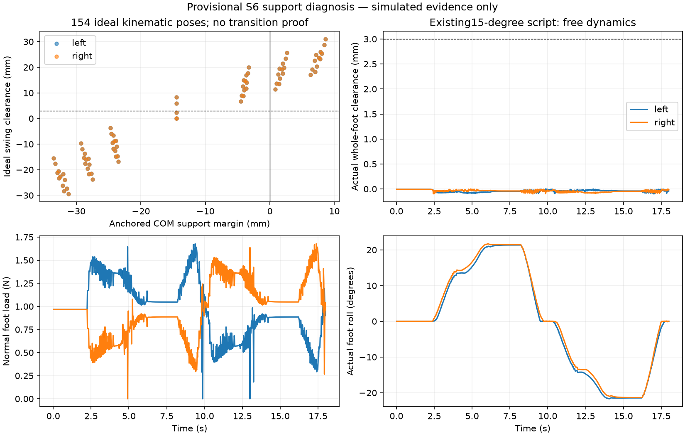

# Support and lifted-step diagnosis — 2026-10-24

**Local provisional-model evidence only.** No physical fit, strength or walking
verification. Geometry, gains, torque envelope, policy observations and model
fingerprint remain unchanged. No new PPO training was run.

## What was tested

1. **154 ideal poses:** either stance foot placed level at its pad plane, within
   existing safe command intervals. Compute COM projection, pad support hull,
   exact whole-foot clearance and gravity torque. This is offline engineering
   kinematics, not an artificial constraint added to the training environment.
2. **Existing three18s profiles:** replay without state changes; log both normal
   loads, loaded-contact hull, tracking error and actual foot roll/clearance.
3. **Four3s prepared-pose holds:** initialize each pose kinematically once, then
   release the floating robot into ordinary dynamics. This tests holding a pose,
   explicitly **not** reaching it from HOME.
4. **Two22s HOME transitions:** lean20° then shorten the swing leg, or shorten
   first then lean. Both sides tested, same bounds/servo approximation and seed42.
   No state anchoring, extra torque, altered contact or training.

## Results

| Test | Observed result | Interpretation |
|---|---|---|
| HOME, ideal single support | COM14.5mm outside either stance pad hull | Double-support HOME is not a quiet single-support pose |
| Static pose scan |48of154 pass sampled COM/clearance/estimated-torque/collision screens | Candidate poses exist; this is not a gait or exhaustive feasibility proof |
| Left20° lean, right hip−35°/knee35° | Ideal clearance31.04mm; COM8.64mm inside stance hull; peak static torque0.02099Nm | Fits the provisional0.08Nm hypothesis, even at2×static demand; not measured servo capability |
| Original15° reference, held swing windows | Intended stance supports about54.2%; actual feet roll about±21.3° | Both feet remain loaded and rock; transient zero load is not a sustained lifted step |
| Prepared±15° poses | Swing settles back onto floor, no fall | Ideal2.44mm COM margin is insufficient to retain this pose with the actual compliant controller/contact dynamics |
| Prepared±20° poses | Both mirrored holds last3s; minimum swing clearance25.36mm; final stance load100% | A sustained single-support state exists in this provisional model, but a HOME transition has not been demonstrated |
| Lean-first HOME transition |0qualifying steps; max clearance<0.001mm; distance−4.58mm | No walking |
| Shorten-first HOME transition |0qualifying steps; max clearance0.015mm; distance+6.11mm | Forward drift is not walking |

The failed reference is **not evidence that the servos are saturating**: maximum
observed actuator torque during the original profiles is only about42% of the
estimated static envelope; maximum target tracking error is2.27°. Feet rolling
and an unreached support state are directly observed. The cause of the transition
failure is not fully isolated: contact equilibrium, trajectory and actuator
compliance need review against physical measurements. Do not increase torque or
claim that these few poses prove the architecture either works or cannot work.



## Reproduction and evidence

```bash
MPLCONFIGDIR=/tmp/s6-mpl .venv/bin/python tools/analyze_support.py --output runs/support_NEW
.venv/bin/python tools/transfer_reference.py --output runs/transfer_NEW
.venv/bin/python -m pytest -q
```

- [Final support summary](validation/2026-10-24/support_diagnosis_final/summary.json),
  static_poses.json, dynamic/hold CSVs and hashed source/mesh snapshot.
- [Transition results](validation/2026-10-24/transition_probes/summary.json), both
  CSVs and hashed runnable source/mesh snapshot.
- The earlier support_diagnosis/ directory is the preserved initial scan, before
  prepared holds and transition probes. Its source snapshot is partial; use the
  final record for reproduction.

The64-point inscribed pad-circle hull conservatively approximates a flat pad
patch. Dynamic hulls use only instantaneous loaded solver contact points; a
degenerate line/point hull is reported without a numeric margin. Static torque
omits acceleration, cable force and flex. Command-level20ms clearance streaks
are diagnostics, not replacements for the physics-step gait acceptance test.

## Next decision

Before another training run or a mechanical redesign, investigate a transition
that moves the COM into the stance pad area while retaining a level loaded foot.
Review actual ankle response, pad friction and foot rocking against bench/video
measurements; test any proposed trajectory in a new bounded diagnostic. The current
candidate is at the20° software bound, so no unmeasured extra travel is available.
Obtain the complete affordable basket and real servo/horn sample in parallel.
Manufacturing, reference-gait and physical-transfer gates remain false.
