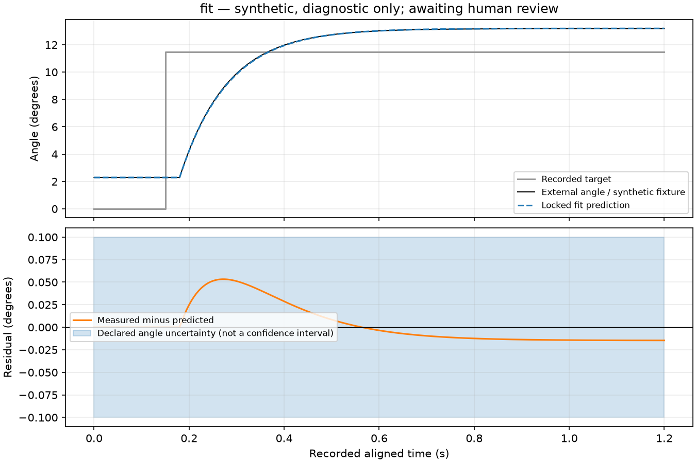
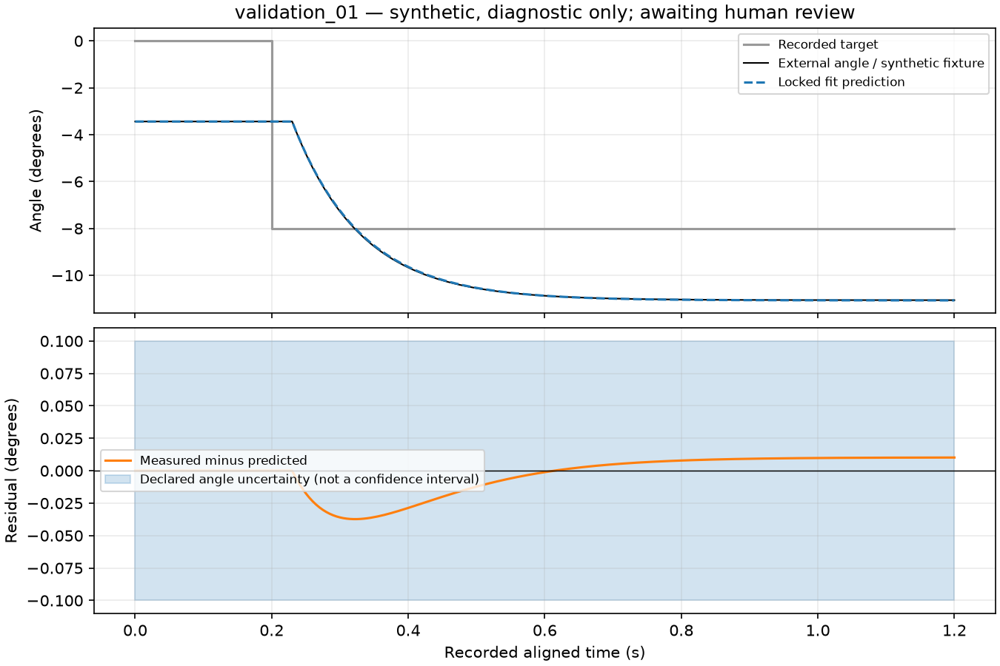
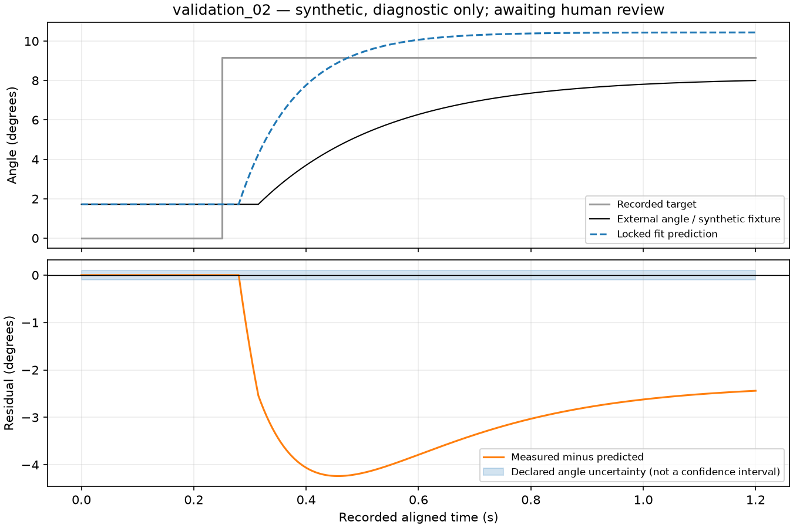

# Servo-response diagnostic — awaiting human review

Data kind: **synthetic**. No physical verification or calibration approval.

One fitting trial supplies the parameters below. Validation trials are never fitted.

Delay 0.03s; time constant 0.101567s; gain 0.951279.

| Trial | RMSE (deg) | Max error (deg) | Declared uncertainty (deg) | RMSE / uncertainty |
|---|---:|---:|---:|---:|
| fit | 0.02107 | 0.05327 | 0.1 | 0.2107 |
| validation_01 | 0.0146 | 0.03729 | 0.1 | 0.146 |
| validation_02 | 2.829 | 4.238 | 0.1 | 28.29 |

## fit

Intake flags: none in performed screens. Condition differences: none.
Voltage [5.0, 5.0]V; load [0.0, 0.0]N·m.

[Prediction/residual CSV](fit_prediction.csv)

## validation_01

Intake flags: none in performed screens. Condition differences: none.
Voltage [5.0, 5.0]V; load [0.0, 0.0]N·m.

[Prediction/residual CSV](validation_01_prediction.csv)

## validation_02

Intake flags: none in performed screens. Condition differences: voltage_range_v, load_range_nm.
Voltage [4.85, 4.85]V; load [0.005, 0.005]N·m.

[Prediction/residual CSV](validation_02_prediction.csv)

Shared evidence groups: 1; details and hashes in [report.json](report.json).

Residual = measured minus predicted. Validation baseline uses only pre-step samples.
No automated goodness threshold: a generated report is not proof of an adequate model.
Validation no-fit intake omits gain/search-boundary/fit-residual screens; predictions above use the locked fitting parameters.
Declared uncertainty is not a confidence interval. Review raw recordings, time alignment, conditions and independence.
Never infer shaft angles from acknowledgements or infer sustainable torque/MuJoCo gains from this fit.
